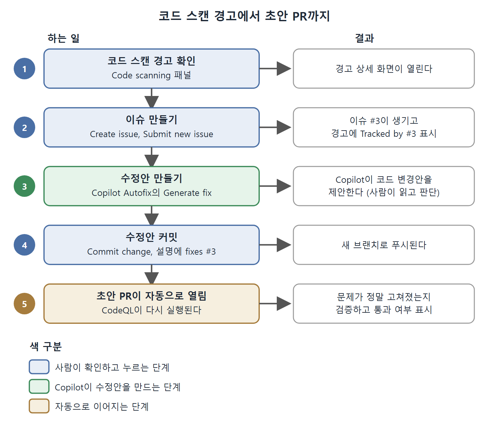

# 코드 스캔 경고에서 Autofix까지

GitHub에서 코드를 고치는 흐름은 보통 문제 발견, 이슈 등록, 수정, 풀 리퀘스트(PR) 순서로 흘러간다. Copilot은 이 흐름의 여러 지점에서 일을 덜어 준다. 이 문서는 책이 든 보안 문제 예시를 따라가며, 경고가 이슈가 되고 Copilot Autofix가 수정안을 만들어 초안 PR까지 이어지는 과정을 단계별로 정리한다.

예시는 데이터베이스 쿼리를 문자열로 이어 붙여 만든 탓에 SQL 인젝션에 취약한 코드다. 이런 문제는 GitHub의 코드 스캔(CodeQL 애플리케이션)이 쉽게 찾아낸다.

---

## 1. 출발점: 코드 스캔 경고

문제가 있는 저장소의 Code scanning 패널에는 경고 목록이 뜬다. 책은 그중 마지막 항목을 골라 링크를 열고, 해당 경고의 상세 화면을 살펴본다.

상세 화면에서 아쉬운 점이 하나 있다. 책을 쓰던 시점에 Copilot은 이 경고를 요약해 주는 기능이 없었다. 대신 같은 화면에 이슈를 만드는 버튼이 있어서, 그 방향으로 이어 간다.

| 가능한 것 | 책 집필 시점의 상태 |
|---|---|
| 경고를 Copilot이 요약 | 지원하지 않음 |
| 경고에서 이슈 만들기 | Create issue 버튼으로 가능 |
| 경고에 대한 수정안 생성 | Copilot Autofix의 Generate fix 버튼으로 가능 |

이 표는 같은 경고 화면에서 Copilot이 무엇을 해 주고 무엇을 못 해 주는지를 보여 준다.

## 2. 경고에서 이슈 만들기

Create issue 버튼을 누르면 제목과 코드 스캔 경고 링크가 들어간 기본 이슈가 만들어진다. 초안 화면에 경고 메시지가 하나 뜨지만 책의 예제와는 상관이 없는 내용이었다. Submit new issue 버튼을 누르면 이슈 생성이 완료된다.

참고로 Create issue 버튼은 저장소 설정에서 Issues가 켜져 있어야 나타난다. 버튼이 안 보이면 저장소 Settings에서 Issues 기능부터 확인한다.

이슈를 만든 뒤 경고 화면으로 돌아오면 "Tracked by #3"이라는 표시가 보인다. #3은 이 저장소의 3번 이슈를 가리킨다. 즉 경고와 이슈가 서로 연결되어 추적된다.

## 3. Copilot Autofix로 수정안 만들기

경고 화면의 아래 상자에는 "Copilot Autofix for CodeQL" 배너와 Generate fix 버튼이 있다. Copilot Autofix는 GitHub의 코드 스캔 도구(CodeQL 등)와 연결되어, 코드를 분석하고 문제를 찾은 다음 Copilot으로 수정 제안을 만드는 기능이다.

Generate fix를 누르면 Copilot이 문제를 바로잡는 코드 변경안을 내놓는다. 사용자는 변경안을 보고 받아들일지 판단한다.

### 수정안을 커밋하기

변경안 끝에는 Commit change 버튼이 있다. 이 버튼은 기본적으로 새 브랜치로 푸시하는 대화상자를 연다. 브랜치 이름과 커밋 메시지는 자동으로 채워진다.

여기서 하나 챙길 것이 있다. 이 변경을 앞서 만든 이슈와 이어 두려고 확장 설명(extended description)에 `fixes #3`을 적는다. 책은 이 변경이 이슈 #3과 연결되도록 하는 용도로 이 문구를 넣었다.

## 4. 커밋하면 일어나는 일

커밋을 끝내면 초안(draft) PR이 자동으로 열린다. 이때 CodeQL이 다시 실행되어 문제가 정말 고쳐졌는지 검증하고, 통과 상태가 되는지 확인한다. 수정을 만든 쪽이 Copilot이어도 검증은 별도의 도구가 한 번 더 하는 셈이다.

## 5. 전체 흐름 한눈에 보기

경고 확인부터 초안 PR까지 다섯 단계를 순서대로 놓고, 사람이 누르는 단계와 Copilot이 수정안을 만드는 단계, 자동으로 이어지는 단계를 색으로 구분한 그림이다.

| 단계 | 하는 일 | 화면의 버튼 또는 표시 | 결과 |
|---|---|---|---|
| 1 | 코드 스캔 경고 확인 | Code scanning 패널 | 경고 상세 화면 열림 |
| 2 | 이슈 등록 | Create issue, Submit new issue | 이슈 #3 생성, 경고에 "Tracked by #3" 표시 |
| 3 | 수정안 생성 | Generate fix | Copilot이 코드 변경안 제안 |
| 4 | 수정안 커밋 | Commit change, 설명에 `fixes #3` | 새 브랜치로 푸시 |
| 5 | 초안 PR과 재검사 | 자동 | CodeQL이 다시 돌고 통과 여부 표시 |

이 표처럼 사람이 직접 쓰는 것은 확인과 버튼 클릭, 그리고 `fixes #3` 한 줄 정도다. 수정안 작성과 검증은 도구가 맡는다. 다만 Copilot이 낸 수정안이므로 내용은 사람이 한 번 읽고 커밋하는 편이 안전하다.

초안 PR이 만들어졌으니, 다음 문서에서 이 PR을 Copilot과 함께 검토하고 병합하는 과정을 이어서 본다.

 
 
 

[Learning GitHub Copilot](../)
