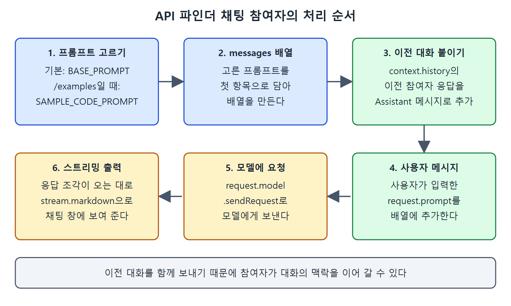

# VS Code용 확장 만들기

VS Code용 Copilot 확장도 Copilot Chat을 통해 사용자에게 기능을 더해 준다. 다만 Copilot 확장과 달리 VS Code 플랫폼과 API로 구현한다. 그래서 VS Code의 넓고 깊은 기능에 접근할 수 있고 긴밀하게 통합할 수 있으며, 별도의 GitHub App도 필요 없다. 단점은 GitHub의 채팅 인터페이스 같은 IDE 밖 클라이언트에서는 쓸 수 없다는 점이다. 이 문서는 세 유형을 비교하고, API 파인더(API finder) 예제를 통해 채팅 참여자를 만드는 코드를 살펴본다.

---

## 1. 세 유형 비교

### 표 2. Copilot 확장 유형 비교(VS Code용 확장 열 추가)

| 항목 | Copilot 에이전트 | Copilot 스킬셋 | VS Code용 Copilot 확장 |
| --- | --- | --- | --- |
| 복잡도 | 사용자 상호작용 전체 흐름과 응답 생성을 관리해야 해서 개발 노력이 더 든다 | 최소한의 설정으로 쉽게 통합하도록 설계됐다 | 쓰는 VS Code API에 따라 복잡할 수도 단순할 수도 있다 |
| 통제 | 요청 처리와 응답 생성을 완전히 통제한다 | 상호작용 통제가 제한적이다. 데이터 가져오기와 기본 작업에 초점 | VS Code 전용으로 작성하므로 통제가 가장 크다 |
| 사용 사례 | 사용자 지정 로직, 다른 AI 모델 통합, 대화 컨텍스트 관리가 필요한 복잡한 시나리오 | 외부 API 데이터 가져오기나 간단한 작업 | IDE에서 코드를 다루는 작업과, 선택에 따라 참여자용 추가 명령 제공 |
| 쓸 수 있는 인터페이스 | 전부(GitHub, IDE) | 전부(GitHub, IDE) | 모든 VS Code API의 이점을 온전히 누리려면 VS Code로 한정 |
| 지원 | GitHub | GitHub | VS Code 팀 |

읽는 법은 이렇다. 앞의 두 유형은 어디서나 쓸 수 있는 대신 GitHub App이 필요하고, VS Code용 확장은 VS Code에서만 쓰는 대신 통제와 통합이 가장 깊다. 지원 주체도 다르다는 점을 눈여겨본다.

---

## 2. 사용자에게 보이는 것: 채팅 참여자

VS Code용 확장을 더하면 사용자에게는 새로운 채팅 참여자(chat participant)가 보인다. 채팅 참여자는 IDE에서 Copilot Chat을 쓸 때 특정 주제에 관해 질문에 답하거나 특정 작업을 수행하는 도메인 전문가다. 3장에서 Copilot에 기본으로 들어 있는 참여자를 다뤘다. 예를 들어 내장 @workspace 참여자는 VS Code 작업 공간 전체를 기준으로 응답하며, 시맨틱 검색과 코드 인덱스 같은 통합 도구를 쓴다. 그 밖에 @terminal, @vscode 등이 있다.

채팅 참여자는 다른 확장과 같은 @식별자 문법으로 호출한다. 호출되어 프롬프트를 받은 참여자의 코드는 다음 방식 중 하나로 처리할 수 있다.

| 처리 방식 | 설명 |
| --- | --- |
| AI 모델 호출 | 모델에게 해석과 응답을 맡긴다 |
| 백엔드 서비스로 전달 | 요청을 백엔드 서비스에 넘긴다 |
| 자체 로직과 API 사용 | 내장 로직이나 API로 직접 처리한다 |

VS Code와 긴밀하게 통합되어 있으므로 응답에 버튼, 파일 트리, 진행 상황 갱신 같은 대화형 요소를 넣을 수 있다. 후속 제안(follow-up)과 참여자 영역에 관련된 고유 슬래시 명령(앞서 본 /explain, /fix 같은 것)도 제공할 수 있다. 요약하면 VS Code용 확장은 프런트엔드에서는 VS Code 클라이언트의 컨텍스트와 인터페이스에 접근하고, 백엔드에서는 Copilot의 힘을 쓰는 풍부한 클라이언트 쪽 경험을 제공한다.

여기서는 VS Code를 중심으로 다루지만 채팅 참여자는 다른 IDE에도 있다. 또 IDE 플랫폼의 역량에 따라 VS Code용 확장을 Copilot이 돌아가는 다른 IDE로 옮겨 만들 수도 있다.

---

## 3. 예제: API 파인더

예제 확장은 API 파인더다. VS Code에 설치하면 특정 기능을 하는 API를 검색해, API 정보와 사용법을 채팅 창에 스트리밍해 준다(원서의 그림 10-27이 전체 구조, 그림 10-28이 날씨 API를 찾는 사용 예).

| 호출 | 하는 일 |
| --- | --- |
| `@apifinder` + 질문 | 조건에 맞는 상위 3개 API의 기본 문서, 호출 방법, 매개변수를 알려 준다 |
| `@apifinder /examples` + 질문 | 상위 3개 API를 호출하는 간단한 예제 코드를 보여 준다. 원서는 두 번째 인자로 Go를 주는 예를 보인다(그림 10-29) |

코드는 책의 GitHub 저장소에 있고 TypeScript로 작성했으며, 핵심 로직은 src/extension.ts에 있다. VS Code 확장 예제를 바탕으로 했다.

---

## 4. 코드 살펴보기

### 프롬프트 두 개

코드는 VS Code 라이브러리에서 의존성을 가져온 뒤, 기본 기능에 보낼 프롬프트와 /examples 명령에 보낼 프롬프트를 정의한다. 내용을 줄이면 다음과 같다.

```typescript
import * as vscode from 'vscode';
const BASE_PROMPT = 'You are a helpful API finder. Your job
 is to locate and provide documentation on the top 3 APIs
 ... If the user asks a question that is not relevant to
 APIs, politely decline to respond.';
const SAMPLE_CODE_PROMPT = 'You are a helpful source of API
 examples. ... provide simple example code ... Keep the code
 as short as possible ...';
```

두 프롬프트 모두 LLM이 질문을 어떻게 처리해야 하는지 명시한다. 기본 프롬프트는 상위 3개 API의 문서와 호출법, 매개변수를 설명하고, 출처와 링크를 밝히고, 가능하면 글머리표로 쓰고, API와 무관한 질문은 정중히 거절하라고 한다. 예제 프롬프트는 상위 3개 API를 호출하는 짧은 예제를 주라고 한다.

/examples에 두 번째 인자로 언어(Go)를 줬지만 프롬프트에는 프로그래밍 언어가 명시되어 있지 않다. 이것이 AI에게 요청을 맡기는 장점이다. 명시하지 않은 추가 컨텍스트와 의미를 AI가 추론해 준다.

### 참여자 만들기

파일 아래쪽에서는 채팅 핸들러를 만들고 채팅에서 쓸 아이콘을 붙인다.

```typescript
const apifinder = vscode.chat.createChatParticipant(
  "chat-tutorial.api-finder", handler);
apifinder.iconPath = vscode.Uri.joinPath(
  context.extensionUri, 'apifinder.jpeg');
```

### 핸들러의 처리 순서

주 처리 함수 activate는 핸들러를 정의한다. 처리 순서는 다음과 같다.

| 순서 | 코드의 동작 |
| --- | --- |
| 1 | 기본 프롬프트로 시작하고, request.command가 'examples'이면 예제 프롬프트로 바꾼다 |
| 2 | 프롬프트를 첫 항목으로 하는 messages 배열을 만든다 |
| 3 | context.history에서 이전 참여자 응답(ChatResponseTurn)을 골라 마크다운 값을 이어 붙여 Assistant 메시지로 추가한다 |
| 4 | 사용자의 메시지(request.prompt)를 추가한다 |
| 5 | request.model.sendRequest로 모델에 요청을 보낸다 |
| 6 | 응답 조각(fragment)을 받는 대로 stream.markdown으로 스트리밍한다 |



이 그림은 핸들러가 프롬프트를 고르고, 이전 대화와 사용자 메시지를 messages 배열에 담아 모델에 보낸 뒤 응답을 스트리밍하는 여섯 단계를 순서대로 보여 준다.

즉 핵심은 "프롬프트 선택, 이전 대화 이어 붙이기, 모델 호출, 스트리밍 출력"이다. 이전 대화를 함께 보내기 때문에 참여자는 대화의 맥락을 유지할 수 있다.

---

## 5. 테스트와 배포

이 확장을 시험하는 방법은 간단하다. VS Code에서 폴더를 열고, `npm install`로 의존성을 설치하고, `npm run compile`로 코드를 컴파일한 다음 새 VS Code 인스턴스에서 확장을 실행한다.

참여자 코드를 시험하는 가장 쉬운 방법은 VS Code 인스턴스에 불러오고 npm 명령을 실행한 뒤 Run 메뉴의 Start Debugging 옵션으로 새 VS Code 인스턴스를 띄우는 것이다. 디버그 인스턴스에는 참여자가 설치되어 활성화되어 있어서 그 인스턴스의 채팅 창에서 쓸 수 있다. 안내는 저장소의 README 파일에 있다.

다른 확장 유형처럼 프로덕션으로 내보내기 전에 인증이 필요한 대로 동작하는지 확인하는 등 추가 작업이 필요하다. 구현의 더 자세한 내용은 VS Code 문서에 있고, 완성한 확장을 VS Code Marketplace에 게시하는 방법도 거기서 찾을 수 있다.

<br>
<br>
<br>

[Learning GitHub Copilot](../)
