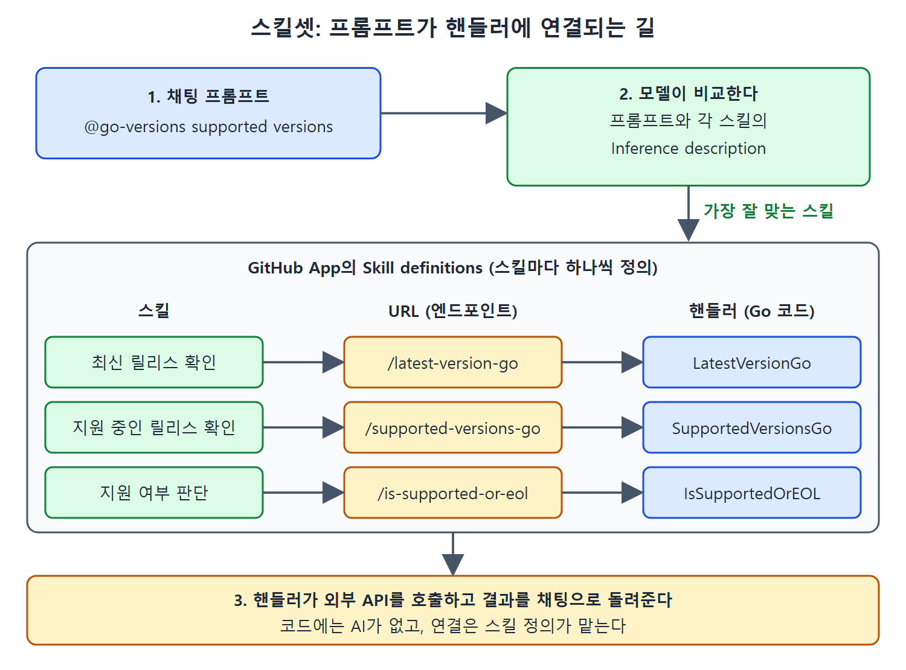

# 스킬셋 방식 확장 만들기

에이전트가 강력하고 유연한 구조이긴 해도 과할 때가 있다. 채팅 프롬프트에 대한 응답으로 특정 도구를 부르거나 API를 호출하기만 하면 된다면 스킬셋으로 확장을 구현하면 된다. 이 문서는 Go 릴리스 정보를 알려 주는 gover-ext 예제를 통해 스킬셋의 구조, Go 백엔드 코드, 그리고 코드에는 AI가 전혀 등장하지 않는데도 채팅 프롬프트가 핸들러에 연결되는 비밀인 GitHub App의 스킬 정의를 설명한다.

---

## 1. 스킬과 스킬셋

Copilot에서 스킬(skill) 하나는 프롬프트에 대한 응답으로 모델이 호출해 특정 작업(예를 들어 외부 API 호출)을 하는 도구다. 스킬을 최대 다섯 개까지 묶은 것을 스킬셋이라고 한다. 스킬셋을 쓰면 에이전트의 복잡함 없이 외부 서비스나 사용자 지정 API 엔드포인트를 Copilot 작업 흐름에 통합할 수 있다.

| 항목 | 내용 |
| --- | --- |
| 스킬 | 모델이 부르는 도구 하나(예: 외부 API 호출) |
| 스킬셋 | 스킬의 묶음. 최대 5개 |
| 장점 | 에이전트보다 가볍고 단순하며, 준비할 것이 적다 |
| 자동 처리 | 라우팅, 프롬프트 작성, 함수 평가, 응답 생성 같은 일을 알아서 처리한다 |

특정한 단순 작업을 많은 설정 없이 해야 할 때 더 알맞은 구조다. 전체 구조는 원서의 그림 10-22에 나와 있다.

---

## 2. 예제: gover-ext

Go 릴리스에 관해 세 가지 기본 작업을 하는 확장이다.

| 작업 | 설명 | 엔드포인트 경로 |
| --- | --- | --- |
| 최신 릴리스 확인 | Go의 가장 최신 릴리스를 알려 준다 | /latest-version-go |
| 지원 중인 릴리스 확인 | 현재 지원되는 Go 릴리스 목록을 알려 준다 | /supported-versions-go |
| 지원 여부 판단 | 주어진 릴리스가 지원되는지, 아니면 지원 종료(EOL, end of life)에 언제 이르렀는지 알려 준다 | /is-supported-or-eol |

코드는 책의 GitHub 저장소에 있다. 다른 언어로 만든 예를 보여 주려고 Go로 작성했고, Copilot 스킬셋 확장 예제를 본떴다.

---

## 3. 백엔드 코드

### main.go

main.go는 확장의 각 기능에 대응하는 URL 패턴에 핸들러 함수를 등록한다. 핵심 부분은 다음과 같다(핵심 줄만).

```go
func run() error {
    http.HandleFunc("/latest-version-go",
        handlers.LatestVersionGo)
    http.HandleFunc("/supported-versions-go",
        handlers.SupportedVersionsGo)
    http.HandleFunc("/is-supported-or-eol",
        handlers.IsSupportedOrEOL)
    http.HandleFunc("/_ping", func(w http.ResponseWriter,
        r *http.Request) { w.Write([]byte("OK")) })
    http.ListenAndServe(":8080", nil)
    return nil
}
```

경로 세 개가 기능 세 개에 대응하고, /_ping은 살아 있는지 확인하는 용도로 OK를 돌려준다. 서버는 8080 포트에서 돌아간다.

### 핸들러 함수

각 핸들러는 별도 함수이며 API를 부르고, 오류를 확인하고, 원하는 결과를 돌려준다.

| 핸들러 | 호출하는 API | 처리 방식 |
| --- | --- | --- |
| LatestVersionGo | `https://go.dev/dl/?mode=json` | 버전을 담을 구조체(GoVersion)를 만들고 요청을 보낸다. 응답을 버퍼에 담아 JSON으로 파싱한다. 목록의 첫 항목이 최신 버전이므로 앞의 "go"를 떼어 내고 응답에 쓴다 |
| SupportedVersionsGo | `https://endoflife.date/api/go.json` | 구조체(VersionInfo: Cycle, ReleaseDate, EOL)로 파싱한다. EOL이 불리언이고 false인 항목, 즉 아직 지원 중인 것만 걸러 낸다. 결과를 "Version: ..., Release Date: ..." 줄이 이어진 문자열 하나로 만들어 응답에 쓴다 |
| IsSupportedOrEOL | 위와 비슷한 흐름 | 주어진 버전이 지원되는지, 지원이 끝났는지 판단한다 |

최신 버전 핸들러는 먼저 요청을 만들다 실패하면 "Failed to create request"와 함께 서버 오류를 돌려준다. 응답 본문을 읽거나 JSON을 파싱하다 실패하는 경우에도 각각 오류를 돌려주도록 되어 있다. 읽는 법은 간단하다. 핸들러는 외부 API 한 번 호출, 오류 점검, 결과 가공, 응답 쓰기의 네 단계로 이뤄진다.

그런데 코드가 이처럼 기본적이고 AI나 추론에 관한 내용이 전혀 없다면, Copilot Chat의 프롬프트가 어떻게 해당 핸들러를 부르게 될까? 비밀은 스킬셋을 쓰는 확장의 GitHub App 설정에 있다.

---

## 4. GitHub App 설정: 에이전트와 다른 점

스킬셋 확장도 Copilot 채팅 창과 확장 구현 사이의 다리 역할을 하는 GitHub App이 필요하다. 설정의 상당 부분은 에이전트와 비슷하므로 에이전트 문서를 참고하고, 여기서는 중요한 차이를 본다.

| 비교 항목 | 에이전트 | 스킬셋 |
| --- | --- | --- |
| General 페이지의 Callback URL | 확장의 공개 URL(끝에 /callback) | 확장 전용 URL이 필요 없다. 인증용 콜백 URL은 필요하지만 `https://github.com` 같은 간단한 주소면 된다 |
| Copilot 페이지의 App Type | Agent | Skillset |
| 프롬프트와 코드 연결 방법 | 앱에 하나의 URL을 지정한다 | Skill definitions 구역에서 스킬마다 정의한다 |

가장 중요한 차이는 Copilot 페이지에서 일어난다. App Type을 Skillset으로 바꾸면 Skill definitions 구역이 나타난다(그림 10-23). 이곳이 채팅의 프롬프트를 코드의 핸들러로 이어 주는 매핑 장소다. 코드에서 처리하는 스킬마다 새 스킬을 추가하는 과정을 거친다. Add new skill 버튼을 누르면 입력 창이 나타난다(그림 10-24).

### 스킬 정의의 입력 항목

| 항목 | 의미 |
| --- | --- |
| Name | 모델이 쓰는 스킬 이름. 스킬이 호출될 때 사용자에게도 표시된다 |
| Inference description | 모델에게 이 스킬을 무엇을, 언제, 어떻게 호출해야 하는지 설명한다. 모델이 의도를 이해할 만큼 의미가 분명해야 한다 |
| URL | 호출할 엔드포인트 주소. 확장 코드에 지정한 경로를 붙인 서버 주소를 쓴다 |
| Parameters | 스킬의 매개변수를 JSON으로 정의한다 |

Inference description은 모델이 이 스킬을 실행하길 바랄 때 직접 줄 법한 프롬프트라고 생각하면 된다. 여기서는 단순한 프롬프트를 쓰지만, 스킬이 하는 일과 복잡도에 따라 기대하는 입력과 출력 같은 세부를 더 정의할 수도 있다. 다른 스킬셋과 매우 비슷한 경우라면 특히 그렇다(그림 10-25).



이 그림은 모델이 채팅 프롬프트를 각 스킬의 Inference description과 맞춰 보고, 가장 잘 맞는 스킬의 URL을 거쳐 Go 핸들러가 호출되는 연결 관계를 보여 준다.

채팅 프롬프트가 입력되면, 모델이 이를 Inference description과 얼마나 잘 맞춰 보느냐에 따라 URL 필드에 지정한 엔드포인트가 호출된다. 코드가 latest-version-go라는 경로를 보고 최신 Go 버전 핸들러를 부르므로, URL 필드에는 서버 주소 끝에 latest-version-go를 붙여서 쓴다.

### URL을 쓰는 방법

| 환경 | URL 예 |
| --- | --- |
| 프로덕션 | 지정된 공개 URL 뒤에 경로를 붙인다 |
| ngrok | `https://8fa7-....ngrok-free.app/latest-version-go` 형태 |
| codespace | `https://turbo-dollop-p74p45vgx739pqj-8080.app.github.dev/latest-version-go` 형태 |

ngrok은 공개 인터넷 엔드포인트에서 내 컴퓨터에서 돌아가는 서비스로 이어지는 보안 터널을 만들어 주는 크로스 플랫폼 도구다. 복잡한 네트워크 설정 없이 로컬 웹 서버를 테스트와 공유용으로 인터넷에 노출할 수 있다. 보통 ngrok은 localhost:8080에서 서비스하지만, 스킬 설정에는 localhost를 쓸 수 없다. 공개적으로 접근할 수 없기 때문이다. ngrok이 localhost:8080으로 전달해 주는 실제 공개 URL을 가져와야 한다.

Parameters는 JSON으로 스킬의 매개변수를 정의하는 곳이다. 예제의 스킬은 모두 프롬프트 문자열을 기준으로 동작하므로 다음처럼 쓰면 된다.

```json
{ "type": "object" }
```

---

## 5. 실행해 보기

구현을 끝내고 앱을 설정한 뒤에는 에이전트 때와 같은 방식으로 실행한다. 원서는 프롬프트 `@go-versions supported versions`와 `@go-versions 1.21`로 여러 스킬을 시험해 보인다(그림 10-26). 사용자는 어떤 핸들러가 불리는지 신경 쓸 필요 없이, 모델이 프롬프트와 스킬 설명을 맞춰 보고 알맞은 엔드포인트를 고른다.

에이전트와 스킬셋으로 구현한 확장은 통합된 모든 채팅 인터페이스(GitHub, IDE)에서 실행할 수 있어 유연성이 가장 크다. 이제 장 첫머리에서 말한 다른 대안, VS Code용 Copilot 확장을 살펴볼 차례다.

<br>
<br>
<br>

[Learning GitHub Copilot](../)
