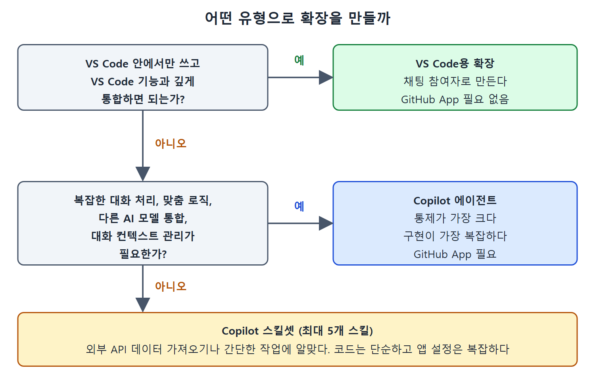

# 정리

GitHub Copilot 확장과 VS Code용 Copilot 확장은 Copilot에 내장된 기능을 넓히는 방법이다. 둘 다 Copilot Chat 창에서 @ 접두사로 접근한다. 이 문서는 장 전체를 표와 짧은 글로 다시 묶어 정리한다.

---

## 1. 핵심 정리

Copilot 확장의 백엔드 코드는 두 가지 구조 중 하나로 설계할 수 있다. 에이전트는 가장 유연하지만 대체로 구현이 가장 복잡하다. 스킬셋 구조를 쓰는 확장은 백엔드에서 하나 이상의 스킬을 불러 추가 정보를 얻는다. 스킬은 API 호출 하나처럼 단순할 수 있다.

VS Code용 Copilot 확장은 VS Code 플랫폼 위에 설계된다. 밑바탕의 VS Code API에 완전히 접근할 수 있고 동작도 VS Code에 의존한다. 사용자 눈에는 @workspace, @terminal 같은 내장 참여자처럼 VS Code 채팅 참여자로 보인다.

백엔드 코드는 JavaScript, TypeScript, Go를 비롯한 여러 언어로 구현할 수 있다. JavaScript로 에이전트 방식을 쓰는 확장에는 GitHub가 코딩을 단순화하고 인증 같은 프로덕션 요구를 채우도록 돕는 SDK 초기 버전을 제공한다.

---

## 2. 세 유형 총정리

| 구분 | Copilot 에이전트 | Copilot 스킬셋 | VS Code용 확장 |
| --- | --- | --- | --- |
| GitHub App | 필요(단일 콜백 URL 정의) | 필요(AI가 프롬프트를 알맞은 스킬 API 엔드포인트에 맞추도록 추론 설명 등 추가 정보 설정) | 필요 없음 |
| 실행 위치 | IDE, GitHub 등 모든 Copilot 채팅 | IDE, GitHub 등 모든 Copilot 채팅 | VS Code에서만 |
| 구현 난이도 | 가장 복잡 | 코드는 단순, 앱 설정은 복잡 | 쓰는 API에 따라 다름 |
| 예제 | @meta-files(JavaScript) | @go-versions(Go) | @apifinder(TypeScript) |
| 핵심 | LLM에 줄 상세한 프롬프트 | 스킬 정의의 Inference description | 프롬프트 선택과 모델 호출 |

이 그림은 VS Code 안에서만 쓸 것인지, 복잡한 대화 처리와 맞춤 로직이 필요한지를 차례로 물어 VS Code용 확장, 에이전트, 스킬셋 중 알맞은 유형을 고르는 판단 순서를 보여 준다.

## 3. 앱 설정 차이 한눈에 보기

| 설정 위치 | 에이전트 | 스킬셋 |
| --- | --- | --- |
| Callback URL | 공개 URL에 /callback을 붙인다 | 인증용으로만 필요하며 간단한 주소로 충분하다 |
| App Type | Agent | Skillset |
| 엔드포인트 지정 | URL 한 곳에 서버 주소 | 스킬마다 Name, Inference description, URL, Parameters 정의 |

## 4. 실행 범위

Copilot 확장은 GitHub App을 쓰기 때문에 IDE나 GitHub 등 어느 Copilot 채팅 인터페이스에서든 돌아간다. 반면 VS Code용 Copilot 확장은 VS Code API와 기능에 의존하므로 그 환경에서만 쓸 수 있다.

개발용 예제는 모두 데모 수준이며, 실서비스로 가려면 보안과 호스팅 등을 더 갖춰야 한다는 점을 기억해 둔다.

 
 
 

[Learning GitHub Copilot](../)
