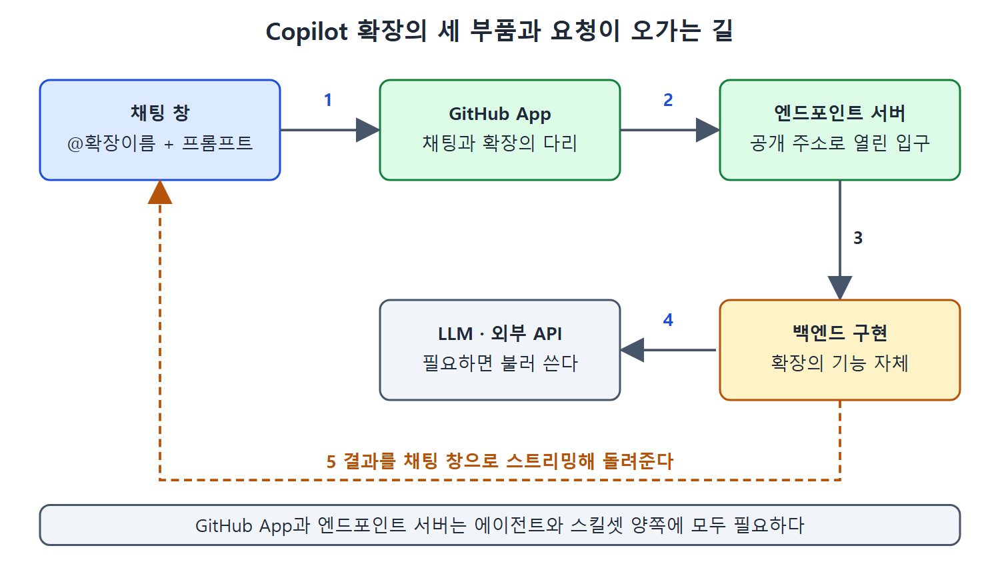

# 확장 유형과 구성 요소

Copilot 확장을 직접 만들려면 먼저 두 가지 구현 유형(에이전트와 스킬셋)을 고르고, 그 확장을 돌아가게 하는 부품들을 알아야 한다. 이 문서는 두 유형의 장단점을 표로 비교하고, 어떤 부품이 필요한지, GitHub App과 엔드포인트 서버가 각각 무슨 일을 하는지 설명한다.

---

## 1. 구현 유형 두 가지

| 유형 | 한 줄 설명 |
| --- | --- |
| 에이전트(Agent) | 완전한 AI 비서 역할을 한다. 복잡한 채팅 대화를 처리하고, 직접 만든 코드를 실행하고, 맞춤형 답변을 돌려준다 |
| 스킬셋(Skillset) | 뒤에서 하나 이상의 API 엔드포인트를 호출해 특정 정보를 가져오거나 기본적인 작업을 한다 |

에이전트는 Copilot 확장의 원래 유형이며, 복잡한 처리나 맞춤 통합이 필요할 때 가장 폭넓은 기능을 준다. 전체를 통제할 수 있지만 그만큼 구현이 복잡하다. 스킬셋은 다른 API를 부르거나 기본 작업을 하기 쉽게 만든 방식이다. 구현은 간단하지만 할 수 있는 일과 통제 범위가 더 제한적이다.

### 표 1. 에이전트와 스킬셋 비교

| 항목 | Copilot 에이전트 | Copilot 스킬셋 |
| --- | --- | --- |
| 복잡도 | 사용자 상호작용 전체 흐름과 응답 생성을 관리해야 해서 개발 노력이 더 든다 | 최소한의 설정으로 쉽게 통합하도록 설계됐다 |
| 통제 | 요청 처리 방식과 응답 생성 방식을 완전히 통제한다 | 상호작용에 대한 통제가 제한적이다. 데이터 가져오기와 기본 작업에 초점을 둔다 |
| 사용 사례 | 사용자 지정 로직 구현, 다른 AI 모델과의 통합, 대화 컨텍스트 관리가 필요한 복잡한 시나리오 | 외부 API에서 데이터를 가져오거나 간단한 작업을 하는 단순한 일 |
| 쓸 수 있는 인터페이스 | 전부(GitHub, IDE) | 전부(GitHub, IDE) |
| 지원 | GitHub | GitHub |

읽는 법은 이렇다. 복잡한 대화와 맞춤 로직이 필요하면 에이전트, 외부 API 한두 개를 부르면 되는 정도면 스킬셋이다. 두 유형 모두 GitHub와 IDE 양쪽에서 쓸 수 있다는 점은 같다.

### 에이전트 모드와는 다르다

4장에서 다룬 Copilot의 에이전트 모드(Agent mode)는 목표를 이루기 위해 코드와 터미널 명령을 스스로 반복해서 만드는 내장 기능이다. 이 장에서 말하는 에이전트는 이름만 같을 뿐, 확장을 위해 따로 만드는 기능이다. 혼동하지 않도록 주의한다.

---

## 2. 확장을 조립하는 세 가지 부품

확장이 접근 가능하고 동작하게 하려면 다음 세 부품을 조립해야 한다.

| 부품 | 역할 |
| --- | --- |
| GitHub App | 확장과 Copilot Chat 사이의 상호작용을 처리하는 특정 엔드포인트를 가진 앱 |
| 서버 프로세스 | 백엔드를 호스팅하고 엔드포인트를 외부에 열어 주는 프로세스 |
| 백엔드 구현 | 확장의 기능 자체. LLM 호출과 외부 도구, 서비스, API 연동이 들어갈 수 있다 |

흐름으로 보면 채팅 창에서 입력한 프롬프트가 GitHub App을 거쳐 서버의 엔드포인트로 가고, 백엔드 코드가 처리한 결과가 다시 채팅 창으로 돌아온다. GitHub App과 엔드포인트 서버는 에이전트와 스킬셋 양쪽에 모두 필요하다. 다만 이 둘은 확장에만 쓰이는 개념은 아니다.

이 그림은 프롬프트가 채팅 창에서 GitHub App과 엔드포인트 서버를 지나 백엔드 구현에 닿고, 필요하면 LLM이나 외부 API를 부른 뒤 결과가 채팅 창으로 돌아오는 순서를 보여 준다.

---

## 3. GitHub App

GitHub App은 GitHub와 통합되어 GitHub의 기능을 넓혀 주는 도구다. 다음과 같은 일을 할 수 있다.

- 작업 자동화
- API와 웹훅(webhook) 연동
- GitHub 작업 흐름 사용자 지정

만들고, 설치하고, 등록하면 GitHub App은 사용자와 별개로 승인된 프로세스로서 위와 같은 일을 할 수 있다. 과정은 앱 등록(필요한 수동 설정 포함), 기능에 필요한 코드 작성, 웹훅이나 콜백 URL 등으로 실행되도록 설정하는 순서다. 앱은 자원에 접근하는 권한을 얻는 관문 역할도 한다.

콜백 URL(callback URL)은 Copilot 확장 맥락에서 사용자 지정 확장이 GitHub에 알려 주는 URL이다. 사용자가 확장에 인증을 마친 뒤 시스템이 이 주소로 되돌려 보낸다. 인증이 끝났을 때의 "돌아올 주소"라고 보면 된다.

설치된 앱은 직접 확인할 수 있다. 앞서 본 PerplexityAI 확장이라면 GitHub 프로필에서 왼쪽 메뉴의 Integrations 아래 Applications를 고르면 확장에 딸려 설치된 앱이 보인다(그림 10-10). 로그인한 상태라면 Installations 페이지로 바로 가서 설치된 앱 목록을 볼 수도 있다.

| 확장 종류 | GitHub App 처리 |
| --- | --- |
| 공개 또는 조직, 엔터프라이즈에서 제공하는 기존 확장 | 확장 설치와 승인 과정에서 앱이 자동으로 설치되고 설정된다 |
| 직접 구현하는 확장 | 새 앱을 만들고 직접 설정해야 한다 |

직접 만드는 경우의 생성과 설정 방법은 이어지는 문서에서 자세히 다룬다.

---

## 4. 엔드포인트 서버

가장 단순하게 보면 에이전트든 스킬셋이든 Copilot 확장은 엔드포인트에 연결되는 앱이다. 엔드포인트는 채팅 입력을 받아 처리하고 결과를 채팅으로 스트리밍해 돌려주는 코드를 위한 API다. 그러므로 엔드포인트가 열려 있어야 흐름이 성립한다.

마켓플레이스나 조직, 엔터프라이즈 사이트에서 설치하는 확장이라면 서버가 이미 준비되어 있다. 직접 확장을 만든다면 공개적으로 접근 가능한 서버에 올려야 한다. 클라우드 서비스에 배포하거나 터널링을 쓰는 방법이 있다.

| 방법 | 설명 | 주의점 |
| --- | --- | --- |
| Cloudflare 또는 ngrok | 개발과 테스트용으로 공개 URL을 열어 주는 간단한 서비스 | 가입하고 로그인해야 쓸 수 있다 |
| VS Code 또는 GitHub Codespace의 포트 포워딩 | 포트를 열고 포트 포워딩을 켠다. 무료이며 정식 위치로 옮기기 전까지 쓰기 좋다 | 포트 공개 범위를 기본값인 비공개(private)에서 공개(public)로 바꿔야 한다 |

앱과 엔드포인트가 채팅 창과 정보를 주고받는 통로라면, 실제 일은 엔드포인트를 구현한 백엔드 코드가 한다. 다음 문서부터 에이전트로 만드는 방법을 시작으로 구현을 살펴본다.

 
 
 

[Learning GitHub Copilot](../)
