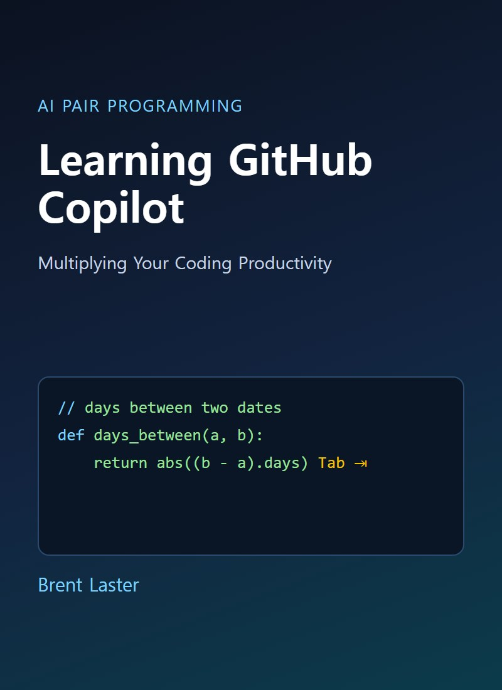
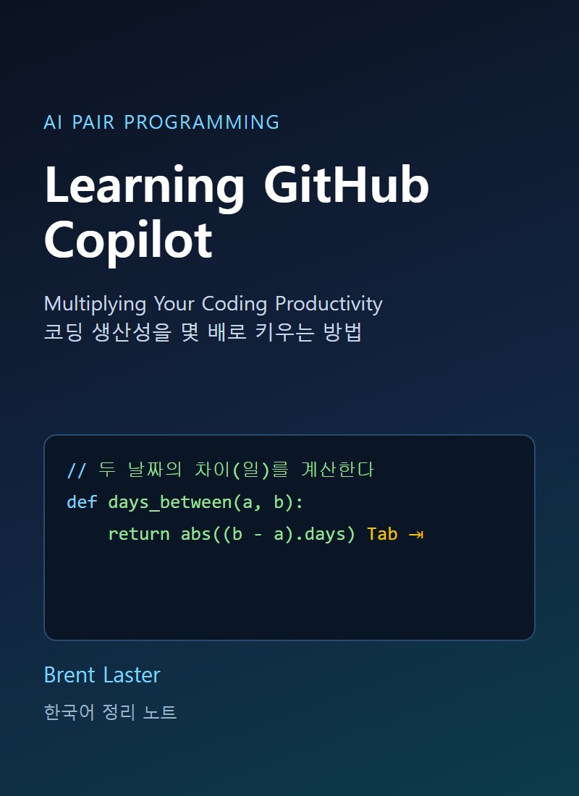
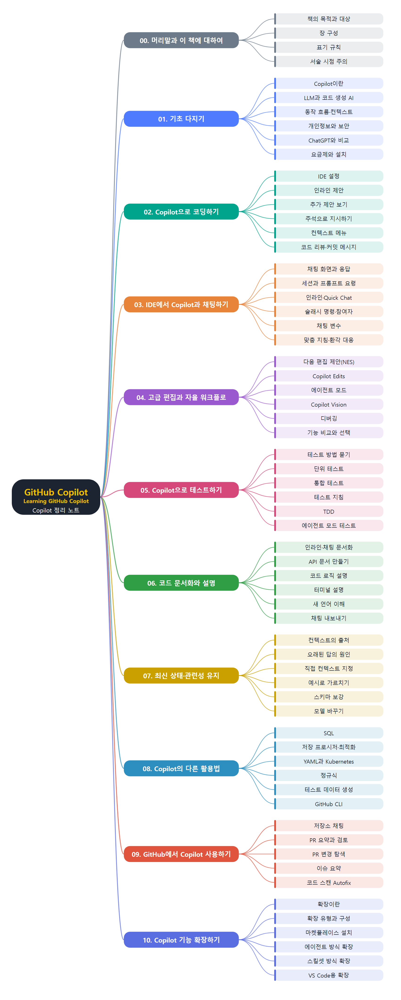

# **Learning GitHub Copilot**
(Learning GitHub Copilot: 코딩 생산성을 몇 배로 키우는 방법)
 

&nbsp;&nbsp;&nbsp;

원문 표지(왼쪽) · 한국어 표지(오른쪽)

 
 

이 문서는 Brent Laster가 쓴 『Learning GitHub Copilot』(O'Reilly)을 장별로 정리한 한국어 학습 노트입니다. 원문을 그대로 번역한 것이 아니라 내용을 풀어서 다시 설명했고, 처음 쓰는 용어는 쉬운 말로 풀이를 붙였습니다. 이해를 돕도록 장마다 비교표와 작동 흐름 그림을 넣었습니다. 책은 Copilot이 무엇이고 어떻게 동작하는지, 요금제는 어떻게 다른지 설명하는 기초에서 시작합니다. 이어서 IDE에서 인라인 제안과 주석으로 코딩하는 방법, 채팅 참여자·슬래시 명령·채팅 변수를 쓰는 방법, 다음 편집 제안·Copilot Edits·에이전트 모드 같은 고급 편집 기능을 다룹니다. 그다음 테스트 작성, 코드 문서화와 설명, 컨텍스트를 최신으로 유지하는 방법, SQL·YAML·정규식 같은 다른 활용법을 살펴보고, 마지막으로 GitHub 웹에서의 활용과 확장 만들기까지 설명합니다. 책의 서술 시점 이후 Copilot의 기능과 화면이 바뀌었을 수 있으니 최신 내용은 공식 문서로 확인해야 합니다.
 
 
 

---

- [00. 머리말과 이 책에 대하여](00.%20%EB%A8%B8%EB%A6%AC%EB%A7%90%EA%B3%BC%20%EC%9D%B4%20%EC%B1%85%EC%97%90%20%EB%8C%80%ED%95%98%EC%97%AC/Readme.md)
- [01. 기초 다지기](01.%20%EA%B8%B0%EC%B4%88%20%EB%8B%A4%EC%A7%80%EA%B8%B0/Readme.md)
  - [Copilot이란 무엇인가](01.%20%EA%B8%B0%EC%B4%88%20%EB%8B%A4%EC%A7%80%EA%B8%B0/Copilot%EC%9D%B4%EB%9E%80%20%EB%AC%B4%EC%97%87%EC%9D%B8%EA%B0%80.md)
  - [LLM과 코드 생성형 AI](01.%20%EA%B8%B0%EC%B4%88%20%EB%8B%A4%EC%A7%80%EA%B8%B0/LLM%EA%B3%BC%20%EC%BD%94%EB%93%9C%20%EC%83%9D%EC%84%B1%ED%98%95%20AI.md)
  - [동작 흐름과 컨텍스트 수집](01.%20%EA%B8%B0%EC%B4%88%20%EB%8B%A4%EC%A7%80%EA%B8%B0/%EB%8F%99%EC%9E%91%20%ED%9D%90%EB%A6%84%EA%B3%BC%20%EC%BB%A8%ED%85%8D%EC%8A%A4%ED%8A%B8%20%EC%88%98%EC%A7%91.md)
  - [사용 시 고려할 점 네 가지](01.%20%EA%B8%B0%EC%B4%88%20%EB%8B%A4%EC%A7%80%EA%B8%B0/%EC%82%AC%EC%9A%A9%20%EC%8B%9C%20%EA%B3%A0%EB%A0%A4%ED%95%A0%20%EC%A0%90%20%EB%84%A4%20%EA%B0%80%EC%A7%80.md)
  - [개인정보와 보안](01.%20%EA%B8%B0%EC%B4%88%20%EB%8B%A4%EC%A7%80%EA%B8%B0/%EA%B0%9C%EC%9D%B8%EC%A0%95%EB%B3%B4%EC%99%80%20%EB%B3%B4%EC%95%88.md)
  - [Copilot과 ChatGPT 비교](01.%20%EA%B8%B0%EC%B4%88%20%EB%8B%A4%EC%A7%80%EA%B8%B0/Copilot%EA%B3%BC%20ChatGPT%20%EB%B9%84%EA%B5%90.md)
  - [요금제와 설치](01.%20%EA%B8%B0%EC%B4%88%20%EB%8B%A4%EC%A7%80%EA%B8%B0/%EC%9A%94%EA%B8%88%EC%A0%9C%EC%99%80%20%EC%84%A4%EC%B9%98.md)
  - [정리](01.%20%EA%B8%B0%EC%B4%88%20%EB%8B%A4%EC%A7%80%EA%B8%B0/%EC%A0%95%EB%A6%AC.md)
- [02. Copilot으로 코딩하기](02.%20Copilot%EC%9C%BC%EB%A1%9C%20%EC%BD%94%EB%94%A9%ED%95%98%EA%B8%B0/Readme.md)
  - [인라인 제안 사용법](02.%20Copilot%EC%9C%BC%EB%A1%9C%20%EC%BD%94%EB%94%A9%ED%95%98%EA%B8%B0/%EC%9D%B8%EB%9D%BC%EC%9D%B8%20%EC%A0%9C%EC%95%88%20%EC%82%AC%EC%9A%A9%EB%B2%95.md)
  - [추가 제안 보기](02.%20Copilot%EC%9C%BC%EB%A1%9C%20%EC%BD%94%EB%94%A9%ED%95%98%EA%B8%B0/%EC%B6%94%EA%B0%80%20%EC%A0%9C%EC%95%88%20%EB%B3%B4%EA%B8%B0.md)
  - [주석으로 Copilot 다루기](02.%20Copilot%EC%9C%BC%EB%A1%9C%20%EC%BD%94%EB%94%A9%ED%95%98%EA%B8%B0/%EC%A3%BC%EC%84%9D%EC%9C%BC%EB%A1%9C%20Copilot%20%EB%8B%A4%EB%A3%A8%EA%B8%B0.md)
  - [컨텍스트 메뉴와 명령 팔레트](02.%20Copilot%EC%9C%BC%EB%A1%9C%20%EC%BD%94%EB%94%A9%ED%95%98%EA%B8%B0/%EC%BB%A8%ED%85%8D%EC%8A%A4%ED%8A%B8%20%EB%A9%94%EB%89%B4%EC%99%80%20%EB%AA%85%EB%A0%B9%20%ED%8C%94%EB%A0%88%ED%8A%B8.md)
  - [코드 리뷰와 커밋 메시지](02.%20Copilot%EC%9C%BC%EB%A1%9C%20%EC%BD%94%EB%94%A9%ED%95%98%EA%B8%B0/%EC%BD%94%EB%93%9C%20%EB%A6%AC%EB%B7%B0%EC%99%80%20%EC%BB%A4%EB%B0%8B%20%EB%A9%94%EC%8B%9C%EC%A7%80.md)
  - [IDE에서 Copilot 설정하기](02.%20Copilot%EC%9C%BC%EB%A1%9C%20%EC%BD%94%EB%94%A9%ED%95%98%EA%B8%B0/IDE%EC%97%90%EC%84%9C%20Copilot%20%EC%84%A4%EC%A0%95%ED%95%98%EA%B8%B0.md)
  - [정리](02.%20Copilot%EC%9C%BC%EB%A1%9C%20%EC%BD%94%EB%94%A9%ED%95%98%EA%B8%B0/%EC%A0%95%EB%A6%AC.md)
- [03. IDE에서 Copilot과 채팅하기](03.%20IDE%EC%97%90%EC%84%9C%20Copilot%EA%B3%BC%20%EC%B1%84%ED%8C%85%ED%95%98%EA%B8%B0/Readme.md)
  - [채팅 화면 열기와 응답 읽기](03.%20IDE%EC%97%90%EC%84%9C%20Copilot%EA%B3%BC%20%EC%B1%84%ED%8C%85%ED%95%98%EA%B8%B0/%EC%B1%84%ED%8C%85%20%ED%99%94%EB%A9%B4%20%EC%97%B4%EA%B8%B0%EC%99%80%20%EC%9D%91%EB%8B%B5%20%EC%9D%BD%EA%B8%B0.md)
  - [세션 관리와 프롬프트 요령](03.%20IDE%EC%97%90%EC%84%9C%20Copilot%EA%B3%BC%20%EC%B1%84%ED%8C%85%ED%95%98%EA%B8%B0/%EC%84%B8%EC%85%98%20%EA%B4%80%EB%A6%AC%EC%99%80%20%ED%94%84%EB%A1%AC%ED%94%84%ED%8A%B8%20%EC%9A%94%EB%A0%B9.md)
  - [프롬프트 입력창 활용하기](03.%20IDE%EC%97%90%EC%84%9C%20Copilot%EA%B3%BC%20%EC%B1%84%ED%8C%85%ED%95%98%EA%B8%B0/%ED%94%84%EB%A1%AC%ED%94%84%ED%8A%B8%20%EC%9E%85%EB%A0%A5%EC%B0%BD%20%ED%99%9C%EC%9A%A9%ED%95%98%EA%B8%B0.md)
  - [인라인 채팅과 Quick Chat, 터미널 채팅](03.%20IDE%EC%97%90%EC%84%9C%20Copilot%EA%B3%BC%20%EC%B1%84%ED%8C%85%ED%95%98%EA%B8%B0/%EC%9D%B8%EB%9D%BC%EC%9D%B8%20%EC%B1%84%ED%8C%85%EA%B3%BC%20Quick%20Chat%2C%20%ED%84%B0%EB%AF%B8%EB%84%90%20%EC%B1%84%ED%8C%85.md)
  - [슬래시 명령과 채팅 참여자](03.%20IDE%EC%97%90%EC%84%9C%20Copilot%EA%B3%BC%20%EC%B1%84%ED%8C%85%ED%95%98%EA%B8%B0/%EC%8A%AC%EB%9E%98%EC%8B%9C%20%EB%AA%85%EB%A0%B9%EA%B3%BC%20%EC%B1%84%ED%8C%85%20%EC%B0%B8%EC%97%AC%EC%9E%90.md)
  - [채팅 변수와 조합하기](03.%20IDE%EC%97%90%EC%84%9C%20Copilot%EA%B3%BC%20%EC%B1%84%ED%8C%85%ED%95%98%EA%B8%B0/%EC%B1%84%ED%8C%85%20%EB%B3%80%EC%88%98%EC%99%80%20%EC%A1%B0%ED%95%A9%ED%95%98%EA%B8%B0.md)
  - [맞춤 코드 생성 지침](03.%20IDE%EC%97%90%EC%84%9C%20Copilot%EA%B3%BC%20%EC%B1%84%ED%8C%85%ED%95%98%EA%B8%B0/%EB%A7%9E%EC%B6%A4%20%EC%BD%94%EB%93%9C%20%EC%83%9D%EC%84%B1%20%EC%A7%80%EC%B9%A8.md)
  - [환각과 잘못된 답 다루기](03.%20IDE%EC%97%90%EC%84%9C%20Copilot%EA%B3%BC%20%EC%B1%84%ED%8C%85%ED%95%98%EA%B8%B0/%ED%99%98%EA%B0%81%EA%B3%BC%20%EC%9E%98%EB%AA%BB%EB%90%9C%20%EB%8B%B5%20%EB%8B%A4%EB%A3%A8%EA%B8%B0.md)
  - [정리](03.%20IDE%EC%97%90%EC%84%9C%20Copilot%EA%B3%BC%20%EC%B1%84%ED%8C%85%ED%95%98%EA%B8%B0/%EC%A0%95%EB%A6%AC.md)
- [04. 고급 편집과 자율 워크플로](04.%20%EA%B3%A0%EA%B8%89%20%ED%8E%B8%EC%A7%91%EA%B3%BC%20%EC%9E%90%EC%9C%A8%20%EC%9B%8C%ED%81%AC%ED%94%8C%EB%A1%9C/Readme.md)
  - [다음 편집 제안](04.%20%EA%B3%A0%EA%B8%89%20%ED%8E%B8%EC%A7%91%EA%B3%BC%20%EC%9E%90%EC%9C%A8%20%EC%9B%8C%ED%81%AC%ED%94%8C%EB%A1%9C/%EB%8B%A4%EC%9D%8C%20%ED%8E%B8%EC%A7%91%20%EC%A0%9C%EC%95%88.md)
  - [Copilot Edits](04.%20%EA%B3%A0%EA%B8%89%20%ED%8E%B8%EC%A7%91%EA%B3%BC%20%EC%9E%90%EC%9C%A8%20%EC%9B%8C%ED%81%AC%ED%94%8C%EB%A1%9C/Copilot%20Edits.md)
  - [에이전트 모드](04.%20%EA%B3%A0%EA%B8%89%20%ED%8E%B8%EC%A7%91%EA%B3%BC%20%EC%9E%90%EC%9C%A8%20%EC%9B%8C%ED%81%AC%ED%94%8C%EB%A1%9C/%EC%97%90%EC%9D%B4%EC%A0%84%ED%8A%B8%20%EB%AA%A8%EB%93%9C.md)
  - [Copilot Vision](04.%20%EA%B3%A0%EA%B8%89%20%ED%8E%B8%EC%A7%91%EA%B3%BC%20%EC%9E%90%EC%9C%A8%20%EC%9B%8C%ED%81%AC%ED%94%8C%EB%A1%9C/Copilot%20Vision.md)
  - [Copilot 디버깅](04.%20%EA%B3%A0%EA%B8%89%20%ED%8E%B8%EC%A7%91%EA%B3%BC%20%EC%9E%90%EC%9C%A8%20%EC%9B%8C%ED%81%AC%ED%94%8C%EB%A1%9C/Copilot%20%EB%94%94%EB%B2%84%EA%B9%85.md)
  - [기능 비교와 선택](04.%20%EA%B3%A0%EA%B8%89%20%ED%8E%B8%EC%A7%91%EA%B3%BC%20%EC%9E%90%EC%9C%A8%20%EC%9B%8C%ED%81%AC%ED%94%8C%EB%A1%9C/%EA%B8%B0%EB%8A%A5%20%EB%B9%84%EA%B5%90%EC%99%80%20%EC%84%A0%ED%83%9D.md)
  - [정리](04.%20%EA%B3%A0%EA%B8%89%20%ED%8E%B8%EC%A7%91%EA%B3%BC%20%EC%9E%90%EC%9C%A8%20%EC%9B%8C%ED%81%AC%ED%94%8C%EB%A1%9C/%EC%A0%95%EB%A6%AC.md)
- [05. Copilot으로 테스트하기](05.%20Copilot%EC%9C%BC%EB%A1%9C%20%ED%85%8C%EC%8A%A4%ED%8A%B8%ED%95%98%EA%B8%B0/Readme.md)
  - [테스트 방법 물어보기](05.%20Copilot%EC%9C%BC%EB%A1%9C%20%ED%85%8C%EC%8A%A4%ED%8A%B8%ED%95%98%EA%B8%B0/%ED%85%8C%EC%8A%A4%ED%8A%B8%20%EB%B0%A9%EB%B2%95%20%EB%AC%BC%EC%96%B4%EB%B3%B4%EA%B8%B0.md)
  - [단위 테스트 만들기](05.%20Copilot%EC%9C%BC%EB%A1%9C%20%ED%85%8C%EC%8A%A4%ED%8A%B8%ED%95%98%EA%B8%B0/%EB%8B%A8%EC%9C%84%20%ED%85%8C%EC%8A%A4%ED%8A%B8%20%EB%A7%8C%EB%93%A4%EA%B8%B0.md)
  - [통합 테스트 만들기](05.%20Copilot%EC%9C%BC%EB%A1%9C%20%ED%85%8C%EC%8A%A4%ED%8A%B8%ED%95%98%EA%B8%B0/%ED%86%B5%ED%95%A9%20%ED%85%8C%EC%8A%A4%ED%8A%B8%20%EB%A7%8C%EB%93%A4%EA%B8%B0.md)
  - [사용자 지정 테스트 지침](05.%20Copilot%EC%9C%BC%EB%A1%9C%20%ED%85%8C%EC%8A%A4%ED%8A%B8%ED%95%98%EA%B8%B0/%EC%82%AC%EC%9A%A9%EC%9E%90%20%EC%A7%80%EC%A0%95%20%ED%85%8C%EC%8A%A4%ED%8A%B8%20%EC%A7%80%EC%B9%A8.md)
  - [테스트 먼저 쓰기 TDD](05.%20Copilot%EC%9C%BC%EB%A1%9C%20%ED%85%8C%EC%8A%A4%ED%8A%B8%ED%95%98%EA%B8%B0/%ED%85%8C%EC%8A%A4%ED%8A%B8%20%EB%A8%BC%EC%A0%80%20%EC%93%B0%EA%B8%B0%20TDD.md)
  - [에이전트 모드로 테스트 돌리기](05.%20Copilot%EC%9C%BC%EB%A1%9C%20%ED%85%8C%EC%8A%A4%ED%8A%B8%ED%95%98%EA%B8%B0/%EC%97%90%EC%9D%B4%EC%A0%84%ED%8A%B8%20%EB%AA%A8%EB%93%9C%EB%A1%9C%20%ED%85%8C%EC%8A%A4%ED%8A%B8%20%EB%8F%8C%EB%A6%AC%EA%B8%B0.md)
  - [정리](05.%20Copilot%EC%9C%BC%EB%A1%9C%20%ED%85%8C%EC%8A%A4%ED%8A%B8%ED%95%98%EA%B8%B0/%EC%A0%95%EB%A6%AC.md)
- [06. 코드 문서화와 설명](06.%20%EC%BD%94%EB%93%9C%20%EB%AC%B8%EC%84%9C%ED%99%94%EC%99%80%20%EC%84%A4%EB%AA%85/Readme.md)
  - [인라인과 채팅으로 문서화](06.%20%EC%BD%94%EB%93%9C%20%EB%AC%B8%EC%84%9C%ED%99%94%EC%99%80%20%EC%84%A4%EB%AA%85/%EC%9D%B8%EB%9D%BC%EC%9D%B8%EA%B3%BC%20%EC%B1%84%ED%8C%85%EC%9C%BC%EB%A1%9C%20%EB%AC%B8%EC%84%9C%ED%99%94.md)
  - [프레임워크와 API 문서 만들기](06.%20%EC%BD%94%EB%93%9C%20%EB%AC%B8%EC%84%9C%ED%99%94%EC%99%80%20%EC%84%A4%EB%AA%85/%ED%94%84%EB%A0%88%EC%9E%84%EC%9B%8C%ED%81%AC%EC%99%80%20API%20%EB%AC%B8%EC%84%9C%20%EB%A7%8C%EB%93%A4%EA%B8%B0.md)
  - [요약 문서 추출과 채팅 내보내기](06.%20%EC%BD%94%EB%93%9C%20%EB%AC%B8%EC%84%9C%ED%99%94%EC%99%80%20%EC%84%A4%EB%AA%85/%EC%9A%94%EC%95%BD%20%EB%AC%B8%EC%84%9C%20%EC%B6%94%EC%B6%9C%EA%B3%BC%20%EC%B1%84%ED%8C%85%20%EB%82%B4%EB%B3%B4%EB%82%B4%EA%B8%B0.md)
  - [새 언어와 생성 코드 이해하기](06.%20%EC%BD%94%EB%93%9C%20%EB%AC%B8%EC%84%9C%ED%99%94%EC%99%80%20%EC%84%A4%EB%AA%85/%EC%83%88%20%EC%96%B8%EC%96%B4%EC%99%80%20%EC%83%9D%EC%84%B1%20%EC%BD%94%EB%93%9C%20%EC%9D%B4%ED%95%B4%ED%95%98%EA%B8%B0.md)
  - [코드 로직 설명과 문제점 찾기](06.%20%EC%BD%94%EB%93%9C%20%EB%AC%B8%EC%84%9C%ED%99%94%EC%99%80%20%EC%84%A4%EB%AA%85/%EC%BD%94%EB%93%9C%20%EB%A1%9C%EC%A7%81%20%EC%84%A4%EB%AA%85%EA%B3%BC%20%EB%AC%B8%EC%A0%9C%EC%A0%90%20%EC%B0%BE%EA%B8%B0.md)
  - [터미널 설명](06.%20%EC%BD%94%EB%93%9C%20%EB%AC%B8%EC%84%9C%ED%99%94%EC%99%80%20%EC%84%A4%EB%AA%85/%ED%84%B0%EB%AF%B8%EB%84%90%20%EC%84%A4%EB%AA%85.md)
  - [정리](06.%20%EC%BD%94%EB%93%9C%20%EB%AC%B8%EC%84%9C%ED%99%94%EC%99%80%20%EC%84%A4%EB%AA%85/%EC%A0%95%EB%A6%AC.md)
- [07. Copilot을 최신 상태로 관련성 있게 유지하기](07.%20Copilot%EC%9D%84%20%EC%B5%9C%EC%8B%A0%20%EC%83%81%ED%83%9C%EB%A1%9C%20%EA%B4%80%EB%A0%A8%EC%84%B1%20%EC%9E%88%EA%B2%8C%20%EC%9C%A0%EC%A7%80%ED%95%98%EA%B8%B0/Readme.md)
  - [컨텍스트는 어디서 오나](07.%20Copilot%EC%9D%84%20%EC%B5%9C%EC%8B%A0%20%EC%83%81%ED%83%9C%EB%A1%9C%20%EA%B4%80%EB%A0%A8%EC%84%B1%20%EC%9E%88%EA%B2%8C%20%EC%9C%A0%EC%A7%80%ED%95%98%EA%B8%B0/%EC%BB%A8%ED%85%8D%EC%8A%A4%ED%8A%B8%EB%8A%94%20%EC%96%B4%EB%94%94%EC%84%9C%20%EC%98%A4%EB%82%98.md)
  - [오래되고 틀린 답이 나오는 이유](07.%20Copilot%EC%9D%84%20%EC%B5%9C%EC%8B%A0%20%EC%83%81%ED%83%9C%EB%A1%9C%20%EA%B4%80%EB%A0%A8%EC%84%B1%20%EC%9E%88%EA%B2%8C%20%EC%9C%A0%EC%A7%80%ED%95%98%EA%B8%B0/%EC%98%A4%EB%9E%98%EB%90%98%EA%B3%A0%20%ED%8B%80%EB%A6%B0%20%EB%8B%B5%EC%9D%B4%20%EB%82%98%EC%98%A4%EB%8A%94%20%EC%9D%B4%EC%9C%A0.md)
  - [엉뚱한 컨텍스트와 빠진 컨텍스트](07.%20Copilot%EC%9D%84%20%EC%B5%9C%EC%8B%A0%20%EC%83%81%ED%83%9C%EB%A1%9C%20%EA%B4%80%EB%A0%A8%EC%84%B1%20%EC%9E%88%EA%B2%8C%20%EC%9C%A0%EC%A7%80%ED%95%98%EA%B8%B0/%EC%97%89%EB%9A%B1%ED%95%9C%20%EC%BB%A8%ED%85%8D%EC%8A%A4%ED%8A%B8%EC%99%80%20%EB%B9%A0%EC%A7%84%20%EC%BB%A8%ED%85%8D%EC%8A%A4%ED%8A%B8.md)
  - [컨텍스트를 직접 지정하기](07.%20Copilot%EC%9D%84%20%EC%B5%9C%EC%8B%A0%20%EC%83%81%ED%83%9C%EB%A1%9C%20%EA%B4%80%EB%A0%A8%EC%84%B1%20%EC%9E%88%EA%B2%8C%20%EC%9C%A0%EC%A7%80%ED%95%98%EA%B8%B0/%EC%BB%A8%ED%85%8D%EC%8A%A4%ED%8A%B8%EB%A5%BC%20%EC%A7%81%EC%A0%91%20%EC%A7%80%EC%A0%95%ED%95%98%EA%B8%B0.md)
  - [모델 바꾸기와 버전 확인](07.%20Copilot%EC%9D%84%20%EC%B5%9C%EC%8B%A0%20%EC%83%81%ED%83%9C%EB%A1%9C%20%EA%B4%80%EB%A0%A8%EC%84%B1%20%EC%9E%88%EA%B2%8C%20%EC%9C%A0%EC%A7%80%ED%95%98%EA%B8%B0/%EB%AA%A8%EB%8D%B8%20%EB%B0%94%EA%BE%B8%EA%B8%B0%EC%99%80%20%EB%B2%84%EC%A0%84%20%ED%99%95%EC%9D%B8.md)
  - [예시로 가르치기](07.%20Copilot%EC%9D%84%20%EC%B5%9C%EC%8B%A0%20%EC%83%81%ED%83%9C%EB%A1%9C%20%EA%B4%80%EB%A0%A8%EC%84%B1%20%EC%9E%88%EA%B2%8C%20%EC%9C%A0%EC%A7%80%ED%95%98%EA%B8%B0/%EC%98%88%EC%8B%9C%EB%A1%9C%20%EA%B0%80%EB%A5%B4%EC%B9%98%EA%B8%B0.md)
  - [스키마로 컨텍스트 보강하기](07.%20Copilot%EC%9D%84%20%EC%B5%9C%EC%8B%A0%20%EC%83%81%ED%83%9C%EB%A1%9C%20%EA%B4%80%EB%A0%A8%EC%84%B1%20%EC%9E%88%EA%B2%8C%20%EC%9C%A0%EC%A7%80%ED%95%98%EA%B8%B0/%EC%8A%A4%ED%82%A4%EB%A7%88%EB%A1%9C%20%EC%BB%A8%ED%85%8D%EC%8A%A4%ED%8A%B8%20%EB%B3%B4%EA%B0%95%ED%95%98%EA%B8%B0.md)
  - [정리](07.%20Copilot%EC%9D%84%20%EC%B5%9C%EC%8B%A0%20%EC%83%81%ED%83%9C%EB%A1%9C%20%EA%B4%80%EB%A0%A8%EC%84%B1%20%EC%9E%88%EA%B2%8C%20%EC%9C%A0%EC%A7%80%ED%95%98%EA%B8%B0/%EC%A0%95%EB%A6%AC.md)
- [08. Copilot의 다른 활용법](08.%20Copilot%EC%9D%98%20%EB%8B%A4%EB%A5%B8%20%ED%99%9C%EC%9A%A9%EB%B2%95/Readme.md)
  - [SQL 질의와 스키마 작성](08.%20Copilot%EC%9D%98%20%EB%8B%A4%EB%A5%B8%20%ED%99%9C%EC%9A%A9%EB%B2%95/SQL%20%EC%A7%88%EC%9D%98%EC%99%80%20%EC%8A%A4%ED%82%A4%EB%A7%88%20%EC%9E%91%EC%84%B1.md)
  - [저장 프로시저와 SQL 최적화](08.%20Copilot%EC%9D%98%20%EB%8B%A4%EB%A5%B8%20%ED%99%9C%EC%9A%A9%EB%B2%95/%EC%A0%80%EC%9E%A5%20%ED%94%84%EB%A1%9C%EC%8B%9C%EC%A0%80%EC%99%80%20SQL%20%EC%B5%9C%EC%A0%81%ED%99%94.md)
  - [YAML과 Kubernetes](08.%20Copilot%EC%9D%98%20%EB%8B%A4%EB%A5%B8%20%ED%99%9C%EC%9A%A9%EB%B2%95/YAML%EA%B3%BC%20Kubernetes.md)
  - [정규식 만들기](08.%20Copilot%EC%9D%98%20%EB%8B%A4%EB%A5%B8%20%ED%99%9C%EC%9A%A9%EB%B2%95/%EC%A0%95%EA%B7%9C%EC%8B%9D%20%EB%A7%8C%EB%93%A4%EA%B8%B0.md)
  - [테스트 데이터 생성](08.%20Copilot%EC%9D%98%20%EB%8B%A4%EB%A5%B8%20%ED%99%9C%EC%9A%A9%EB%B2%95/%ED%85%8C%EC%8A%A4%ED%8A%B8%20%EB%8D%B0%EC%9D%B4%ED%84%B0%20%EC%83%9D%EC%84%B1.md)
  - [GitHub CLI와 Copilot](08.%20Copilot%EC%9D%98%20%EB%8B%A4%EB%A5%B8%20%ED%99%9C%EC%9A%A9%EB%B2%95/GitHub%20CLI%EC%99%80%20Copilot.md)
  - [정리](08.%20Copilot%EC%9D%98%20%EB%8B%A4%EB%A5%B8%20%ED%99%9C%EC%9A%A9%EB%B2%95/%EC%A0%95%EB%A6%AC.md)
- [09. GitHub에서 Copilot 사용하기](09.%20GitHub%EC%97%90%EC%84%9C%20Copilot%20%EC%82%AC%EC%9A%A9%ED%95%98%EA%B8%B0/Readme.md)
  - [GitHub 채팅과 저장소 인덱싱](09.%20GitHub%EC%97%90%EC%84%9C%20Copilot%20%EC%82%AC%EC%9A%A9%ED%95%98%EA%B8%B0/GitHub%20%EC%B1%84%ED%8C%85%EA%B3%BC%20%EC%A0%80%EC%9E%A5%EC%86%8C%20%EC%9D%B8%EB%8D%B1%EC%8B%B1.md)
  - [코드 스캔 경고에서 Autofix까지](09.%20GitHub%EC%97%90%EC%84%9C%20Copilot%20%EC%82%AC%EC%9A%A9%ED%95%98%EA%B8%B0/%EC%BD%94%EB%93%9C%20%EC%8A%A4%EC%BA%94%20%EA%B2%BD%EA%B3%A0%EC%97%90%EC%84%9C%20Autofix%EA%B9%8C%EC%A7%80.md)
  - [풀 리퀘스트 검토와 요약](09.%20GitHub%EC%97%90%EC%84%9C%20Copilot%20%EC%82%AC%EC%9A%A9%ED%95%98%EA%B8%B0/%ED%92%80%20%EB%A6%AC%ED%80%98%EC%8A%A4%ED%8A%B8%20%EA%B2%80%ED%86%A0%EC%99%80%20%EC%9A%94%EC%95%BD.md)
  - [링크로 PR 만들기와 요약 생성](09.%20GitHub%EC%97%90%EC%84%9C%20Copilot%20%EC%82%AC%EC%9A%A9%ED%95%98%EA%B8%B0/%EB%A7%81%ED%81%AC%EB%A1%9C%20PR%20%EB%A7%8C%EB%93%A4%EA%B8%B0%EC%99%80%20%EC%9A%94%EC%95%BD%20%EC%83%9D%EC%84%B1.md)
  - [PR 변경 내용 탐색](09.%20GitHub%EC%97%90%EC%84%9C%20Copilot%20%EC%82%AC%EC%9A%A9%ED%95%98%EA%B8%B0/PR%20%EB%B3%80%EA%B2%BD%20%EB%82%B4%EC%9A%A9%20%ED%83%90%EC%83%89.md)
  - [이슈 요약과 다음 단계 제안](09.%20GitHub%EC%97%90%EC%84%9C%20Copilot%20%EC%82%AC%EC%9A%A9%ED%95%98%EA%B8%B0/%EC%9D%B4%EC%8A%88%20%EC%9A%94%EC%95%BD%EA%B3%BC%20%EB%8B%A4%EC%9D%8C%20%EB%8B%A8%EA%B3%84%20%EC%A0%9C%EC%95%88.md)
  - [정리](09.%20GitHub%EC%97%90%EC%84%9C%20Copilot%20%EC%82%AC%EC%9A%A9%ED%95%98%EA%B8%B0/%EC%A0%95%EB%A6%AC.md)
- [10. Copilot 기능 확장하기](10.%20Copilot%20%EA%B8%B0%EB%8A%A5%20%ED%99%95%EC%9E%A5%ED%95%98%EA%B8%B0/Readme.md)
  - [확장이란 무엇인가](10.%20Copilot%20%EA%B8%B0%EB%8A%A5%20%ED%99%95%EC%9E%A5%ED%95%98%EA%B8%B0/%ED%99%95%EC%9E%A5%EC%9D%B4%EB%9E%80%20%EB%AC%B4%EC%97%87%EC%9D%B8%EA%B0%80.md)
  - [마켓플레이스에서 확장 설치하기](10.%20Copilot%20%EA%B8%B0%EB%8A%A5%20%ED%99%95%EC%9E%A5%ED%95%98%EA%B8%B0/%EB%A7%88%EC%BC%93%ED%94%8C%EB%A0%88%EC%9D%B4%EC%8A%A4%EC%97%90%EC%84%9C%20%ED%99%95%EC%9E%A5%20%EC%84%A4%EC%B9%98%ED%95%98%EA%B8%B0.md)
  - [확장 유형과 구성 요소](10.%20Copilot%20%EA%B8%B0%EB%8A%A5%20%ED%99%95%EC%9E%A5%ED%95%98%EA%B8%B0/%ED%99%95%EC%9E%A5%20%EC%9C%A0%ED%98%95%EA%B3%BC%20%EA%B5%AC%EC%84%B1%20%EC%9A%94%EC%86%8C.md)
  - [에이전트 방식 확장 만들기](10.%20Copilot%20%EA%B8%B0%EB%8A%A5%20%ED%99%95%EC%9E%A5%ED%95%98%EA%B8%B0/%EC%97%90%EC%9D%B4%EC%A0%84%ED%8A%B8%20%EB%B0%A9%EC%8B%9D%20%ED%99%95%EC%9E%A5%20%EB%A7%8C%EB%93%A4%EA%B8%B0.md)
  - [스킬셋 방식 확장 만들기](10.%20Copilot%20%EA%B8%B0%EB%8A%A5%20%ED%99%95%EC%9E%A5%ED%95%98%EA%B8%B0/%EC%8A%A4%ED%82%AC%EC%85%8B%20%EB%B0%A9%EC%8B%9D%20%ED%99%95%EC%9E%A5%20%EB%A7%8C%EB%93%A4%EA%B8%B0.md)
  - [VS Code용 확장 만들기](10.%20Copilot%20%EA%B8%B0%EB%8A%A5%20%ED%99%95%EC%9E%A5%ED%95%98%EA%B8%B0/VS%20Code%EC%9A%A9%20%ED%99%95%EC%9E%A5%20%EB%A7%8C%EB%93%A4%EA%B8%B0.md)
  - [정리](10.%20Copilot%20%EA%B8%B0%EB%8A%A5%20%ED%99%95%EC%9E%A5%ED%95%98%EA%B8%B0/%EC%A0%95%EB%A6%AC.md)
