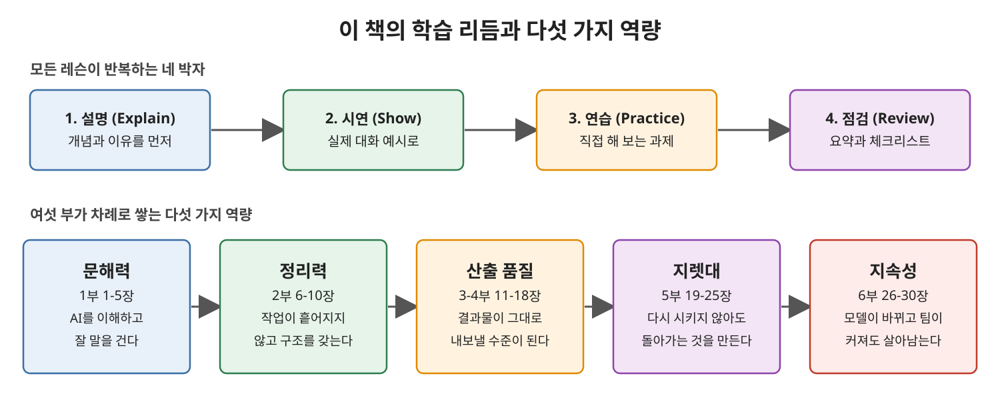
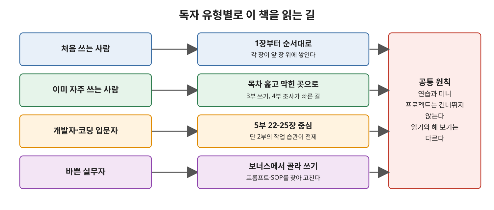

# 머리말과 이 책에 대하여 (Front Matter)

Cade Corwin의 『Mastering Claude AI』는 프롬프트 작성, 프로젝트, 아티팩트, Claude Code, MCP, 자동화, API 연동까지 Claude를 실제 업무에 쓰는 방법을 서른 개 장으로 풀어 쓴 실용서다. 본문에 들어가기 전 앞부분(저작권, 헌정, 이 책 사용법, 시장 위치, 독자상, 약속, 로드맵, 장별 목표)은 이 책을 어떤 태도로 읽어야 하는지 알려 주는 안내문이다. 이 문서는 그 앞부분을 한곳에 정리한다.

이 노트는 번역이 아니라 책의 내용을 이해한 뒤 우리말로 다시 정리한 학습 노트다. 책 속의 제품 이름, 화면 문구, 가격, 기능은 책이 쓰인 시점(2026년 초판) 기준이며 이후 바뀔 수 있다. 책 자신도 같은 점을 거듭 밝히고 있다.

> **이 앞부분을 한 문장으로**
> 이 책은 기능 소개서가 아니라 일을 끝내는 순서를 가르치는 작업 교본이며, 읽는 것보다 직접 해 보는 것을 중심에 둔다.

---

## 1. 핵심 요점

- **책의 정체**: 정식 제목은 『Mastering Claude AI』이고, 부제는 프롬프트 엔지니어링, 프로젝트, 아티팩트, Claude Code, MCP, 자동화, API 연동, 실제 업무 흐름을 아우르는 완전 실무 가이드다. 2026년 초판이다.
- **독립 저작물**: 저자는 이 책이 Anthropic과 관계없는 독립 교육서이며 보증이나 후원을 받지 않았다고 밝힌다. Claude와 관련 상표는 각 소유자의 것이다.
- **읽는 법**: 처음이면 1장부터 차례로, 경험자면 막힌 지점의 부로 건너뛰되 연습과 미니 프로젝트는 건너뛰지 않는다.
- **장의 리듬**: 모든 장이 설명, 시연, 연습, 점검(Explain, Show, Practice, Review)을 반복한다.
- **차별점**: 기능이 아니라 일(job) 중심으로 장을 짠다. 각 장 끝에 "내가 만들었다"고 말할 결과물이 남고, Claude가 틀리는 지점도 솔직히 다룬다.
- **약속**: 끝까지 하면 정리된 작업 환경, 실제 결과물 최소 다섯 개, 어떤 기능 변화에도 통하는 사고 틀, 사람이 꼭 확인해야 할 일의 기준을 얻는다.
- **로드맵**: 문해력, 정리력, 산출 품질, 지렛대, 지속성의 다섯 역량을 여섯 부에 걸쳐 쌓는다.

## 2. 저작권과 면책

저작권은 2026년 Cade Corwin에게 있고, 출판사의 사전 서면 허락 없이 복제, 배포, 전송할 수 없다. 비평 목적의 짧은 인용 등 법이 허용하는 비상업적 이용은 예외다. 표지 디자인도 저자가 직접 했다.

면책 문구는 세 가지로 요약된다.

| 항목 | 내용 | 독자가 할 일 |
|---|---|---|
| 독립성 | Anthropic이 쓰거나 후원하지 않은 책 | 공식 정보는 공식 문서로 확인한다 |
| 시점 | 기능, 화면, 가격, 한도는 저자가 쓴 시점의 이해이며 계속 바뀐다 | 가격과 한도는 사용 전에 최신 문서로 본다 |
| 전문 조언 | 법률, 재무, 의료, 규정 준수 자문을 대신하지 않는다 | 해당 분야는 전문가에게 확인한다 |

저자와 출판사는 책의 정보를 쓰다 생긴 직접 또는 간접 손해에 책임지지 않는다고 적었다.

## 3. 헌정

헌정사는 한 줄이다. 새 대화창을 열어 놓고 빈 입력칸을 바라보다가 "help"라고만 쳐 본 모든 사람에게 이 책을 바친다는 내용이다. 초보자의 막막함을 출발점으로 삼겠다는 저자의 태도가 드러난다.

## 4. 이 책 사용법 (How to Use This Book)

저자의 첫 문장은 "이 책은 읽기만 하는 책이 아니라 쓰는 책"이다. 읽는 길은 독자 처지에 따라 다르다.

- **처음 쓰는 사람**: 1장부터 순서대로 간다. 2부의 정리 습관은 1부의 프롬프트 기술 위에 서 있고, 5부의 자동화와 코딩은 2부에서 다진 작업 규율을 전제하기 때문이다.
- **이미 자주 쓰는 사람**: 목차를 훑고 지금 가장 불편한 부로 건너뛴다. 저자는 경험자가 가장 빨리 개선을 얻는 곳으로 3부(쓰기)와 4부(조사와 분석)를 꼽는다.

모든 장은 네 박자로 돈다. 개념을 설명하고(Explain), 실제 대화로 보여 주고(Show), 직접 해 보게 하고(Practice), 요약과 점검으로 닫는다(Review). 저자는 연습과 미니 프로젝트를 건너뛰지 말라고 강조한다. 프롬프트를 읽는 것과 프롬프트를 써 보는 것은 다르고, 프로젝트(Project, 관련 파일과 지침을 묶는 작업 폴더)에 대해 읽는 것과 하나를 만들어 보는 것도 다르다는 이유다.

저자는 책 전체에서 오래가는 원리와 곧 바뀔 세부 사항을 구분해 표시한다고 한다. 확실하지 않으면 Anthropic 공식 문서를 보라고 안내하는데, 이를 책의 결함이 아니라 설계 방식으로 이해해 달라고 덧붙인다. 마지막 권고는 노트, 빈 문서, 또는 전용 Claude 프로젝트를 하나 열어 두고 읽으라는 것이다. 미니 프로젝트가 책을 마칠 때 쓸 수 있는 실제 결과물로 남도록 설계되어 있기 때문이다.

참고(노트 작성자): 위 그림의 "개발자"와 "바쁜 실무자" 길은 원문에 문장으로 적힌 것이 아니라, 원문의 보조 독자상과 보너스 설명을 근거로 노트 작성자가 정리한 것이다.

## 5. 시장 내 위치 (Market Positioning)

저자는 아마존의 Claude 책 시장이 두 가지 실패 유형으로 붐빈다고 진단한다.

1. **스크린샷 책**: 도움말 센터를 다시 포장하고, 어떤 챗봇에나 해당하는 일반 팁으로 분량을 채운 책.
2. **과장 책**: AI가 일자리를 대체한다는 식의 호들갑은 크지만, 화요일 오후에 당장 할 일은 거의 없는 책.

이 책은 둘 사이의 빈자리, 곧 기능 둘러보기가 아니라 작업 매뉴얼(workflow manual)을 자처한다. 보고서 쓰기, 스프레드시트 정리, 계약 관련 메일 쓰기, 스크립트 디버깅, 경쟁사 조사처럼 독자가 이미 쥐고 있는 일을 중심으로, Claude 안에서 처음부터 제대로 해내는 동작 순서를 보여 준다.

차별점은 문체가 아니라 구조에 있다고 저자는 말한다. 셋으로 줄이면 다음과 같다.

- 프로젝트, 아티팩트(Artifact, 대화에서 나오는 문서나 앱 같은 결과물), 메모리, MCP, Claude Code 같은 기능을 따로 소개하지 않고, 그 기능이 풀어 주는 일과 함께 가르친다.
- 모든 장이 독자가 "이건 내가 만들었다"고 가리킬 수 있는 무엇인가로 끝난다.
- Claude가 어디서 틀리는지, 사람이 어디서 반드시 확인해야 하는지, 무엇이 돈이 들고 무엇이 공짜인지 솔직하게 적는다.

## 6. 독자상 (Reader Avatar)

저자는 대표 독자로 **프리야**를 세운다. 34세에 직원 여섯 명의 마케팅 컨설팅 회사를 운영하고, 챗GPT를 1년쯤 가볍게 써 봤으며, 긴 문서에 좋다는 동료의 권유로 Claude 구독을 막 시작했다. 하루에 도구 공부에 쓸 시간은 많아야 45분이고, 컴퓨터 과학 수업은 원하지 않는다.

프리야가 바라는 것은 네 가지다.

- 대화를 시작할 때마다 브랜드 어조를 다시 설명하는 일을 그만두고 싶다.
- 고객 통화 녹취를 손질 세 번 없이 깔끔한 결과물로 바꾸고 싶다.
- 자꾸 눈에 띄는 "프로젝트"와 "아티팩트" 버튼이 시간을 들일 가치가 있는지 알고 싶다.
- 작은 내부 도구를 개발자에게 맡겨야 할지, Claude에게 시키면 될지 결정하고 싶다.

보조 독자도 있다. 터미널에서 Claude Code를 쓰고 싶은 개발자, 논문 PDF에 파묻힌 대학원생, 고객 메일을 자동화하려는 작은 쇼핑몰 주인, 어조와 독창성을 걱정하는 프리랜서 작가다.

참고(노트 작성자): 프리야는 책에서 만든 가상 인물이다. 실존 인물이나 통계에 근거한 독자 조사가 아니다.

## 7. 책의 약속 (Book Promise)

각 장을 순서대로 읽고 연습을 하면 네 가지를 갖고 끝난다고 저자는 약속한다.

1. **전문가식 작업 환경**: 흩어진 일회성 대화가 아니라 정리된 Claude 환경.
2. **실제 결과물 다섯 개 이상**: 보고서, 작은 웹 도구, 자동화 워크플로, 조사 브리프, 동작하는 코드 한 조각 같은 것.
3. **어디에나 통하는 사고 틀**: 단추의 위치가 아니라 원리 위에 세웠기 때문에 미래의 기능, 모델, 가격 변화에도 옮겨 쓸 수 있는 프롬프트와 컨텍스트(context, Claude에게 주는 배경 정보) 이해.
4. **신뢰의 기준**: 감독 없이 Claude에게 맡길 일과 반드시 사람이 확인할 일에 대한 분명하고 솔직한 감각.

## 8. 차별화 포인트 (Unique Selling Points)

| 포인트 | 의미 |
|---|---|
| 일 중심 구조 | 장 제목이 기능이 아니라 결과다. 예를 들면 "엉킨 녹취를 고객에게 보낼 보고서로" 같은 식 |
| 네 박자 반복 | 설명-시연-연습-점검이 모든 레슨에서 반복되어 학습이 장마다 초기화되지 않고 쌓인다 |
| 솔직한 실패 상자 | 모든 장에 "Where This Breaks"(어디서 깨지는가) 상자가 있다. Claude가 실패하는 모습을 안 보여 주는 책은 현실에서 쓸모가 없다는 논리다 |
| 보너스 시스템 | 책 뒤에 프롬프트 모음이 아닌 완결된 업무 시스템 10개를 둔다 |
| 완전한 자체 예시 | 시나리오, 회사 이름, 사례 모두 이 책을 위해 지어냈고 기존 가이드나 강의, 문서에서 가져오거나 바꿔 쓰지 않았다고 밝힌다 |

참고(노트 작성자): "Where This Breaks" 상자가 장마다 있다는 것은 저자의 서술이다. 이 노트의 장 문서에서는 그 취지를 "흔한 실수와 문제 해결" 표로 담았다.

## 9. 학습 로드맵 (Learning Roadmap)

- **1-5장, 기초**: 기술자라도 건너뛸 수 없다. 사고 모델이 여기서 만들어진다.
- **6-10장, 작업 공간 숙달**: 마치면 Claude 환경이 초보자의 것과 전혀 달라진다.
- **11-18장, 쓰기와 조사 실력**: 현실에서 가장 자주 쓰는 용도의 응용 기술.
- **19-25장, 만들기와 자동화**: "대화"를 넘어 "결과를 내놓는" 단계로 나아간다.
- **26-30장, 전문가의 성숙**: 보안, 팀, 기능 업데이트를 견디는 체계.

## 10. 장별 목표와 기술 진행 (Chapter Objectives & Skill Progression)

각 부는 하나의 역량 층을 쌓는다. 다섯 층으로 요약하면 아래와 같다.

| 층 | 해당 부 | 도달 상태 |
|---|---|---|
| 문해력(Literacy) | 1부 | 다루는 도구가 무엇인지 알고 잘 말을 걸 수 있다 |
| 정리력(Organization) | 2부 | 작업이 여기저기 열린 탭이 아니라 구조 안에 있다 |
| 산출 품질(Output quality) | 3-4부 | 결과물이 "AI치고는 괜찮은" 수준이 아니라 그대로 내놓을 수준이다 |
| 지렛대(Leverage) | 5부 | 매번 다시 프롬프트하지 않아도 돌아가는 것을 만든다 |
| 지속성(Durability) | 6부 | 모델 업데이트, 팀 성장, 외부 검증을 견디는 체계가 된다 |

여섯 부와 다섯 층이 일대일이 아닌 점에 주의한다. 3부와 4부가 한 층(산출 품질)을 함께 쌓기 때문이다. 층 이름의 영어 표기는 원문 그대로이고, 부 번호와 장 범위는 원문 로드맵을 따랐다.

## 11. 실행 체크리스트

- [ ] 책을 읽는 동안 쓸 노트, 빈 문서, 또는 전용 Claude 프로젝트를 하나 정했다.
- [ ] 내가 처음 쓰는 사람인지 경험자인지 정하고 시작할 장을 골랐다.
- [ ] 프리야의 네 가지 바람 중 내 것과 같은 것을 적어 두었다.
- [ ] 책을 마칠 때 갖고 싶은 결과물 다섯 가지의 후보를 적어 두었다.
- [ ] 가격, 한도, 화면 이름은 사용 전에 공식 문서로 다시 본다고 다짐했다.

---

## 12. 문서 목록

이 폴더의 문서는 이 파일 하나다. 본문은 아래 폴더에서 이어진다.

- 1부 기초: 1장부터 5장까지
- 2부 핵심 작업 도구: 6장부터 10장까지
- 3부 쓰기와 소통, 4부 조사와 분석, 5부 만들기와 자동화, 6부 책임 있게 규모 있게
- 보너스: 프롬프트 350개, 워크플로, 의사결정 틀, 체크리스트, 템플릿, SOP, 사례, 업무 시스템

 
 
 

[Mastering Claude AI](../)
