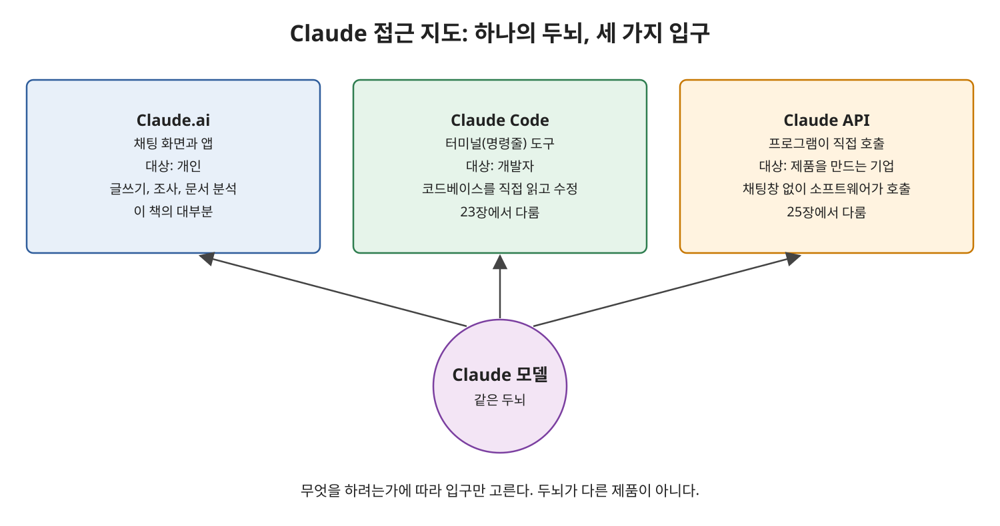

# 1장 Claude의 정체와 한계 (What Claude Actually Is and Isn't)

1장은 이 책 전체의 바탕이 되는 장이다. Claude가 무엇이고 무엇이 아닌지, 어떤 경로로 접근하는지, 모델과 컨텍스트 윈도우가 왜 결과를 바꾸는지를 먼저 정리한다. 저자는 "이미 챗봇을 아니까" 건너뛰면 초보자가 흔히 하는 세 가지 실수를 그대로 되풀이한다고 경고한다.

책의 비유는 이렇다. Claude는 글, 코드, 추론 사례를 엄청나게 읽었고 초안을 몇 초 만에 쓰는 동료와 같다. 다만 당신이 건네지 않으면 받은편지함을 볼 수 없고, 메모리를 켜지 않으면 어제 일을 기억하지 못하며, 틀릴 때도 자신만만하다. "로봇"이나 "검색 엔진"보다 훨씬 정확한 그림이라는 것이다.

> **참고(노트 작성자)** 모델 이름, 요금제, 화면 문구처럼 변하는 정보는 책이 쓰인 시점 기준이다. 책도 구체적 목록보다 "지금 내 계정의 선택 화면"을 믿으라고 권한다.

---

## 1. 이 장의 학습 목표와 핵심 용어

장을 마치면 다음을 할 수 있어야 한다. 마케팅 문구 없이 Claude를 한 문장으로 설명하기, Claude.ai와 Claude Code와 Claude API의 차이를 알고 필요한 것을 고르기, 모델 계열이 결과를 바꾼다는 점을 이해하기, 초보자의 세 가지 오해를 알아보기, Claude의 한계에 현실적인 기대를 갖기다.

- **대규모 언어 모델(LLM)**: 방대한 글로 훈련되어 학습한 패턴에 따라 언어를 한 조각씩 예측해 생성하는 시스템이다.
- **모델**: Sonnet이나 Opus처럼 속도, 비용, 추론 깊이의 균형이 다른 Claude의 버전이다.
- **컨텍스트 윈도우**: 한 대화에서 Claude가 한꺼번에 볼 수 있는 텍스트의 양이며, 그 대화의 단기 기억이다.
- **토큰**: Claude가 읽고 쓰는 글의 조각(대개 단어 또는 단어의 일부)이며 비용과 한도의 단위다.
- **환각**: Claude가 사실이 아닌 것을 자신 있게 말하는 현상이다. 일부러 거짓말하는 것이 아니라 언어 예측 방식의 부산물이다.

## 2. 레슨 1: Claude의 정체

Claude는 Anthropic이 만든 AI 시스템이다. 핵심은 대규모 언어 모델, 즉 방대한 글로 훈련되어 다음에 올 말을 예측함으로써 일관되고 쓸모 있는 글, 설명, 코드, 추론을 만들어내는 소프트웨어다. 당신이 준 텍스트(요금제에 따라 이미지나 문서도)와 훈련에서 익힌 패턴을 합쳐 답을 만든다.

이 정의는 강점과 한계를 한꺼번에 설명한다. 글쓰기, 요약, 설명, 구조 바꾸기, 코딩, 아이디어 내기에는 매우 강하다. 반대로 데이터베이스가 아니고, 기본적으로 검색 엔진도 아니며, 훈련 자료가 끝난 뒤의 일은 웹 검색을 켜지 않는 한 알지 못한다.

**언제 Claude를 쓰나.** 일이 본질적으로 언어, 당신이 준 정보에 대한 추론, 코드에 관한 것일 때다. 이메일 쓰기, 어지러운 메모 정리, 개념 설명, 스크립트 초안, 올린 문서 분석이 그렇다. 검토 없이는 정확성을 보장할 수 없는 일, 곧 확인하지 않을 재무 계산, 변호사 검토 없는 법률 서류, 의료 결정에는 맞지 않는다.

**실제로는 어떻게 되나.** Claude는 한 줄 지시로 모든 것을 지어내게 할 때보다 실제 원재료, 곧 메모, 데이터, 초안을 줄 때 가장 잘한다. 책이 드는 예는 양초 가게다.

- "양초 가게 상품 설명을 써 줘"라고 하면 평범하고 어디서나 본 듯한 글이 나온다.
- 향 이름 다섯 개, 브랜드 어조(장난스럽고 약간 능청스럽게, 점잔 빼지 않기), 예전 설명 두 개를 주고 같은 목소리로 세 개를 요청하면 바로 쓸 수 있는 글이 나온다.

차이는 운이 아니라 Claude가 받은 실제 맥락의 양이다. 책의 권고는 Claude를 입사 첫날의 유능한 신입처럼 대하라는 것이다. 똑똑하고 빠르지만 준 정보와 지시만큼만 잘한다. 가장 흔한 실수는 당신의 사업, 취향, 지난주에 생긴 사실을 Claude가 "그냥 안다"고 가정하는 것이다. 확신이 안 서면 Claude에게 직접 물어보라. 잘 만들어진 Claude는 확실하지 않을 때 추측 대신 그렇다고 말해 주며, 불확실성을 표시해 달라고 요청하면 더 그렇다.

## 3. 레슨 2: Claude.ai, Claude Code, Claude API

신규 사용자가 가장 자주 헷갈리는 지점이다. 세 가지는 서로 다른 두뇌를 가진 제품이 아니라 같은 지능에 접근하는 세 가지 방법이다.

- **Claude.ai(와 모바일, 데스크톱 앱)**: 대부분이 시작하는 대화 인터페이스다. 입력하면 Claude가 답하고, 파일 첨부, 프로젝트, 아티팩트(8장)를 쓴다. 이 책의 약 90퍼센트가 여기서 일어난다.
- **Claude Code**: 개발자용 도구로, 명령줄에서 Claude가 실제 코드베이스를 읽고 고치며 테스트를 돌리고 여러 파일을 한 번에 바꾼다. 채팅창에서 코드에 대해 답만 하는 것과 다르다. 23장에서 다룬다.
- **Claude API**: 개발자가 자기 애플리케이션(고객지원 도구, 사내 대시보드, 모바일 앱)에서 프로그램으로 Claude에 요청을 보내는 방법이다. 사람이 채팅창에 입력하지 않는다. 25장에서 다룬다.

| 하고 싶은 일 | 쓸 것 |
|--------------|-------|
| 매일 채팅, 글쓰기, 조사, 문서 분석 | Claude.ai |
| 내 코드베이스 안에서 Claude가 작업 | Claude Code |
| 제품이나 사내 도구에 Claude를 넣기 | Claude API |

흔한 실수는 API를 쓰는 개발자용 튜토리얼을 읽고 Claude.ai 채팅창에서 그대로 따라 하는 것이다. 환경이 달라 단계가 맞지 않는다.

## 4. 레슨 3: 모델 계열, "어느 Claude"가 중요한 이유

Anthropic은 한 가지 버전만 내지 않고 속도, 비용, 추론 깊이의 균형이 다른 모델 계열을 낸다. 책이 쓰인 시점에는 빠른 일상용 모델과 느리지만 깊이 추론하는 모델이 함께 있었고, 이름과 성능은 계속 바뀐다.

채팅창의 모델 선택기는 장식이 아니다. Claude가 요청에 쏟는 추론 노력, 곧 답의 질과 속도를 바꾼다. 빠른 모델은 빠른 고쳐쓰기, 단순 질문, 짧은 이메일에 맞춰져 있다. 깊은 모델은 단계를 신중히 밟을수록 이득이 큰 복잡한 분석, 긴 문서, 여러 단계의 코딩에 맞다. 복잡한 문제에 빠른 모델을 쓰면 얕은 답이 나오기 쉽고, 한 줄 질문에 가장 깊은 모델을 쓰면 시간이 낭비되며 사용량 기준 요금제에서는 비용도 든다.

- 단순하고 빠른 일은 가볍고 빠른 모델로 한다.
- 여러 단계, 미묘함, 높은 위험(계약서, 복잡한 분석, 큰 리팩터링)이 있으면 더 능력 있는 모델로 한다.

선택기는 보통 메시지 상자 근처 드롭다운에 있다. 이름과 구성이 바뀌므로 책의 목록보다 자기 계정의 현재 화면을 기준으로 삼는다. 두 문장짜리 소셜 캡션에는 깊은 모델이 필요 없지만, 40쪽짜리 공급사 계약서에서 모순된 조항을 찾을 때는 꼭 필요하다. 답이 얕거나 뻔한 뉘앙스를 놓친다면 "Claude가 못 한다"고 결론짓기 전에 어떤 모델인지 확인하라. 한 단계 올리는 것만으로 해결되는 경우가 많다는 것이 책의 팁이다.

## 5. 레슨 4: 컨텍스트 윈도우, Claude의 단기 기억

모든 대화에는 컨텍스트 윈도우, 곧 Claude가 한 번에 고려할 수 있는 최대 텍스트 양(토큰 단위)이 있다. 책상에 비유하면 책상이 클수록 가장자리 서류를 놓치기 전에 더 많은 문서를 펼칠 수 있다. 큰 문서, 긴 녹취록, 큰 코드베이스를 붙여 넣다 보면 그 책상의 끝에 닿는다. 요금제와 모델에 따라 한도는 상당히 커서 긴 보고서나 책 몇 장을 담을 수 있지만 무한하지는 않다. 아주 긴 대화에서는 앞부분이 밀려나기도 한다.

흔한 실수는 몇 주째 한 대화를 계속 끌고 가다가 초반 내용을 Claude가 "잊었다"고 놀라는 것이다. 건망증이 아니라 오래된 내용이 윈도우 밖으로 나갔거나, 대화가 너무 길어져 중요한 세부가 묻힌 것이다. 큰 지속 작업은 끝없는 한 줄기 대화보다 정돈된 새 대화, 더 좋게는 프로젝트(6장)로 시작하는 것이 좋다.

## 6. 레슨 5: 시간을 가장 많이 버리는 세 가지 오해

| 오해 | 현실 |
|------|------|
| Claude가 나에 대해 다 자동으로 기억한다 | 메모리(7장)를 켜거나 알맞은 파일이 든 프로젝트(6장)에서 일하지 않으면 새 대화는 백지에서 시작한다 |
| 자신 있게 말하면 사실이다 | 유창하고 자신만만하게 틀릴 수 있다(환각). 날짜, 통계, 인용, 틈새 정보처럼 훈련에 잘 안 담겼거나 이후 바뀐 구체적 사실에서 특히 그렇다 |
| AI 도구는 다 똑같아서 프롬프트는 상관없다 | 같은 모델도 모호한 프롬프트와 잘 짠 프롬프트에서 품질이 크게 갈린다. 신입에게 하는 명확한 지시와 비슷하다(4장) |

해법은 Claude의 모든 말을 불신하는 것이 아니라 어떤 종류의 주장을 검증해야 하는지 아는 것이다. 18장이 이를 깊이 다룬다.

## 7. 비즈니스 예시: 회계사무소의 갱신 이메일

소규모 회계사무소 사무장 데이나는 고객 갱신 안내 이메일을 Claude에게 맡기려 한다. 처음에는 "회계 고객에게 보낼 갱신 이메일을 써 줘"라고만 입력했고, 평범해서 기억에 남지 않는 글이 나왔다.

두 번째에는 작년 갱신 이메일을 붙여 넣고, 올해 요금을 4퍼센트 올렸다는 사실을 알리고, 어조를 "영업하는 게 아니라 안부를 묻는 것처럼" 따뜻하되 전문적으로 지정했다. 결과는 약간만 고쳐 보낼 수 있는 글이었다. 모델이 똑똑해진 것이 아니라 데이나가 실제 맥락을 먹이는 법을 익힌 것이다. 이 사고방식의 변화가 어떤 요령 목록보다 값지다는 것이 책의 교훈이다.

## 8. Claude 대화 예시

사용자가 Claude가 "지어내는 것"을 걱정해야 하는지, 언제 다시 확인해야 하는지 묻는다. Claude는 대략 이렇게 답한다.

> 좋은 질문입니다. 저는 정확한 통계, 인용문, 인용 출처, 틈새 날짜, 최근 바뀌었을 수 있는 것처럼 아주 구체적인 사실에서 틀리기 쉽습니다. 반대로 주신 글의 구조 바꾸기, 개념 설명, 지정한 문체로 쓰기, 대화에 실제로 있는 정보로 단계적으로 추론하는 일은 훨씬 믿을 만합니다. 제가 한 말이 틀렸을 때 창피하거나 비용이 큰 주장이라면 쓰기 전에 독립적으로 확인하세요.

## 9. 연습과 미니 프로젝트

연습 문제는 네 가지다. 첫째, Claude가 무엇인지 "AI"라는 말을 한 번 이하로 쓰며 두 문장으로 설명한다. 둘째, 세 접근 방법 중 지금 목표에 맞는 것과 나머지 둘이 맞지 않는 이유를 적는다. 셋째, 새 대화에서 Claude의 현재 모델 이름과 내 요금제의 대략적인 컨텍스트 윈도우 크기를 묻고 답을 적어 둔다(5장에서 다시 쓴다). 넷째, 내 업무에서 꼭 다시 확인할 일 세 가지와 가볍게 읽고 믿어도 될 일 세 가지를 나눈다.

미니 프로젝트 "정직한 소개"는 반 쪽짜리 문서 "나는 Claude를 이렇게 쓰고 이렇게 쓰지 않겠다"를 쓰는 것이다. 포함할 것은 정기적으로 맡길 일 세 가지, 독립적 검증 없이 완전히 맡기지 않을 일의 범주 두 가지, 이 책이 답해 주길 바라는 아직 모르는 것 한 가지다. 이 문서는 책의 마지막 장에서 다시 열어 이해가 얼마나 바뀌었는지 비교한다.

## 10. 흔한 실수와 문제 해결

| 증상 | 가능한 원인 | 해결 |
|------|-------------|------|
| 복잡한 질문에 얕은 답 | 가장 빠르고 가벼운 모델 사용 | 선택기에서 더 능력 있는 모델로 전환 |
| 앞서 한 말을 Claude가 잊음 | 대화가 너무 길거나 새 대화임 | 지속 맥락은 프로젝트(6장)로, 아니면 핵심 사실을 다시 공유 |
| 특정 사실이나 통계가 이상함 | 구체적 사실에서의 환각 위험 | 웹 검색으로 확인시키거나 독립적으로 확인 |
| 튜토리얼과 화면이 다름 | 다른 접근 방법(API 대 Claude.ai)용 튜토리얼 | 자료가 세 방법 중 무엇을 설명하는지 확인 |

그 밖에 모든 모델 등급을 서로 바꿔 쓸 수 있다고 여기는 것, 한 줄짜리 모호한 프롬프트를 쓰고 모델 탓을 하는 것도 피해야 할 실수다.

## 11. 장 요약

- Claude는 언어, 주어진 맥락에 대한 추론, 코드에 뛰어난 대규모 언어 모델이다. 데이터베이스도, 독심술사도 아니다.
- 접근 방법은 대화용 Claude.ai, 코드베이스 작업용 Claude Code, 제품에 넣는 API 세 가지다.
- Claude는 속도와 깊이의 균형이 다른 모델 계열로 나오며 일에 맞게 고르는 것이 중요하다.
- 모든 대화에는 한정된 작업 기억인 컨텍스트 윈도우가 있다.
- 가장 비싼 세 오해는 자동 기억, 자신감을 정확성으로 믿기, 프롬프트 품질이 상관없다는 믿음이다.

## 12. 실행 체크리스트

- [ ] Claude가 무엇인지 쉬운 말로 설명할 수 있다.
- [ ] Claude.ai, Claude Code, API의 차이를 안다.
- [ ] 지금 쓰는 모델을 확인했고 바꾸는 법을 안다.
- [ ] 컨텍스트 윈도우가 무엇이며 긴 대화가 초반 세부를 놓치는 이유를 이해한다.
- [ ] "나는 Claude를 이렇게 쓰고 이렇게 쓰지 않겠다" 미니 프로젝트를 썼다.

퀴즈는 네 문항이다. Claude를 가장 정확히 설명한 것 고르기, 회사 코드베이스에서 여러 파일을 고치기에 맞는 접근 방법 고르기, 메모리 없이 다른 대화로 기억이 넘어가는지 참과 거짓, 환각의 뜻 고르기다. 더 해 볼 것으로는 이번 주 실제 업무 세 가지로 짧은 대화를 하며 실제 자료를 줄 때와 맨 지시만 줄 때의 차이를 보는 것, 한 달 뒤 모델 계열 레슨을 다시 읽고 최신 선택지를 확인하는 것이 있다.

 
 
 

[Mastering Claude AI](../)
