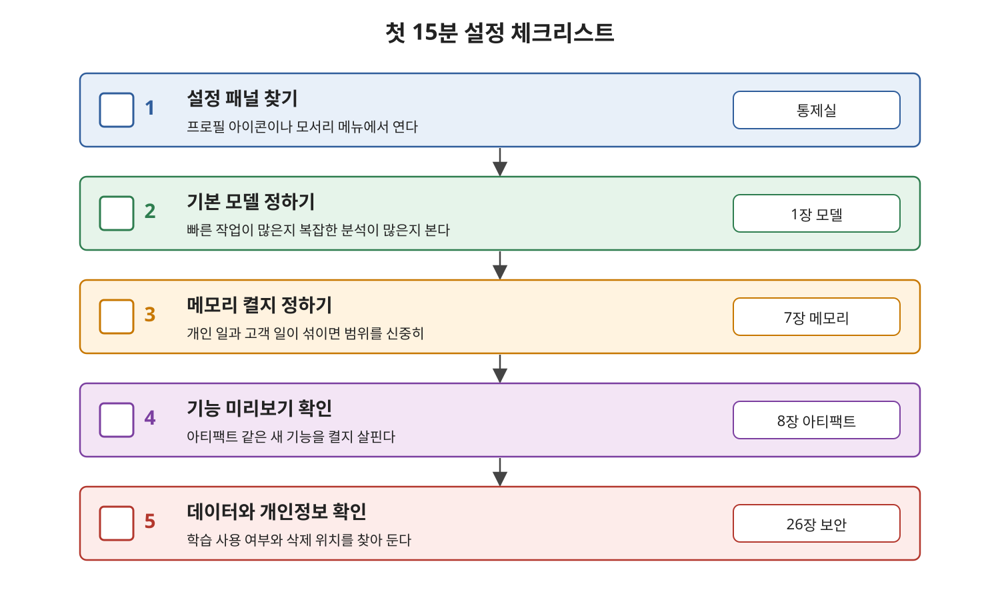

# 2장 작업 공간 제대로 세우기 (Setting Up Your Workspace the Right Way)

2장은 Claude 계정과 요금제를 고르고, 첫 15분의 설정을 마치고, 대화에 이름을 붙이는 규칙을 만드는 장이다. 책은 대부분의 사람이 첫 몇 주를 똑같이 보낸다고 말한다. 채팅 상자를 열고 질문하고 괜찮은 답을 받고 탭을 닫는 일을 정리 없이 몇 달 되풀이하다가, 어느 날 "3월에 Claude가 써 준 그 훌륭한 개요"를 찾으려 하면 "새 채팅"이라는 이름의 대화 마흔 개 밑에 묻혀 있다.

이 장의 목적은 그런 난장판을 치우는 것이 아니라 생기기 전에 막는 것이다. 지금 5분을 들이면 나중에 몇 시간의 검색을 아낀다. 첫 출근날 새 서류함을 세우는 일처럼 지루하지만, 몇 년 가는 시스템과 한 달 만에 버리는 시스템을 가른다.

> **참고(노트 작성자)** 요금제 이름, 가격, 한도, 설정 화면의 위치와 문구는 책이 쓰인 시점 기준이며 자주 바뀐다. 책도 숫자를 외우지 말고 계정 안의 현재 비교표를 보라고 한다.

---

## 1. 이 장의 목표와 핵심 용어

장을 마치면 실제 사용 패턴에 맞춰 요금제를 고르고, 각 요금제가 보통 무엇을 열어 주는지 알고, 첫 대화들이 "잡동사니 서랍"이 되지 않게 정리하고, 첫 주에 중요한 설정(기본 모델, 메모리, 기능 미리보기)을 마치고, 여섯 달 뒤에도 통하는 이름 규칙을 만들 수 있다.

- **요금제 등급(Plan Tier)**: Free, Pro 같은 구독 단계로 사용 한도와 쓸 수 있는 기능을 정한다.
- **기능 미리보기(Feature Preview)**: 설정에서 켜고 끌 수 있는 선택적, 때로 더 새로운 기능이다.
- **대화(Conversation, Chat)**: Claude와 주고받는 메시지 한 줄기다.
- **프로젝트(Project)**: 파일, 지침, 관련 대화를 한곳에 모아 두는 지속적 작업 공간이다(6장에서 본격적으로 다룸).
- **설정 패널**: 모델 기본값, 메모리, 데이터 제어, 미리보기 같은 계정 수준 환경설정을 다루는 곳이다.

## 2. 레슨 1: 실제 일하는 방식에 맞는 요금제 고르기

Anthropic은 Claude.ai에 여러 구독 등급을 두는데, 대체로 기본 접근의 무료 등급, 유료 개인 등급, 팀을 위한 비즈니스와 엔터프라이즈 등급으로 나뉜다. 이름, 가격, 한도는 바뀌므로 어떤 책의 숫자도 외우지 말고 결정 전에 계정이나 Anthropic 사이트의 현재 비교표를 보는 것이 옳은 습관이다.

요금제를 마케팅 문구로 고르는 것이 구매 후회의 가장 흔한 원인이다. 높은 등급을 사고 일부만 쓰는 사람도 있고, 무료 등급에 머물다가 한창 일이 잘될 때 한도에 부딪히는 사람도 있다. 올려야 할 때를 가리는 비기술적 시험은 이렇다. 시험 질문이 아닌 진짜 업무로 일주일 동안 사용을 기록한다. 사용 한도에 걸리거나, 큰 문서를 첨부하려는데 크기 때문에 거절되거나, 현재 등급이 허용하는 것보다 더 자주 깊은 추론 모델이 필요하다면 그것이 올릴 신호다. 마케팅 이메일은 신호가 아니다.

결정 절차는 세 단계다. 계정 설정에서 현재 비교표를 본다. 가벼운 일상 사용, 무거운 문서 작업, 팀 전체 도입 중 매주 패턴과 맞춰 본다. 생각하는 곳보다 한 단계 아래에서 시작하고 실제 한도에 닿으면 올린다. 월중에 올리는 편이 내렸을 때 돈을 낭비했다고 느끼는 것보다 쉽다. 일주일에 몇 번 블로그 초안을 쓰는 프리랜서 작가는 낮은 등급으로도 충분하지만, 매일 고객 프로젝트를 돌리며 긴 녹취록과 보고서를 올리는 컨설턴트는 같은 등급을 두 주 안에 넘어설 것이다.

주의할 점은 가장 비싼 요금제가 곧 더 나은 답을 뜻하지 않는다는 것이다. 높은 등급은 대체로 사용 한도를 늘리고 더 고급의 모델과 기능을 열어 줄 뿐, 같은 모델이 낮은 등급 사용자에게 쓰는 것과 다르게 쓰지는 않는다. 두 등급 사이에서 망설일 때는 가격만이 아니라 문서와 컨텍스트 한도, 모델 접근을 보라. 전문 업무의 실제 기능 차이는 대개 거기 있다. 분기마다 요금제를 다시 점검하는 것이 좋은 습관이다.

## 3. 레슨 2: 첫 15분, 정말 중요한 설정

처음 로그인하면 바로 질문부터 입력하고 싶겠지만 15분을 이 설정에 쓰라고 책은 권한다.



1. **설정 패널 찾기.** 보통 프로필 아이콘이나 구석 메뉴에서 연다. 통제실이다.
2. **기본 모델 정하기(가능하면).** 일부 인터페이스는 새 대화의 기본 모델을 정하게 해 준다. 1장의 원칙대로, 하루가 빠른 일이면 빠른 모델, 복잡한 분석이면 깊은 추론 모델을 고른다.
3. **메모리 정하기.** 메모리(7장)는 Claude가 별개의 대화들 사이에 사실과 선호를 가져가게 한다. 켤지 지금 의식적으로 정한다. 개인 일과 고객 일처럼 서로 다른 일을 섞어 쓴다면 무엇을 기억시킬지 더 신중해야 한다.
4. **기능 미리보기 확인.** 새 기능은 널리 풀리기 전에 선택 토글로 나온다. 어떤 것은 아티팩트(8장)처럼 곧바로 도움이 되고 어떤 것은 나와 무관하다.
5. **데이터와 개인정보 제어 확인.** 어떤 것이 Anthropic 모델 개선에 쓰이고 쓰이지 않는지, 내 데이터를 보고 지우는 방법의 위치를 알아 둔다. 26장에서 깊이 다루지만 위치는 지금 찾아 둔다.

## 4. 레슨 3: 이름 붙이기 문제

모든 대화는 첫 메시지를 바탕으로 자동 제목을 받는다. 내버려 두면 목록은 "이메일 초안", "이메일 도움", "또 이메일", "빠른 질문"처럼 비슷한 제목의 두루마리가 된다. 3주 전에 만든 것을 반드시 다시 찾아야 할 날이 오는데, 이름 체계가 엉망이면 그때마다 몇 분을 스크롤하고 짐작해야 한다. 이는 Claude를 쓰려던 시간 절약 효과를 조용히 갉아먹는다.

언제 이름을 바꾸나. "언젠가"가 아니라 다시 참조하고 싶은 대화가 되었다고 느끼는 바로 그때다. 책이 권하는 규칙은 이메일과 파일을 정리하는 전문가의 방식에서 빌린 이 형식이다.

```text
[분류] - [구체적 작업] - [날짜 또는 고객]
마케팅 - 3분기 뉴스레터 초안 - 7월
고객: Larsen Co. - 계약 검토 메모
개인 - 여행 계획 - 포르투갈
코드 - 재고 스크립트 디버깅
```

가치 있는 대화임을 깨닫는 순간 바로 바꾸는 것이 모범 사례다. 긴 세션이 끝난 뒤에는 세부를 잊는다. 흔한 실수는 이름 없는 채팅이 예순 개 쌓일 때까지 기다렸다가 소급 정리하려는 것이다. 그때는 습관이 아니라 잡일이 된다.

## 5. 레슨 4: 한 채팅, 여러 채팅, 프로젝트

초보자는 두 가지 실수 중 하나를 한다. 모든 것을 끝없이 커지는 단 하나의 대화에 쑤셔 넣거나, 작은 질문마다 새 채팅을 열어 연속성을 잃는 것이다. 책이 전편에서 쓰는 규칙은 아래와 같다.

| 상황 | 쓸 것 |
|------|-------|
| 자기완결적 단일 작업(이메일 한 통 초안) | 이름 붙인 채팅 하나 |
| 공유 맥락이 있는 반복 업무(고객, 책, 코드베이스) | 프로젝트(6장) |
| 서로 무관한 단발 질문 | 각각 개별 채팅. 기존 줄기에 억지로 넣지 않는다 |

이유는 이렇다. 무관한 일을 한 긴 채팅에 몰아넣으면 컨텍스트 윈도우(1장)가 관계없는 내용으로 차서 정말 중요한 것이 밀려난다. 관련된 일을 끊어진 단발 채팅으로 쪼개면 같은 배경을 계속 다시 설명하느라 시간을 버린다. 1장의 사무장 데이나는 처음에 고객 이메일, 사내 인사 질문, 새 소프트웨어 조사가 뒤섞인 "업무 잡동사니"라는 거대한 채팅 하나를 썼다. 이를 고객 소통 프로젝트, 인사 문서 프로젝트, 단발 조사용 개별 채팅으로 나누자 결과가 눈에 띄게 또렷해졌고 매번 고객 정보를 다시 설명할 필요가 없어졌다.

## 6. 레슨 5: 첫 실전 세션 따라 하기

제대로 설정된 첫 실전 세션을 해설과 함께 따라가 보자. 시나리오는 작은 사업주가 고객 후속 이메일 시퀀스를 Claude로 쓰는 것이다.

1. **분명한 범위의 이름 붙은 채팅으로 시작한다.** 일회성 초안이라 아직 프로젝트가 아니다.
2. **첫 메시지에 필요한 것을 다 담는다.** 책의 예는 작은 식물 농원이다. 첫 구매 후 고객에게 보낼 세 통의 시퀀스를 요청한다. 즉시 보내는 감사와 관리 팁, 7일째 안부, 21일째 계절 상품의 부드러운 추가 판매다. 브랜드 어조는 따뜻하고 약간 장난스럽고 절대 강요하지 않는다. 이전에 보낸 이메일 한 통을 붙여 어조를 맞추게 한다.

```text
작은 식물 농원이야. 첫 구매 고객용 후속 이메일 3통을 써 줘.
1통 즉시(감사+관리 팁), 2통 7일째(안부), 3통 21일째(계절 상품 소프트 업셀).
어조는 따뜻하고 약간 장난스럽게, 절대 강요하지 않기.
어조 참고용으로 예전 이메일을 붙인다: [붙여 넣은 예시]
```

3. **무엇이 이미 잘됐는지 확인한다.** 구체적 과제, 구체적 구조(세 통, 정해진 시점과 목적), 설명한 어조, 목소리를 맞출 실제 예시가 모두 있다. 이 메시지 하나가 모호한 프롬프트로 몇 시간 시행착오하는 것보다 낫다.
4. **첫 답이 오면 바로 대화 이름을 바꾼다.** 예: `마케팅 - 구매 후 이메일 시퀀스 - 농원`.
5. **다시 시작하지 말고 이어서 고친다.** 2통의 둘째 문단이 너무 격식 차렸다면 새 채팅을 열지 말고 같은 줄기에서 "첫 이메일의 장난스러운 어조에 맞춰 풀어 줘"라고 한다. Claude는 지금까지 만든 전체 맥락을 갖고 있다.
6. **끝나면 프로젝트로 키울지 정한다.** 계절 캠페인을 정기적으로 돌린다면 단발 채팅에서 프로젝트(6장)로 올라갈 일이다.

## 7. 비즈니스 예시: Norrland Studio

두 명이 일하는 건축사무소 "Norrland Studio"는 구조 없이 시작했다. 공유 계정 하나, 고객 제안서와 사내 메모와 두 파트너의 개인 질문이 섞인 한 줄기 대화였다. 한 달 만에 3주 전의 제안서 초안을 찾지 못했고, 무관한 내용이 부푼 그 줄기에서 Claude의 답도 모호해졌다.

이들은 구조를 바꿨다. 파트너마다 별도 계정, 진행 중인 고객마다 프로젝트 하나, 사내 행정 질문은 이름 붙인 개별 채팅, 금요일 5분 습관으로 그 주의 쓸 만한 채팅을 이름 바꾸고 보관한다. 두 주 안에 두 파트너 모두 과거 작업을 몇 분이 아닌 몇 초에 찾았고, 고객별 프로젝트 맥락이 집중되어 있어서 Claude가 쓰는 초안도 계속 적절했다. 교훈은 구조가 관료주의가 아니라 Claude가 내는 결과의 질을 직접 높인다는 것이다. 집중된 맥락이 집중된 결과를 낳는다.

## 8. Claude 대화 예시

사용자가 같은 프로젝트에 관한 일인데도 매일 새 채팅을 시작해도 되는지 묻는다. Claude의 답의 요지는 이렇다.

> 나쁘다고는 못 하지만 매번 유용한 맥락을 잃고 있을 가능성이 큽니다. 같은 고객, 같은 문서, 같은 코드베이스처럼 한 가지 일에 관한 채팅이라면, 이름을 잘 붙인 한 줄기를 이어 가거나 더 좋게는 이런 반복 맥락을 위해 설계된 프로젝트로 만드는 편이 결과가 일관되고 배경을 다시 설명하는 수고도 덜어 줍니다. 새 채팅은 서로 정말 무관한 주제에 아껴 두세요.

## 9. 연습과 미니 프로젝트

연습은 네 가지다. 첫째, 지난주 실제 사용 패턴(처음이면 예상 패턴)을 적고 현재 요금제 비교표와 솔직하게 맞춰 본 뒤 맞다, 조정 필요 중 정한다. 둘째, 지금 내 계정에서 레슨 2의 다섯 설정을 모두 끝낸다. 셋째, 이미 있는 대화 중 가장 쓸모 있는 셋을 이름 규칙대로 바꾼다. 넷째, 최근 열 개 대화를 "프로젝트였어야 함", "단발 채팅으로 충분", "다른 주제와 섞이면 안 됐음"으로 분류한다.

미니 프로젝트 "작업 공간 제로"는 오래 써 왔더라도 이번 주에 작업 공간을 처음부터 다시 세우는 일이다. 요금제가 실제 사용에 맞는지 확인하고, 15분 설정을 마치고, `[분류] - [작업] - [날짜/고객]` 형식을 적은 이름 규칙 문서를 포스트잇 수준으로라도 만들고, 프로젝트가 될 만한 반복 업무 하나를 정하고(6장에서 만든다), 남기고 싶은 기존 대화는 모두 이름을 바꾸거나 보관한다.

## 10. 흔한 실수와 문제 해결

| 증상 | 가능한 원인 | 해결 |
|------|-------------|------|
| 작업 도중 사용 한도에 걸림 | 요금제가 실제 사용과 안 맞음 | 레슨 1의 시험으로 재평가 |
| 지난 대화를 못 찾음 | 이름 규칙 없음 | 앞으로 규칙 적용, 지금 찾을 수 있는 것부터 이름 바꾸기 |
| Claude의 답이 산만함 | 한 긴 채팅에 무관한 내용이 많음 | 새 채팅이나 프로젝트(6장)로 분리 |
| 같은 배경을 계속 다시 설명함 | 관련 작업을 끊어진 단발 채팅으로 쪼갬 | 이름 붙인 한 줄기나 프로젝트로 통합 |

가격만 보고 요금제를 고르는 것(문서 크기 한도와 모델 접근 확인 없이), 모든 대화를 모호한 자동 제목으로 두는 것, 한 곳에 모은다며 무관한 일을 한 채팅에 몰아넣는 것, 같은 작업의 작은 후속 질문마다 새 채팅을 여는 것, 첫 로그인 뒤 사용이 변해도 설정을 다시 보지 않는 것도 피할 실수다.

## 11. 장 요약

- 요금제는 마케팅 문구가 아니라 일주일의 실제 사용으로 고르고 주기적으로 다시 점검한다.
- 첫 실전 세션 전에 15분을 투자해 모델 기본값, 메모리, 기능 미리보기, 개인정보 제어를 정한다.
- 단순한 일관된 이름 규칙을 소급이 아니라 즉시 적용한다.
- 일에 맞는 그릇을 고른다. 일회성은 단일 채팅, 반복 맥락은 프로젝트, 무관한 주제는 별도 채팅이다.
- 잘 구조화된 작업 공간은 집중된 맥락 덕분에 답의 질을 직접 높인다.

## 12. 실행 체크리스트

- [ ] 일주일 실제 사용으로 요금제를 점검했다.
- [ ] 15분 설정 점검을 마쳤다.
- [ ] 이름 규칙이 있고 몇몇 채팅에 적용했다.
- [ ] 단일 채팅, 여러 채팅, 프로젝트를 언제 쓰는지 안다.
- [ ] "작업 공간 제로" 미니 프로젝트를 마쳤다.

퀴즈는 네 문항이다. 요금제를 올려야 하는지의 가장 좋은 시험 고르기, 대화 이름을 언제 바꾸나, 무관한 일을 한 채팅에 몰아넣으면 답의 질이 좋아지는지 참과 거짓, 지속적인 고객 관계 같은 반복 업무에 맞는 그릇 고르기다. 더 해 볼 것으로는 다음 한 달 동안 매주 말 5분씩 그 주 채팅을 이름 바꾸고 정리하는 것(책은 이 습관이 다른 어떤 팁보다 복리로 쌓인다고 말한다), 30일 뒤 추측이 아닌 실제 데이터로 요금제 결정을 다시 보는 것이 있다.

<br>
<br>
<br>

[Mastering Claude AI](../)
