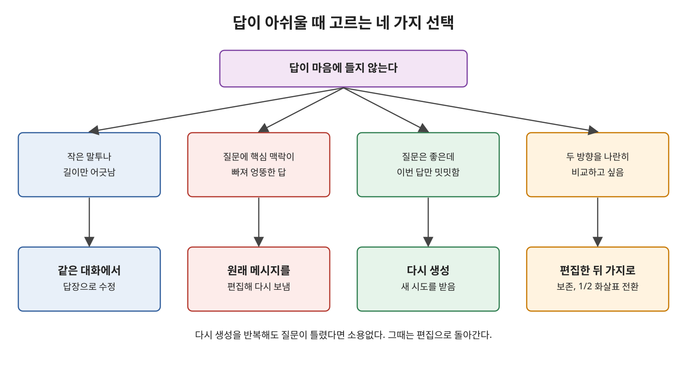

# 3장 대화 인터페이스 제대로 이해하기 (The Conversation Interface, Properly Understood)

3장은 채팅 화면의 숨은 도구들, 곧 메시지 편집, 가지치기, 다시 생성, 파일 첨부, 확장 사고, 그리고 답을 비판적으로 읽는 법을 다룬다. 저자는 대부분 입력하고 읽고 다시 입력하는 시행착오로 인터페이스를 익히며, 그것이 가치의 70퍼센트를 준다고 말한다. 이 장은 나머지 30퍼센트, 곧 "Claude를 쓰는 사람"과 "Claude와 효율적으로 일하는 법을 익힌 사람"을 가르는 기능들을 다룬다.

내용은 어렵지 않지만 우연히 발견하기도 어렵다. 매일 쓰는 소프트웨어의 키보드 단축키를 배우는 것과 같아서, 하나하나는 작아도 일 년이면 시간 차이가 커진다.

> **참고(노트 작성자)** 아이콘 모양, 토글 위치, 기능 이름은 책이 쓰인 시점 기준이며 화면마다 다를 수 있다. 책도 "보통", "대개"라는 표현을 쓰며 내 화면에서 직접 확인하라고 한다.

---

## 1. 이 장의 목표와 핵심 용어

장을 마치면 채팅 화면의 핵심 요소를 우연이 아니라 의도로 다루고, 편집, 가지치기, 다시 생성으로 좋은 작업을 잃지 않고 대안을 탐색하고, 파일, 이미지, PDF를 올바르게 첨부하고, 확장 사고의 원리와 쓸 때를 이해하고, 얼버무림과 확신의 표지, 확인이 필요한 주장의 신호를 읽어낼 수 있다.

- **메시지 편집**: 이미 보낸 메시지를 고쳐 그 지점부터 대화의 새 버전을 만드는 것이다.
- **가지치기(Branching)**: 대화의 특정 지점에서 원래 흐름을 잃지 않고 다른 방향을 탐색하는 것이다.
- **다시 생성(Regenerate)**: 같은 메시지에 새 답을 요청하는 것으로, 첫 시도가 빗나갔을 때 쓴다.
- **확장 사고(Extended Thinking)**: Claude가 답하기 전에 눈에 보이는 더 깊은 단계로 문제를 풀어 가는 모드다. 복잡한 추론에 유용하다.
- **첨부(Attachment)**: Claude가 읽고 쓰도록 대화에 더한 파일, 이미지, 문서다.
- **시스템 프롬프트 / 사용자 지침**: 반복하지 않고 한 번 정해 대화나 프로젝트 전체에서 Claude의 행동을 이끄는 상시 지침이다.

## 2. 레슨 1: 대화의 해부

Claude 대화는 단순한 주고받기 구조지만, 지적받지 않으면 놓치기 쉬운 부분이 있다.

- **메시지 상자**: 입력하는 곳이다. 보통 파일 첨부, 웹 검색 토글, 모델 선택 컨트롤도 같은 영역에 있어 메뉴 깊이 숨어 있지 않다.
- **응답**: Claude의 답이다. 코드, 긴 문서, 표, 도표처럼 길거나 구조적인 답은 자동으로 별도 패널에 열리는데 이것이 아티팩트다(8장). 짧은 대화형 답은 채팅 안에 남는다.
- **메시지 컨트롤**: 내 메시지나 Claude의 메시지에 마우스를 올리거나 탭하면 복사, 편집, 다시 생성 같은 옵션이 보인다. 이 장 레슨 2와 3의 도구다.
- **대화 목록**: 사이드바나 메뉴에 지난 채팅이 보인다. 2장의 이름 규칙을 적용하면 훨씬 쓸모 있어진다.

## 3. 레슨 2: 메시지 편집, 가장 덜 쓰이는 도구

이전에 보낸 메시지를 편집하면 대화의 그 지점이 다시 쓰이고 거기서부터 새 답이 생성되어, 이후에 있던 것이 새 방향으로 대체된다.

초보자는 평범한 답을 받고 나서야 프롬프트가 조금 틀렸다는 것을 알아채고, 본능적으로 새 메시지로 "좀 더 격식 있게 해 줄래?" 같은 교정을 보낸다. 작은 손질에는 괜찮다. 하지만 원래 프롬프트가 구조적으로 틀렸다면, 곧 핵심 맥락이 빠졌거나 형식이나 독자가 틀렸다면, 흠 있는 토대를 후속 교정으로 덧대는 것보다 원본 메시지를 편집해 다시 시도하는 편이 더 깨끗한 결과를 낸다.

| 상황 | 가장 좋은 선택 |
|------|----------------|
| 어조나 길이의 작은 손질 | 같은 줄기에서 평소처럼 답장 |
| 원래 프롬프트에 핵심 맥락이 빠짐 | 원본 메시지를 편집해 추가 |
| 현재 것을 잃지 않고 완전히 다른 각도 시도 | 편집 후 가지치기(레슨 3) |

방법은 내 메시지의 편집 옵션(보통 연필 아이콘, 마우스를 올리거나 탭하면 나옴)을 찾아 바꾸고 다시 보내는 것이다. 대화는 새 버전에서 이어진다. 예를 들어 "이 보고서를 요약해 줘"에 평범한 요약이 왔다. 누구를 위한 것인지 빠뜨렸다는 걸 깨닫는다. 이사회와 인턴에게 필요한 요약은 전혀 다르기 때문이다. "좀 더 임원용으로"라고 답하지 말고 원본을 이렇게 고친다.

```text
이 보고서를 이사회용으로 요약해 줘. 이사들은 5분밖에 없고
주로 재무 위험에 관심이 있어.
```

사후 패치보다 근본적으로 나은 결과가 나온다. 답이 "옳은 문제를 서투르게 푼" 것이 아니라 "틀린 문제를 푼" 것 같다면 아래쪽에서 고치려 하지 말고 근원 메시지를 편집하라는 것이 모범 사례다. 흔한 실수는 원래 프롬프트가 불분명했을 뿐인데 교정에 교정을 거듭 보내서 대화가 길고 지저분해지고 답이 덧대어 붙인 결과가 되는 것이다.

## 4. 레슨 3: 가지치기, 둘 다 잃지 않고 두 방향 시도

원본 메시지를 편집하면 많은 인터페이스가 원래 버전도 남겨 두고(작은 화살표나 버전 표시로), 대화의 "가지", 곧 원래 길과 새 길 사이를 오갈 수 있게 한다.

그러면 진짜로 실험할 수 있다. 한 가지에서는 격식 있는 어조를, 다른 가지에서는 편안한 어조를 시도해 비교하고 승자를 고를 수 있다. 응답을 문서에 복사해 두거나 첫 버전을 잃을 필요가 없다. 어느 방향이 나은지 정말 모르고 짐작하지 않고 실제 결과를 나란히 비교하고 싶을 때 쓴다. 방법은 메시지를 편집한 뒤 그 메시지 근처의 작은 탐색 화살표("1/2" 같은 표시)로 원래 버전과 편집 버전, 각각의 결과 답을 오가는 것이다.

책의 예는 마케팅 담당자가 광고 문구를 세 갈래로 가지치기하는 것이다. 가격을 강조하는 것, 배송 속도를 강조하는 것, 고객 후기를 강조하는 것이다. 셋 다 같은 대화 안에 가지로 있어 가장 강한 것을 골라도 나머지를 기억으로 복원할 필요가 없다. 가지치기는 마케팅 문구의 A/B 비교, 고객 소통의 어조 테스트, 같은 문제에 대한 두 코드 접근 비교에 특히 쓸모 있다.

## 5. 레슨 4: 답 다시 생성하기

프롬프트는 괜찮았는데 그 특정한 답이 최선이 아닐 때가 있다. Claude의 응답은 같은 프롬프트에도 매번 똑같지 않기 때문이다. 다시 생성은 같은 메시지에 새 시도를 요청한다.

- 프롬프트가 문제였다면 편집한다(레슨 2).
- 프롬프트는 괜찮았지만 이번 답이 밋밋하거나 뭔가 빠졌거나 다른 안을 보고 싶다면 다시 생성한다.

새 제품의 슬로건 다섯 개를 요청했는데 첫 묶음이 무난하지만 평범하다. 프롬프트를 다시 쓰지 않고 다시 생성해 새 다섯 개를 받아 두 묶음을 비교한다. 흔한 실수는 근본적으로 다른 종류의 답을 바라며 계속 다시 생성하는 것이다. 실제로 필요한 것은 더 분명하고 구체적인 프롬프트이니 이때는 다시 생성이 아니라 편집이다.



## 6. 레슨 5: 파일, 이미지, 문서를 올바르게 첨부하기

PDF나 Word 파일 같은 문서, 이미지, 스프레드시트 등을 원시 텍스트로 붙여 넣는 대신 대화에 직접 첨부해 Claude가 읽게 할 수 있다. 큰 텍스트를 직접 붙여 넣어도 작동하지만 대개 더 지저분하고, 특히 길거나 복잡한 문서에서는 제대로 된 첨부보다 컨텍스트 윈도우를 비효율적으로 쓰게 된다. 첨부는 붙여 넣을 때 잃기 쉬운 표와 서식 같은 구조도 보존한다.

붙여 넣는 경우는 참고 텍스트 몇 문장이나 짧은 문단이다. 여러 쪽의 문서, 스프레드시트, PDF는 실제 파일을 첨부한다. Claude가 해석할 스크린샷이나 사진은 이미지로 첨부한다. 방법은 메시지 상자 근처 첨부 아이콘으로 파일을 고르고 같은 메시지에 지시를 쓰는 것이다. 예를 들어 첨부한 PDF와 함께 "이 계약서의 핵심 위험을 요약해 줘"라고 쓴다.

대학원생이 관련 논문 PDF 세 편을 한 대화에 첨부하고 방법론이 어디서 일치하고 갈리는지 찾아 달라고 한다. 세 PDF에서 추출한 원문을 손으로 붙여 넣는 것보다 훨씬 효과적이고 오류도 적다. 모범 사례는 파일에 대해 무엇을 할지 명시적 지시를 항상 함께 주는 것이다. 첨부만 하고 "이거 봐 줘"라고만 하는 것은 정말 흔한 초보자 실수이며 4장에서 더 다룬다. 또 아주 크거나 이미지만 있는 스캔 PDF가 완벽히 추출되리라 기대하는 것도 실수다. 선택할 수 있는 텍스트가 없는 스캔은 직접 읽기보다 OCR(그림 속 글자를 텍스트로 바꾸는 기술) 처리가 필요할 수 있고 10장에서 다룬다.

## 7. 레슨 6: 확장 사고, Claude가 풀이 과정을 보여줄 때

어떤 모델과 모드는 최종 답을 내기 전에 문제를 눈에 보이는 더 신중한 단계로 풀게 해 준다. 다단계 추론, 복잡한 분석, 성급히 답으로 가면 놓칠 위험이 있는 문제에 유용하다.

단순한 요청에는 불필요한 시간만 더한다. 하지만 정말 복잡한 문제, 예컨대 여러 조항의 논리 퍼즐, 경쟁하는 트레이드오프가 있는 까다로운 사업 결정, 미묘한 코딩 버그에서는 더 신중하고 근거 있는 결과를 내는 경우가 많다. 복잡하고 여러 단계이거나 위험이 큰 추론에 쓰고, 빠르고 단순한 요청에는 지연만 늘리므로 건너뛴다. 인터페이스에 따라 토글일 수도 있고, 특정 모델 변형일 수도 있고, Claude에게 답하기 전에 단계별로 생각해 달라고 직접 요청하는 방식일 수도 있다.

가격 구조, 계약 기간, 숨은 수수료가 다른 세 공급사 제안을 비교하는 사용자는 확장 사고의 이점을 본다. 서로 맞물리는 변수가 충분히 많아서 신중하고 구조적인 검토가 빠른 한 번의 답보다 믿을 만한 비교를 낸다. 복잡한 질문에 대한 답이 성급해 보이거나 뻔한 요소를 놓친다면, 일이 능력 밖이라고 단정하기 전에 확장 사고나 더 능력 있는 모델(1장)을 써 보라는 것이 책의 신호다.

## 8. 레슨 7: Claude의 답을 비판적으로 읽기

기능이 아니라 기술이지만, 인터페이스와 그 출력과 어떻게 상호작용하느냐의 문제이므로 이 장에 속한다.

- **얼버무림 표현**("가능성이 있다", "일부 자료는 ...라고 한다", "확신하지 못하겠다")을 주의한다. 진짜 불확실성을 알리는 신호인 경우가 많으니 그냥 읽고 넘기지 말고 진지하게 받아들인다.
- **출처 없는 지나치게 구체적인 숫자나 인용**을 주의한다. 특히 통계, 인용문, 날짜에서 전형적인 환각 위험 패턴이다(1장).
- **진짜로 논쟁적이거나 미묘한 질문에 대한 자신 있고 깔끔한 답**을 주의한다. 전문가 사이에 실제 이견이 있는 주제에서 수상할 만큼 정돈된 한쪽 답은 다시 볼 만하다.

모범 사례는 어떤 출력이든 쓰기 전에 2초짜리 직관 점검 습관을 들이는 것이다. "이것은 틀리면 창피하거나 비용이 큰 종류의 주장인가? 그렇다면 확인했는가?"

## 9. 비즈니스 예시: 비영리단체 지원금 제안서

비영리단체의 지원금 작성자 마커스는 방과후 프로그램 후원 제안서를 쓴다. 첫 프롬프트는 넓었다. "방과후 프로그램 후원금을 위한 제안서를 써 줘." 탄탄하지만 평범한 초안을 받았다. 처음부터 다시 하는 대신 원래 메시지를 편집해 구체 내용을 더했다. 해당 지원금이 명시한 우선순위, 프로그램의 실제 성과 데이터, 후원사가 선호하는 어조(감정에 호소하기보다 데이터 중심)다. 훨씬 강한 토대가 나왔다. 이어 가지치기로 마무리 절의 두 버전을 시험했다. 데이터로 시작하는 것과 짧은 이야기로 시작하는 것이다. 둘 다 책임자에게 보여 주고 결정했다.

교훈은 편집이 토대를 고치고 가지치기가 완성된 대안을 다시 작업하지도 한쪽을 잃지도 않고 비교하게 했다는 것이다.

## 10. Claude 대화 예시

사용자가 2분기 매출 보고서를 첨부하고 매출이 늘었는지 묻는다. Claude의 보정된 답은 대략 이렇다.

> 첨부한 보고서 기준으로 매출은 1분기 34만 달러에서 2분기 40만 2천 달러로, 약 18퍼센트 늘었습니다. 한 가지 짚을 점이 있습니다. 보고서는 일회성 매출과 반복 매출을 나누지 않아서, 이 문서만으로는 그 성장이 지속적인 추세인지 일회성 계약 덕인지 말씀드릴 수 없습니다. 보고서 작성자에게 보낼 후속 질문으로 적어 둘까요?

여기서 얼버무림과 한계의 명시적 표시에 주목하라. 거짓 자신감이 아니라 보정된 응답이라는 신호다.

## 11. 연습과 미니 프로젝트

연습은 네 가지다. 첫째, 최근 평범했던 답에서 원래 프롬프트에 빠진 맥락을 찾아 메시지를 편집하고 결과를 비교한다. 둘째, 어조 선택이 분명한 것(이메일, 제목, 소개글)을 하나 받고 편집으로 가지를 쳐서 다른 어조를 시도해 둘을 비교한다. 셋째, 가진 실제 문서를 첨부하고 "이거 봐 줘"가 아닌 구체적 지시를 한다. 넷째, 최근 다섯 대화에서 얼버무림 표현이 나온 곳을 찾아 내가 그 주장을 확인했는지, 했어야 했는지 판단한다.

미니 프로젝트 "세 가지 비교"는 필요한 실제 글(이메일, 소셜 게시물, 짧은 제안 문단) 하나로 한 대화에서 진행한다. 실제 맥락과 어조 안내를 담은 잘 지정한 프롬프트 하나를 쓰고, 첫 답을 받고, 편집과 가지치기로 어조나 각도가 다른 두 대안을 만들고, 세 개를 나란히 비교해 가장 강한 것을 고르고 이긴 이유를 적는다.

## 12. 흔한 실수와 문제 해결

| 증상 | 가능한 원인 | 해결 |
|------|-------------|------|
| 답이 엉뚱한 문제를 풂 | 원래 프롬프트에 핵심 맥락이 빠짐 | 아래에서 덧대지 말고 원본 메시지를 편집 |
| 편집 후 이전 버전을 못 찾음 | 가지 탐색을 못 봄 | 편집한 메시지 근처의 작은 버전 화살표를 찾기 |
| 첨부 PDF가 제대로 안 읽힘 | 스캔이거나 이미지뿐인 문서 | OCR과 스캔 문서 워크플로는 10장 참고 |
| 복잡한 문제에 답이 얕음 | 확장 사고나 더 깊은 모델을 안 씀 | 확장 사고나 더 능력 있는 모델 등급 시도 |

교정에 교정을 거듭 보내는 것, 큰 문서를 첨부 대신 채팅에 직접 붙여 넣는 것, 구체적 지시 없이 파일만 첨부하는 것, 답의 얼버무림을 무시하는 것, 사소한 요청에 확장 사고를 써서 이득 없이 기다리는 것도 피할 실수다.

## 13. 장 요약

- 인터페이스에는 입력하고 읽기 이상의 도구가 있다. 편집, 가지치기, 다시 생성, 첨부, 확장 사고는 각각 쓰임이 다르다.
- 프롬프트가 틀렸다면 편집하고, 프롬프트는 괜찮은데 그 답이 아쉬웠다면 다시 생성한다.
- 가지치기는 어느 쪽도 잃지 않고 실제 대안 결과를 비교하게 해 준다.
- 긴 텍스트는 붙여 넣기보다 실제 파일을 첨부하고 항상 구체적 지시를 함께 준다.
- 확장 사고는 진짜로 복잡한 다단계 추론에 쓰고 단순한 요청에는 쓰지 않는다.
- 답을 비판적으로 읽는다. 얼버무림과 근거 없이 구체적인 주장은 확인하라는 신호다.

## 14. 실행 체크리스트

- [ ] 채팅 화면의 핵심 부분을 찾느라 헤매지 않고 짚을 수 있다.
- [ ] 흠 있는 프롬프트를 메시지 편집으로 고쳐 봤다.
- [ ] 가지치기로 두 실제 대안을 비교해 봤다.
- [ ] 실제 문서를 구체적 지시와 함께 첨부해 봤다.
- [ ] 확장 사고가 언제 가치 있는지 안다.

퀴즈는 네 문항이다. 답장 대신 이전 메시지를 편집해야 할 때 고르기, 가지치기의 주된 이점 고르기, 20쪽 문서를 채팅에 직접 붙여 넣는 것이 대체로 최선인지 참과 거짓, 모든 첨부에 따라와야 할 것 고르기다. 더 해 볼 것으로는 다음 한 주 동안 편집과 가지치기를 실제 일에 각각 한 번 이상 의도적으로 쓰는 것(첫 본능이 후속 교정을 치는 것이더라도), 일주일간 얼버무림 표현을 알아채는 연습을 하는 것이 있다. 찾기 시작하면 더 자주 보이게 된다.

<br>
<br>
<br>

[Mastering Claude AI](../)
