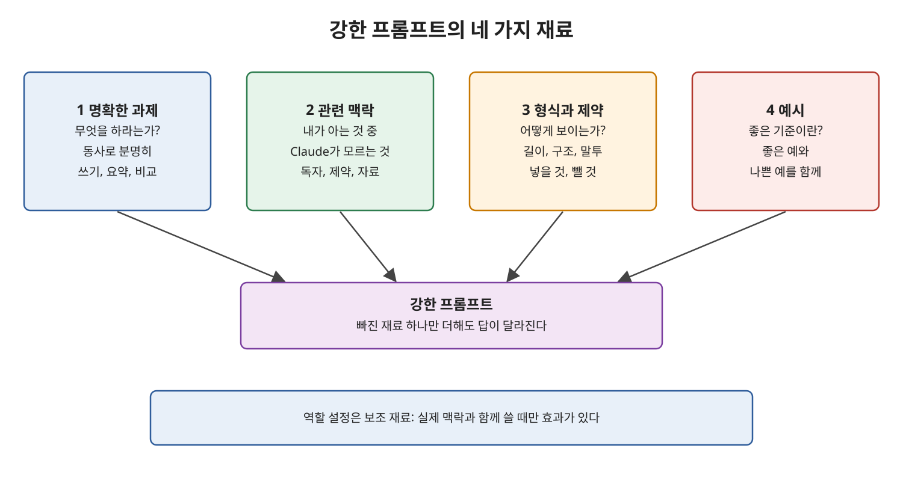

# 4장 프롬프트 기본기 (Prompting Fundamentals: Getting Good Output on the First Try)

4장은 첫 시도에서 좋은 결과를 얻는 프롬프트의 틀을 다룬다. 저자는 프롬프트가 마법이나 숨겨진 능력을 여는 비밀 주문이 아니라고 말한다. 훨씬 익숙한 일, 곧 당신의 마음을 읽지 못하는 유능한 사람에게 분명한 지시를 주는 일에 가깝다. 신입, 프리랜서, 외주업체에게 업무를 설명해 본 사람이라면 본능의 대부분을 이미 갖고 있고, 이 장은 그것을 명시하고 Claude에 맞춰 적용할 뿐이다.

저자는 이 장이 책 전체에서 레버리지가 가장 큰 장일 것이라고 한다. 프로젝트, 아티팩트, 자동화, 코드 등 나머지가 모두 원하는 것을 분명히 말하는 능력 위에 서 있다. 이를 제대로 하면 다른 모든 장이 복리로 쌓이고, 건너뛰면 몇 년간 평범한 결과를 받고 도구를 탓하게 된다.

> **참고(노트 작성자)** 프롬프트 예시는 취지를 살려 우리말로 옮긴 것이다. 책의 영어 원문을 그대로 번역한 것이 아니다.

---

## 1. 이 장의 목표와 핵심 용어

장을 마치면 어떤 과제에도 쓸 수 있는 반복 가능한 틀로 프롬프트를 구성하고, 약한 프롬프트와 강한 프롬프트를 가르는 네 재료를 구별하고, 좋은 예와 나쁜 예로 결과를 정밀하게 이끌고, 크고 모호한 요청을 작고 분명한 단계로 쪼개고, 특정 답이 어긋난 이유를 진단해 증상이 아니라 프롬프트 문제의 뿌리를 고칠 수 있다.

- **프롬프트(Prompt)**: 메시지에서 Claude에게 주는 지시나 질문이다.
- **역할 설정(Role Framing)**: "특허 변호사가 설명하듯이"처럼 Claude가 어떤 관점이나 전문성으로 답할지 알려 주는 것이다.
- **퓨샷 예시(Few-Shot Example)**: 원하는 결과 형태를 설명만 하지 않고 하나 이상의 예로 보여 주는 것이다.
- **부정 제약(Negative Constraint)**: 넣을 것만이 아니라 피할 것도 알려 주는 것이다.
- **사고의 사슬 프롬프팅(Chain-of-Thought)**: 곧바로 최종 답으로 가지 않고 단계별로 추론해 달라고 요청하는 것이다.
- **출력 형식 지정**: 표, 불릿 목록, 단어 수 등 원하는 답의 구조를 명시하는 것이다.

## 2. 레슨 1: 강한 프롬프트의 네 재료

과제가 무엇이든 강한 프롬프트에는 다음 네 재료의 어떤 조합이 들어 있기 마련이다. 모든 프롬프트에 네 가지가 다 필요한 것은 아니지만, 존재를 알면 답이 아쉬울 때 빠진 것을 더할 수 있다.



1. **명확한 과제.** 원하는 일을 행동 동사로 정확히 적는다. 쓰기, 요약하기, 비교하기, 디버깅하기, 번역하기, 구조 바꾸기, 비평하기다.
2. **관련 맥락.** Claude가 일을 잘하는 데 필요한 배경이다. 독자, 제약, 기존 자료(3장의 첨부 참고)가 해당한다.
3. **형식과 제약.** 어떤 모양으로 받고 싶은가. 길이, 구조, 어조, 넣을 것과 뺄 것이다.
4. **예시(도움이 될 때).** 말하기만 하지 않고 보여 준다. 목표로 하는 어조, 구조, 품질 기준의 견본이다.

이 틀이 통하는 이유는 각 재료가 Claude가 달리 짐작해야 할 서로 다른 질문에 답하기 때문이다. 무엇을 원하는가, 내가 모르지만 당신은 아는 것은 무엇인가, 어떻게 보여야 하는가, 당신에게 "좋음"이란 구체적으로 무엇인가. 모호한 프롬프트는 이 중 하나 이상을 비워 두어 Claude가 짐작하게 만들고, 짐작은 평범한 쪽으로 기운다.

## 3. 레슨 2: 약한 프롬프트와 강한 프롬프트 나란히 보기

책의 비교 예시는 링크드인 게시물이다. 약한 쪽은 "우리 신제품에 관한 링크드인 글을 써 줘" 한 줄이다. 강한 쪽은 다음과 같다.

```text
재사용 커피 필터인 신제품을 알리는 링크드인 글을 써 줘.
독자: 환경을 생각하는 30-50세 직장인.
어조: 자신 있되 훈계하지 않기. 플라스틱 쓰레기로 죄책감을
주는 표현은 피해 줘.
널리 알려진 폐기물 감소 통계가 있으면 하나 넣고, 정확한
수치가 확실치 않으면 추정치라고 분명히 표시해 줘.
150단어 이내, 부드러운 행동 유도로 끝내고 강매는 하지 마.
```

달라진 점은 과제, 맥락(독자), 형식과 제약(어조, 길이, 구조), 어조 기준의 암묵적 예시("자신 있되 훈계하지 않기")가 모두 들어갔다는 것이다. 통계에 불확실성을 표시하라고 해서 환각 위험(1장)을 선제적으로 관리하기도 했다. 흔한 실수는 긴 프롬프트가 자동으로 좋다고 믿는 것이다. 실제 정보가 없는 긴 프롬프트는 여전히 약하다. 목표는 길이가 아니라 알맞은 재료의 존재다.

## 4. 레슨 3: 역할 설정, 쓰되 남용하지 않기

세무사, 교정 편집자, 시니어 개발자처럼 특정 전문가로서 답해 달라고 하면 어휘, 우선순위, 깊이를 유용하게 잡을 수 있다. 도움이 되는 경우는 두 가지다. 분야에 맞는 어휘와 우선순위를 원할 때("계약 전문 변호사처럼 검토하고 모호한 책임 조항을 짚어 줘"), 그리고 특정한 소통 방식을 원할 때("인내심 많은 경험 많은 교사가 완전 초보자에게 설명하듯이")다.

도움이 별로 안 되는 경우도 있다. 역할 설정은 실제 맥락을 주는 일의 대체물이 아니다. 제품, 독자, 목표의 세부 없이 "마케팅 전문가처럼 행동해"라고만 하면 여전히 평범한 답이 나오고, 자신만만하게 들리는 전문 용어만 늘 뿐이다. 모범 사례는 역할 설정을 실제 맥락과 짝지어 쓰고, 완전한 프롬프트인 양 혼자 쓰지 않는 것이다.

약한 예는 "영양사처럼 조언해 줘"다. 더 나은 예는 "영양사가 환자에게 설명하듯이 비임상적인 쉬운 말로, 가벼운 소화 불편을 관리하는 사람에게 식이섬유 섭취가 왜 중요한지 설명해 줘. 구체적인 복용량 조언은 하지 마"이다.

## 5. 레슨 4: 긍정 예시와 부정 예시

원하는 것의 예(긍정 예시)와 원치 않는 것의 예(부정 예시)를 함께 보여 주는 것이 어조를 추상적으로 설명하는 것보다 효과적인 경우가 많다. "전문적", "캐주얼", "강렬한" 같은 말은 사람마다 다른 뜻이다. 실제 예가 모호함을 완전히 없앤다. 함께 쓰는 방식의 틀은 이렇다.

```text
내가 원하는 어조의 예: [예시 붙여 넣기]
내가 특별히 피하고 싶은 어조의 예, 너무 딱딱하고 기업적임:
[대조 예시 붙여 넣기]
첫 번째 어조에 맞고 두 번째는 아닌 새 버전 세 개를 써 줘.
```

비영리단체의 소통 담당자는 "기업의 후원 요청"이 아닌 개인적인 느낌의 모금 이메일을 원한다. "개인적이되 기업적이지 않게"라는 추상적 설명(말로 정의하기 정말 어렵다)이 아니라 좋아하는 이메일 한 통과 너무 딱딱하다고 느끼는 한 통을 붙여, 앞의 것을 향하고 뒤의 것을 멀리하라고 요청한다. 여러 번의 모호한 주고받기 없이 결과가 바로 맞아떨어진다.

흔한 실수는 긍정 예시만 주는 것이다. 부정 예시는 원치 않는 기본 성향, 예컨대 따로 말하지 않으면 약간 더 격식 있는 표현으로 기우는 Claude의 자연스러운 경향을 없애는 데도 똑같이 유용하다.

## 6. 레슨 5: 크고 모호한 요청을 단계로 쪼개기

"사업 계획을 만들어 줘", "마케팅 전략 전체를 도와줘" 같은 아주 크고 막연한 요청은 Claude가 복잡함을 못 다뤄서가 아니라 요청 자체가 "끝났다"의 모습을 정하지 않았기에 얕고 평범한 결과를 낸다. 경계가 없는 요청은 Claude가 범위를 짐작하게 만들고, 정작 중요한 곳의 깊이 대신 모든 것에 걸친 넓고 표면적인 훑기로 기본값을 잡기 쉽다.

해법은 "한 번에 한 단계" 기법이다. "마케팅 전략 전체를 도와줘" 대신 순서로 쪼갠다.

1. "목표 독자부터 시작하자. 필요하면 확인 질문을 하고, 독자층 두세 개를 제안해 줘."
2. (검토 후) "좋아, 두 번째 층으로 확정하자. 그 층에 맞는 메시지 각도 세 개를 제안해 줘."
3. (검토 후) "고른 각도로 이메일 한 통과 소셜 게시물 하나를 완성해 줘."

더 잘 되는 이유는 각 단계에 확인 가능한 분명한 결과물이 있고, Claude가 전략 전체를 한 번에 짐작해 헤쳐 가는 대신 각 단계가 내가 실제로 검토하고 승인한 결정 위에 쌓이기 때문이다. 한 메시지로 프롬프트하기에 일이 너무 크게 느껴진다면 대개 단계로 쪼개라는 신호이지 Claude가 도울 수 없다는 신호가 아니다.

## 7. 레슨 6: 단계별로 추론하게 하기

까다로운 계산, 여러 요인의 결정, 논리 퍼즐, 미묘한 분석처럼 정말 복잡한 문제에서는 Claude에게 "최종 답을 주기 전에 단계별로 생각해 줘"라고 명시적으로 요청하는 편이 답을 곧바로 묻는 것보다 더 신중하고 정확한 결과를 내는 경우가 많다. 그럴듯하지만 충분히 따져 보지 않은 답으로 달려가는 대신 더 의도적이고 구조적인 추론을 유도하며, 문제가 복잡할수록 중요해진다.

"가격을 10퍼센트 올릴까 15퍼센트 올릴까?" 대신 "고객 이탈 위험, 경쟁사 가격, 마진 영향을 고려해 10퍼센트와 15퍼센트 인상의 득실을 단계별로 짚어 본 뒤 최종 권고를 줘"라고 한다. 흔한 실수는 정말 단순한 질문에 이 기법을 써서 정확도 향상 없이 길이만 늘리는 것이다. 실제 복잡함이나 경쟁하는 요인이 여럿 있는 문제에 아껴 쓴다.

## 8. 비즈니스 예시: 스무 개 상품 설명

소규모 이커머스 창업자 레나타는 새 상품 스무 종의 설명이 필요하다. 첫 시도는 상품마다 세부가 거의 없는 프롬프트 하나씩이었고, 쓸 만하지만 기억에 안 남고 모두 조금씩 비슷하게 들리는 설명 스무 개가 나왔다.

그는 이 장의 틀로 접근을 다시 짰다. 브랜드 목소리의 긍정 예시, 경쟁사의 마음에 안 드는 설명이 나쁜 예시, 엄격한 형식(두 문장, 장점과 이점 짝 하나, 느낌표 금지)을 담은 마스터 프롬프트 하나를 쓰고, 스무 상품의 세부 정보를 같은 메시지 안의 구조화된 목록으로 넣었다. 결과는 한 번에 서로 다르고 브랜드에 맞는 스무 개였다. 처음에 빠졌던 재료, 곧 실제 맥락, 형식 제약, 예시가 두 번째에는 모두 있었기 때문이다. 해법은 "더 열심히 하기"나 "더 나은 도구"가 아니라 네 재료 중 무엇이 빠졌는지 진단해 의도적으로 더한 것이었다.

## 9. Claude 대화 예시

사용자가 앱의 슬로건 세 번의 시도가 모두 평범했다며 무엇이 문제인지 묻는다. Claude의 답의 요지는 이렇다.

> 프롬프트를 못 봤으니 짐작입니다만, 슬로건은 예시가 특히 중요한 경우예요. "눈길을 끄는"이나 "재치 있는"은 사람마다 뜻이 다르니까요. 다른 업종이어도 좋으니 감탄하는 제품의 슬로건 두세 개와, 유치하거나 너무 흔하다고 느끼는 슬로건 스타일 하나를 주세요. 그런 대조가 설명만 할 때보다 훨씬 빨리 범위를 좁혀 줍니다.

## 10. 연습과 미니 프로젝트

연습은 네 가지다. 첫째, 최근 Claude에게 보낸 프롬프트 다섯 개에 대해 네 재료(과제, 맥락, 형식, 예시) 중 무엇이 있고 없는지 확인한다. 둘째, 가장 약했던 최근 프롬프트를 네 재료로 다시 써서 두 버전을 돌려 비교한다. 셋째, 필요한 글(이메일, 게시물, 설명) 하나에 좋아하는 예와 싫어하는 예를 찾아 한 프롬프트에 함께 쓰고 결과를 평가한다. 넷째, 내 일의 크고 막연한 목표 하나를 레슨 5처럼 순서가 있고 범위가 분명한 프롬프트 세 개로 쪼갠다.

미니 프로젝트 "프롬프트 재건"은 과거에 Claude에게 요청했는데 실망스럽거나 평범하게 돌아온 결과물 하나를 고르는 것이다. 이 장의 모든 기법으로 프롬프트를 처음부터 다시 짠다. 네 재료 전부, 해당된다면 긍정과 부정 예시, 알맞으면 역할 설정, 실제로 큰 일이면 단계 쪼개기까지다. 새 버전을 돌려 전후를 비교한 두세 문장을 적는다.

## 11. 흔한 실수와 문제 해결

| 증상 | 가능한 원인 | 해결 |
|------|-------------|------|
| "자세한" 프롬프트인데도 결과가 평범함 | 길이와 무관하게 실제 맥락이나 예시가 없음 | "좋음"의 모습을 보여 주는 구체적 예시를 추가 |
| 어조가 계속 빗나감 | 어조를 보여 주지 않고 추상적으로 설명함 | 긍정 예시와 부정 예시를 붙여 넣기 |
| 큰 요청이 얕고 표면적인 결과를 냄 | 한 프롬프트로는 과제가 너무 넓음 | 순서가 있는 더 작은 단계로 쪼개기 |
| 추론이 필요한 일에 성급하고 빈약한 답 | 단계별 추론을 요청하지 않음 | 결론 전에 단계별로 생각해 달라고 명시 |

더 긴 프롬프트가 곧 더 강한 프롬프트라고 가정하는 것, 역할 설정만 완전한 지시처럼 쓰는 것, 대조되는 부정 예시 없이 긍정 예시만 주는 것, 크고 막연한 프로젝트 전체를 한 번에 요청하는 것, 아주 단순한 질문에 단계별 추론 프롬프트를 쓰는 것도 피할 실수다.

## 12. 장 요약

- 강한 프롬프트에는 분명한 과제, 관련 맥락, 형식과 제약, 예시의 조합이 들어 있다.
- 역할 설정은 실제 맥락과 짝지을 때 가장 효과적이며 맥락의 대체물이 아니다.
- 긍정 예시와 부정 예시는 어조의 모호함을 추상적 설명보다 빨리 해소한다.
- 크고 막연한 요청은 작고 순서 있고 범위가 분명한 단계로 쪼갠다.
- 정말 복잡한 문제에는 단계별 추론을 명시적으로 요청하면 깊이와 정확도가 올라간다.

## 13. 실행 체크리스트

- [ ] 강한 프롬프트의 네 재료를 외워서 말할 수 있다.
- [ ] 한 프롬프트에 긍정 예시와 부정 예시를 함께 써 봤다.
- [ ] 역할 설정이 도움이 될 때와 혼자서는 부족할 때를 안다.
- [ ] 크고 막연한 요청을 순서 있는 단계로 쪼갤 수 있다.
- [ ] "프롬프트 재건" 미니 프로젝트를 마쳤다.

퀴즈는 네 문항이다. 네 재료에 속하지 않는 것 고르기, 부정 예시의 용도 고르기, 실제 상황 맥락 없이 역할 설정만으로 대체로 충분한지 참과 거짓, 크고 막연한 요청이 얕은 결과를 계속 낼 때의 권장 해법 고르기다. 더 해 볼 것으로는 다음 한 주 동안 사소하지 않은 프롬프트를 보내기 전에 네 재료에 맞춰 마음속으로 점검하는 것, 자주 하는 글쓰기(이메일, 게시물, 보고서)의 긍정과 부정 예시를 모은 개인 라이브러리를 만드는 것이 있다. 이것은 책이 이후 장에서 재사용 가능한 체계로 정식화한다고 한다.

<br>
<br>
<br>

[Mastering Claude AI](../)
