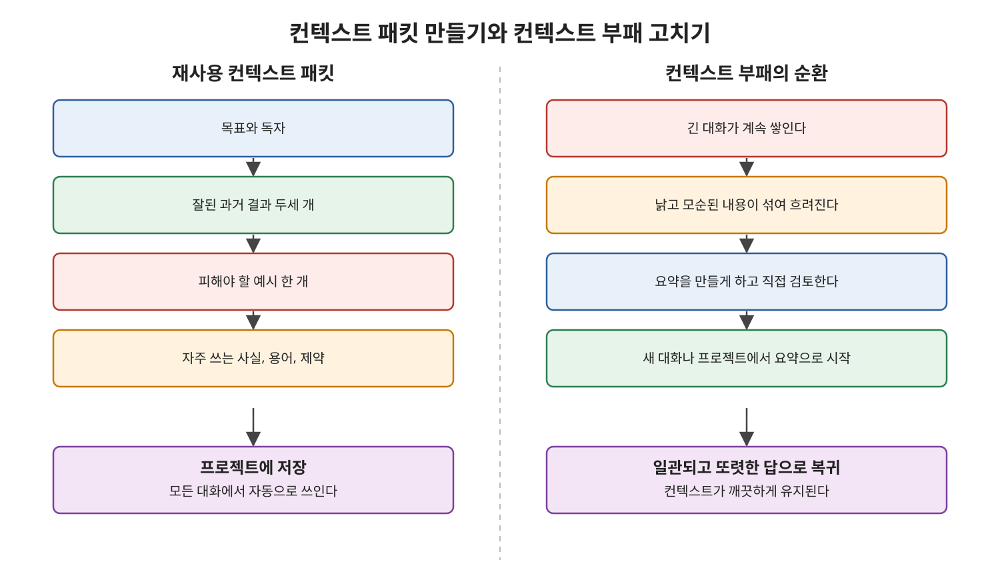

# 5장 컨텍스트 엔지니어링 (Context Engineering: Feeding Claude What It Actually Needs)

4장이 "어떻게 묻느냐"였다면 5장은 "무엇을 주고 일하게 하느냐"다. 저자는 이쪽이 덜 눈에 띄기 때문에 장기적으로 더 중요한 기술일 수 있다고 말한다. 훌륭한 프롬프트라도 맥락이 약하거나 없으면 약한 결과가 나오고, 평범한 프롬프트라도 맥락이 훌륭하면 정말 쓸 만한 결과가 나오는 경우가 많다.

책의 비유는 편집자다. 큰 기사를 쓰기 전에 작가의 취재 폴더를 살피는 편집자는 더 많이 쓰게 하는 것이 아니라 알맞은 자료만 골라 글쓰기 자체가 쉽고 나아지게 한다. 대화에 무엇을 첨부하고, 다시 말하고, 빼느냐를 정할 때마다 바로 그 일을 하는 것이다.

> **참고(노트 작성자)** 이 장의 용어(컨텍스트 엔지니어링, 컨텍스트 패킷, 컨텍스트 부패)는 책의 표현을 이 노트의 통일 용어로 옮긴 것이다. 부패는 원문의 Context Rot를 풀어 쓴 말이다.

---

## 1. 이 장의 목표와 핵심 용어

장을 마치면 프롬프트와 컨텍스트 엔지니어링의 차이와 둘 다 중요한 이유를 설명하고, 대화에 들어갈 정보와 뺄 정보를 정하고, 길게 이어지는 대화가 커져도 효과를 유지하게 관리하고, 반복 업무용 재사용 "컨텍스트 패킷"을 만들고, 대화의 컨텍스트가 부풀었거나 낡았거나 모순되는 징후를 알아보고 고칠 수 있다.

- **컨텍스트 엔지니어링**: 영리한 프롬프트 하나에 기대지 않고 Claude에게 줄 정보를 의도적으로 고르고 조직하는 일이다.
- **컨텍스트 패킷(Context Packet)**: 반복 업무를 위해 미리 준비해 둔 배경 정보(사실, 예시, 스타일 가이드) 꾸러미다.
- **컨텍스트 부패(Context Rot)**: 긴 대화에 자료가 쌓이면서, 일부는 낡고 일부는 모순되어 Claude의 답이 덜 집중되고 덜 일관되어지는 현상이다.
- **신호 대 잡음**: Claude가 일을 수행하는 데 실제로 도움이 되는 정보와 부피만 더하는 정보의 구분이다.
- **기준 문서(Anchoring Document)**: 프로젝트 전반에서 반복해 첨부하거나 참조하는 단일 참고 파일(스타일 가이드, 브랜드 브리프, 용어집)이다.

## 2. 레슨 1: 프롬프트와 컨텍스트 엔지니어링의 진짜 차이

프롬프트는 지시 자체다. 컨텍스트 엔지니어링은 그 지시를 Claude가 얼마나 잘 수행할 수 있는지를 좌우하는 나머지 전부, 곧 의도적으로 주거나 보류하는 문서, 예시, 이전 결정, 배경 사실, 제약이다.

차이가 중요한 이유는, 프롬프트로 "다 해 봤다"고 느끼는 많은 사람이 실제로는 프롬프트 문제가 아니라 컨텍스트 문제를 겪기 때문이다. Claude가 당신의 목소리를 한 번도 본 적이 없다면 아무리 문구를 다듬어도 그 목소리로 쓰게 만들 수 없다. 회사의 실제 숫자가 없다면 아무리 영리한 표현도 회사의 고유한 상황을 제대로 분석하게 하지 못한다.

간단한 시험이 있다. 같은 지시를 다섯 가지로 다시 썼는데 결과가 모두 비슷하게 어긋난다면 문구 조정을 멈추고 이렇게 묻는다. "Claude가 실제로 필요한데 갖지 못한 정보는 무엇인가?" 예컨대 "우리답게 들리게 바꿔 줘"는 어떻게 표현해도 실패한다. 첨부한 스타일 가이드, 과거 예시, 목소리를 쓴 명확한 서술로 "우리"가 대화 어딘가에 실제로 표현되어 있지 않다면 말이다.

## 3. 레슨 2: 대화에 무엇을 넣을지 정하기

공유할 수 있는 모든 것을 공유해야 하는 것은 아니다. 컨텍스트 엔지니어링은 포함만큼 전략적 생략의 기술이기도 하다. 어떤 정보든 넣기 전에 세 가지를 묻는 간단한 거름망을 쓴다.

1. **좋은 답의 모습을 바꾸는가?** 아니면 뺀다.
2. **Claude가 달리 짐작해야 하는 것인가?** 그렇다면 넣는다.
3. **이미 준 다른 정보와 모순될 수 있는가?** 그렇다면 모순을 먼저 풀고 넣는다(레슨 4의 컨텍스트 부패 참고).

고객 제안서를 쓰는 일이라면 넣을 것은 고객이 밝힌 목표, 가격 구조, 잘 된 과거 제안서, 고객이 쓰는 특정 용어다. 뺄 것은 관계없는 사내 소란, 지금은 맞지 않는 2년 전 가격, 제안서 내용을 바꾸지 않는 지나친 배경 이야기다.

흔한 실수는 "맥락은 많을수록 좋다"를 규칙으로 삼는 것이다. 관계없거나 낡은 정보는 도움이 안 될 뿐 아니라, 대화 다른 곳의 더 최신이거나 관련 있는 자료와 모순되면 답을 적극적으로 혼란시킬 수 있다. 모범 사례는 좋은 리서치 보조원이 바쁜 임원에게 브리핑하듯이 관련 있고, 최신이고, 구체적으로 고르되 빠짐없이 나열하지 않는 것이다.

## 4. 레슨 3: 재사용 컨텍스트 패킷 만들기

브랜드 목소리로 쓰기, 특정 유형의 보고서 분석, 특정 유형의 이메일 초안처럼 반복하는 일에는 상시 "컨텍스트 패킷"을 한 번 만들어 두고, 매 대화마다 맥락을 처음부터 재구성하는 대신 매번 재사용한다.

좋은 패킷에는 대체로 다음이 들어간다.

- 이 유형의 일의 목표와 독자에 대한 짧은 설명.
- 잘된 과거 결과의 실제 예시 두세 개.
- 피해야 할 것의 예시 하나(4장의 부정 예시 기법).
- 자주 바뀌지 않는 반복되는 사실, 용어, 제약.

쓰는 방법은 이 패킷을 문서로 저장해 관련 대화에 첨부하는 것이다. 더 좋은 방법은 프로젝트(6장) 안에 두어 그 프로젝트의 모든 대화에서 매번 다시 첨부하지 않아도 자동으로 쓰이게 하는 것이다.



책이 드는 사례는 프리랜서 지원금 작성자다. 그는 패킷 하나에 소속 단체의 사명 선언문, 자랑스러운 지원금 선정 제안서 두 건, 탈락한 제안서 한 건과 왜 실패했을 듯한지에 대한 메모, 클라이언트들이 쓰는 프로그램 용어집을 담았다. 새 지원금 신청은 모두 이 패킷을 첨부하는 것으로 시작하며, 몇 달치 온보딩에 해당하는 것을 몇 초 만에 Claude에게 준다. 책의 팁은 패킷을 주기적으로 갱신하라는 것이다. 옛 브랜드 목소리나 지난 가격 구조 같은 낡은 예시는 자산이 아니라 부담이 된다.

## 5. 레슨 4: 컨텍스트 부패, 부푼 대화 알아보고 고치기

"컨텍스트 부패"는 오래 이어진 대화에 자료가 너무 많이 쌓여, 일부는 낡고 일부는 모순되고 일부는 지금 순간과 무관해져서 Claude의 답이 산만하고 일관성이 없으며 대화가 길어도 이상하게 평범하게 느껴지는 상황을 가리킨다.

이유는 모든 대화에 한정된 컨텍스트 윈도우가 있기 때문이다(1장). 대화가 커지면 오래된 자료가 밀려나기도 하고, 기술적으로 여전히 "시야 안"에 있어도 경쟁하는 정보의 양 자체가 지금 정말 중요한 것에 대한 집중을 흐린다.

**징후**는 세 가지다. 이미 바꾼 오래된 결정을 Claude가 언급한다. 서로 다른 시점에 준 모순된 지시들을 평균 내는 듯한 답이 나온다. 같은 해명을 여러 번 반복하는데 "붙지" 않는 것 같다.

**고치는 법**도 세 가지다.

1. **요약하고 다시 시작하기.** Claude에게 지금까지 대화의 핵심 결정과 사실을 요약하게 하고, 그 요약이 정확한지 검토한 다음, 그 깨끗한 요약을 새 토대로 새 대화(또는 프로젝트)를 연다.
2. **낡은 정보를 명시적으로 대체하기.** 새 지시가 옛 지시를 덮어쓴다고 Claude가 추론하길 기대하지 말고 직접 말한다.

```text
이 대화 앞쪽에서 말한 가격 수치는 무시해 줘.
현재의 올바른 구조는 이거야: [새 정보]
```

3. **반복되는 맥락은 프로젝트로 옮기기(6장).** 하나의 걷잡을 수 없는 채팅 대신, 토대 자료가 깨끗하게 분리되어 매일의 주고받기와 섞이지 않게 한다.

예시로 한 제품 관리자의 기능 명세 대화가 6주 동안 이어지며 진화하는 요구사항 세 버전이 쌓였다. Claude의 답이 옛 요구와 새 요구를 일관성 없이 섞기 시작했다. 해법은 Claude에게 최종 요구사항의 깨끗한 현재 요약을 만들게 하고, 검토하고 고친 뒤, 그 요약만으로 새 대화를 시작한 것이다. 불일치가 곧바로 사라졌다.

## 6. 레슨 5: 과제 유형별 컨텍스트

모든 일이 같은 종류의 맥락을 필요로 하지는 않는다. 책의 간단한 멘탈 모델은 다음과 같다.

| 과제 유형 | 우선할 컨텍스트 |
|-----------|-----------------|
| 특정 목소리로 쓰기 | 그 목소리의 실제 예시(긍정과 부정) |
| 문서 분석 | 실제 문서와 그 분석이 어떤 결정에 쓰일지 |
| 코딩 | 관련 실제 코드, 오류 메시지, 의도한 동작 |
| 사업 결정 | 실제 숫자, 실제 제약, 이미 배제한 것과 그 이유 |
| 진행 중인 조사 | 이미 찾은 것의 누적 요약(같은 곳을 다시 훑지 않게) |

흔한 실수는 모든 과제 유형에 같은 컨텍스트 전략을 적용하는 것이다. 코딩 과제는 "프로그램이 대체로 해야 할 일"의 긴 산문 설명보다 실제 코드와 오류 문구가 훨씬 필요하다.

## 7. 비즈니스 예시: 인터뷰 녹취록 요약

중견 컨설팅 회사의 분석가 토마스는 고객 인터뷰 녹취록을 통찰 브리프로 요약해 달라는 요청을 반복해서 받는다. 처음에는 녹취록을 매번 새로 붙여 넣고 원하는 형식을 기억에서 설명했고, 결과가 들쭉날쭉했다. 어떤 것은 너무 길고 어떤 것은 회사가 선호하는 통찰 범주를 빠뜨렸다.

그는 컨텍스트 패킷을 만들었다. 회사의 표준 통찰 브리프 양식, 모범이 된 과거 브리프 두 개, 반드시 다룰 범주(고충, 결정 기준, 예산 신호)에 대한 짧은 메모다. 이를 프로젝트 안에 저장했다. 그 뒤로는 새 녹취록마다 짧은 지시와 함께 첨부하기만 하면 된다. 패킷이 일관된 구조, 예시, 필수 범주를 이미 공급하기 때문이다. 결과의 일관성이 곧바로 좋아졌고 토마스는 같은 형식을 매번 다시 설명하지 않게 되었다. 개선은 전적으로 컨텍스트 관리에서 왔고 더 영리한 프롬프트에서 온 것이 아니다. 프롬프트 자체는 거의 바뀌지 않았다.

## 8. Claude 대화 예시

사용자가 "내 목소리로" 써 달라고 표현을 바꿔 가며 여러 번 요청했지만 여전히 아쉽다며 다음에 무엇을 해 볼지 묻는다. Claude의 답의 요지는 이렇다.

> 이쯤에서는 지시 문구를 다시 쓰는 일을 멈추겠습니다. 문제는 제가 작업할 만큼 선명한 당신의 실제 목소리 예시를 아직 갖지 못했다는 쪽일 가능성이 큽니다. 당신이 정말 자기답다고 느끼는 짧은 글 두세 편과, 어색하게 느껴지는 글 한 편을 붙여 주시겠어요? 그런 대조가 지시를 또 고쳐 쓰는 것보다 훨씬 더 가까이 데려다 줍니다.

## 9. 연습과 미니 프로젝트

연습은 네 가지다. 첫째, 최근 만족스럽지 않았던 대화에서 Claude가 실제로 갖지 못했고 결과를 바꿨을 정보를 적는다. 둘째, 최소 한 달에 한 번 하는 일에 컨텍스트 패킷을 만든다. 예시, 제약, 다시 설명하지 않아도 될 반복 사항을 담는다. 셋째, 가장 오래 이어진 대화를 훑어 낡았거나 모순되는 정보가 여전히 "살아 있는지" 보고 요약 후 재시작 기법을 연습한다. 넷째, Claude에게 정기적으로 부탁하는 서로 다른 일 세 가지에 대해 레슨 5의 표를 본보기 삼아 가장 중요한 맥락 하나씩을 찾는다.

미니 프로젝트 "컨텍스트 패킷 라이브러리"는 이번 주에 첫 재사용 패킷 두 개를 만드는 것이다. 매번 타이핑하려고 기억해 두는 것이 아니라 실제 문서로 저장한다. 하나는 반복하는 글쓰기 일(브랜드 목소리, 보고서 형식, 이메일 스타일)용이고, 다른 하나는 반복하는 의사결정 지원이나 분석 일(표준 평가 기준, 핵심 숫자, 과거 결정과 이유)용이다. 둘 다 실제 일에 첨부해 시험하고, 패킷 없이 접근했을 경우와 결과를 비교한다.

## 10. 흔한 실수와 문제 해결

| 증상 | 가능한 원인 | 해결 |
|------|-------------|------|
| 프롬프트를 다시 써도 개선이 없음 | 문제가 문구가 아니라 빠진 맥락임 | 빠진 구체 정보를 찾아 추가 |
| 낡은 사실이나 결정을 Claude가 언급 | 긴 대화의 컨텍스트 부패 | 요약, 교정, 깨끗한 토대로 재시작 |
| 매 세션 같은 배경을 재구성 | 재사용 컨텍스트 패킷이 없음 | 패킷을 만들어 프로젝트에 저장 |
| 비슷한 반복 일의 결과가 들쭉날쭉 | 매번 맥락이 달라짐 | 예시와 제약이 든 패킷으로 표준화 |

관련성과 무관하게 맥락이 많을수록 자동으로 낫다고 가정하는 것, 맥락이 문제인지 묻지 않고 같은 프롬프트를 계속 다시 쓰는 것, 한 대화를 요약이나 초기화 없이 끝없이 돌리는 것, 같은 배경 정보를 재사용 가능한 패킷 대신 매번 처음부터 재구성하는 것, 아주 다른 유형의 일에 같은 맥락 전략을 일률 적용하는 것도 피할 실수다.

## 11. 장 요약

- 컨텍스트 엔지니어링은 Claude에게 줄 정보를 고르고 조직하는 일이며, 프롬프트 문구보다 더 결정적인 경우가 많다.
- 모든 정보가 대화에 속하는 것은 아니다. 관계없거나 낡은 맥락은 결과를 적극적으로 해친다.
- 재사용 컨텍스트 패킷은 일회성 온보딩을 반복 업무의 되풀이 가능한 자산으로 바꾼다.
- 컨텍스트 부패는 낡거나 모순된 자료가 쌓인 긴 대화에서 생기며 요약하고 다시 시작해서 고친다.
- 과제 유형마다 우선할 컨텍스트가 다르다. 목소리 작업은 예시, 코딩은 실제 코드와 오류, 결정은 실제 숫자가 필요하다.

## 12. 실행 체크리스트

- [ ] 프롬프트와 컨텍스트 엔지니어링의 차이를 설명할 수 있다.
- [ ] 대화에 정보를 넣기 전에 세 질문 거름망을 쓴다.
- [ ] 재사용 컨텍스트 패킷을 적어도 하나 만들었다.
- [ ] 긴 대화의 컨텍스트 부패를 알아보고 고치는 법을 안다.
- [ ] "컨텍스트 패킷 라이브러리" 미니 프로젝트를 마쳤다.

퀴즈는 네 문항이다. 컨텍스트 엔지니어링의 뜻 고르기, 컨텍스트 부패를 겪는 긴 대화의 권장 해법 고르기, 관련성이나 최신성과 무관하게 맥락이 많을수록 좋은지 참과 거짓, 재사용 컨텍스트 패킷에 보통 들어갈 것 고르기다. 더 해 볼 것으로는 앞으로 다섯 번의 대화 전에 프롬프트를 쓰기도 전에 "Claude가 아직 모르는데 알아야 할 것은 무엇인가?"를 먼저 묻는 것, 몇 달마다 컨텍스트 패킷을 다시 보고 갱신해 일회성 설정이 아닌 살아 있는 문서로 다루는 것이 있다. 이어지는 6장은 반복 업무를 위한 집인 프로젝트를 다룬다.

<br>
<br>
<br>

[Mastering Claude AI](../)
