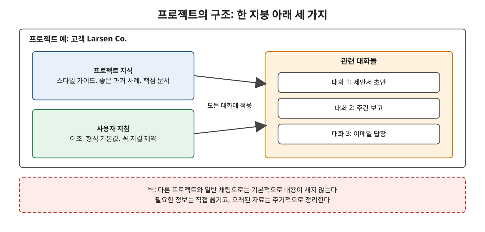

# 06장 프로젝트 (Projects: Building a Home for Recurring Work)

6장은 반복되는 일을 위한 집을 짓는 장이다. 5장이 Claude에게 어떤 정보를 줄지를 다뤘다면, 이 장은 그 정보를 어디에 두어야 두 번 말하지 않아도 되는지를 다룬다. 프로젝트(Project)는 평범한 사용자가 할 수 있는 가장 큰 정리 방법이라고 책은 말한다. 매번 같은 배경을 다시 설명하는 일과, 관련 없는 작업이 한 대화에 뒤섞이는 일을 한꺼번에 줄여 주기 때문이다.

책은 프로젝트를 변호사의 사건 파일이나 컨설턴트의 고객 폴더에 비유한다. 문서, 상시 지침, 작업 이력이 한곳에 모여 있고 다른 일과는 벽으로 나뉘어 있다는 뜻이다.

> **쉽게 말하면**
> 프로젝트는 일 하나에 서랍장 하나를 주는 것과 같다. 서랍을 열면 자료와 규칙이 이미 들어 있어서, 새 대화를 열자마자 일을 시작할 수 있다.

> **참고(노트 작성자)** 화면 이름이나 기능 범위는 책이 쓰인 시점 기준이며 요금제와 업데이트에 따라 달라질 수 있다.

---

## 1. 프로젝트란 무엇인가 (Lesson 1)

프로젝트는 지속되는 작업 공간이며 세 가지로 이루어진다.

- **프로젝트 지식(Project Knowledge)**: 프로젝트 안의 모든 대화에서 쓸 수 있는 파일과 참고 문서다.
- **사용자 지침(Custom Instructions)**: 한 번 정해 두면 모든 대화에 자동으로 적용되는 상시 안내다.
- **관련 대화 모음**: 각각 독립된 대화지만 같은 바탕 위에서 진행된다.

프로젝트가 없으면 새 대화마다 처음부터 시작한다. 파일을 다시 첨부하고, 문체를 다시 설명하고, 제약을 다시 말해야 한다. 프로젝트 안에서는 그 기초 맥락이 새 대화를 여는 순간 이미 깔려 있다.

언제 프로젝트를 쓰고 언제 일반 대화를 쓸까. 책은 2장의 기준을 다시 꺼낸다. 맥락을 공유하는 반복 작업, 예를 들어 이어지는 고객 관계, 오래 걸리는 집필, 특정 코드베이스, 자주 돌아가는 연구 주제에는 프로젝트가 맞다. 한 번으로 끝나는 단일 작업에는 필요 없다.



## 2. 첫 프로젝트 만들기 (Lesson 2)

책은 다섯 단계를 제시한다.

1. **반복되는 일 찾기.** 2장에서 만든 미니 프로젝트에 후보를 이미 적어 두었을 가능성이 크다.
2. **이름을 분명히 짓기.** 2장의 이름 규칙을 따른다. 그냥 "업무"가 아니라 "고객: Larsen Co."나 "원고: 정원 설계 안내서"처럼 구체적으로 쓴다.
3. **프로젝트 지식은 꼼꼼히 고르되 전부 넣지 않기.** 5장의 기준을 그대로 적용한다. 좋은 답의 모양을 바꾸는 자료, 즉 스타일 가이드, 핵심 참고 문서, 모범 사례만 넣고 낡거나 관련 없는 것은 뺀다.
4. **사용자 지침을 한 번 쓰기.** 5장의 컨텍스트 패킷 개념이 여기서 공식화된다. 어조, 항상 지킬 제약, 거의 바뀌지 않는 사실(회사 이름, 표준 조건, 팀 역할 구조)을 적는다.
5. **프로젝트 안에서 첫 실제 대화 시작하기.** 일반 채팅보다 설명할 일이 얼마나 줄었는지 바로 느껴진다.

## 3. 프로젝트 지식에 넣을 것과 뺄 것 (Lesson 3)

넣을 만한 것은 다음과 같다.

- 브랜드 또는 스타일 가이드
- 이 분야에서 가장 잘 된 과거 작업 두세 개
- 자주 쓰는 참고 문서(상품 카탈로그, 정책 문서, 코드베이스 구조 개요)
- 이 일에만 쓰는 용어집

뺄 것도 분명하다.

- 품질과 관련성을 따지지 않은 모든 과거 파일
- 이미 대체된 옛 버전 문서. 결과를 오히려 헷갈리게 만든다.
- AI 작업 공간에 둘 필요가 없는 민감 정보(26장에서 다룬다)

책의 경고는 간단하다. 프로젝트 지식을 쓰레기통으로 쓰지 말고 엄선한 참고 서가로 쓰라는 것이다. 잘 고른 문서 다섯 개가 걸러지지 않은 파일 쉰 개보다 대체로 낫다. 공유 드라이브를 가끔 청소하듯 지식도 주기적으로 솎아 낸다.

## 4. 도움이 되는 사용자 지침 쓰기 (Lesson 4)

사용자 지침은 기술적 설정 없이 Claude에게 내 선호를 가르치는 방법에 가장 가깝다. 잘 쓰는 법은 세 가지다.

- **막연하지 않고 구체적으로.** "전문적으로 써라"는 모호하다. "느낌표를 쓰지 말고, 문장은 가급적 20단어 안으로, 'in today's fast-paced world'라는 표현은 쓰지 말라"는 지킬 수 있는 규칙이다.
- **형식 기본값을 적는다.** "항목이 세 개 이상이면 내가 말하지 않는 한 불릿으로 쓰라"처럼 쓴다.
- **물어볼 것과 가정할 것을 구분한다.** "요청에 고객 예산이 없으면 숫자를 짐작하지 말고 되물어라"처럼 적는다.

책의 예는 마케팅 컨설팅 회사의 고객 프로젝트 지침이다. 내용을 우리말로 풀면 이렇다.

```text
이 프로젝트는 [고객 이름]을 위한 것이다.
브랜드 목소리는 따뜻하지만 간결하다.
기업 전문용어와 "놀라운", "혁명적인" 같은 최상급을 피한다.
고객에게 가는 문서는 선택지 여러 개가 아니라
분명한 다음 행동 하나로 끝낸다.
가격은 프로젝트 지식의 현행 요금표만 쓰고 숫자를 지어내지 않는다.
```

흔한 실수는 한 번 쓰고 다시 열어 보지 않는 것이다. 고객 관계, 브랜드 목소리, 프로젝트의 필요는 계속 변한다.

## 5. 프로젝트의 한계 (Lesson 5)

프로젝트는 강력하지만 분명한 경계가 있으니 짐작하지 말고 알아 두라고 책은 말한다.

- **격리는 설계의 일부다.** 프로젝트는 기본적으로 다른 프로젝트와 일반 채팅으로부터 내용이 분리된다. 1장과 2장에서 말한 윤리적 벽에 해당하며 결함이 아니라 기능이다. 대신 정보가 저절로 건너가지 않는다.
- **프로젝트의 기억과 계정 전체의 메모리는 다를 수 있다.** 요금제와 설정에 따라 프로젝트 안의 대화가 일반 대화의 메모리 종합을 쓰지 않을 수 있고 그 반대도 가능하다. 제품 업데이트로 바뀔 수 있으니 지금 설정을 확인한다.
- **프로젝트는 원본 시스템의 대체물이 아니다.** 진짜 가격표가 매주 갱신되는 스프레드시트에 있다면, 오래된 사본이 프로젝트 지식에 방치되게 하지 않는다. 사본은 일정을 정해 새로 고친다.

팀이나 기업 요금제라면 프로젝트의 열람과 편집 권한 설정을 확인한다. 여러 사람이 쓰기 시작하면 중요해지며 27장에서 더 다룬다.

## 6. 비즈니스 예시: 의뢰 건마다 프로젝트 하나

작은 법률 사무소는 진행 중인 의뢰 건마다 프로젝트를 하나씩 만든다. 1장에서 말한 "윤리적 벽" 방식이다. 각 프로젝트에는 사건 문서, 사무소 표준 서식, 그리고 "최종 법률 조언처럼 제시하지 말고 변호사 검토가 필요해 보이는 부분은 표시하라"는 짧은 지침이 들어 있다.

새 변호사가 합류해도 긴 인수 대화가 필요 없다. 진행 중인 사건의 맥락이 정리되어 이미 들어 있고, 다른 고객의 정보와는 분리되어 있다. 사건이 끝나면 프로젝트를 삭제하지 않고 보관해 깔끔한 기록을 남기고 진행 중인 작업을 어지럽히지 않는다.

책이 짚는 교훈은 이렇다. 사무소는 더 똑똑한 Claude를 얻은 것이 아니라 훨씬 더 정돈된 Claude를 얻었고, 그래서 결과가 빠르고 일관되며 범위에 맞았다.

## 7. Claude 대화 예시

사용자가 "안전하게 가려고 이 고객에 관한 모든 걸 프로젝트에 넣을까요?"라고 묻는다. Claude는 반대한다고 답한다.

> 프로젝트는 지금 유효한 관련 자료를 골라 넣을 때 가장 잘 작동합니다. 낡거나 서로 어긋나는 문서는 긴 대화에서처럼 조용히 결과를 해칩니다. 시작은 가장 최신 참고 문서, 잘된 과거 작업 두세 개, 어조와 꼭 지킬 제약을 적은 짧은 지침이면 충분합니다. 부족하면 나중에 더 넣으면 됩니다.

## 8. 연습과 미니 프로젝트

**연습 문제** 네 가지다.

- 후보 목록: 내 삶이나 업무에서 프로젝트가 될 만한 반복 작업 세 가지를 적는다.
- 하나를 끝까지 만들기: 2절의 다섯 단계로 이번 주 안에 실제 프로젝트 하나를 만든다.
- 솎아 내기 시험: 이미 있는 프로젝트의 지식을 열어 낡고 무관한 것을 빼 본다.
- 지침 점검: 사용자 지침을 마케팅 컨설팅 예처럼 구체적이고 지킬 수 있게 다시 쓴다.

**미니 프로젝트 "프로젝트 제로"**: 실제 프로젝트 하나를 처음부터 끝까지 만든다. 구체적 이름, 엄선한 지식 문서 세 개에서 다섯 개, 어조와 형식 기본값과 최소 하나의 강한 제약이 든 지침을 갖춘다. 마지막으로 그 안에서 실제 대화를 하나 끝내고, 같은 일을 일반 채팅에서 했을 때와 어떻게 달랐는지 짧게 적는다.

**퀴즈**는 프로젝트의 두 구성요소, 지식 관리의 모범 방식, 프로젝트 사이 정보의 자동 이동 여부(없다), 좋은 지침의 조건을 묻는다.

## 9. 흔한 실수와 문제 해결

| 증상 | 가능한 원인 | 고치는 법 |
|------|-------------|-----------|
| 프로젝트 안인데 답이 평범하다 | 지식이 비었거나 너무 적다 | 실제로 관련된 자료와 사례를 넣는다 |
| 바꾼 선호가 안 먹힌다 | 사용자 지침이 옛 그대로다 | 지침을 현재 선호에 맞게 고친다 |
| 알 거라 믿은 정보가 안 나온다 | 다른 프로젝트나 일반 채팅에 있다 | 의도한 프로젝트 안인지 확인한다 |
| 프로젝트가 어수선하고 답이 흐리다 | 낡거나 무관한 자료가 많다 | 5장의 세 질문 필터로 솎아 낸다 |

그 밖의 실수로는 프로젝트만 만들고 지식을 비워 두는 것, 문서를 몽땅 던져 넣는 것, 막연하고 포부 같은 지침을 쓰는 것, 프로젝트 사이로 정보가 흐를 것이라 가정하는 것, 일이 바뀌어도 지식과 지침을 갱신하지 않는 것이 있다.

## 10. 장 요약

- 프로젝트는 지식, 지침, 관련 대화를 하나의 지속적이고 집중된 작업 공간으로 묶는다.
- 맥락을 공유하는 반복 작업에 맞고 일회성 작업에는 맞지 않는다.
- 지식은 많이가 아니라 엄선해서 넣는다.
- 지침은 지킬 수 있을 만큼 구체적으로 쓴다.
- 프로젝트는 설계상 서로 격리되어 있으며 이는 대개 장점이다.

## 11. 실행 체크리스트

- [ ] 프로젝트와 일반 대화의 차이를 설명할 수 있다.
- [ ] 프로젝트가 될 만한 반복 작업을 하나 이상 찾았다.
- [ ] 엄선한 지식과 구체적 지침으로 프로젝트를 만들었다.
- [ ] 프로젝트가 서로, 그리고 일반 채팅과 격리됨을 안다.
- [ ] 프로젝트 제로 미니 프로젝트를 마쳤다.
- [ ] 한 달에 한 번 지식과 지침을 솎아 내는 알림을 걸어 두었다.

<br>
<br>
<br>

[Mastering Claude AI](../)
