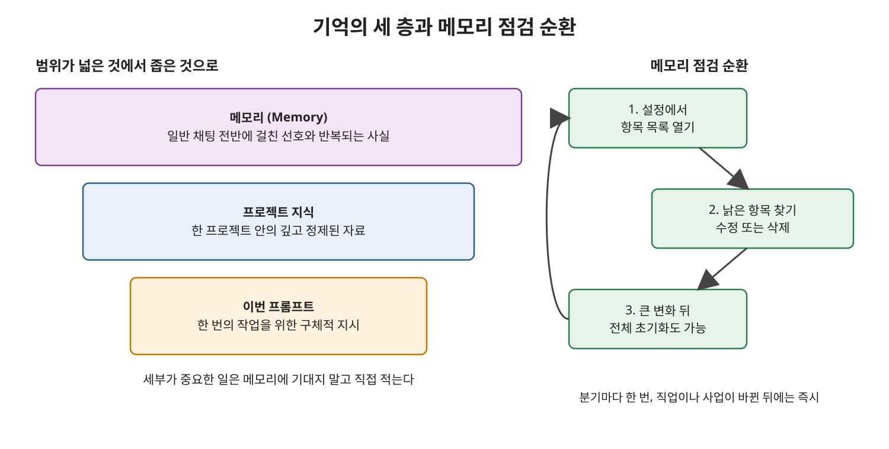

# 07장 메모리 (Memory: What Claude Remembers and What It Doesn't)

7장은 이 책의 기능 중 사람들이 가장 빨리 오해하는 메모리(Memory)를 바로잡는 장이다. 어떤 사람은 Claude가 모든 대화를 자동으로 기억한다고 믿었다가 실망하고, 어떤 사람은 아무것도 기억하지 못한다고 여겨 메모리가 알아서 처리해 줄 기본 사실까지 매번 다시 설명한다. 둘 다 틀렸다.

메모리는 Anthropic이 제한된 공개에서 더 넓은 제공으로 확장하며 무엇을 담는지와 어떻게 조절하는지를 계속 손봐 온 기능이다. 그래서 책은 이 장의 구체적 동작을 머릿속 모형으로만 삼고, 실제 동작은 내 계정 설정에서 확인하라고 거듭 당부한다.

> **쉽게 말하면**
> 메모리는 나를 천천히 알아 가는 일반 비서이고, 프로젝트 지식은 사건 하나를 정리한 서류철이다. 둘은 하는 일이 다르다.

> **참고(노트 작성자)** 메모리의 범위, 이름, 설정 위치는 책이 쓰인 시점 기준이며 자주 바뀐다. 이 장은 개념 틀로 읽고 지금 화면에서 확인한다.

---

## 1. 메모리가 실제로 하는 일 (Lesson 1)

메모리는 Claude가 이름, 소통 선호, 일에 관한 반복되는 사실, 진행 중인 맥락 같은 정보를 서로 다른 일반 대화에 걸쳐 간직하게 한다. 메모리가 없으면 새 대화마다 자기소개와 맥락 설명을 다시 해야 한다. 켜져 있으면 새 대화가 이미 이전에 정한 것을 반영할 수 있다. 특정 프로젝트에 속하지 않는 일반적이고 반복되는 사실에서 되풀이되는 설명을 줄여 준다.

6장의 프로젝트 지식과 다른 점은 이렇다. 프로젝트 지식은 내가 직접 엄선하고, 한 작업 범위에 한정되며, 다른 프로젝트와 분리된다. 메모리는 일반 대화 전반에 넓게 작동하며 구체적 문서가 아니라 일반적 사실과 선호를 종합한다. 흔한 실수는 둘이 같은 일을 한다고 여기는 것이다. 메모리는 범용 선호를, 프로젝트는 특정 반복 작업의 깊은 맥락을 맡는다.

용어 하나를 짚자. 메모리 종합(Memory Synthesis)은 Claude가 대화에서 반복되는 사실이나 선호를 추려 나중에 떠올릴 수 있는 형태로 만드는 과정이다. 메모리 항목(Memory Entry)은 기억된 사실이나 선호 하나이고 보통 설정에서 보고 고칠 수 있다.

## 2. 메모리를 켤지 정하기 (Lesson 2)

메모리는 대개 켜고 끌 수 있는 설정이며, 기본값에 맡기지 말고 의식적으로 정해야 한다고 책은 말한다.

**켜면 도움이 되는 경우**

- 비교적 일정한 개인 또는 업무 용도로 쓰고, 같은 선호와 배경을 반복해 말하는 데 지쳤다.
- 일반 대화 사용이 대체로 위험이 낮고, 보관되기를 원치 않는 민감 정보가 없다.

**조심해야 할 경우**

- 개인 생활과 기밀 고객 업무처럼 성격이 전혀 다른 맥락에 같은 계정을 쓴다. 경계를 넘어 사실이 새는 것이 걱정이다.
- 요약된 형태로라도 보관되지 않기를 바라는 민감 정보를 다룬다.
- 탐색적이거나 민감한 대화는 완전히 백지 상태에서 하고 싶다.

현실적인 절충안은 이렇다. 일반 용도에는 메모리를 켜고, 민감하거나 기밀인 일은 아예 별도 계정이나 최소한 분명히 분리된 프로젝트에서 한다. 이 경계는 26장 개인정보 장에서 더 깊이 다룬다. 확신이 없다면 몇 주 켜 보고, 무엇이 남았는지 직접 점검한 뒤 조정해도 좋다. 짐작이 아니라 증거로 의견을 만드는 낮은 위험의 방법이다.

## 3. 기억한 내용 보기, 고치기, 지우기 (Lesson 3)

대부분의 메모리 구현은 맹목적으로 믿어야 하는 블랙박스가 아니라 가시성과 통제권을 준다.

1. **설정에서 메모리 영역을 찾는다.** 지금 기억되는 항목의 목록이 보통 여기 있다.
2. **항목을 하나씩 훑는다.** 틀렸거나 낡았거나, 계속 가져가기를 원치 않는 것을 찾는다.
3. **필요한 항목을 고치거나 지운다.** 새 동료가 나에 대해 잘못 안 것을 바로잡듯, 우회하지 말고 메모리를 직접 고친다.
4. **전체를 비우는 방법을 알아 둔다.** 보통 완전 초기화 옵션이 있다. 직업이나 사업이 크게 바뀐 뒤처럼 기억된 맥락 대부분이 낡았을 때 유용하다.

예를 들어 비영리 모금 일을 하다 기업 영업으로 옮긴 사용자가 있다. 일반 대화에서 Claude가 여전히 모금 관련 가정을 내놓는다. 그는 대화마다 바로잡는 대신 메모리 설정에서 낡은 항목을 찾아 지우고 새 맥락을 적는다. 문제를 근원에서 해결한 것이다. 흔한 실수는 낡은 기억을 발견하고도 대화마다 말로 우회하는 것이다.

## 4. 메모리가 문제를 일으키는 곳 (Lesson 4)

정보를 자동으로 이어 가는 기능에는 으레 실패 양상이 있다.

- **낡은 사실.** 메모리는 기록 당시에 참이었던 것을 반영한다. 사업, 역할, 선호가 바뀌어도 점검하지 않으면 옛 가정이 조용히 새 대화를 기울인다.
- **맥락 사이로 새는 일.** 한 계정을 전혀 다른 영역에 쓰면, 메모리 종합이 한 맥락의 내용을 전혀 다른 맥락의 대화에 꺼내 어색하거나 부적절하게 만들 수 있다.
- **맞춤형이라는 거짓 확신.** Claude가 나를 "아는 것 같아서" 중요한 맥락을 덜 적게 되고, 빈 곳을 알아서 맞게 채울 것이라 믿는다. 하지만 결과에 정말 중요한 일에서는 5장에서 배운 명시적 맥락이 메모리 회상보다 더 믿을 만하다.

모범 사례는 이렇다. 세부가 정말 중요한 일, 곧 어조나 선호 수준을 넘는 일에는 메모리가 켜져 있어도 그 대화에 맥락을 직접 준다. 메모리는 좋은 컨텍스트 엔지니어링의 보조이지 대체가 아니다.

## 5. 메모리와 프로젝트를 함께 쓰기 (Lesson 5)

두 기능은 경쟁하지 않는다. 같은 문제, 곧 반복 설명 줄이기의 서로 다른 층을 맡는다. 책의 모형은 세 층이다.

| 층 | 기능 | 범위 |
|----|------|------|
| 넓고 일반적인, 나에 관한 선호와 사실 | 메모리 | 일반 채팅 전체 |
| 특정 반복 작업의 깊고 엄선된 맥락 | 프로젝트 지식 | 한 프로젝트 안 |
| 한 작업을 위한 구체적 일회성 지시 | 내 프롬프트 | 한 대화 |

컨설턴트라면 이름, 일반 소통 스타일, 컨설팅 회사를 운영한다는 사실은 메모리에 맡긴다. 고객별 세부 맥락은 그 고객의 전용 프로젝트에 둔다. 고객 세부를 일반 메모리에 억지로 밀어 넣거나, 일반 선호를 프로젝트마다 다시 설명하는 일은 하지 않는다.

## 6. 비즈니스 예시: 주거에서 상업으로 업종을 바꾼 중개인

혼자 일하는 부동산 중개인 펠릭스는 일찍 메모리를 켰고 꽤 유용했다. 힘 있고 이점 중심의 매물 문구를 좋아한다는 것을 Claude가 말하지 않아도 기억했다. 그런데 여섯 달 뒤 주거 매물에서 상업 매물로 바꾼 뒤에도 일반 대화에서 Claude의 제안이 여전히 주거용 표현으로 기울었다.

그는 메모리 설정을 열어 낡은 주거 중심 항목 몇 개를 지우고 상업 쪽으로 옮겼다는 짧은 메모를 넣었다. 현재 상업 매물의 실제 서식과 사례가 든 전용 프로젝트도 만들었다. 결과 품질은 전환 전 수준으로 돌아왔고, 이번에는 지금의 사업을 제대로 반영했다. 책의 교훈은 메모리가 한 번 켜고 잊는 기능이 아니라는 것이다. 일에 의미 있는 변화가 생기면 주기적으로 점검해야 한다.

## 7. Claude 대화 예시

사용자가 "지난주 다른 대화에서 우리가 나눈 거 기억나요?"라고 묻는다.

> 메모리가 계정에서 켜져 있는지, 어떤 종류의 정보였는지에 따라 다릅니다. 메모리가 켜져 있으면 이전에 말씀하신 일반 사실이나 선호는 떠올릴 수 있습니다. 하지만 같은 대화, 같이 쓰는 프로젝트, 또는 다시 공유해 주신 내용이 아니라면 지난 대화의 자세한 내용까지는 갖고 있지 않습니다. 지난주 내용 중 지금 중요한 것이 있다면 기억하리라 가정하지 말고 붙여넣거나 다시 적어 주시는 것이 가장 안전합니다.

## 8. 연습과 미니 프로젝트

**연습 문제**

- 메모리 감사: 설정에서 현재 메모리 항목을 모두 훑고 낡거나 틀린 것을 고치거나 지운다.
- 결정 연습: 2절의 틀로 메모리를 켤지에 대한 내 결정과 이유를 적는다. 기본값에 그냥 두지 않는다.
- 새어 나옴 시험: 여러 영역에 쓴다면 일반 대화에 엉뚱한 맥락의 가정이 나오는지 확인하고 있으면 해결한다.
- 층 분류: 5절의 표로 메모리에 둘 것, 프로젝트 지식에 둘 것, 한 프롬프트에 새로 적을 것을 하나씩 찾는다.

**미니 프로젝트 "메모리 점검"**: 지금부터 분기마다 반복되는 알림을 걸고 첫 점검을 한다. 점검에서는 모든 메모리 항목의 정확성을 보고, 특히 일, 역할, 사업에 큰 변화가 있었다면 낡은 것을 제거하며, 메모리 켜기와 끄기 결정이 지금의 사용 방식에 여전히 맞는지 확인한다.

**퀴즈**는 메모리의 주된 기능, 낡은 항목의 올바른 처리법, 고위험 작업에서 메모리를 명시적 맥락의 대체물로 삼아도 되는지(안 된다), 메모리와 프로젝트를 함께 쓰는 합리적 방식을 묻는다.

## 9. 흔한 실수와 문제 해결

| 증상 | 가능한 원인 | 고치는 법 |
|------|-------------|-----------|
| 나에 관한 낡은 사실을 언급한다 | 상황이 바뀐 뒤 낡은 항목이 남음 | 설정에서 항목을 고치거나 지운다 |
| 전에 말한 것을 기억 못 한다 | 메모리가 꺼졌거나 다른 프로젝트나 대화였다 | 설정을 확인하고 중요한 맥락은 다시 적는다 |
| 관련 없는 대화에 엉뚱한 정보가 나온다 | 넓은 메모리가 삶의 영역 사이로 샌다 | 해당 항목을 지우고 민감한 맥락은 계정이나 프로젝트를 분리한다 |
| 프롬프트가 막연해진다 | Claude가 알아서 알 것이라 가정한다 | 결과에 중요한 것은 명시적으로 준다 |

그 밖의 실수로는 메모리가 모든 대화를 세세하게 남긴다고 가정하는 것, 항목을 점검하지 않고 낡은 가정을 방치하는 것, 민감한 맥락을 일반 메모리에 두는 것, 메모리와 프로젝트 지식을 혼동하는 것이 있다.

## 10. 장 요약

- 메모리는 일반 대화에 걸쳐 일반 사실과 선호를 간직해 반복 설명을 줄인다.
- 깊이 엄선되고 한 작업에 한정되는 프로젝트 지식과는 구별된다.
- 항목을 직접 보고 고치고 지울 수 있으니 우회하지 말고 근원에서 바로잡는다.
- 점검하지 않으면 낡거나 맥락 사이로 샐 수 있으니 한 번 켜는 스위치가 아니라 살아 있는 설정으로 대한다.
- 메모리, 프로젝트, 대화 안의 명시적 맥락은 경쟁이 아니라 서로 보완하는 층이다.

## 11. 실행 체크리스트

- [ ] 메모리가 하는 일과 프로젝트 지식과의 차이를 안다.
- [ ] 메모리를 켤지 의식적으로 정했다.
- [ ] 항목을 보고 고치고 지우는 법을 안다.
- [ ] 중요한 일에는 메모리에만 의존하지 않고 명시적 맥락을 준다.
- [ ] 메모리 점검 미니 프로젝트를 마치고 정기 알림을 걸었다.

 
 
 

[Mastering Claude AI](../)
