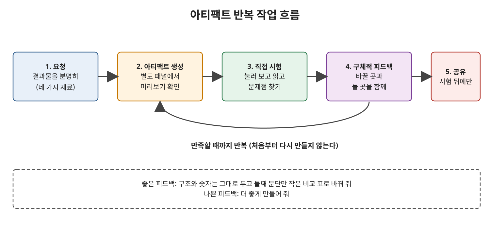

# 08장 아티팩트 (Artifacts: Turning Conversations Into Deliverables)

8장은 대화를 결과물로 바꾸는 장이다. 보고서 한 장, 작은 계산기, 도표처럼 제법 큰 것을 서너 번 부탁하다 보면 답이 평범한 채팅 글로 나오지 않고 별도의 공간에 열려 바로 쓸 수 있는 모습으로 나타난다. 이것이 아티팩트(Artifact)다. 책은 이를 잘 다루는 것이 Claude를 "무언가에 대해 말하는 챗봇"으로 쓰는 것과 "바로 쓸 수 있는 것을 만드는 도구"로 쓰는 것의 차이라고 말한다.

책은 디자인 전공 학생이 시제품 도구를 대하는 방식을 빌려, 막연한 생각에서 눈에 보이는 작동하는 물건까지 한 대화 안에서 가는 작업 흐름을 다룬다.

> **쉽게 말하면**
> 아티팩트는 대화 옆에 놓인 작업대다. 대화는 지시를 주고받는 곳이고, 작업대 위의 물건은 그 지시대로 조금씩 고쳐 가며 완성한다.

> **참고(노트 작성자)** 지원하는 형식, 공유 기능, 요금제별 차이는 책이 쓰인 시점 기준이며 제품 업데이트로 달라질 수 있다.

---

## 1. 무엇이 아티팩트를 만드는가 (Lesson 1)

제법 크고 독립적인 것, 곧 코드, 서식을 갖춘 문서, 도표, 인터랙티브 페이지를 부탁하면 Claude는 종종 그 내용을 별도 패널에 렌더링된 라이브 미리보기와 함께 연다. 채팅 글에 그냥 붙이지 않는다.

이유는 반복 수정에 있다. 내용이 자기 패널에 있으니 "이 차트 색을 더 차분하게", "이 절을 줄여 줘", "여기 버튼을 넣어 줘" 하며 주고받아도 대화에는 지시만 남고 계속 전체를 붙여 넣은 글이 쌓이지 않는다.

대체로 의미 있는 길이의 코드, 서식을 갖춘 보고서, 도표, 인터랙티브 도구처럼 크고 구조적이거나 시각적인 내용은 아티팩트가 된다. 짧은 대화형 답, 확인 질문, 작은 코드 조각은 보통 채팅 글로 남는다. 원하는데 자동으로 안 되면 이렇게 묻는다.

```text
이걸 아티팩트로 만들어 줄래요? 반복해서 고쳐 보고 싶어요.
```

용어를 정리한다. 라이브 미리보기(Live Preview)는 원시 코드가 아니라 실제로 작동하는 웹페이지, 서식이 적용된 문서, 차트처럼 렌더링된 모습이다. 반복(Iteration)은 매번 새로 만들지 않고 후속 대화로 기존 결과를 다듬는 일이다. 게시와 공유는 링크로 다른 사람이 보거나 경우에 따라 조작할 수 있게 하는 일이다.

## 2. 아티팩트가 만들 수 있는 것 (Lesson 2)

범위는 넓고 시간이 가며 넓어졌다. 책이 쓰인 시점의 대표 범주는 다음과 같다.

- 여러 프로그래밍 언어의 코드와 스크립트
- 서식 있는 문서(마크다운 기반 보고서, 안내서, 구조화된 글)
- 도표(순서도, 공정도 같은 시각 구조)
- 인터랙티브 웹 콘텐츠(HTML 페이지, 작은 도구, 계산기)
- 내가 준 데이터로 만든 차트와 그래프
- 일부 상황의 내려받기 형식(요금제와 요청에 따라 문서, 프레젠테이션, 스프레드시트)

그래서 아티팩트는 개발자만의 것이 아니다. 소상공인은 작동하는 가격 계산기를, 교사는 인터랙티브 퀴즈를, 프로젝트 관리자는 깔끔한 공정도를 받을 수 있다. 코드를 몰라도 되고, 내가 할 일은 원하는 결과를 분명히 설명하는 것이다(4장).

책의 예시 요청은 다음과 같다. 의미를 풀어 쓴다.

```text
고객의 월 광고비를 입력하면 우리 관리 수수료를
단계별 요율로 추정해 주는 간단한 도구를 만들어 줘.
월 5,000달러 미만은 15%, 5,000달러에서 15,000달러는 12%,
그 이상은 10%야.
```

그 결과는 요율을 글로 설명한 것이 아니라 실제로 작동하는 인터랙티브 계산기 아티팩트다. 흔한 실수는 아티팩트를 "개발자 기능"이라 단정하고 보고서, 도표, 간단한 도구 같은 비기술 작업에 시도해 보지 않는 것이다.

## 3. 아티팩트를 잘 고쳐 가기 (Lesson 3)

아티팩트가 생기면 대화로 다듬는 편이 거의 항상 새로 시작하는 것보다 낫다. 방법은 세 가지다.

1. **무엇을 바꾸고 무엇을 둘지 구체적으로 말한다.** "구조는 그대로 두고 서론을 줄이고 끝에 요약 표를 더해 줘"가 "더 좋게 만들어 줘"보다 훨씬 쓸모 있다.
2. **특정 부분을 짚는다.** 여러 절이 있으면 "둘째 절은 너무 격식 있으니 부드럽게"가 막연한 총평보다 낫다.
3. **인터랙티브하면 더 고치기 전에 먼저 써 본다.** 계산기, 도구, 페이지는 실제로 눌러 보면 코드나 설명을 읽어서는 못 잡던 사용상 문제가 보인다.

비영리 단체의 프로그램 책임자가 한 장짜리 기부 영향 보고서를 아티팩트로 부탁했다. 첫 초안은 탄탄하지만 글이 너무 많았다. 처음부터 다시 부탁하는 대신 이렇게 답했다. 같은 숫자와 구조는 그대로 두고, 둘째 문단을 모금한 금액과 도운 가정 수를 보여 주는 짧은 표 같은 시각적 구성으로 바꿔 달라는 것이다. 아티팩트는 이미 잘된 부분을 모두 지킨 채 갱신되었다. 흔한 실수는 한 절이 마음에 안 든다고 대체로 괜찮은 결과를 버리고 새로 시작해 잘된 부분까지 잃는 것이다.



## 4. 아티팩트를 직접 부탁할 때 (Lesson 4)

Claude가 알아서 만들 때까지 기다릴 필요는 없다. 직접 요청할 수 있고, 반대로 일반 대화 글로 남겨 달라고 할 수도 있다.

**명시적으로 요청할 때**

- 여러 번 고쳐 쓸 것임을 안다.
- 오가는 대화와 따로 깔끔하고 내보낼 수 있는 판본이 필요하다(보고서, 도표).
- 인터랙티브한 것을 만들어 읽는 데서 그치지 않고 직접 시험해 보려 한다.

**일반 글이면 충분할 때**

- 단순한 질문에 대한 빠른 답
- 다시 쓰거나 고치지 않을 것
- 아직 구조화된 결과물로 확정하기 전의 짧은 아이디어 모색

확신이 없으면 "이건 아티팩트가 좋을까요, 글이면 충분할까요?"라고 물으면 된다. 비용이 들지 않으며 Claude가 설명을 듣고 판단을 도와준다.

## 5. 공유와 재사용 (Lesson 5)

요금제에 따라 아티팩트는 보통 링크로 공유할 수 있고, 받은 사람은 원래 대화가 없어도 보거나 경우에 따라 조작하고 복제할 수 있다. 한 번의 좋은 대화가 그 대화를 넘어 재사용 가능한 것이 된다. 나를 위해 만든 계산기가 팀 전체의 도구가 되고, 한 고객 발표용 도표가 그대로 공유될 수 있다.

넓게 공유하기 전에 직접 끝까지 검토한다. 고객, 팀, 대중에게 건네는 다른 모든 것과 같은 성실함이 필요하며 18장 검증 습관과 이어진다. 흔한 실수는 직접 시험하지 않고 널리 공유하는 것, 특히 인터랙티브한 것이다. 작은 사용상 문제는 고객이나 동료가 발견하기 전에 잡는 편이 훨씬 쉽다.

## 6. 비즈니스 예시: 스스로 채점하는 분수 퀴즈

고등학교 교사 베티나는 분수 단원용 자동 채점 연습 퀴즈를 원한다. 도구를 직접 만드는 대신 열 개의 문제, 정답, 오답에 줄 피드백의 성격("부드럽게, 실수를 설명하고 그냥 '틀렸다'고만 하지 말 것")을 설명했다. Claude가 작동하는 인터랙티브 퀴즈를 아티팩트로 만들었다.

그녀는 먼저 직접 풀어 보다가 한 문제의 표현이 모호한 것을 발견하고, 그 문제의 문구만 명확히 해 달라고 부탁했다. 전체를 다시 만드는 대신 작고 정확한 반복이었다. 그리고 웹 개발 지식 없이 링크를 학생들에게 바로 공유했다.

책의 교훈은 이렇다. 아이디어를 가진 것과 작동하는 도구를 가진 것 사이를 가르던 장벽, 곧 직접 코딩하거나 사람을 구해야 하던 일이 이런 과제에서는 크게 무너졌다. 단 결과를 분명히 설명하고 공유 전에 시험한다는 조건에서다.

## 7. Claude 대화 예시

사용자가 말한다. "이 보고서 아티팩트는 전체적으로 좋은데 결말만 바꾸고 싶어요. 나머지는 건드리지 말아 줄래요?"

> 물론입니다. 결말이 무엇을 말하거나 강조하길 원하시는지 구체적으로 알려 주세요. 그 절만 고치고 나머지 보고서는 지금 그대로 두겠습니다.

## 8. 연습과 미니 프로젝트

**연습 문제**

- 첫 아티팩트: 아직 안 해 봤다면 실제로 필요한 제법 큰 것(보고서, 도표, 작은 도구)을 부탁하고 저절로 아티팩트가 되는지 본다.
- 반복 연습: 기존 아티팩트를 두고 "더 좋게"가 아니라 구체적이고 표적이 분명한 수정 지시를 해 본다.
- 비개발자 시험: 비기술직이라면 평소 생각 못 할 인터랙티브한 것, 곧 간단한 계산기나 인터랙티브 체크리스트를 부탁해 본다.
- 공유와 시험: 요금제가 공유를 지원하면 먼저 직접 시험한 뒤 동료나 친구에게 하나를 공유한다.

**미니 프로젝트 "진짜 하나 만들기"**: 이번 주 업무나 생활의 실제 필요 하나를 골라 아티팩트로 완성한다. 4장의 네 가지 재료로 원하는 결과를 분명히 설명하고, 구체적이고 표적이 분명한 피드백으로 최소 두 번 고친다. "끝났다"고 하기 전에 직접 철저히 시험하고, 적절하다면 실제로 쓸 사람에게 공유한다.

**퀴즈**는 아티팩트의 정의, 수정의 가장 좋은 방식, 아티팩트가 코드 검토에만 쓰이는지(아니다), 인터랙티브 아티팩트를 널리 공유하기 전에 할 일을 묻는다.

## 9. 흔한 실수와 문제 해결

| 증상 | 가능한 원인 | 고치는 법 |
|------|-------------|-----------|
| 아티팩트를 원했는데 글로만 나온다 | 요청이 충분히 크거나 구조적이지 않았다 | "아티팩트로 만들어 줄래요?"라고 직접 묻는다 |
| 수정이 남기고 싶던 부분을 자꾸 되돌린다 | 수정 지시가 막연하다 | 바꿀 곳과 그대로 둘 곳을 정확히 적는다 |
| 공유 뒤 사용상 문제가 나온다 | 공유 전에 시험하지 않았다 | 널리 공유하기 전에 직접 철저히 시험한다 |
| 아티팩트인지 글인지 모르겠다 | 정해진 기준이 없다 | Claude에게 묻거나 4절의 반복과 재사용 기준을 쓴다 |

그 밖에는 개발자 전용이라 가정하는 것, 구체적 피드백 대신 새로 시작하는 것, 비기술 작업에 아티팩트를 써 보지 않는 것이 흔한 실수다.

## 10. 장 요약

- 아티팩트는 코드, 문서, 도표, 인터랙티브 도구 같은 크고 독립적인 결과를 반복 수정이 가능한 전용 패널에 만든다.
- 코드를 넘어 매우 다양한 형식을 지원하므로 비기술 사용자에게도 유용하다.
- 새로 시작하거나 막연히 고치지 말고 구체적이고 표적이 분명한 피드백으로 반복한다.
- Claude의 판단을 기다리지 말고 아티팩트나 일반 글을 직접 요청할 수 있다.
- 공유 전에, 특히 인터랙티브한 것은 직접 철저히 시험한다.

## 11. 실행 체크리스트

- [ ] 무엇이 아티팩트를 만들고 무엇이 일반 답이 되는지 안다.
- [ ] 아티팩트가 코드 외에도 많은 것을 만든다는 것을 안다.
- [ ] 막연한 요청이 아니라 구체적이고 표적이 분명한 피드백으로 고친다.
- [ ] 공유 전에 직접 시험한다.
- [ ] "진짜 하나 만들기" 미니 프로젝트를 마쳤다.

<br>
<br>
<br>

[Mastering Claude AI](../)
