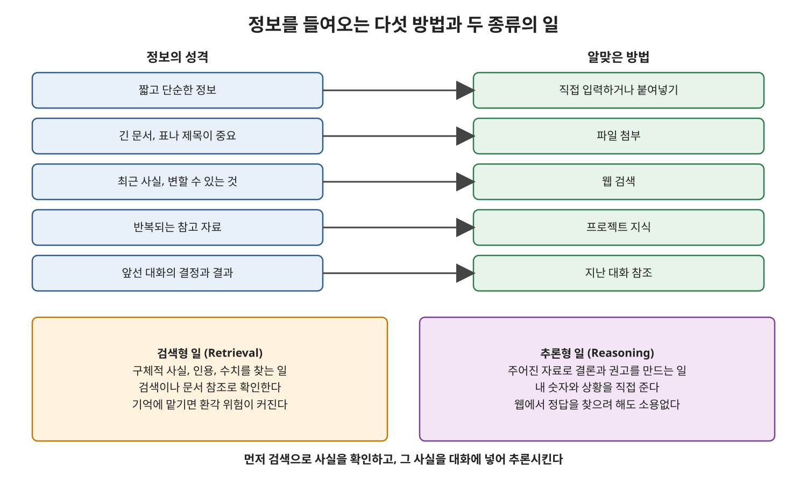

# 09장 지식 관리 (Knowledge Management: Files, Search, and Long Documents)

9장은 내가 아는 것, 나눈 대화, Claude가 찾아야 할 것을 어떻게 한곳에서 쓸 만하게 관리하느냐를 묻는 장이다. 지금까지의 장은 Claude에게 필요한 정보가 이미 손에 있다고 가정했다. 문서, 사실 몇 가지, 예시가 그것이다. 이 장은 더 넓은 질문으로 간다. 흩어지고 반쯤 잊히는 정보를 어떻게 정말 쓸 수 있는 상태로 만들 것인가.

책은 이 장을 나만의 참고 도서관을 짓는 일에 비유한다. 좋은 연구 조수가 몇 달에 걸쳐 무엇을 둘지, 버릴지, 매번 새로 찾아볼지, 서가에 둘 만큼 안정적인지를 다듬어 가는 것과 같다.

> **쉽게 말하면**
> 정보마다 알맞은 문이 따로 있다. 짧은 메모는 직접 말하고, 두꺼운 표는 파일로 건네고, 어제 바뀐 사실은 검색으로 확인한다.

> **참고(노트 작성자)** 웹 검색과 지난 대화 검색의 이름과 제공 범위는 책이 쓰인 시점 기준이며 요금제와 설정에 따라 다르다.

---

## 1. 정보를 들여오는 알맞은 방법 고르기 (Lesson 1)

정보를 대화에 넣는 방법은 여러 가지이고, 상황에 맞는 것을 고르는 일이 생각보다 중요하다.

| 방법 | 가장 알맞은 경우 |
|------|------------------|
| 직접 입력하거나 붙여넣기 | 복잡한 서식을 보존할 필요 없는 짧고 단순한 정보 |
| 파일 첨부 | 긴 문서, 스프레드시트처럼 구조(표, 제목)가 중요한 것 |
| 웹 검색 | 최근 사건, 최신 사실, 학습 이후 바뀌었을 수 있는 것 |
| 프로젝트 지식 | 진행 중인 작업의 반복되는 참고 자료(6장) |
| 지난 대화 참조 | 이어서 쓰고 싶은 앞선 대화의 정보나 결정 |

잘못된 방법을 쓰면 품질을 잃는다. 표가 많은 긴 스프레드시트를 글로 붙여넣으면 구조를 잃는다. 지난달 바뀐 것을 Claude의 학습 데이터에 기대면 낡은 정보를 받는다. 3주 전 결정을 원본 대화를 참조하지 않고 다시 쳐 넣으면 뉘앙스를 잃거나 일관성이 깨질 수 있다. 흔한 실수는 정보의 성격과 무관하게 한 방법, 대개 붙여넣기로 모두 처리하는 것이다.

## 2. 웹 검색을 잘 쓰기 (Lesson 2)

켜 두면 Claude는 학습 때 배운 것에만 의존하지 않고 웹에서 최신 정보를 찾을 수 있다. 시간에 민감하거나 최근에 바뀌었을 수 있는 것에 유용하다.

**쓸 때**

- 최근 사건, 가격, 통계, 곧잘 바뀌는 사실
- 확신이 없는 특정 주장이 아직 맞는지 확인
- Claude의 내부 지식이 아니라 현재의 여러 출처를 원하는 조사

**필요하지 않을 때**

- 시간을 타지 않는 개념, 확립된 역사적 사실, 최근 변화에 좌우되지 않는 일반 설명
- 이미 준 자료를 바탕으로 추론하는 일. 웹 검색이 보태는 것이 없다.

**잘 쓰는 법**은 두 가지다. 무엇을 확인하고 찾을지 구체적으로 말한다. "이 소프트웨어의 현재 버전 번호를 찾아봐"가 "온라인에서 확인해 봐"보다 낫다. 그리고 중요한 주장이 최신인지 확신이 없다면 Claude가 검색했는지 학습 데이터에 의존했는지 직접 묻는다. 이 구분은 1장에서 다룬 환각 위험과 연결된다.

흔한 실수는 답이 최신처럼 자신 있게 들린다는 이유로 Claude가 웹을 자동으로 검색했다고 여기는 것이다. 시간에 민감한 주장은 검색이 실제로 쓰였는지 늘 확인한다. 최신성이 중요한 조사라면 매번 알아서 하리라 기대하지 말고 특정 사실을 검색으로 확인해 달라고 명시한다.

## 3. 지난 대화 검색하고 참조하기 (Lesson 3)

요금제와 설정에 따라 내 지난 대화 전체를 검색해 관련 맥락을 끌어올 수 있다. 7장 메모리의 일반 선호 종합과는 다르며, 내 대화 기록 위의 개인 검색 엔진에 가깝다.

이것이 없으면 좋았던 개요, 신중히 따져 본 결정, 마음에 든 문구 같은 가치 있는 과거 작업이 대화를 닫는 순간 사실상 사라진다. 잘 저장하거나 이름을 잘 붙여 두지 않았다면 더 그렇다(2장).

쓰는 법은 다음과 같다.

- 전에 했던 일과 비슷한 새 작업을 시작할 때 "예전에 이런 걸 논의한 적 있나요? 확인해 줄래요?"라고 적극적으로 묻는다. 처음부터 시작해야 한다고 가정하지 않는다.
- 2장의 이름 규칙과 함께 쓴다. 이름이 잘 붙은 지난 대화는 내가 직접 훑든 검색 기능이 찾든 훨씬 쉽게 찾고 정확히 참조할 수 있다.

흔한 실수는 이미 지난 대화에 있는 작업을 찾기 어렵거나 떠오르지 않는다는 이유로 처음부터 다시 하는 것이다.

## 4. 시간이 갈수록 쌓이는 개인 지식 베이스 (Lesson 4)

어느 한 프로젝트를 넘어, 스타일 가이드, 의사결정 틀, 핵심 사실, 표준 서식 같은 내 전체 참고 자료를 자라나는 개인 지식 베이스(Knowledge Base)로 보라고 책은 권한다. 이후의 모든 Claude 상호작용이 나아진다.

의도적으로 쌓는 법은 세 가지다.

1. **가장 자주 하는 일부터 시작한다.** Claude에게 가장 자주 부탁하는 것에 먼저 잘 정리된 참고 문서를 만든다. 5장의 컨텍스트 패킷과 통한다.
2. **"명작 모음" 폴더를 둔다.** Claude가 정말 훌륭한 구절, 구조, 추론을 내놓으면 한 대화에 묻어 두지 말고 찾을 수 있는 곳에 저장한다.
3. **주기적으로 통합한다.** 매달이나 분기마다 쌓인 것을 훑어 가장 좋은 것을 상시 컨텍스트 패킷과 프로젝트 지식에 합치고 낡은 것은 버린다.

프리랜서 카피라이터는 고객 피드백 패턴, 곧 고객이 꾸준히 좋아한 표현과 꾸준히 요청한 수정을 담은 문서를 계속 쌓는다. 분기마다 컨텍스트 패킷과 프로젝트 지식을 최신 패턴으로 갱신한다. 프롬프트 기술 자체는 그대로인데 프롬프트와 참고 자료가 계속 나아지는 것이다. 지식 베이스는 한 번 하고 끝나는 설치 작업이 아니라 살아 있는 자산이며, 복리 효과는 큰 노력 한 번이 아니라 꾸준한 작은 관리에서 나온다.

## 5. 검색형 일과 추론형 일 구분하기 (Lesson 5)

내가 하는 요청은 두 종류로 나눌 수 있다.

- **검색형 일(Retrieval)**: 특정 사실, 인용, 정보를 찾는 일이다. 웹 검색이나 특정 문서 참조가 가장 잘 맞는다.
- **추론형 일(Reasoning)**: 이미 준 자료로 결론을 내거나 권고하거나 논거를 종합하는 일이다. 분명한 맥락과 좋은 프롬프트가 맞다(4장과 5장).

구분이 중요한 이유는 이렇다. 검색형 일을 추론형처럼 다루면, 예를 들어 특정 통계를 조회하지 않고 기억에서 "떠올려" 달라고 하면 환각 위험이 커진다. 반대로 추론형 일을 검색형처럼 다루면, 내 구체적 상황에 달린 미묘한 전략 질문의 "정답"을 웹에서 찾으려 해도 아무것도 얻지 못한다. 답이 온라인 어딘가에 놓인 사실이 아니라 내 맥락에 달려 있기 때문이다.

책의 예시를 보면, "특정 기관이 정한 현재 금리는 얼마인가?"는 검색형이니 빨리 바뀌는 수치는 기억을 믿지 말고 검색으로 확인한다. "지금 금리 환경과 우리 회사 현금 사정을 보면 고정금리 대출을 지금 묶을까, 기다릴까?"는 추론형이니 웹 검색의 정답이 아니라 내 실제 숫자와 맥락이 필요하다.

## 6. 비즈니스 예시: 경쟁사 가격 조사

시장조사 분석가 유키는 경쟁 구도 보고서를 준비한다. 처음에는 최근 경쟁사 가격을 Claude가 기억에서 대도록 했다. 검색형 일을 추론형처럼 다룬 것이다. 일부는 낡았거나 불확실하다는 표시와 함께 나왔다.

그녀는 접근을 바꿨다. 현재 경쟁사 가격은 웹 검색을 명시적으로 써서 확인하고(검색형), 확인된 수치를 직접 대화에 넣어 추세와 시사점을 분석하게 했다(추론형). 보고서의 사실 기반이 단단해졌고 그 위의 분석도 기억이 아니라 검증된 수치에 기댔다. 책의 교훈은 사실을 찾는 일인지 사실을 놓고 추론하는 일인지를 아는 것이 어떤 도구와 기법이 믿을 만한 결과를 주는지를 바꾼다는 것이다.

## 7. Claude 대화 예시

사용자가 "이 제품의 현재 가격이 얼마예요? 보고서에 넣으려고요"라고 묻는다.

> 제가 기억에 의존하기보다 검색해 보겠습니다. 가격은 자주 바뀌고, 추측이 아니라 검증된 최신 수치를 드리고 싶어서요. 지금 찾아보겠습니다.

## 8. 연습과 미니 프로젝트

**연습 문제**

- 방법 맞추기: 이번 주 대화에 넣어야 할 정보 세 가지에 대해 각각 가장 알맞은 방법(붙여넣기, 첨부, 검색, 프로젝트 지식, 지난 대화 참조)을 정한다.
- 검색 습관: 시간에 민감한 특정 사실을 저절로 되리라 가정하지 말고 검색으로 확인해 달라고 명시해 본다.
- 지난 대화 찾기: 비슷한 것을 전에 논의했는지 Claude에게 확인해 달라고 하고 결과가 얼마나 쓸모 있는지 평가한다.
- 검색형과 추론형 분류: 최근 한 요청 다섯 개를 검색형인지 추론형인지 분류하고 맞는 접근을 썼는지 적는다.

**미니 프로젝트 "지식 베이스 시작 키트"**: 개인 지식 베이스의 첫 판을 만든다. Claude에게 가장 자주 하는 요청 세 가지를 꼽고, 각각에 잘 정리된 참고 문서 하나를 만든다. 다시 쓰고 싶은 뛰어난 결과를 모을 "명작 모음" 폴더나 노트를 시작한다. 이 자료를 통합하고 새로 고치는 월간 또는 분기 점검을 일정에 넣는다.

**퀴즈**는 길고 표가 많은 문서를 들여오는 최선의 방법(파일 첨부), 웹 검색이 학습 데이터보다 나은 경우, 추론형 일의 답을 웹에서 찾는 것이 최선인지(아니다), 검색형 일의 정의를 묻는다.

## 9. 흔한 실수와 문제 해결

| 증상 | 가능한 원인 | 고치는 법 |
|------|-------------|-----------|
| 붙여넣은 문서가 표와 제목 구조를 잃었다 | 파일 첨부 대신 글로 붙여넣었다 | 가능하면 실제 파일을 첨부한다 |
| 시간에 민감한 사실이 낡았다 | 실시간 검색 대신 학습 데이터에 의존했다 | 확인용 웹 검색을 명시적으로 요청한다 |
| 값진 과거 작업을 못 찾는다 | 이름 규칙이 없거나 검색을 안 해 봤다 | 2장의 이름 체계를 쓰고 지난 대화를 직접 참조해 본다 |
| 추론이 필요한 질문에 얕고 일반적인 답이 온다 | 맥락 없이 검색형으로 다뤘다 | 내 구체적 숫자와 상황을 직접 준다 |

그 밖의 실수로는 정보의 성격과 무관하게 한 방법만 쓰는 것, 시간에 민감한 주장을 Claude가 알아서 검색했다고 가정하는 것, 처음 만든 지식 베이스를 방치하는 것이 있다.

## 10. 장 요약

- 습관이 아니라 정보의 성격에 따라 붙여넣기, 첨부, 검색, 프로젝트 지식, 지난 대화 참조 중에서 고른다.
- 웹 검색은 최신의 시간 민감한 사실에 의도적으로 쓰고, 실제로 쓰였는지 확인한다.
- 지난 대화를 적극 검색하고 참조해 값진 과거 작업을 잃지 않는다.
- 가장 자주 하는 일 중심으로 개인 지식 베이스를 쌓고 정기적으로 관리한다.
- 검색형과 추론형을 구분해 각각에 알맞은 접근을 쓴다.

## 11. 실행 체크리스트

- [ ] 정보의 성격에 맞게 들여오는 방법을 고른다.
- [ ] 시간에 민감한 사실에는 웹 검색을 의도적으로 쓰고 확인한다.
- [ ] 처음부터 다시 하기 전에 지난 대화를 검색한다.
- [ ] 관리 일정이 있는 개인 지식 베이스의 시작을 만들었다.
- [ ] 내 요청이 검색형인지 추론형인지 구분할 수 있다.

 
 
 

[Mastering Claude AI](../)
