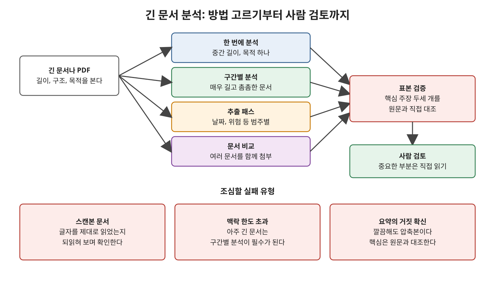

# 10장 긴 문서와 PDF 분석 워크플로 (Long Document and PDF Analysis Workflows)

10장은 Claude의 쓸모가 가장 빨리 드러나는 동시에 허술한 습관이 가장 빨리 벌을 받는 영역, 긴 문서를 다룬다. 60쪽짜리 계약서, 빽빽한 연구 논문, 여러 해의 재무 보고서는 예전에는 오후 한나절을 잡아먹던 일이다. 올바른 구조로 접근하면 Claude가 이를 몇 분으로 의미 있게 줄여 준다.

이 장은 3장의 파일 첨부 요령과 5장의 컨텍스트 엔지니어링 원칙을 긴 문서의 고유한 어려움에 적용한다. 컨텍스트 윈도우에 들어가는 문제만이 아니라 중요한 것이 훑고 지나가며 빠지지 않게 하는 문제까지 다룬다.

> **쉽게 말하면**
> 두꺼운 책을 "한마디로 어때?"라고 묻지 말고, 장별로 읽히고, 찾을 것을 콕 집어 주고, 마지막에 원문과 대조한다.

> **참고(노트 작성자)** 지원하는 파일 크기와 쪽수, 컨텍스트 윈도우 한도는 책이 쓰인 시점 기준이며 모델과 요금제에 따라 다르다.

---

## 1. 문서에 맞는 접근 고르기 (Lesson 1)

긴 문서라고 모두 같은 방식으로 다루지 않는다. 문서의 길이, 구조, 내가 정말 원하는 것에 따라 접근이 달라진다.

| 문서 상황 | 권장 접근 |
|-----------|-----------|
| 중간 길이에 목적 하나(짧은 보고서, 계약서 하나) | 구체적이고 구조화된 요청으로 한 번에 분석 |
| 매우 길거나 구조가 촘촘함(긴 법률 문서, 여러 장의 보고서) | 구간별 분석 후 종합 |
| 특정 범주의 정보를 뽑아야 함 | 명확히 구조화한 전용 추출 패스 |
| 관련 문서가 여러 개 | 문서를 함께 공유해 교차 비교 |

용어를 정리한다. 한 번에 분석(Single-Pass Analysis)은 문서 전체를 한 요청으로 분석하게 하는 것이다. 구간별 분석(Section-by-Section Analysis)은 문서를 부분으로 나눠 차례로 분석한 뒤 종합하는 것이다. 추출(Extraction)은 큰 문서에서 날짜, 위험, 할 일 같은 특정 범주를 뽑는 것이고, 교차 문서 비교(Cross-Document Comparison)는 여러 문서를 함께 분석해 닮은 점, 다른 점, 모순을 찾는 것이다.

매우 길고 빽빽한 문서에 "어떻게 생각해?"라는 막연한 요청 하나를 던지면 중간에 묻힌 중요한 세부를 놓친 얕은 겉핥기 요약이 나오기 쉽다. 범위를 알맞게 잡은 구조화된 접근이 훨씬 많이 잡아낸다.



## 2. 구간별 분석을 제대로 하기 (Lesson 2)

정말 길거나 빽빽한 문서라면 거대한 한 번의 요청 대신 구간으로 나누면 더 철저하고 믿을 만한 결과가 나온다. 책은 네 단계를 제시한다.

1. **전체 문서를 첨부하되 첫 요청의 범위는 좁게 잡는다.** "이 문서를 절별로 가 보자. 먼저 첫 절만 핵심을 요약하고 중요하거나 특이해 보이는 것을 짚어 줘."
2. **다음으로 가기 전에 검토하고 확인한다.** 요약을 실제 절과 대조한다. 품질 관리일 뿐 아니라 나머지 문서에서 "좋은 결과"가 어떤 모습인지 감을 잡게 해 준다.
3. **앞선 발견을 참조하며 절별로 계속한다.** "이제 둘째 절. 첫 절에서 찾은 것과 모순되거나 이어지는 것이 있으면 짚어 줘."
4. **마지막에 종합을 요청한다.** "문서 전체를 훑었으니, 가장 중요한 발견과 위험, 서로 어긋나 보이는 부분을 하나의 종합 요약으로 줘."

거대한 한 번의 요청보다 나은 이유는 각 패스의 범위가 좁아 간결함을 위해 무엇이 뭉개지지 않고, 마지막 종합이 문서 전체를 한 번에 압축하는 대신 이미 드러난 절 수준의 세부 위에서 이루어지기 때문이다.

흔한 실수는 100쪽 문서를 3쪽 문서처럼 다루어 한 번의 요청으로 "요약"을 부탁하고 완전한 그림을 얻었다고 믿는 것이다. 주요 계약이나 실제 결정을 기댈 긴 연구 보고서처럼 매우 길거나 중요한 문서는 한 번에 한 요약이 겉보기에 "충분히 좋아" 보여도 구간별 분석에 시간을 들일 가치가 있다. 얕은 패스가 놓칠 것을 잡는 것이 핵심이다.

## 3. 추출: 특정 범주의 정보 뽑기 (Lesson 3)

긴 문서에서 정말 필요한 것은 일반 요약이 아니라 특정 범주인 경우가 많다. 언급된 모든 기한, 모든 재무 수치, 모든 할 일, 책임을 언급하는 모든 조항이 그것이다.

일반 요약을 부탁하면 Claude가 내게 무엇이 중요한지 짐작해야 한다. 추출 요청은 정확히 무엇을 볼지 알려 주므로 대표적인 몇 개가 아니라 그 범주의 모든 사례를 찾는 데 주의를 모은다. 요청을 구조화하는 예는 다음과 같다.

```text
이 문서 전체를 훑어 언급된 모든 구체적 날짜와 기한을
각각의 앞뒤 맥락과 함께 뽑아 줘.
표로 정리해 줘: 날짜 | 맥락 | 나오는 절
```

인사 담당 관리자가 40쪽짜리 공급 서비스 계약서를 받았다. "이 계약 어떻게 생각해?"라고 묻는 대신 세 번의 별도 추출 패스를 돌렸다. 모든 금액과 지급 조건, "해지"나 "종료"가 든 모든 조항, 모든 기한과 갱신일이다. 각 패스는 빠르고 집중되어, 일반 요약이 압축하거나 놓쳤을 세부를 잡았다.

흔한 실수는 일반 요약 한 번이 필요한 구체적 세부를 모두 드러내 주리라 가정하는 것이다. 요약은 정의상 압축하고 우선순위를 매기므로 내가 직접 묻지 않으면 일부 구체적 사항은 걸러진다.

## 4. 여러 문서 비교하기 (Lesson 4)

두 개 이상의 긴 문서, 곧 공급사 제안서, 계약서 버전, 같은 주제의 연구 논문을 비교할 때는 같은 요청에 함께 공유하고 구조화된 비교 틀을 주는 편이 각각 따로 분석한 뒤 요약을 직접 비교하는 것보다 훨씬 낫다.

```text
공급사 제안서 세 개를 첨부한다. 다음 항목만 비교해 줘.
(1) 각 문서 어디에든 언급된 수수료까지 포함한 총비용
(2) 납품이나 구현 일정
(3) 특이하거나 제한적인 계약 조건
공급사별로 열 하나씩 둔 표 하나로 정리해 줘.
```

이유는 Claude가 한 번의 패스에서 문서 사이의 세부를 직접 교차 참조할 수 있기 때문이다. 예를 들어 A사 일정이 B사 제안서가 명시적으로 배제한 것을 전제한다는 점을 알아챈다. 따로 만든 세 요약을 손으로 비교하면 이런 연결은 훨씬 잡기 어렵다. 흔한 실수는 문서마다 별도 대화에서 요약한 뒤 결과를 손으로 비교해 직접 교차 참조의 이점을 잃는 것이다.

## 5. 실패 양상과 대비 (Lesson 5)

긴 문서 분석에는 예측 가능한 실패 방식이 있다. 미리 알면 중요한 일에서 뼈아프게 발견하는 대신 대비할 수 있다.

- **스캔본이나 이미지 기반 문서는 글자로 믿을 만하게 읽히지 않을 수 있다.** 글자가 아니라 글의 사진이나 스캔이라면, 전체 분석을 믿기 전에 Claude가 내용을 제대로 읽는지 확인한다. 내가 직접 대조할 수 있는 한 쪽의 특정 세부를 되읽어 보게 한다. 스캔본은 글자로 검색되지 않는 이미지 형태의 문서(Scanned Document)를 말한다.
- **매우 긴 문서는 여전히 컨텍스트 한도를 넘을 수 있다.** 넉넉한 컨텍스트 윈도우에도 천장이 있다(1장). 지원 한계의 끝자락에 있는 문서라면 구간별 분석은 있으면 좋은 것이 아니라 필수일 수 있다.
- **요약은 거짓 확신을 만들 수 있다.** 깔끔하게 정리된 요약은 권위 있어 보이지만 요약은 정의상 압축이다. 중대한 결정이라면 전적으로 기대기 전에 핵심 몇 가지를 원문과 표본으로 대조한다.

모범 사례는 이렇다. 법률 문서, 주요 재무 보고서, 실제 결과가 따르는 결정처럼 정말 중대한 일에서는 Claude의 분석을 아주 빠르고 잘 정리된 첫 패스로 보고, 가장 중요한 절은 사람이 검토한다. 최종적이고 점검되지 않은 평결로 삼지 않는다. 이는 18장의 더 넓은 검증 틀과 이어진다.

## 6. 비즈니스 예시: 90쪽 공급 계약 갱신

작은 제조업체의 운영 이사 행크는 갱신 전에 90쪽 공급 계약서를 검토해야 한다. 일반 요약 하나를 부탁하는 대신, 전년도 계약서도 함께 첨부해 지난해와 달라진 것을 찾는 구간별 패스를 돌렸다. 이어서 위약금, 최소 주문 수량, 가격 조정 발동 조건을 언급하는 모든 조항의 전용 추출 패스를 돌렸다.

이 과정은 가격 조정 시기에 관한 미묘하게 다시 쓰인 조항을 드러냈다. 일반 요약이라면 대수롭지 않은 한 줄 언급으로 뭉갰을 것이다. 행크는 서명 전에 이를 회사 변호사에게 넘겼고, 비용에 상당한 영향을 줄 수 있었던 것을 잡았다. 분석이 일반 패스가 아니라 정말 중요한 것에 맞춰 구조화되었기 때문이다.

책의 교훈은 Claude가 긴 문서를 빨리 읽었다는 것이 아니라, 정말 잡아야 할 것을 중심으로 비교, 추출, 구간별 분석을 구조화했다는 점이다.

## 7. Claude 대화 예시

사용자가 "80쪽짜리 이 보고서 요점만 알려 줄래요?"라고 묻는다.

> 높은 수준의 요약은 드릴 수 있지만, 이렇게 긴 문서는 한 번의 요약이 많은 세부를 압축할 수밖에 없습니다. 이 보고서가 실제 결정에 쓰인다면 핵심 위험, 재무 수치, 권고처럼 정확히 필요한 것을 알려 주세요. 그 항목을 따로 추출하거나 구간별로 훑어 일반 요약에서 중요한 것이 사라지지 않게 하겠습니다. 아니면 먼저 큰 줄기를 드리고 필요한 절을 더 파고들 수도 있습니다.

## 8. 연습과 미니 프로젝트

**연습 문제**

- 접근 맞추기: 지금 분석해야 할 문서 세 개에 대해 1절의 표로 어떤 접근이 맞는지 정한다.
- 구간별 연습: 정말 긴 문서 하나를 2절의 네 단계로 끝까지 구간별 분석한다.
- 추출 연습: 문서 하나에서 일반 요약 대신 특정 범주(날짜, 수치, 위험)의 전용 추출 패스를 돌린다.
- 비교 연습: 관련 문서가 둘 이상이면 함께 첨부해 따로 요약하지 말고 구조화된 비교를 돌린다.

**미니 프로젝트 "중대 문서 검토"**: 정말 중요한 문서 하나, 곧 계약서, 기댈 보고서, 긴 제안서를 골라 전체 워크플로를 거친다. 단계마다 확인하는 구간별 분석, 내 결정에 가장 중요한 범주의 전용 추출 패스, 마지막 종합 요청을 한다. 마지막으로 분석을 끝났다고 보기 전에 핵심 주장 두세 개를 원문과 직접 대조한다.

**퀴즈**는 매우 길고 빽빽한 문서의 권장 접근, 추출 패스의 정의, 여러 문서를 따로 요약해 비교하는 것이 함께 비교하는 것만큼 효과적인지(아니다), 중대한 문서의 요약을 전적으로 믿기 전에 할 일을 묻는다.

## 9. 흔한 실수와 문제 해결

| 증상 | 가능한 원인 | 고치는 법 |
|------|-------------|-----------|
| 요약이 얕고 뻔한 세부를 놓친다 | 길고 빽빽한 문서에 막연한 요청 하나를 했다 | 구간별 분석으로 바꾼다 |
| 필요한 세부가 요약에 없다 | 일반 요약은 압축하고 우선순위를 매긴다 | 그 범주의 전용 추출 패스를 돌린다 |
| 문서 비교가 일관되지 않고 종합이 어렵다 | 문서를 따로 요약했을 뿐 직접 비교하지 않았다 | 문서를 함께 첨부해 구조화된 단일 비교를 요청한다 |
| 스캔본을 제대로 읽었는지 불확실하다 | 이미지 파일에서 글자가 믿을 만하게 추출되지 않았을 수 있다 | 내가 확인할 수 있는 세부를 되읽혀 본 뒤 전체 분석을 믿는다 |

그 밖의 실수로는 매우 긴 문서를 짧은 문서처럼 막연한 요약 한 번으로 다루는 것, 스캔본 요약을 확인 없이 믿는 것, 중대한 문서의 한 번에 한 요약을 점검 없는 최종 평결로 삼는 것이 있다.

## 10. 장 요약

- 문서의 길이와 실제 필요에 따라 한 번에 분석, 구간별 분석, 추출, 비교 중에서 접근을 맞춘다.
- 긴 문서에서는 단계마다 확인하는 구간별 분석이 막연한 요약 한 번보다 훨씬 많이 잡아낸다.
- 전용 추출 패스는 일반 요약이 압축하거나 놓칠 특정 범주를 믿을 만하게 드러낸다.
- 여러 문서는 따로 요약한 뒤 비교하지 말고 한 구조화된 요청에서 함께 비교한다.
- 스캔본의 불확실한 읽기, 매우 긴 파일의 한도, 요약 하나의 거짓 확신이라는 알려진 실패를 대비한다.

## 11. 실행 체크리스트

- [ ] 문서의 길이와 목적에 맞게 분석 접근을 고른다.
- [ ] 정말 길거나 빽빽한 문서는 구간별 분석을 쓴다.
- [ ] 특정 범주가 필요하면 전용 추출 패스를 돌린다.
- [ ] 여러 문서는 따로가 아니라 함께 비교한다.
- [ ] 중대한 문서의 요약은 의존하기 전에 원문과 표본 대조한다.
- [ ] 자주 쓰는 추출 범주 목록을 지식 베이스에 만들어 두었다.

<br>
<br>
<br>

[Mastering Claude AI](../)
