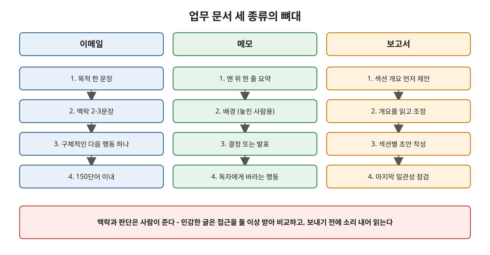

# 11장 업무 문서 쓰기 (Business Writing: Emails, Memos, and Reports)

11장은 Claude로 이메일, 메모, 보고서를 쓰는 방법을 다룬다. 저자는 업무 글쓰기가 Claude의 가장 흔한 실제 용도이면서, 허술한 습관이 가장 잘 드러나는 영역이라고 본다. 어색하게 일반적인 이메일은 금방 티가 나고, 그 평판은 도구가 아니라 보낸 사람에게 돌아가기 때문이다.

이 장의 핵심 원칙은 역할 분담이다. Claude는 구조가 탄탄한 첫 초안을 빠르게 만든다. 사람은 5장에서 배운 실제 맥락을 주고, 관계와 이해관계를 아는 사람만 내릴 수 있는 판단, 곧 어조와 시기와 꼭 할 말을 정한다. 이 장의 수치와 UI 설명은 책이 쓰인 시점 기준이다.

> **쉽게 말하면**
> Claude는 초안을 빨리 쓰는 비서이고, 보낼지 말지와 어떤 말투로 보낼지는 내가 정한다.

---

## 1. 핵심 용어

| 용어 | 쉬운 설명 |
|------|-----------|
| 업무 목소리(Business Voice) | 직장이라는 맥락에 맞는 일관된 어조와 문체. 개인 글이나 창작 글의 목소리와는 다르다 |
| 훑어 읽기 쉬운 구조(Scannable Structure) | 바쁜 독자가 전부 읽지 않아도 핵심을 잡을 수 있게 짠 글 |
| 초안 후 다듬기(Draft-and-Refine) | 빈 화면에서 시작하지 않고 초안을 빨리 받은 뒤 필요한 부분만 고쳐 가는 방식 |
| 민감한 소통(Sensitive Communication) | 어조, 시기, 단어에 따라 관계나 평판에 실제 위험이 생기는 메시지 |



## 2. 레슨 1: 거의 모든 이메일에 통하는 틀

대부분의 업무 이메일은 같은 뼈대를 쓰면 좋아진다. 첫 줄에 목적을 밝히고, 본문에는 꼭 필요한 맥락만 넣고, 끝에는 구체적인 다음 행동을 하나 둔다. 책이 권하는 요청문은 아래와 같다.

```text
[받는 사람/상황]에게 [목적]에 대한 이메일을 써 줘.
구조: 첫 문장에 목적, 필요한 맥락 2-3문장, 마지막에 구체적인
다음 행동이나 요청 하나. 어조: [설명 또는 예시]. 150단어 이내.
```

바쁜 사람은 이메일을 훑어 읽는다. 목적이 세 번째 단락에 묻히면 놓치거나 오해한다. 그래서 중요한 내용을 앞에 두는 구조가 실제 읽는 방식에 맞는다.

책의 예를 보면 차이가 분명하다. 막연히 부탁한 결과는 정중하지만 세 단락이 지나서야 요청이 나온다. 구조를 준 결과는 이런 식이다. "Jordan 님, 화요일 통화 이어서 연락드립니다. 논의한 예산 변경을 반영한 수정 제안서를 첨부했습니다. 금요일까지 검토 후 확정해 주시면 3월 일정을 고정할 수 있습니다. 통화가 편하시면 잠깐 하셔도 좋습니다." 흔한 실수는 구조 안내 없이 "전문적인 이메일"만 요청하고, 무난하게 공손할 뿐 효율이 없는 글에 놀라는 것이다.

## 3. 레슨 2: 읽히는 사내 메모

메모는 이메일과 달리 혼자 읽히는 경우가 많다. 주고받는 대화 없이도 이해되어야 하고, 배경을 아는 정도가 다른 독자에게 모두 통해야 한다. 요청문은 이렇게 쓴다.

```text
[주제]를 알리는 사내 메모를 써 줘. 구조: 맨 위에 한 줄 요약
("한 문장만 읽는다면" 버전), 이전 논의를 놓친 사람을 위한 배경,
실제 결정이나 발표, 독자에게 바라는 행동(있다면).
독자: 지난 회의에 없던 사람까지 포함한 팀 전체.
```

맨 위 한 줄 요약이 중요한 이유는 바쁜 독자가 첫 한두 줄만 읽기 때문이다. 이를 책은 답부터 말하기(leading with the answer)라고 부른다. 훑어 읽어도 핵심이 전달된다.

비즈니스 예시로, 부서장이 처리 절차 변경을 알린다고 하자. 시간순으로 "먼저 X를 검토했고, 이어서 Y를 논의했고, 마침내 Z로 정했다"고 쓰는 대신 이렇게 나온다. "요약: 월요일부터 모든 경비 보고서는 이메일이 아니라 새 포털로 제출합니다. [배경 단락] [해야 할 일] [문의처]." 굵은 요약만 봐도 핵심은 전해진다. 흔한 실수는 결정에 이른 순서대로 쓰는 것이다. 독자에게 필요한 순서는 결정, 행동, 필요하면 배경이다.

## 4. 레슨 3: 구조를 갖춘 보고서

보고서는 3, 4, 10장의 구간별 작업과 구조화 요청 기법이 가장 잘 합쳐지는 곳이다. 책이 권하는 순서는 네 단계다.

1. **개요 먼저, 초안은 나중**: "분기 성과 보고서의 섹션 개요를 먼저 제안해 줘. 내가 검토하고 조정한 뒤에 전체를 쓰자."
2. **개요 검토와 조정**: 완성본보다 개요를 고치는 편이 훨씬 빠르고, 필요 없는 섹션에 힘을 쓰는 낭비를 막는다.
3. **섹션별로 쓰거나, 승인된 개요로 전체 초안 요청**: 긴 보고서는 섹션별이 한 번에 쓰는 것보다 대체로 일관되고 충실하다. 10장의 분석 방식과 같은 원리다.
4. **마지막 일관성 점검**: "전체를 읽고 섹션 사이에 어조, 용어, 숫자가 어긋나는 곳을 표시해 줘."

개요를 먼저 승인하는 습관 하나가 긴 문서의 수정 시간을 크게 줄인다. 뼈대를 먼저 확정하고 살을 붙이는 것이다. 흔한 실수는 한 번에 전체 보고서를 요청했다가 검토 중간에야 구조 자체를 바꿔야 함을 알고 큰 재작업을 하는 것이다.

## 5. 레슨 4: 민감하고 어려운 소통

모든 업무 글이 일상적이지는 않다. 해고, 요청 거절, 어려운 피드백, 갈등 완화 같은 글은 관계와 평판에 무게가 실리므로 일반 현황 보고와는 다르게 접근해야 한다. 책이 주는 세 가지 방법이다.

- **사실만이 아니라 감정과 관계의 맥락을 준다.** "오래된 고객이고 까다롭지만 가장 큰 거래처다"라는 한 줄이 갈등의 사실 관계보다 좋은 답을 더 크게 바꾼다.
- **한 안이 아니라 여러 접근을 받는다.** 위험이 큰 메시지는 직접적인 안과 부드러운 안처럼 두세 가지 전략을 받아, 첫 틀을 그냥 받아들이지 않고 의도적으로 고른다.
- **최종본의 판단은 늘 내가 한다.** 관계의 이력, 조직 내 정치, 상대의 반응 가능성은 나만 안다. 어조와 시기의 결정은 사람 몫이다.

책의 예를 보자. 한 관리자가 팀원의 근무 일정 변경 요청을 거절해야 하는데 공백이 생기기 때문이다. 이렇게 요청한다.

```text
따뜻하게 상대의 사정을 진심으로 인정하면서도, 이번 요청은 지금은
어렵다는 점은 완전히 분명하게 전달하는 글을 써 줘. 공감으로
시작하는 버전과 제약으로 시작하는 버전을 하나씩 줘서, 어느 쪽이
관계에 더 맞는지 내가 고를 수 있게 해 줘.
```

두 안을 나란히 보면 어떤 어조가 그 관계에 맞는지 선명해진다. 참고(노트 작성자): 책의 취지는 Claude가 선택지를 만들고 문장을 다듬어 주되, 민감한 글을 보낼지 여부와 방식의 결정은 넘기지 말라는 것이다.

## 6. 레슨 5: 내 목소리 지키기

AI가 쓴 업무 글의 흔한 실패는 일반적이고 약간 지나치게 격식 있는 AI 목소리로 흐르는 것이다. 문법은 맞지만 내가 실제로 말하는 방식은 아니다. 막는 방법은 세 가지다.

- 4장의 좋은 예와 나쁜 예 기법을 쓴다. 마음에 들었던 내 이메일 몇 개와, 너무 딱딱했던 것 하나를 붙여 추상적 설명 대신 구체적 목표를 준다.
- 목소리 참고 자료를 컨텍스트 패킷이나 프로젝트(5, 6장)에 넣는다. 업무 글을 자주 쓴다면 금방 본전을 뽑는다.
- 보내기 전에 소리 내어 읽는다. 내가 할 말처럼 들리지 않으면 고친다. 빠르고 믿을 만한 확인이다.

흔한 실수는 목소리를 확인하지 않고 Claude 초안을 그대로 보내는 것이다. 특히 목소리 참고 자료를 만들기 전 초기에 그렇다.

## 7. 비즈니스 예시: 좋은 소식과 나쁜 소식을 한 메일에

지역 영업 이사 Priyanka는 팀에 분기 업데이트를 써야 한다. 좋은 소식(강한 분기 실적)과 어려운 소식(일부 담당자가 불만일 영역 재편)이 함께 들어간다. 하나의 요청으로 쓴 첫 시도는 두 소식의 어조가 섞여 묘하게 밋밋했다.

그는 요청을 고쳤다. 두 섹션을 분리하고, 좋은 소식은 활기와 구체적 수치로 시작하게 했다. 어려운 섹션은 이유를 솔직하게 말하되 지나친 사과 없이 변경 사항을 숨기지 않게 하라고 요구했다. 자기 과거 이메일도 목소리 예로 붙였다. 결과물은 그의 말투로 읽혔고 두 부분 모두 적절히 처리되었으며 최종 손질이 조금만 필요했다. 책이 꼽는 교훈은 주제가 아니라 메시지가 가진 감정의 모양에 맞춰 요청을 구성했을 때 어조 조절이 크게 좋아졌다는 점이다.

## 8. Claude 대화 예시

사용자가 "이 메모 초안은 괜찮은데 로봇이 쓴 것 같아요. 어떻게 고치죠?"라고 묻는다. Claude의 답은 대략 이렇다.

> 가장 빠른 방법은 실제 예를 주시는 것입니다. 전혀 다른 주제여도 좋으니 평소 쓰신 메모나 이메일을 붙여 주시면, 일반적인 업무 어조 대신 그 목소리에 더 가깝게 맞추겠습니다. 없다면 무엇이 어색한지 구체적으로, 예를 들어 너무 격식적이거나 정이 없거나 장황한지 알려 주시면 거기서 조정하겠습니다.

## 9. 연습과 미니 프로젝트

1. **이메일 틀 연습**: 이번 주에 보낼 이메일 하나를 레슨 1의 구조로 쓴다.
2. **메모 답부터 시험**: 최근 메모(가상도 가능)를 가장 중요한 내용이 첫 줄에 오도록 다시 쓴다.
3. **개요 먼저 보고서**: 다음 보고서에서 바로 초안으로 가고 싶은 유혹을 참고 개요 먼저 방식을 연습한다.
4. **목소리 참고 자료**: 내 목소리가 잘 드러난 과거 글 두세 개를 모아 저장한다.

**미니 프로젝트 "어려운 메시지"**: 실제로 보내야 할 다소 어려운 업무 메시지(또는 현실적인 가상 사례)를 정한다. 레슨 4처럼 관계 맥락을 주고 두 가지 전략 안을 받아 첫 초안이 아니라 의도적으로 하나를 고른다. 끝나기 전에 최종본을 소리 내어 읽는다.

## 10. 흔한 실수와 문제 해결

| 증상 | 가능한 원인 | 해결 |
|------|-------------|------|
| 이메일이 공손하지만 효율이 없다 | 프롬프트에 구조 안내가 없음 | 목적, 짧은 맥락, 구체적 다음 행동 순으로 요청 |
| 메모가 훑어 읽혀 핵심을 놓친다 | 시간순 구조 | 맨 위에 한 줄 요약을 두고 다시 쓴다 |
| 보고서 구조를 중간에 크게 바꿔야 한다 | 전체 초안 전에 개요 단계가 없음 | 3레슨의 개요 먼저 방식 도입 |
| 초안이 일반적이고 AI 같다 | 목소리 예시를 주지 않음 | 내 과거 글을 실제 참고 자료로 붙인다 |

그 밖에 민감한 메시지를 어조와 시기에 대한 내 판단 없이 보내는 것, Claude가 쓴 글을 목소리 확인 없이 그대로 보내는 것도 흔한 실수다.

## 11. 장 요약

- 대부분의 업무 이메일은 목적 먼저, 짧은 맥락, 구체적 다음 행동이라는 일관된 구조가 이롭다.
- 메모는 결정에 이른 경로가 아니라 답부터 시작해야 훑는 독자에게도 핵심이 전해진다.
- 보고서는 개요를 먼저 승인한다. 뼈대를 고치는 쪽이 완성본을 고치는 쪽보다 훨씬 싸다.
- 민감한 소통에는 관계 맥락, 여러 전략 안, 어조와 시기에 대한 내 최종 판단이 필요하다.
- 내 실제 글 예시와 소리 내어 읽기로 일반적인 AI 목소리로의 쏠림을 막는다.

## 12. 실행 체크리스트

- [ ] 업무 이메일에 일관된 구조 틀을 쓴다.
- [ ] 메모는 시간순 배경이 아니라 핵심부터 시작한다.
- [ ] 보고서는 전체 초안 요청 전에 개요를 만든다.
- [ ] 민감한 글은 관계 맥락을 주고 여러 접근을 비교한다.
- [ ] 내 글 예시와 소리 내어 읽기로 내 목소리를 지킨다.

## 13. 퀴즈 취지

1. 업무 이메일이 맨 앞에 두어야 하는 것은 무엇인가(목적).
2. 보고서를 전체 초안 전에 개요로 먼저 쓰는 이유는 무엇인가.
3. 민감한 소통에서 Claude의 첫 초안만 받아도 되는가(참 거짓).
4. 일반적인 AI 목소리를 줄이는 가장 빠른 방법은 무엇인가.

**다음 장**: 12장은 블로그, 가이드, 책 같은 장문 글쓰기로 이어진다.

<br>
<br>
<br>

[Mastering Claude AI](../)
