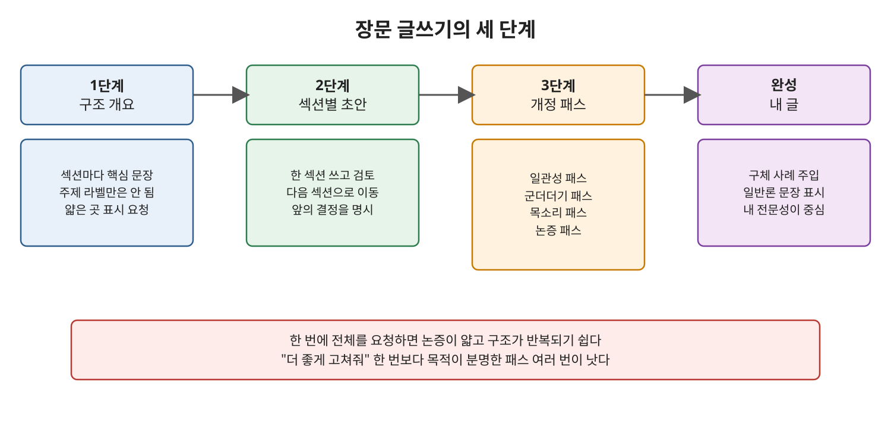

# 12장 장문 글쓰기 (Long-Form Writing: Blogs, Guides, and Books)

12장은 블로그, 가이드, 책 한 챕터처럼 긴 글을 Claude와 쓰는 방법을 다룬다. 저자는 Claude를 오 분 써 본 사람과 잘 쓰는 사람의 차이가 장문에서 독자 눈에 가장 선명하게 드러난다고 말한다. 블로그 글 하나는 프롬프트 한 번으로 뚝딱 만들 수 있지만 얄팍하게 읽힌다. 책 한 챕터는 진지한 글쓰기 프로젝트와 같은 규율, 곧 구조, 반복, 편집자적 판단이 필요하다. Claude는 그 과정을 빠르게 해 주는 유능한 초안 파트너다.

이 장은 장문을 현업 작가와 편집자의 방식으로 다룬다. 개요를 먼저 만들고, 관리할 수 있는 크기의 섹션 단위로 쓰고, 의도를 갖고 고친다. 유창한 첫 초안을 완성작으로 착각하지 않는 것이 요점이다.

> **쉽게 말하면**
> 집을 지을 때 설계도, 골조, 마감을 따로 하듯 글도 개요, 섹션 초안, 개정을 따로 한다.

---

## 1. 핵심 용어

| 용어 | 쉬운 설명 |
|------|-----------|
| 장문 글쓰기(Long-Form Writing) | 이메일이나 SNS 글보다 훨씬 긴 글. 블로그, 가이드, 책의 한 장, 책 전체 |
| 구조 개요(Structural Outline) | 본문을 쓰기 전에 만든, 섹션과 그 목적의 뼈대 |
| 목소리 흐트러짐(Voice Drift) | 긴 대화에서 컨텍스트가 옅어지며 글 어조가 점점 일관성을 잃는 현상 |
| 개정 패스(Revision Pass) | 한 번에 모든 것이 아니라 일관성, 군더더기, 어조 같은 한 가지 차원만 겨냥한 편집 라운드 |



## 2. 레슨 1: 장문은 왜 별도 접근이 필요한가

4장과 5장의 프롬프트와 컨텍스트 원칙은 그대로 적용된다. 장문에는 여기에 새로운 어려움이 하나 더해진다. 글이 한 번의 대화 안에 전부 들어와 눈에 보이기엔 너무 길어서, 일관성과 품질을 끝까지 유지하기 어렵다는 점이다.

3,000단어짜리 가이드를 한 번에 요청하면, 문장 하나하나는 괜찮아 보여도 논증이 얇고 구조가 반복되고 섹션마다 깊이가 들쭉날쭉한 결과가 자주 나온다. 크고 복잡한 글을 단계 없이 한 번에 만들려 한 자연스러운 결과다. 해법은 한 문장으로 말할 수 있다. 장문 글쓰기를 개요, 섹션 초안, 개정의 다단계 프로젝트로 다루고 결코 한 번의 요청으로 다루지 않는다.

## 3. 레슨 2: 1단계, 구조 개요

본문을 한 줄도 쓰기 전에 섹션별 개요를 만들고 승인한다. 11장의 보고서와 같은 방식이다. 강한 개요를 얻는 요청문은 이렇다.

```text
[구체적 독자]를 위한 [주제] 가이드를 쓰려 해. 아무것도 쓰기 전에
섹션별 개요를 제안해 줘. 각 섹션에는 주제 이름이 아니라 핵심
요점을 한 문장으로 적어 줘. 얇아 보이는 섹션이나 논증에 빈틈이
있으면 표시해 줘.
```

주제 이름만이 아니라 핵심 요점을 요구하는 이유가 있다. "3절 가격 책정"처럼 주제만 나열한 개요는 그 절에 할 말이 있는지 알려 주지 않는다. "3절: 계절성 사업에서 정액제 가격이 특히 실패하는 이유"처럼 요점이 있으면 실제 논증이 있는지, 자리만 채웠는지 드러난다. 흔한 실수는 사실상 주제 목록일 뿐인 개요를 승인했다가, 초안을 쓰다 보니 몇몇 섹션에 실질적으로 할 말이 없음을 발견하는 것이다.

## 4. 레슨 3: 2단계, 섹션별 초안

개요가 승인되면 전체를 한꺼번에가 아니라 한 섹션씩 쓴다. 10장에서 문서 분석에 썼던 구간별 규율을 생성에 적용하는 것이다. 잘하는 방법은 세 가지다.

1. **한 섹션을 쓰고 검토한 뒤 다음으로 간다.** 아무것도 검토하지 않은 채 전체를 줄줄이 쌓아 두지 않는다.
2. **핵심 결정을 명시적으로 가져간다.** 2절에서 만든 특정 사례나 틀을 뒤에서도 쓰고 싶다면 5절을 쓸 때 직접 말한다. "2절에서 쓴 [구체 사례]를 다시 언급해 일관성을 지켜 줘."
3. **섹션 사이의 반복을 살핀다.** 단계로 쓴 긴 글은 서로 전체가 보이지 않았던 섹션에서 같은 요점이나 표현이 되풀이될 수 있다. 검토 중에 적극적으로 표시하고 마지막 일관성 패스에서 처리한다.

예를 들어 가정 정리 가이드를 10개 섹션으로 쓰던 저자가 7절을 검토하다가 고객의 차고 일화가 이미 3절에 나왔음을 알아챈다. 둘 다 두지 않고 "이 예는 3절에서 이미 썼어. 여기서는 다른 예로 바꿔 줘"라고 요청한다. 각 섹션이 어느 정도 독립적으로 쓰였기 때문에 이런 섹션 간 인식은 사람이 가져와야 한다. 흔한 실수는 섹션을 연달아 쓰고 검토를 미뤘다가 반복과 불일치를 맨 끝에 발견해 고치는 비용이 커지는 것이다.

## 5. 레슨 4: 3단계, 의도적인 개정 패스

전체 초안이 생겼을 때 "더 좋게 만들어 줘"라는 만능 개정 요청 하나로 끝내려는 충동을 참는다. 대신 한 가지 차원에 집중한 별도의 패스를 여러 번 돌린다.

- **일관성 패스**: "전체 초안을 읽고 되풀이된 예, 모순, 섹션 사이의 어조 변화를 표시해 줘."
- **군더더기 패스**: "의미를 잃지 않고 뺄 수 있는 문장이나 단락을 표시해 줘. 자동으로 자르지 말고 표시만 해서 내가 결정하게."
- **목소리 패스**: 11장의 참고 예시를 쓰며 "도입부에서 정한 목소리에서 벗어난 섹션이 있어? 어디인지 표시해 줘."
- **논증 패스**: "충분히 뒷받침되거나 설명되지 않은 주장이 이 초안에 있어? 구체적으로 표시해 줘."

패스를 나누면 더 잘되는 이유는 각 패스가 한 가지 차원에 주의를 모으기 때문이다. 전문 편집자가 구조 편집, 문장 편집, 교정을 한꺼번에가 아니라 별개 단계로 하는 것과 같다. 흔한 실수는 만능 "다듬어 줘" 한 번으로 모든 차원이 얕게만 좋아지는 것이다.

## 6. 레슨 5: 속 빈 글과 반복적인 글 피하기

AI와 쓴 장문에 대한 가장 흔한 불만은 속이 비었다는 것이다. 유창하고 구조도 좋은데 고유한 관점이나 구체적 디테일이 없다. 방지책은 세 가지다.

- **프롬프트 단계에서 일반론 대신 구체성을 고집한다.** "X의 장점을 써 줘" 대신 강조하고 싶은 실제 장점, 사례, 데이터를 직접 준다. 표현은 Claude가 잘하지만 내용은 내 지식과 조사에서 나와야 한다.
- **가능한 한 실제 사례와 이야기를 넣는다.** 필요하면 익명화하거나 각색한 실제 일화는 지어낸 듯한 일반 시나리오와 읽히는 느낌이 전혀 다르다.
- **일반적으로 들리는 대목을 표시해 달라고 직접 요청한다.** "이 섹션을 읽고 다른 어떤 주제에도 해당할 수 있는, 이 주제에 특정되지 않은 문장을 표시해 줘"는 유용하지만 덜 쓰이는 요청이다.

비교해 보자. 첫 시도가 낼 법한 "효과적인 시간 관리는 생산성을 크게 높이고 스트레스를 줄일 수 있다"는 일반론이다. 구체적 디테일을 가진 문장은 이렇다. "내가 코칭한 프리랜서 중 고객 메일을 계속 확인하는 대신 하루 두 번 정해진 시간에 몰아서 처리한 사람들은 약 2주 안에 퇴근 무렵의 피로가 눈에 띄게 줄었다고 말한다." 두 번째 문장이 진짜 쓴 글로 읽히는 이유는 일반 초안이 스스로 지어내지 않을 검증 가능한 디테일을 담았기 때문이다.

모범 사례는 이렇다. 일반적으로 들리는 대목은 자기 분야의 전문가인 내가 구체적인 무언가를 넣어야 한다는 신호다. Claude는 실제 내용을 다듬는 데는 능하지만, 아무것도 없는 곳에 설득력 있는 내용을 만들어 내는 데는 훨씬 약하다.

## 7. 비즈니스 예시: 퇴직 설계 가이드

금융 자문가가 고객용 퇴직 설계 가이드를 쓰면서 처음에는 전체를 한 번에 요청했다. 초안은 매끄럽게 읽혔지만 어느 자문가에게도 해당할 법한 일반적인 글이었다.

그는 이 장의 단계로 다시 했다. 먼저 승인된 개요를 만들었다. 섹션별 초안을 쓰며 실제로 만난 고객 상황(익명화)을 적극 넣었다. 마지막에는 별개의 개정 패스를 돌렸다. 일관성 패스, 구체성 패스("일반적으로 느껴지는 것을 표시해 줘"), 자기 과거 뉴스레터와 비교하는 목소리 패스다. 완성된 가이드는 일반 템플릿이 아니라 그 자신의 전문성으로 읽혔다. 구조적 과정과 직접 주입한 구체성의 결합이 글을 기술적으로는 괜찮은 수준에서 진짜 내 것으로 끌어올렸다는 것이 책의 교훈이다.

## 8. Claude 대화 예시

사용자가 "이 섹션이 좀 일반적인 느낌인데 왜 그런지 모르겠어요"라고 말한다. Claude는 이렇게 답한다.

> 다시 보니 몇몇 문장은 이 분야의 어떤 주제에도 해당할 수 있어서, 말씀하신 논증에만 해당하지는 않습니다. 예를 들어 "일관성의 중요성"이라는 줄은 당신 논점만의 구체 정보를 담고 있지 않습니다. 이 요점과 관련된 경험에서 구체적인 예, 숫자, 이야기 하나를 알려 주시면, 지금의 일반적인 진술 대신 그것을 중심으로 이 섹션을 다시 쓰겠습니다.

## 9. 연습과 미니 프로젝트

1. **개요 규율**: 다음 장문 한 편을 쓸 때 본문 한 문장을 쓰기 전에 주제 이름이 아니라 핵심 요점이 있는 전체 개요를 만들고 검토한다.
2. **섹션별 연습**: 장문 한 편을 전부 섹션 단위로 쓰고, 각 섹션을 검토한 뒤 다음으로 넘어간다.
3. **개정 패스 연습**: 기존 초안에 만능 "다듬어 줘" 대신 일관성, 군더더기, 구체성처럼 집중된 패스를 최소 세 번 돌린다.
4. **구체성 감사**: 일반적으로 읽힌다고 의심되는 단락 하나에 넣을 구체적인 실제 디테일, 사례, 숫자를 찾는다.

**미니 프로젝트 "완성된 한 편"**: 블로그 글, 가이드, 책 한 장 중 하나를 이 장의 모든 단계로 처음부터 끝까지 쓴다. 승인된 구체적 개요, 섹션 사이 검토를 곁들인 섹션별 초안, 집중된 개정 패스 최소 세 번, 나만이 줄 수 있는 구체적인 실제 디테일이나 사례 최소 두 개가 포함되어야 한다.

## 10. 흔한 실수와 문제 해결

| 증상 | 가능한 원인 | 해결 |
|------|-------------|------|
| 긴 글이 얇고 반복적이다 | 단계 없이 큰 요청 하나로 썼다 | 개요 먼저, 섹션별 초안으로 다시 시작 |
| 같은 사례나 요점이 여러 섹션에 나온다 | 섹션끼리 서로 참조하지 않고 썼다 | 일관성 패스를 따로 돌려 반복을 표시 |
| 기술적으로는 괜찮은데 속이 빈 느낌 | 구체적 디테일이나 사례 부족 | 내 지식, 숫자, 이야기를 직접 주입 |
| 글 중간에 목소리가 바뀐다 | 작업 세션 사이에 목소리 참고 자료를 유지하지 않았다 | 11장의 참고 자료를 주고 목소리 패스를 돌린다 |

이 밖에도 논증 없이 주제 라벨만 적힌 개요를 승인하는 것, 장문 전체를 한 프롬프트로 요청하고 깊이와 일관성을 기대하는 것, 직접 알지 못하는 지어낸 사례에 기대는 것이 흔한 실수다.

## 11. 장 요약

- 장문은 개요, 섹션별 초안, 별개의 개정 패스라는 단계적 접근이 필요하다.
- 좋은 개요는 섹션마다 주제 이름이 아니라 진짜 핵심 요점을 담는다.
- 한 섹션씩 쓰고 검토하며 섹션 사이의 반복과 불일치를 적극적으로 살핀다.
- 일관성, 군더더기, 목소리, 논증은 하나의 만능 요청이 아니라 따로 패스를 돌린다.
- 내 구체적 디테일을 넣어 속 빈 글을 막는다. Claude는 내용을 잘 다듬지만 그 내용은 나에게서 나와야 한다.

## 12. 실행 체크리스트

- [ ] 장문을 쓰기 전에 핵심 요점이 있는 전체 개요를 만들고 검토한다.
- [ ] 한 섹션씩 쓰고 다음으로 넘어가기 전에 검토한다.
- [ ] 만능 다듬기 요청 대신 집중된 개정 패스를 돌린다.
- [ ] 일반적으로 들리는 대목에는 구체적인 실제 디테일을 넣는다.
- [ ] 미니 프로젝트 "완성된 한 편"을 마쳤다.

## 13. 퀴즈 취지

1. 강한 개요는 섹션마다 무엇을 담아야 하는가(한 문장의 핵심 요점).
2. 만능 다듬기 한 번보다 별개의 개정 패스를 권하는 이유는 무엇인가.
3. Claude가 글쓴이의 입력 없이도 구체적인 실제 디테일을 믿을 만하게 지어낼 수 있는가(참 거짓).
4. 섹션 사이에서 발견한 반복의 권장 해법은 무엇인가(일관성 패스).

**추가 연습**: 앞으로 세 편의 장문에 이 단계를 적용하고, 내 구체적 사례와 이야기와 데이터를 계속 목록으로 모아 두어 9장의 지식 베이스로 연결한다.

**다음 장**: 13장은 마케팅 카피와 캠페인 작업 흐름으로 이어진다.

<br>
<br>
<br>

[Mastering Claude AI](../)
