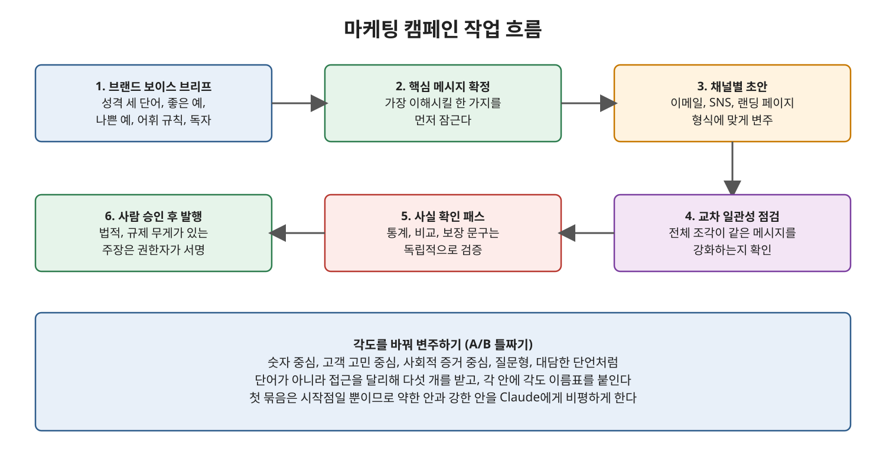

# 13장 마케팅 카피와 캠페인 (Marketing Copy and Campaign Workflows)

13장은 마케팅 글쓰기를 Claude와 하는 방법을 다룬다. 마케팅은 근본적으로 언어 작업이고 양이 많으며 구조가 반복되는 일이 많아서(헤드라인 하나 더, 이메일 하나 더, SNS 문구 하나 더) Claude와 잘 맞는다. 하지만 마케팅 카피는 정의상 외부에 공개되므로 일반적인 AI 문장이 세상 앞에 가장 잘 드러나는 영역이기도 하다. 밋밋하고 기억에 남지 않는 슬로건은 성과가 낮을 뿐 아니라 브랜드를 직접 나쁘게 보여 준다.

이 장은 4, 5, 11장의 목소리 맞추기와 컨텍스트 기법을 마케팅 특유의 요구에 적용한다. 반복 없는 다양성, 여러 조각과 채널에 걸친 일관성, 공개 전 모든 주장을 사실 확인하는 규율이다. 책의 사례 수치와 도구 설명은 책이 쓰인 시점 기준이다.

> **쉽게 말하면**
> 브랜드의 말투를 한 번 문서로 만들어 두고, 메시지를 먼저 확정한 뒤, 모든 숫자를 확인하고 내보낸다.

---

## 1. 핵심 용어

| 용어 | 쉬운 설명 |
|------|-----------|
| 브랜드 보이스 브리프(Brand Voice Brief) | 브랜드의 어조, 어휘, 성격을 적어 두고 결과의 일관성을 지키는 데 쓰는 참고 문서 |
| 메시징 각도(Messaging Angle) | 제품이나 제안의 가치를 틀 짓는 구체적 방식. 절약으로 시작할지 지위로 시작할지 등 |
| 캠페인 워크플로 | 여러 조각과 채널에 걸친 마케팅 콘텐츠의 기획, 초안, 다듬기 전체 순서 |
| A/B 틀짜기(A/B Framing) | 하나만 확정하지 않고 같은 메시지의 서로 다른 버전을 여럿 만들어 비교하는 방식 |



## 2. 레슨 1: 브랜드 보이스 브리프를 한 번 만들어 어디서나 쓰기

카피를 만들기 전에 상시 쓰는 브랜드 보이스 브리프를 먼저 만든다. 5장의 컨텍스트 패킷 개념을 마케팅 용도로 정식화한 것이다. 좋은 브리프에 들어갈 내용은 다섯 가지다.

- **브랜드 성격을 나타내는 세 단어.** "자신감 있고 따뜻하고 약간 장난스러운"처럼 쓴다. "전문적인" 같은 차별성 없는 말은 피한다.
- **목소리를 정확히 보여 주는 실제 카피 예 두세 개.**
- **어긋난 카피 예 한두 개와 이유 메모.** 너무 기업적이다, 애쓴 티가 난다, 모호하다 같은 이유다.
- **구체적인 어휘 규칙.** 브랜드가 늘 쓰는 말과 일부러 피하는 말이다.
- **독자 설명.** 실제로 누가 읽고 무엇을 중요하게 여기는가.

한 번 만들어 두면 이후의 모든 마케팅 요청이 브랜드를 처음부터 다시 설명하지 않고 이 브리프를 참조하면 된다. 6장 프로젝트 지식 개념과 같지만 시간이 지나며 여러 콘텐츠에 걸친 마케팅 일관성에 맞춘 것이다. 모범 사례는 이 브리프를 전용 마케팅 프로젝트(6장)에 넣는 것이다. 그러면 그 프로젝트에서 쓰는 모든 캠페인, 이메일, SNS 글이 자동으로 혜택을 받는다.

## 3. 레슨 2: 반복 없이 다양하게 만들기

AI 카피에서 흔한 불만은 요청한 여러 변형이 사실상 같은 말을 단어만 바꿔 한 것이라는 점이다. 헤드라인 세 개가 실은 동의어만 바꾼 한 개다. 각도 자체를 바꾸라는 명시적 지시가 없으면 "다섯 개 버전" 요청은 같은 아이디어의 표면적 다시 쓰기 다섯 개가 되기 쉽다. 진짜 다양성을 끌어내는 요청문은 이렇다.

```text
이 제품 출시용 헤드라인 다섯 개를 줘. 각각 서로 다른 각도여야 해.
예: 구체적 숫자나 통계로 시작, 고객의 고민으로 시작, 사회적 증거로
시작, 질문 형태, 대담하고 직접적인 단언. 각 안에 각도 이름표를 붙여 줘.
```

각도를 지정하면 단어가 아니라 구조 차원의 다양성이 생긴다. 다섯 안이 사실 같은 아이디어라면 성과도 비슷할 수밖에 없으므로, 이는 실제 A/B 테스트에 쓸모가 있다. 책의 비교를 보자. 약한 다양성(같은 각도, 다른 단어)은 "우리 도구로 시간을 아끼세요 / 우리 도구가 시간을 아껴 줍니다 / 쉬워진 시간 절약"이다. 진짜 다양성(서로 다른 각도)은 이렇다. "보고서 시간을 3시간에서 20분으로 줄이세요."(통계 중심) "월요일 현황 보고가 더는 두렵지 않습니다."(고민 중심) "수동 보고를 버린 4,000개 팀에 합류하세요."(사회적 증거 중심) 흔한 실수는 "더 많은 안"만 요청하고 전략적으로 다른 각도를 지정하지 않아 모든 안이 서로 바꿔 쓸 수 있는 것에 불만을 갖는 것이다.

## 4. 레슨 3: 전체 캠페인 기획 흐름

여러 조각으로 된 캠페인(제품 출시, 시즌 프로모션)은 개별 카피 전에 전체 전략부터 만든다. 11, 12장의 개요 먼저 규율과 같다. 단계는 넷이다.

1. **캠페인의 핵심 메시지와 독자를 정한다.** "[제품]을 [독자]에게 출시한다. 가장 이해시키고 싶은 단 한 가지는 [핵심 메시지]다. 이메일, SNS, 랜딩 페이지 같은 [채널] 전체에 이 핵심 메시지를 강화하되 형식에 맞게 변주한 캠페인 구조를 제안해 줘."
2. **개별 조각을 쓰기 전에 핵심 메시지를 검토하고 잠근다.** 메시지 자체를 고쳐야 한다면 지금이 가장 싸다. 잘못된 틀로 이미 다섯 개를 만든 뒤보다 훨씬 낫다.
3. **조각마다 형식에 맞는 지시와 함께 쓰되, 공유 브랜드 보이스 브리프와 잠근 핵심 메시지를 참조한다.** 모든 조각이 같은 캠페인의 일부로 느껴져야 하지만 형식에 맞게 달라야 한다. 랜딩 페이지 헤드라인과 인스타그램 문구는 같은 메시지를 공유해도 똑같이 읽히면 안 된다.
4. **조각 사이 일관성을 점검한다.** "여기 이 캠페인의 다섯 조각이 있어. 모두 같은 핵심 메시지를 일관되게 강화하는지, 서로 모순되거나 다른 어조로 흘러가지 않는지 확인해 줘."

책의 예로, 새 세럼을 출시하는 스킨케어 브랜드는 핵심 메시지("일반 레티놀 제품 같은 자극 없이 임상 시험을 거친 성분")를 먼저 만들고 잠근 뒤에야 쓰기 시작한다. 이후 이메일, 인스타그램 문구, 랜딩 페이지 헤드라인이 모두 이 같은 잠긴 메시지를 형식에 맞게 강화하도록 만들어진다. 조각마다 따로 제품에 대한 각도를 지어내는 것과 다르다.

## 5. 레슨 4: 첫 초안을 받아들이지 말고 시험하고 다듬기

첫 카피 묶음은 완성품이 아니라 평가의 출발점으로 다룬다. 전문 마케팅의 표준 관행이며, Claude가 초안을 써도 똑같이 적용된다. 가벼운 시험 습관은 이렇게 만든다.

- **Claude가 자기 안을 비평하게 한다.** "준 헤드라인 다섯 개 중 비용에 민감한 소규모 사업자에게 가장 강한 것은 무엇이고 이유는? 가장 약한 것은?" 최종 결정은 내 몫이지만 장단점의 추론을 끌어낼 수 있다.
- **정말 다른 틀의 두 번째 의견을 받는다.** "지금까지 본 것이 전부 틀렸다고 가정하고, 시도하지 않은 새로운 각도는 무엇이야?"
- **가능하면 실제 독자의 반응을 포함한다.** Claude는 안을 빠르게 만들고 다듬지만, 몇 명의 실제 고객이나 동료의 비공식 반응도 여전히 가장 믿을 만한 신호다. 실제 피드백의 대체가 아니라 시험할 안을 더 빨리 만드는 데 쓴다.

흔한 실수는 모두 세련되고 전문적으로 읽힌다는 이유만으로 첫 묶음을 최종으로 취급하는 것이다. 세련됨은 효과와 같지 않다.

## 6. 레슨 5: 공개 전 마케팅 주장 사실 확인

마케팅 카피에는 통계, 비교, 보장 같은 구체적 주장이 자주 들어가고, 틀리면 법적, 평판상 무게가 크다. 1장의 환각 논의가 실수가 공개되고 결과가 큰 맥락에 그대로 적용된다. 책임 있는 처리법은 세 가지다.

- **검증되지 않은 구체적 통계나 주장은 그대로 두지 않는다.** 특히 경쟁사, 성능 보장, 연구 인용은 발행 전에 9장의 검색 규율로 독립적으로 확인한다.
- **Claude에게 확인이 필요한 주장을 직접 표시하게 한다.** "이 캠페인 카피를 읽고 발행 전에 확인해야 할 모든 구체적 사실 주장, 통계, 비교를 표시해 줘."
- **법적이나 규제상 무게가 있는 것은 실제 권한이 있는 사람이 승인한다.** 건강 주장, 금융 보장, 비교 광고가 해당한다. 위험이 사람의 최종 확인을 분명히 정당화하는 경우이며, 진지한 업무에서 법률과 금융 조언에 대해 늘 적용되는 주의와 같다.

모범 사례는 캠페인 흐름에 상시 단계, 곧 발행 전 전용 사실 확인 패스를 넣는 것이다. 책임 있는 마케팅 팀이 초안을 누가 또는 무엇이 썼든 내보내기 전에 검토하는 것과 같다.

## 7. 비즈니스 예시: 60퍼센트가 35퍼센트였을 때

B2B 소프트웨어 회사의 마케팅 책임자 Denny는 신기능 출시 카피를 쓰고 있었다. 초기 초안에 "온보딩 시간을 60퍼센트 줄입니다"라는 구체적 주장이 있었다. 실제로 확인한 수치가 아니라 초안 작성 중에 나온 그럴듯한 숫자였다.

캠페인 흐름에 사실 확인 패스를 넣어 둔 덕에 이 주장은 발행 전에 표시되었다. 제품팀에 확인하니 초기 고객 데이터의 실제 측정값은 35퍼센트에 가까웠고, 공개 전에 카피를 바로잡았다. 부정확하게 나갔다면 신뢰와 법적 위험까지 생길 수 있는 주장을 피한 것이다. 책의 교훈은 이 단계가 형식이 아니었다는 점이다. 운에 맡기지 않고 흐름의 의도적인 상시 부분이었기 때문에 실제로 큰 피해가 될 것을 잡아냈다.

## 8. Claude 대화 예시

사용자가 "다양하게 달라고 했는데 슬로건 다섯 개가 서로 비슷해요"라고 말한다. Claude는 이렇게 답한다.

> 맞습니다. 다시 보니 다섯 개 모두 단어만 다른 "속도와 편리함" 각도입니다. 진짜 전략적 다양성이 있도록 다시 드리겠습니다. 지위와 열망 중심 하나, 구체적인 고민 중심 하나, 신뢰와 신용 중심 하나로 한 세트를 만들어 한 아이디어의 다섯 버전이 아니라 실제로 고를 수 있게 하겠습니다.

## 9. 연습과 미니 프로젝트

1. **브랜드 보이스 브리프 만들기**: 실제로 일하는(또는 만드는) 브랜드에 레슨 1의 구조대로 전체 브리프를 만든다.
2. **진짜 다양성 연습**: 실제 대상에 다섯 가지 서로 다른 전략적 각도를 명시해 헤드라인이나 카피 다섯 개를 요청하고, 정말로 의미 있게 다른지 평가한다.
3. **캠페인 흐름 연습**: 레슨 3의 네 단계로 작은 실제 캠페인 하나를 기획하며 개별 조각 전에 핵심 메시지를 잠근다.
4. **사실 확인 패스**: 기존 마케팅 카피(내 것이나 가상 예)에 전용 사실 확인 패스를 돌려 발행 전에 확인이 필요한 모든 주장을 찾는다.

**미니 프로젝트 "전체 캠페인"**: 작은 마케팅 캠페인 하나를 처음부터 끝까지 기획하고 쓴다. 브랜드 보이스 브리프(또는 기존 것 참조), 최소 두 형식이나 채널에 걸친 잠근 핵심 메시지와 캠페인 구조, 한 조각 이상에서 서로 다른 전략 각도로 만든 다양한 카피 안, 발행 가능하다고 보기 전에 모든 구체적 주장에 돌린 전용 사실 확인 패스가 들어가야 한다.

## 10. 흔한 실수와 문제 해결

| 증상 | 가능한 원인 | 해결 |
|------|-------------|------|
| 카피가 일반적이거나 브랜드답지 않다 | 브랜드 보이스 브리프가 없다 | 전체 브리프를 만들어 참조한다 |
| 다양하게 달라 했는데 안이 서로 바꿔 쓸 수준이다 | 서로 다른 각도를 지정하지 않았다 | 단어가 아니라 전략적 각도를 명시한다 |
| 캠페인 조각이 서로 일관되지 않다 | 개별 조각 전에 핵심 메시지를 잠그지 않았다 | 메시지를 먼저 잠근 뒤 조각마다 그 기준으로 쓴다 |
| 발행한 주장이 부정확했다 | 발행 전 사실 확인 패스가 없었다 | 캠페인 흐름에 상시 사실 확인 단계를 넣는다 |

그 밖에 첫 묶음을 시험이나 비평 없이 최종으로 취급하는 것, 구체적 주장이나 통계를 독립 확인 없이 발행하는 것도 흔한 실수다.

## 11. 장 요약

- 브랜드 보이스 브리프를 한 번 만들고 이후 모든 마케팅 요청에서 참조해 일관성을 지킨다.
- "더 많은 안"이 아니라 서로 다른 전략적 각도를 지정해 진짜 다양성을 얻는다.
- 전체 캠페인은 핵심 메시지를 먼저 잠그고 그 뒤에 개별 조각을 쓴다.
- 첫 카피는 완성품이 아니라 시험과 다듬기의 출발점으로 다룬다.
- 구체적 사실 주장은 독립 검증 없이, 필요하면 사람의 승인 없이 발행하지 않는다.

## 12. 실행 체크리스트

- [ ] 참조할 브랜드 보이스 브리프를 만들어 두었다.
- [ ] 단어 차이가 아니라 진짜 전략적 다양성을 요청한다.
- [ ] 개별 조각 전에 캠페인 핵심 메시지를 잠근다.
- [ ] 첫 카피를 그대로 받지 않고 시험하고 비평한다.
- [ ] 발행 전 모든 구체적 마케팅 주장에 전용 사실 확인 패스를 돌린다.

## 13. 퀴즈 취지

1. 브랜드 보이스 브리프에는 무엇이 들어가야 하는가(성격, 실제 예, 어휘 규칙, 독자).
2. 진짜로 다른 카피 안을 얻으려면 어떻게 요청해야 하는가.
3. 카피 작성 중 나온 그럴듯한 통계는 독립 검증 없이 발행해도 되는가(참 거짓).
4. 캠페인의 개별 조각을 쓰기 전에 무엇을 해야 하는가(핵심 메시지 확정과 잠금).

**추가 연습**: 마케팅 카피를 쓰는 브랜드나 고객마다 따로 보이스 브리프를 만들어 각자의 프로젝트(6장)에 저장하고, 캠페인이 사소해 보여도 사실 확인 패스를 마지막의 타협 불가 단계로 삼는다.

**다음 장**: 14장은 편집, 목소리 맞추기, AI 티 지우기로 이어진다.

<br>
<br>
<br>

[Mastering Claude AI](../)
