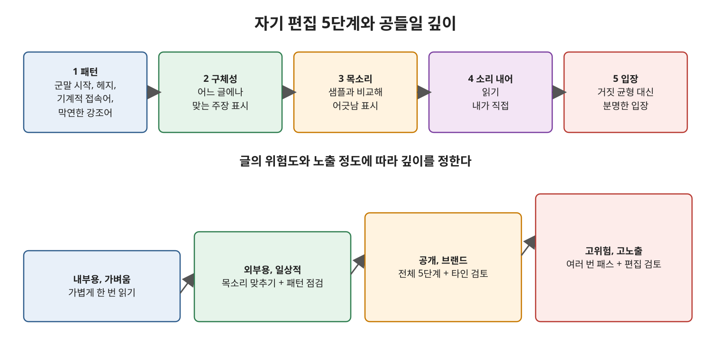

# 14장 편집과 문체 맞추기와 AI 티 지우기 (Editing, Voice-Matching, and Avoiding "AI Slop")

14장은 Claude를 진지하게 쓰는 사람이 결국 마주치는 문제를 다룬다. 편집하지 않은 AI 글에는 알아볼 수 있는 느낌이 있다. 정해진 리듬, 특정 연결 표현, 균형 잡힌 듯한 헤지(hedge, 확언을 피하는 완곡 표현), 약간의 과한 격식, 관련 없는 주제에서도 반복되는 구조가 그것이다. 한 번 눈에 들어오면 지울 수 없고 독자도 마찬가지다.

좋은 소식은 이것이 불가피하지 않다는 점이다. 한계가 아니라 기본값이고, 이 장의 모든 기법은 그 기본값에서 벗어나 진짜로 구체적으로 쓴 글에 가까워지는 방향으로 이끄는 것이다. 새로운 하나의 기술이라기보다 4, 11, 12장의 내용을 하나의 편집 규율로 통합하는 장이다.

> **쉽게 말하면**
> AI 초안은 틀리진 않았는데 누구나 쓴 것 같다. 편집은 거기에 내 입장과 내 말투와 구체적 사실을 넣는 일이다.

---

## 1. 핵심 용어

| 용어 | 쉬운 설명 |
|------|-----------|
| AI 슬롭(AI Slop) | 편집하지 않은 AI 글에 흔한, 일반적이고 헤지가 많고 공식에 박힌 듯한 글을 가리키는 구어 표현 |
| 목소리 맞추기(Voice-Matching) | 생성된 글이 일반적 기본값이 아니라 특정 사람이나 브랜드처럼 들리게 만드는 의도적 과정 |
| 편집 패스(Editorial Pass) | 처음부터 생성하지 않고 이미 있는 글(내 글이나 Claude의 글)을 검토하고 개선하는 작업 |
| 헤지 패턴(Hedge Pattern) | "중요한 것은", "많은 경우" 같은 조심스럽고 단서가 많은 표현이 명확한 글을 흐리는 것 |



## 2. 레슨 1: AI 슬롭의 패턴 알아보기

편집하지 않은 AI 글에는 특정 패턴이 유독 자주 나온다. 알아보는 것이 없애는 첫걸음이다. 주의할 패턴은 여섯 가지다.

- **군말로 여는 문장**: "오늘날 빠르게 변하는 세상에서...", "누구나 알다시피..." 같은, 정작 요점을 미루는 문장.
- **과한 헤지**: "결과는 다를 수 있다는 점을 알아야 합니다"가 반복되어 확신과 명료함을 흐린다.
- **"X일 뿐 아니라 Y"라는 구문**: 수사적 힘이 사라질 정도로 남용된다.
- **입장을 피하는 대칭적 구조**: "이점도 있지만 단점도 고려해야 한다"처럼, 독자에게는 진짜 관점이 더 도움이 되는 자리에서 균형 잡힌 듯 말한다.
- **기계적으로 쓰는 연결어**: 논증의 실제 흐름이 요구해서가 아니라 습관적으로 쓰는 "더욱이", "게다가", "결론적으로".
- **구체성 없는 막연한 강조어**: 실제 숫자나 디테일 없이 쓰는 "크게", "극적으로".

이 패턴 하나하나가 단독으로는 틀리지 않았다. 문제는 밀도와 기계적 남용이다. 독자, 편집자, 고객은 왜인지 정확히 짚지 못해도 글에 이런 느낌이 있음을 느낀다. 팁이 하나 있다. 초안을 소리 내어 읽어 본다. 지면에서 괜찮아 보이던 패턴이 소리로는 눈에 띄게 어색하거나 반복적으로 들린다. 가장 빠르고 수고가 적은 품질 점검 중 하나다.

## 3. 레슨 2: Claude에게 이 패턴을 기준으로 자기 편집시키기

이 패턴은 잘 알려져 있으므로 Claude에게 자기 결과를 대조해 보게 할 수 있다. 모델이 처음 그 글을 쓴 당사자여도 글 속 패턴을 알아볼 수 있어서 실제로 효과적인 기법이다. 요청문은 이렇다.

```text
이 초안을 읽고 군말로 여는 문장, 과하게 쓴 헤지, 기계적인 연결어,
구체성 없는 막연한 강조어를 표시해 줘. 각각에 더 직접적인 대안을
제안해 줘.
```

책의 예로, 원문은 "고객 피드백이 대체로 긍정적이긴 하나 잠재적으로 개선될 수 있는 일부 영역을 부각한다는 점을 유의해야 합니다"이다. 표시하고 고친 결과는 "고객은 제품 전반을 좋아했지만 한 가지 문제를 일관되게 지적했다. 배송 속도다."이다. 고친 글은 실제 입장을 밝히고 헤지 누적을 없애고 구체적이라서, 레슨 1의 패턴과 정반대다. 흔한 실수는 실제 독자에게 갈 글의 첫 초안을 이런 전용 패턴 점검 없이 받아들이는 것이다.

## 4. 레슨 3: 목소리 맞추기, 한 줄 지시가 아닌 진짜 과정

"내 목소리로 써 줘"는 그것만으로는 통하는 지시가 아니다. 목소리는 구체적이고 추상적으로 설명하기 어려우며, 그래서 4장의 좋은 예와 나쁜 예 기법이 여기서 그토록 중요하다. 진짜 목소리 맞추기 과정은 네 단계다.

1. **대상 목소리의 실제 샘플 세 개에서 다섯 개를 모은다.** 내 과거 글이나 브랜드의 기존 카피다.
2. **막연한 형용사가 아니라 구체적이고 이름 붙일 수 있는 특징을 찾는다.** "캐주얼하다" 대신 "짧은 문장, 축약형을 자유롭게 사용, 가끔 '당신'으로 독자에게 직접 말함, 세미콜론은 거의 안 씀"처럼 쓴다.
3. **샘플과 이름 붙인 특징을 함께 준다.**
4. **결과에 전용 목소리 확인 패스를 돌린다.** "이 초안을 내가 준 목소리 샘플과 비교해서 구체적으로 어디가 그 목소리에서 벗어나는지 알려 줘."

요청문은 대략 이렇다.

```text
내 글 예시 세 개야: [샘플]. 특징: 문장이 짧고, 축약형을 계속 쓰고,
가끔 독자에게 직접 말하고, 세미콜론과 "leverage"라는 단어는 거의
안 써. 이 목소리에 정확히 맞춰 다음 글을 써 줘.
```

특징에 이름을 붙이는 편이 막연한 수식어보다 나은 이유는, "캐주얼"은 백 가지 뜻일 수 있지만 "짧은 문장, 잦은 축약형, 독자 직접 호칭, 세미콜론 없음"은 일관되게 적용할 만큼 구체적이기 때문이다. 흔한 실수는 샘플은 주고 그 안의 구체적 특징에는 이름을 붙이지 않아 Claude가 패턴을 추론하게 두는 것이다. 어느 정도는 되지만 명시보다 덜 믿을 만하다.

## 5. 레슨 4: 다시 쓸 수 있는 구조적 자기 편집 패스

레슨 1에서 3까지를 나가기 전에 무엇에나 돌릴 수 있는 재사용 가능한 자기 편집 체크리스트 하나로 합친다. 다섯 단계다.

1. **패턴 점검**: 군말 시작, 헤지 누적, 기계적 연결어, 막연한 강조어를 표시한다.
2. **구체성 점검**: 거의 어떤 주제에도 해당할 만한 일반적 주장을 표시하고 구체적 디테일을 주거나 삭제한다.
3. **목소리 점검**: 실제 목소리 샘플과 비교해 어긋남을 표시한다.
4. **소리 내어 읽기 점검**: 이것은 내가 직접 한다. 자동 패스가 가끔 놓치는 것을 잡아 준다.
5. **입장 점검**: 글이 실제로 필요로 하는 분명한 입장 대신 거짓 균형으로 얼버무린 곳을 표시한다.

효율적으로 돌리려면 대화를 다섯 개 따로 열 필요는 없다. 구조화한 한 번의 요청으로 여럿을 한꺼번에 다룰 수 있다.

```text
이 초안을 읽고 다음을 따로 표시해 줘. (1) 군말이나 헤지가 많은
표현, (2) 구체적 디테일이 없는 일반적 주장, (3) 내가 준 목소리
샘플에서 어조가 벗어난 곳. 결과를 이 세 제목 아래 정리해 줘.
```

흔한 실수는 위험이 낮아 보이는 글에서 자기 편집 패스를 건너뛰었다가, 위험이 높은 글에서 점검 없이 나왔을 때와 똑같이 일반적으로 읽히는 것이다.

## 6. 레슨 5: 어디까지 맡길지 정하기

이 장의 전체 과정이 모든 글에 필요하지는 않고, 이것은 게으름이 아니라 정당하고 의도적인 선택이다. 작업마다 그 선을 긋는 것 자체가 기술이다. 책의 틀은 이렇다.

| 위험도와 노출 | 권장 과정 깊이 |
|---------------|----------------|
| 내부용, 위험 낮음, 버려질 글(간단한 사내 메모) | 가볍게, 빠르게 한 번 읽으면 대개 충분 |
| 외부용이지만 일상적(표준 고객 이메일) | 목소리 맞추기와 빠른 패턴 점검 |
| 공개되고 브랜드를 대표(마케팅 카피, 발행 글) | 전체 자기 편집 패스, 가능하면 나 외의 사람 검토 |
| 위험과 노출이 큰 글(책, 주요 캠페인, 내 이름으로 대규모로 나가는 것) | 전체 과정, 여러 번 패스, 추가 편집자 검토 가능성 |

모범 사례는 글의 실제 위험과 노출에 맞춰 편집 강도를 맞추는 것이다. 버려질 사내 메모를 과하게 다듬으면 시간 낭비이고, 공개되는 글을 덜 다듬으면 이 장이 피하려는 바로 그 AI 슬롭이라는 평판을 얻을 위험이 있다.

## 7. 비즈니스 예시: 컨설팅 보고서의 3번 반복

컨설팅 회사의 주니어 어소시에이트 Wren은 고객용 인사이트 보고서 초안을 쓰라는 요청을 받았다. 빠르게 만든 첫 초안은 매끄럽게 읽혔지만 "X일 뿐 아니라 Y"가 세 번, "오늘날 경쟁적인 환경에서"로 시작하는 첫 줄, 구체적 수치 없는 "상당한 개선이 관찰되었다" 같은 막연한 주장이 여럿 있었다.

그는 레슨 4의 자기 편집 패스를 돌렸다. 패턴 점검이 반복 구문과 군말 시작을 잡았다. 구체성 점검이 막연한 개선 주장을 표시해 기반 데이터에서 실제 비율을 가져오게 했다. 과거 호평받은 보고서와 한 번 목소리를 비교해 어조가 맞는지 확인했다. 고친 보고서는 날카롭고 구체적이며 진짜로 쓴 글처럼 읽혔다. 이 과정으로 실제로 그렇게 만들었기 때문이다. 책의 교훈은 첫 초안이 나쁜 것이 아니라 편집되지 않았을 뿐이라는 점이다. 자기 편집 패스가 유창하지만 일반적인 글을 진짜로 다듬어진 글로 바꾸었고, 이 장 전체가 메우려는 간극이 바로 그것이다.

## 8. Claude 대화 예시

사용자가 "솔직히 이거 딱 봐도 AI가 쓴 것 같아요?"라고 묻는다. Claude의 답은 대략 이렇다.

> 몇 가지 표시가 있습니다. 첫 문장이 꽤 전형적인 군말 패턴("오늘날 빠르게 진화하는 업계에서...")이고, 두 번째 단락에 "효율적일 뿐 아니라 혁신적인" 구문이 있어 약간 공식처럼 읽힙니다. 중간 섹션은 실제로 꽤 구체적이고 잘 읽힙니다. 첫 줄은 아예 빼고 두 번째 문장부터 시작하시길 권합니다. 훨씬 빨리 실제 요점에 닿습니다.

## 9. 연습과 미니 프로젝트

1. **패턴 찾기**: 내가 AI와 썼던 과거 글에서 레슨 1의 패턴 사례를 최소 세 개 찾는다.
2. **목소리 맞추기 연습**: 이번 주에 쓸 글 한 편에 레슨 3의 네 단계로 전체 목소리 맞추기 요청을 만든다.
3. **자기 편집 패스 연습**: 기존 초안에 레슨 4의 구조적 자기 편집 패스를 돌리고 전후를 비교한다.
4. **위험도 분류**: 레슨 5의 표로 최근이나 앞으로의 글 다섯 편을 알맞은 과정 깊이로 분류한다.

**미니 프로젝트 "AI 티 없는 초안"**: 이번 주에 실제로 써야 하는 글 한 편, 가능하면 공개되거나 브랜드를 대표하는 글을 고른다. 이 장의 전체 과정, 곧 이름 붙인 구체적 특징으로 목소리 맞추기, 초안 작성, 내가 직접 하는 소리 내어 읽기를 포함한 다섯 단계 자기 편집 패스를 돌린다. 최종본을 편집 없는 첫 초안이 어땠을지와 비교한다.

## 10. 흔한 실수와 문제 해결

| 증상 | 가능한 원인 | 해결 |
|------|-------------|------|
| 세련돼 보이는데도 일반적으로 읽힌다 | 헤지, 군말, 막연한 강조어 같은 슬롭 패턴을 안 다뤘다 | 레슨 1과 4의 패턴 점검을 돌린다 |
| "내 목소리로"라 했는데 내 말투 같지 않다 | 실제 샘플이나 이름 붙인 특징이 없다 | 레슨 3의 전체 목소리 맞추기 과정을 따른다 |
| 균형이 지나쳐 아무 말도 안 하는 글 | 진짜 입장 대신 거짓 균형 헤지 | 입장 점검을 돌려 더 분명한 입장으로 고친다 |
| 공개용인데 여전히 AI가 쓴 티가 난다 | 글의 노출 정도에 맞는 전체 편집을 안 했다 | 레슨 5의 표대로 깊은 과정을 적용한다 |

그 밖에 자동 점검에만 의존하고 소리 내어 읽기를 건너뛰는 것, 글의 위험과 노출에 상관없이 모든 글에 똑같이 무거운 편집을 적용하는 것도 흔한 실수다.

## 11. 장 요약

- 군말 시작, 헤지 누적, 기계적 연결어, 막연한 강조어 같은 배울 수 있는 패턴이 글을 일반적인 AI 슬롭으로 읽히게 한다.
- Claude는 명시적으로 점검하라고 하면 이 패턴을 기준으로 효과적으로 자기 편집할 수 있다.
- 진짜 목소리 맞추기에는 막연한 한 줄 지시가 아니라 실제 샘플과 이름 붙인 구체적 특징이 필요하다.
- 다섯 단계 자기 편집 패스(패턴, 구체성, 목소리, 소리 내어 읽기, 입장)는 거의 모든 글에 재사용할 수 있다.
- 편집 강도는 글의 실제 위험과 노출에 맞춘다. 모든 글에 전체 과정이 필요하지는 않지만 공개 글은 대체로 필요하다.

## 12. 실행 체크리스트

- [ ] 글에서 AI 슬롭 패턴을 최소 네 가지 알아볼 수 있다.
- [ ] 중요한 글은 마무리 전에 전용 패턴 점검 패스를 돌린다.
- [ ] 목소리 맞추기에 막연한 지시가 아니라 실제 샘플과 이름 붙인 구체적 특징을 쓴다.
- [ ] 공개되거나 위험이 큰 글에는 전체 구조적 자기 편집 패스를 돌린다.
- [ ] 미니 프로젝트 "AI 티 없는 초안"을 마쳤다.

## 13. 퀴즈 취지

1. 다음 중 흔한 AI 슬롭 패턴은 무엇인가(군말로 여는 문장).
2. 효과적인 목소리 맞추기에 필요한 것은 무엇인가(실제 샘플과 이름 붙인 특징).
3. 위험과 노출에 상관없이 모든 글에 똑같은 전체 편집 과정이 필요한가(참 거짓).
4. 어색하거나 반복적인 표현을 잡는 빠르고 수고가 적은 방법은 무엇인가(소리 내어 읽기).

**추가 연습**: 지금 나만의 목소리 특징 목록이나 브랜드 목소리 특징 목록을 만들어 두어 앞으로의 모든 목소리 맞추기 요청에 바로 쓰고, 공개되는 글에는 자기 편집 패스를 맞춤법 검사처럼 자동으로 하는 마지막 단계로 삼는다.

**다음 장**: 15장은 믿을 만한 조사 워크플로로 이어진다.

<br>
<br>
<br>

[Mastering Claude AI](../)
