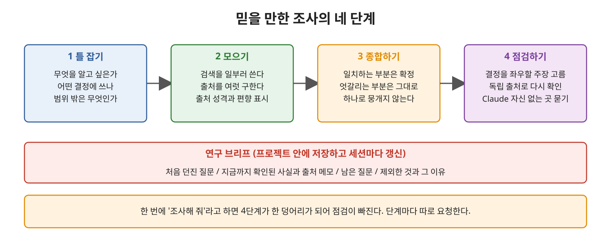

# 15장 믿을 만한 조사 워크플로 (Research Workflows That Actually Hold Up)

조사는 Claude가 가장 쓸모 있는 영역이면서 오류 위험도 가장 가까이 붙어 있는 영역이다. 몇 시간치 독서와 정리를 몇 분으로 줄여 주지만, 서두르는 독자가 놓칠 만큼 미묘하게 틀린 내용을 자신 있는 문체로 정돈해 내놓을 수도 있다. 이 장은 조사를 "이것 좀 찾아줘" 한 번의 요청이 아니라 여러 단계로 나뉜 과정으로 다루어, 속도의 이점은 얻고 위험은 물려받지 않는 방법을 설명한다.

바탕이 되는 것은 9장의 검색(회수)과 추론의 구분, 그리고 1장의 환각(hallucination, 근거 없이 그럴듯하게 지어낸 내용) 경계심이다. 이 장은 그것을 "실제로 의지할 조사"라는, 위험이 큰 상황에 적용한다.

> **참고(노트 작성자)** 이 장은 도구의 버전이나 가격을 다루지 않고 작업 방식을 다룬다. 다만 검색 기능의 이름과 화면은 책이 쓰인 시점 기준이다.



---

## 1. 학습 목표와 핵심 용어

이 장을 마치면 다음을 할 수 있어야 한다. 조사를 빠르기만 한 것이 아니라 믿을 만하게 구조화한다. 틀 잡기, 모으기, 종합하기, 점검하기의 각 단계에서 Claude를 알맞게 쓴다. 여러 세션에 걸친 조사를 연구 브리프로 일관되게 유지한다. Claude가 혼자 잘하는 조사와 내가 직접 개입해야 하는 조사를 구분한다. AI 조사가 조용히 틀어지는 구체적인 경로를 피한다.

| 용어 | 뜻 |
|------|----|
| 연구 브리프(Research Brief) | 조사 질문, 범위, "끝났다"의 기준을 적은 짧은 문서. 조사를 일관되게 유지한다 |
| 종합(Synthesis) | 여러 출처의 정보를 하나의 정돈된 이해로 묶는 일 |
| 출처 삼각검증(Source Triangulation) | 한 출처만 믿지 않고 서로 독립된 여러 출처로 주장을 대조하는 일 |
| 범위 확산(Scope Creep) | 조사가 처음 질문을 벗어나 조용히 넓어지는 현상. 넓지만 얕은 결과가 나온다 |

## 2. Lesson 1 믿을 만한 조사의 네 단계

사소하지 않은 조사는 하나의 뭉뚱그린 요청이 아니라 네 단계로 나눠 다룬다.

1. **틀 잡기(Framing)**: 정확히 어떤 질문에 왜 답하려는지 정한다.
2. **모으기(Gathering)**: 관련 정보를 수집한다. 최신이거나 구체적인 내용은 웹 검색(9장)을 쓴다.
3. **종합하기(Synthesizing)**: 모은 정보를 하나의 일관된 이해로 정돈한다.
4. **점검하기(Checking)**: 가장 중요하거나 놀라운 주장을 의지하기 전에 검증한다.

단계를 나누는 이유는 분명하다. "X를 조사해 줘"처럼 네 단계를 한 요청에 합치면 결과가 완성돼 보이지만 실제 검증은 빠진다. 요청이 검증을 명시하지 않았기 때문이다. 단계마다 의식적으로 처리하면 훨씬 많은 오류를 잡는다.

## 3. Lesson 2 틀 잡기: 질문부터 정확히

모으기 전에 실제 질문을 정밀하게 정한다. 막연한 질문은 막연하고 초점 없는 결과를 낳는다. 4장의 프롬프트 원칙이 그대로 적용된다. 책이 제안하는 틀은 이렇다.

```text
[넓은 주제]를 이해하고 싶다. 구체적으로 [정밀한 질문]에 답해야 한다.
이 결과는 [결정이나 용도]에 쓰인다.
특히 [최근 동향, 특정 비교, 특정 시장 등 관심 각도]가 궁금하고,
[범위 밖으로 명시할 것]은 필요 없다.
```

예를 들어 "전기차 배터리를 조사해 줘"는 약한 틀이다. 강한 틀은 이렇다. "중견 배송업체의 차량 구매 결정에 쓰려고, 리튬이온과 전고체 전기차 배터리의 현재 장단점을 비용과 충전 속도 중심으로 알고 싶다. 화학 원리까지 깊이 파고들 필요는 없고, 지금 시점의 실용적인 비용, 주행거리, 충전 영향만 필요하다."

흔한 실수는 어떤 결정에 쓸지 모른 채 넓게 시작하는 것이다. 범위가 퍼지고 정작 중요한 곳이 깊지 않은 결과가 나온다.

## 4. Lesson 3 모으기: 검색을 의도적으로

이 단계는 9장의 검색 규율을 그대로 쓴다. 최신이거나 구체적이거나 변했을 가능성이 있는 내용에는 기억에 기대지 말고 검색을 명시적으로 쓰라는 것이다. 잘 모으는 방법은 세 가지다.

- **여러 출처를 요구한다.** "첫 결과만 말고 몇 군데 다른 출처에서 현재 정보를 찾아줘."
- **출처의 질과 편향을 적게 한다.** "출처마다 1차 자료인지, 뉴스 요약인지, 의견 글인지 적고, 뚜렷한 편향이나 상업적 이해가 보이면 표시해 줘."
- **확립된 사실과 논쟁 중인 사실을 나눈다.** "찾은 출처들이 서로 어긋나는 곳을 표시해 줘."

사업 사례로, 경쟁사의 최근 가격 변경을 조사하는 제품 관리자는 한 기사에 기대지 않고 여러 출처를 찾게 했다. 그리고 경쟁사 자체 사이트의 정보(자사 가격이라 신뢰도가 높다)와 제3자 블로그의 정보(낡았거나 추측일 수 있다)를 구분해 표시하도록 했다. 단일 출처를 따져 보지 않고 가져온 것보다 훨씬 믿을 만한 토대가 생겼다. 흔한 실수는 첫 검색 결과나 요약을 충분하다고 받아들이는 것이다.

## 5. Lesson 4 종합하기: 뉘앙스를 뭉개지 않고 정리하기

종합은 흩어진 정보가 일관된 이해로 바뀌는 단계다. 동시에 출처 사이의 진짜 불일치나 불확실성이 조용히 하나의 확신 있는 서사로 매끄럽게 덮이는 단계이기도 하다. 그래서 요청에 이 점을 넣는다.

```text
이제 찾은 내용을 명확한 요약으로 종합해 줘.
출처들이 일치하는 곳은 확립된 사실로 제시하고,
출처가 엇갈리거나 상황이 정말 불확실한 곳은 한쪽 버전을 사실처럼
고르지 말고 분명히 그렇다고 말해 줘.
```

아무 말도 하지 않으면 종합은 자연스럽게 깔끔한 하나의 서사로 흐른다. 읽기에는 좋지만, 실제 현실이 논쟁 중이거나 불확실하다면 오해를 부른다. 불일치와 불확실성을 보존해 달라고 명시해야 종합이 정직해진다. 흔한 실수는 깨끗하고 자신 있는 종합을 "논쟁 없는 주제"의 증거로 착각하는 것이다.

## 6. Lesson 5 점검하기: 가장 자주 건너뛰는 단계

점검은 의지할 수 있는 조사와 그저 완성돼 보이는 조사를 가르는 단계다. 시간이 급할 때 가장 먼저 생략되기 때문에 의식적인 관리가 필요하다. 실용적인 절차는 세 단계다.

1. **내 결정에 가장 중요한 주장을 고른다.** 모든 세부 사항을 같은 강도로 볼 필요는 없다. 점검의 힘은 결정이 걸린 곳에 쓴다.
2. **그 주장을 독립적으로 확인한다.** 출처 삼각검증, 곧 최소 하나 이상의 다른 독립 출처로 대조한다.
3. **Claude에게 자신 없는 주장을 직접 묻는다.** "이 요약에서 완전히 정확하거나 최신이라고 가장 자신 없는 주장은 무엇이야? 그것들을 따로 다시 확인하려고 해."

Claude에게 불확실성을 스스로 짚게 하는 것은 독립 검증의 대체물이 아니다. 하지만 한정된 검증 시간을 오류 가능성이 큰 주장에 먼저 쓰게 해 주는 분류(triage) 도구로서 유용하다. 사례로, 후원 기관의 지원 이력을 조사하던 기금 신청서 작성자는 Claude에게 제안서에 넣기 전에 기관의 공식 보고서와 직접 대조해야 할 수치가 무엇인지 물었다. 그녀는 전부를 다시 확인하는 대신 중요한 두세 건에 집중해 검증했다.

## 7. Lesson 6 여러 세션의 조사를 일관되게 유지하기

며칠에 걸친 조사에는 짧은 연구 브리프를 만들어 갱신한다. 5장의 컨텍스트 패킷과 6장의 프로젝트 개념을 조사에 적용한 것이다. 브리프에 적을 것은 네 가지다.

- 처음에 정한 질문(Lesson 2의 결과)
- 지금까지 확인된 핵심 사실과 출처 메모
- 아직 풀리지 않은 질문
- 명시적으로 제외하거나 우선순위를 낮춘 것과 그 이유(이미 정리한 쟁점을 다음 세션에서 다시 따지는 일을 막는다)

이 브리프는 조사 전용 프로젝트 안에 저장하고 진행하면서 갱신한다. 그러면 새 세션이 항상 깨끗하고 최신인 토대에서 시작하고, 맥락을 처음부터 복원하거나 이미 잊은 앞선 결과와 모순될 위험을 피한다. 5장에서 말한 컨텍스트 부패(context rot, 대화가 길어지며 맥락이 흐려지는 현상)를 막는 방법이기도 하다.

## 8. 비즈니스 예시: 공중보건 비영리단체의 조사 코디네이터

아마라는 새 사업을 구상하며 지역사회 프로그램 모델을 조사한다. 처음에는 "효과적인 지역 보건 프로그램을 조사해 줘"라는 넓은 요청 하나를 보냈다. 결과는 깔끔하고 자신 있어 보였지만, 확립된 연구 결과와 한 편의 연구에서 나온 주장을 구분하지 못했다.

그래서 네 단계로 다시 했다. 자기 대상 집단과 제약에 맞춘 촘촘한 질문으로 틀을 잡고, 여러 출처와 질 메모를 요구하며 모으고, 불일치를 표시하게 하며 종합하고, 보조금 제안서에 인용할 통계 세 가지를 직접 확인했다. 결과 브리프는 처음보다 덜 깔끔했지만 훨씬 믿을 만했다. 점검 중에 한 주장이 폭넓은 합의가 아니라 소규모 단일 연구에 기댄 것임을 발견했고, 그에 맞게 표현을 고쳐 썼다.

책이 짚는 교훈은 이것이다. 더 엄격한 과정은 더 "지저분하지만" 더 정직한 결과를 냈고, 그것이 핵심이다. 자기 불확실성을 숨기는 조사는 드러내는 조사보다 위험하다.

## 9. Claude 대화 예시

사용자가 방금 받은 요약을 얼마나 믿어야 하는지 묻는 장면이다.

> **사용자**: 방금 준 조사 요약을 얼마나 믿어도 돼?
>
> **Claude**: 전체 윤곽은 꽤 믿어도 됩니다. 다만 두 가지는 따로 짚겠습니다. 세 번째 발견은 제가 찾은 출처 하나에 근거하고 다른 곳에서 확인하지 못했으니 더 조심해서 보세요. 두 번째 주장에는 통계가 들어 있는데, 그 출처가 나온 뒤 쉽게 바뀌었을 수 있습니다. 공개 발표에 쓰신다면 직접 확인하길 권합니다. 첫 번째와 네 번째 발견은 여러 출처에서 일관되게 나와 비교적 단단합니다.

이 답이 좋은 이유는 확신의 정도를 주장별로 나누고, 어디를 먼저 확인할지까지 알려 주기 때문이다.

## 10. 연습과 미니 프로젝트

연습 네 가지는 다음과 같다.

- **틀 잡기 연습**: 지금 필요한 조사 하나를 Lesson 2의 구조로, 범위 밖 항목까지 넣어 써 본다.
- **출처 질 점검**: 출처 범위와 질 평가를 명시한 모으기 요청을 실행하고, 추가된 검토가 얼마나 도움이 되는지 평가한다.
- **종합의 정직성 점검**: 기존 조사 요약에 "출처들이 어디서 엇갈렸을 수 있나"를 물어 무엇이 나오는지 본다.
- **분류 점검**: 주장이 여러 개인 조사에서 Claude에게 가장 자신 없는 주장을 묻고, 그것들만 독립 확인한다.

**미니 프로젝트 "네 단계 연구 브리프"**: 실제로 답이 필요한 질문 하나를 골라 네 단계를 의도적으로 전부 거친다. 틀 잡기, 출처 질 메모를 붙인 모으기, 불일치를 표시한 종합, 결정에 가장 중요한 두세 주장에 대한 표적 점검이다. 결과를 남에게 건네도 믿을 수 있는 연구 브리프로 저장한다.

## 11. 흔한 실수와 문제 해결

| 문제 | 가능한 원인 | 해결 |
|------|------------|------|
| 조사가 넓지만 중요한 곳이 얕다 | 결정과 연결되지 않은 막연한 틀 | Lesson 2 구조로 다시 틀을 잡고 범위 경계를 명시한다 |
| 요약이 수상할 만큼 깨끗하고 논쟁이 없다 | 종합 중 출처 불일치가 매끄럽게 지워졌다 | 불일치와 불확실성을 표시해 달라고 명시한다 |
| 발표한 주장이 틀린 것으로 드러났다 | 점검 단계가 생략됐다 | 워크플로에 필수 표적 점검을 넣는다 |
| 여러 세션의 조사가 일관성을 잃는다 | 세션 간 연구 브리프가 없다 | 전용 프로젝트에서 브리프를 만들고 갱신한다 |

이 밖에 책이 꼽는 실수는 네 단계를 한 요청에 뭉치는 것, 결정과 연결된 정밀한 질문 없이 시작하는 것, 단일 출처나 첫 결과를 그대로 받는 것, 깨끗하고 자신 있는 종합을 논쟁 없음의 증명으로 보는 것, 시간이 급하다고 특히 중요한 주장의 점검을 건너뛰는 것이다.

## 12. 장 요약

- 조사는 틀 잡기, 모으기, 종합하기, 점검하기의 네 단계로 나눠 다룬다.
- 모으기 전에 결정과 연결된 정밀한 질문을 먼저 세운다.
- 첫 결과 하나가 아니라 여러 출처를, 질과 편향 메모와 함께 모은다.
- 종합할 때 진짜 불일치와 불확실성을 지우지 말고 보존해 달라고 명시한다.
- 결정에 걸린 주장은 점검을 건너뛰지 않는다. Claude의 자신 없음 표시로 분류하고 독립적으로 확인한다.

퀴즈 네 문항은 네 단계의 이름, 종합에서 불일치 보존을 요청하는 이유, Claude의 자신 없는 주장 지목이 분류에 유용한지(맞다), 연구 브리프에 무엇을 적는지를 묻는다.

## 13. 실행 체크리스트

- [ ] 모으기 전에 결정과 연결된 정밀한 조사 질문을 세운다.
- [ ] 모으는 동안 여러 출처와 질, 편향 메모를 요청한다.
- [ ] 종합 중 불일치와 불확실성을 보존해 달라고 명시한다.
- [ ] 의지하기 전에 가장 중요한 주장에 표적 점검을 한다.
- [ ] 여러 세션에 걸친 조사에는 연구 브리프를 유지한다.

더 해 볼 것으로 책은 두 가지를 권한다. 다음 중요한 조사에 "사소해 보이는 일"이라도 네 단계를 적용해, 점검이 한 번에 끝내는 방식이 놓쳤을 것을 무엇이나 잡는지 본다. 그리고 9장의 지식 베이스 습관과 이어 쓸 수 있는 상시 연구 브리프 양식을 만들어 새 조사마다 재사용한다. 다음 장은 데이터 분석과 스프레드시트다.

<br>
<br>
<br>

[Mastering Claude AI](../)
