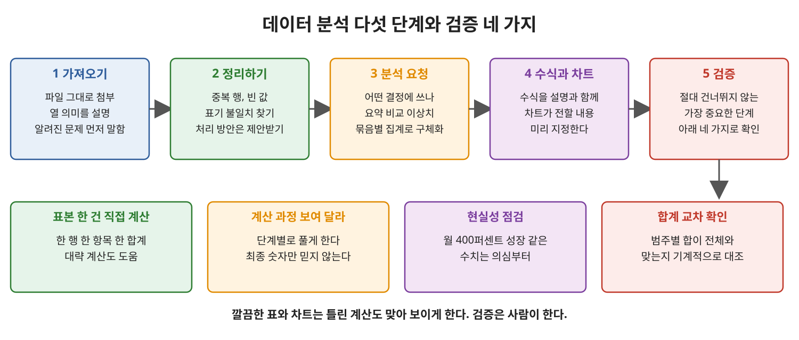

# 16장 데이터 분석과 스프레드시트 (Data Analysis and Spreadsheets with Claude)

숫자에는 특별한 권위가 있다. 깔끔한 합계가 적힌 표와 단정한 차트는, 밑바닥 계산이 틀렸더라도 산문 한 단락보다 객관적인 진실처럼 느껴진다. 그래서 데이터 분석은 Claude가 도울 수 있는 가장 가치 있는 일이면서 검증 규율이 가장 중요한 영역이기도 하다. 보고서 속 자신 있게 틀린 숫자는 자신 있게 틀린 문장보다 위험한 경우가 많다. 독자가 숫자는 덜 따져 보기 때문이다.

이 장은 긴 문서(10장)와 조사(15장)에서 쓴 단계별 규율을 데이터에도 적용한다. 무엇을 다루는지 파악하고, 의도적으로 분석하고, 의지하기 전에 검증한다.

> **참고(노트 작성자)** 파일 첨부 방식, 차트와 스프레드시트 생성 기능은 제품 화면에 따라 달라진다. 책이 쓰인 시점 기준 설명이므로 지금의 화면과 다를 수 있다.



---

## 1. 학습 목표와 핵심 용어

이 장을 마치면 다음을 할 수 있다. 정확성과 구조가 보존되도록 표 데이터를 Claude에 가져온다. 데이터가 알려 줘야 할 결정에 맞는 분석을 요청한다. 깊은 스프레드시트 지식 없이 수식을 만들고 지저분한 데이터를 정리하고 차트를 뽑는다. Claude의 숫자 작업을 맹신하지 않고 검증한다. 데이터 분석이 틀어지는 구체적 경로를 알고 오류를 일찍 잡는 습관을 만든다.

| 용어 | 뜻 |
|------|----|
| 데이터 정리(Data Cleaning) | 분석 전에 원자료의 불일치, 오류, 서식 문제를 바로잡는 일 |
| 피벗식 분석(Pivot-Style Analysis) | 선택한 범주별로 묶어 합계, 평균, 개수로 요약하는 방식 |
| 수식 생성(Formula Generation) | 설명한 계산에 맞는 스프레드시트 수식을 Claude가 쓰게 하는 일 |
| 상식 점검(Sanity Check) | 결과의 크기가 그럴듯한지 빠르게 확인해 큰 오류를 거르는 일 |

## 2. Lesson 1 데이터를 올바르게 가져오기

3장의 문서와 마찬가지로, 데이터를 대화에 넣는 방식이 Claude가 얼마나 믿을 만하게 일하는지를 좌우한다. 책이 권하는 방법은 세 가지다.

- **실제 파일을 첨부한다.** 스크린샷이나 가공해서 붙여 넣은 내용 대신 스프레드시트나 CSV 원본을 올린다. 구조와 정밀도가 훨씬 잘 보존된다.
- **열마다 무엇인지 말해 준다.** 머리글이 줄임말이나 코드면 특히 그렇다. "C열은 총매출이 아니라 반품을 뺀 순매출이다"라고 한 줄만 적어도 한 부류의 분석 오류가 사라진다.
- **알려진 품질 문제를 미리 말한다.** 중복, 빈 값, 알려진 불일치가 있으면 분석 전에 밝힌다. 정리 단계가 실제 문제에 집중하게 된다(Claude가 스스로 찾아내는 경우도 많다).

흔한 실수는 머리글이 알아서 설명된다고 보고 설명을 생략하는 것이다. 사내 용어, 코드, 뜻이 분명하지 않은 줄임말이 있는 데이터일수록 위험하다.

## 3. Lesson 2 분석 전에 정리하기

서식이 일정하지 않거나 중복 행이 있거나 값이 비었거나 같은 뜻의 범주 이름이 다르게 쓰인 데이터("NY", "New York", "N.Y.")는 분석 전에 손봐야 한다. 그러지 않으면 결과가 조용히 왜곡된다. 책이 주는 요청 문구는 이렇다.

```text
분석에 들어가기 전에 이 데이터의 품질 문제를 검토해 줘.
중복 행, 빈 값, 서식이나 범주 이름의 불일치, 그 밖에 오류로 보이는 것.
진행하기 전에 찾은 것을 나열하고, 각 문제를 어떻게 처리할지 제안해 줘.
```

"처리 방법을 제안해 달라"가 중요한 이유가 있다. 정리에는 판단이 필요하다. 빈 값을 제외할지, 0으로 볼지, 추정할지. 비슷한 범주 이름을 합친다면 어느 표기를 표준으로 삼을지. 이는 더 큰 분석 속에 묻어 두고 자동으로 정할 일이 아니라 내가 의견을 내야 하는 결정이다.

사례로, 1년치 매출을 검토하던 소상공인은 이 정리 단계에서 지역 열에 "California", "CA", "Calif."가 따로 집계되고 있음을 발견했다. 합치기 전에는 그 주의 실제 매출이 상당히 낮게 잡혀 있었다. 분석 뒤가 아니라 앞에서 잡았기에 오해를 부르는 결과가 의사결정까지 가지 못했다. 흔한 실수는 원자료를 검토 없이 곧장 분석하고, 결과가 이상해 보일 때에야(그것도 알아챌 때에만) 문제를 발견하는 것이다.

## 4. Lesson 3 맞는 종류의 분석 요청하기

연구(15장)와 마찬가지로 분석의 품질은 무엇이 필요한지를 얼마나 정밀하게 정하느냐에 크게 좌우된다. 분석이 알려 줘야 할 결정에 곧바로 연결해야 한다. 좋은 요청의 예는 이렇다. "올해와 작년을 비교해 어느 제품 범주가 매출 성장을 이끌고 어느 범주가 정체하거나 줄었는지 알고 싶다. 범주별로 나누고 증감률을 보여 주며, 어느 쪽이든 변동이 유난히 큰 항목은 표시해 줘."

"이 데이터를 분석해 줘" 같은 막연한 요청은 Claude가 무엇이 중요한지 추측하게 만들어, 결정에 쓸 구체적 분해 대신 넓고 일반적인 개요를 내놓기 쉽다. 책은 요청 유형별 틀을 표로 준다.

| 필요한 것 | 요청 틀 |
|----------|---------|
| 전체 요약과 합계 | "[기준들] 전반의 합계와 주요 추세를 요약해 줘" |
| 기간 비교 | "[A 기간]과 [B 기간]을 비교하고 증감률을 보여 줘" |
| 이상치 찾기 | "나머지에 비해 유난히 높거나 낮아 보이는 값을 찾아 줘" |
| 묶음별 분해 | "[범주]별로 나누어 각각 [지표]를 보여 줘" |

## 5. Lesson 4 수식, 차트, 스프레드시트 만들기

분석과 해석을 넘어, Claude는 스프레드시트 작업 자체도 돕는다. 수식을 쓰고, 차트를 만들고, 8장의 아티팩트로 구조화된 스프레드시트 파일을 만들기도 한다.

**수식 생성**: "이번 달과 지난달 매출의 증감률을 계산하고, 지난달 값이 0이면 오류 대신 'N/A'를 돌려주는 수식이 필요해." Claude는 수식을 만들고 각 부분이 무엇을 하는지 설명할 수 있다. 바로 쓰기에도, 비슷한 수식을 스스로 쓰도록 배우기에도 좋다.

**차트 요청**: "지난 12개월 월별 매출 추세 차트를 만들어 줘. 가장 크게 떨어진 두 달에는 분명한 표시를 붙여 줘." 차트가 무엇을 전해야 하는지 구체적으로 말한다. 앞선 장들의 구체성 원칙이 시각 결과에도 그대로 적용된다.

흔한 실수는 어떤 이야기를 전해야 하는지 안내 없이 "차트 하나"만 요청해, 기술적으로 정확하지만 내가 말하려는 요점에는 쓸모없는 차트를 받는 것이다.

## 6. Lesson 5 숫자 작업 검증하기: 절대 건너뛰지 말 것

책은 이것이 이 장에서 가장 중요한 레슨이라고 못 박는다. 숫자 오류는 만들기도 쉽고 놓치기도 쉽다. 결과가 깔끔하게(단정한 표, 매끈한 차트) 제시되면 계산이 맞다는 잘못된 신뢰가 생긴다. 실용적인 검증 습관은 네 가지다.

1. **계산 하나는 직접 점검한다.** 실제 결정이나 보고서에 들어가는 숫자라면 특히 그렇다. 한 행, 한 범주, 한 합계를 독립적으로 확인한다. 대략의 암산으로도 큰 오류를 잡는다.
2. **Claude에게 과정을 보여 달라고 한다.** "이 합계를 정확히 어떻게 계산했는지 단계별로 보여 줘." 최종 숫자만 보는 것보다 오류가 훨씬 눈에 띈다.
3. **상식 점검을 한다.** 결과의 크기가 현실적으로 말이 되는가. 안정적인 기존 사업의 월간 성장률이 400퍼센트라면 축하보다 의심이 먼저여야 한다.
4. **합계를 교차 확인한다.** 범주별 합계가 알려진 전체 합계와 맞아야 한다면 실제로 맞는지 대조한다. 기계적이고 빠르지만 의외로 많은 실제 오류를 잡는다.

사례로, Claude가 만든 분기 요약을 검토한 재무팀은 한 지역의 합계를 원자료와 직접 대조해 보다가, 여러 행에 걸쳐 적용된 반올림 처리가 보고 총액을 상당히 바꿔 놓았음을 발견했다. 정확하리라 가정하지 않고 의도적으로 표본 점검을 했기에 경영진에 보고되기 전에 오류가 고쳐졌다.

책의 모범 사례는 이렇다. 모든 분석 결과를 꼼꼼한 회계사가 주니어 동료의 작업을 대하듯 다룬다. 정말 유용하고 대체로 맞지만, 중요한 일에 의지하기 전에는 늘 검토한다.

## 7. 비즈니스 예시: 식당 체인 운영 분석가 코피

코피는 12개 지점의 1년치 매출을 분석해 부진한 지점을 찾는다. 정리 단계 없이 처음 돌린 결과는 한 지점이 극단적으로 부진하다고 표시했다. 그런데 표본 점검을 해 보니 그 지점은 판매시점 관리(POS) 시스템 문제로 몇 주치 입력이 빠져 있었고, 실제로 매출이 낮았던 것이 아니었다.

그는 전체 워크플로로 다시 시작했다. 빠진 주를 그냥 합계에 묻지 않고 드러내 처리하는 별도 정리 단계, 같은 기간끼리 비교하도록 정밀하게 정한 분석 요청, 표시된 지점의 수정된 숫자를 원본 보고서와 직접 대조하는 검증 단계다. 수정된 분석은 실제로 다른, 진짜 부진 지점을 짚었다. 정리하지 않은 첫 결과보다 훨씬 쓸모 있고 정확했다.

교훈은 분명하다. 정리하지 않은 첫 결과는 단지 부정확한 것이 아니라, 검증 없이 갔다면 엉뚱한 지점을 조사하는 잘못된 행동으로 이어졌을 것이다. 차이를 만든 것은 Claude의 능력이 아니라 워크플로다.

## 8. Claude 대화 예시

> **사용자**: 그 매출 합계 다시 확인해 줄래? 생각보다 높아 보여.
>
> **Claude**: 좋은 판단입니다. 계산을 되짚어 보겠습니다. "순매출" 열을 그대로 합쳤는데, 반품으로 표시된 행은 이미 음수로 반영돼 있어 합계에 포함됩니다. 다만 반품이라기보다 입력 오류처럼 보이는 아주 큰 음수 행이 세 개 있습니다. 그 행들을 빼면 수정된 합계는 약 8퍼센트 낮아집니다. 수정한 값으로 진행할까요, 아니면 먼저 그 세 행을 원본과 확인하시겠어요?

이 답은 어떻게 계산했는지를 되짚고, 의심 가는 행을 짚은 뒤, 판단을 사용자에게 돌려준다. 앞서 말한 "과정 보여 달라"와 "정리는 내가 결정한다"가 함께 드러난 모습이다.

## 9. 연습과 미니 프로젝트

- **열 설명 연습**: 자주 쓰는 스프레드시트의 모호하거나 코드로 된 열마다 명확한 설명을 써 둔다.
- **정리 단계 연습**: 실제 데이터셋을 분석하기 전에 별도 정리 검토를 돌리고 어떤 문제가 나오는지 기록한다.
- **정밀한 틀 연습**: "데이터가 어떻게 돼 가지?" 같은 막연한 질문을 Lesson 3의 표로 정밀하게 바꿔 쓴다.
- **검증 습관**: 다음 실제 분석 결과를 쓰기 전에 Lesson 5의 네 단계를 모두 거친다.

**미니 프로젝트 "검증된 분석"**: 실제로 분석할 데이터셋 하나를 골라 전체 워크플로를 거친다. 모호한 열을 설명하고, 판단이 필요한 부분은 내 의견을 넣어 정리 단계를 돌리고, 실제 결정에 연결된 정밀한 분석 요청을 쓰고, Lesson 5의 네 기법 중 최소 세 가지로 결과를 완전히 검증한 뒤에야 최종으로 삼는다.

## 10. 흔한 실수와 문제 해결

| 문제 | 가능한 원인 | 해결 |
|------|------------|------|
| 결과가 비현실적이거나 지나치게 극단적이다 | 데이터 품질 문제나 계산 오류 | 상식 점검을 하고 단계별로 과정을 보여 달라고 한다 |
| 범주 합계가 예상 전체 합계와 다르다 | 범주 이름 불일치나 누락 행 | 비슷한 범주 이름과 빠진 데이터를 정리 단계에서 점검한다 |
| 분석이 일반적이고 진짜 질문에 답하지 못한다 | 결정과 연결되지 않은 막연한 요청 | Lesson 3의 표로 구체적으로 다시 요청한다 |
| 차트는 맞지만 내 요점이 전해지지 않는다 | 차트가 전할 이야기를 지정하지 않았다 | 시각화가 강조할 내용을 명시한다 |

책이 꼽는 실수 목록은 원본 대신 가공본이나 스크린샷을 붙이는 것, 열이 자명하다고 가정하는 것, 정리 단계 없이 지저분한 데이터를 곧장 분석하는 것, 결정과 연결되지 않은 "분석"이나 "차트"를 요청하는 것, 깔끔해 보이는 결과를 표본 점검 없이 믿는 것이다.

## 11. 장 요약

- 데이터는 가능하면 실제 파일로 올리고 모호한 열은 분석 전에 설명한다.
- 판단이 필요한 부분에 내 의견을 넣는 별도 정리 단계를 먼저 돌린다.
- 분석 요청은 결과가 알려 줘야 할 실제 결정에 연결해 정밀하게 쓴다.
- Claude는 수식과 차트를 잘 만든다. 시각화가 전할 이야기를 구체적으로 지정한다.
- 표본 점검, 과정 보여 달라, 상식 점검, 합계 교차 확인 없이는 숫자 결과에 의지하지 않는다.

퀴즈 네 문항은 분석 전에 정리 검토를 하는 이유, "과정을 보여 달라"의 효용, 깔끔해 보이는 결과를 검증 없이 믿어도 되는지(안 된다), 상식 점검의 뜻을 묻는다.

## 12. 실행 체크리스트

- [ ] 실제 데이터 파일을 첨부하고 모호한 열을 명시적으로 설명한다.
- [ ] 지저분한 데이터는 분석 전에 별도 정리 단계를 돌린다.
- [ ] 분석 요청은 실제 결정에 연결해 정밀하게 쓴다.
- [ ] 수식과 차트는 명확한 사양과 함께 요청한다.
- [ ] 표본 점검, 과정 요구, 상식 점검, 합계 교차 확인으로 숫자를 검증한다.

더 해 볼 것으로 책은 실제 보고서나 결정에 쓸 모든 분석 결과에 네 가지 검증 습관을 자동이 될 때까지 적용하라고 한다. 그리고 자주 다루는 데이터 종류별 표준 정리 체크리스트를 만들어 9장의 개인 지식 베이스에 넣으라고 한다. 다음 장은 의사결정 틀과 비교다.

<br>
<br>
<br>

[Mastering Claude AI](../)
