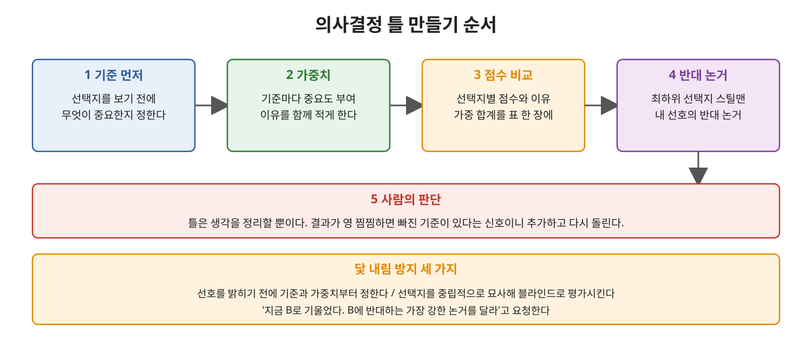

# 17장 의사결정 틀과 비교 (Building Decision Frameworks and Comparisons)

어떤 업체를 고를지, 어떤 전략을 택할지, 어떤 후보를 뽑을지. 결정은 명료한 사고가 가장 중요하면서 혼자 하기 가장 어려운 일이다. 그 순간 내 선호와 편향은 나에게 보이지 않기 때문이다. Claude가 여기서 쓸모 있는 이유는 대신 결정해 주어서가 아니라, 공정하고 구조화된 비교의 뼈대를 시간에 쫓기는 나 혼자보다 빠르고 철저하게 짜 주기 때문이다.

이 장은 경계를 분명히 한다. Claude는 결정의 과정의 질을 크게 높일 수 있다. 그러나 결정 자체, 특히 실제 이해관계가 걸린 결정은 어떤 틀도 다 담지 못하는 맥락과 판단을 가진 내 몫으로 남는다.

> **참고(노트 작성자)** 이 장은 도구 기능보다 사고 절차를 다룬다. 가중치 점수 표 같은 방법은 책이 쓰인 시점과 무관하게 쓸 수 있다.



---

## 1. 학습 목표와 핵심 용어

이 장을 마치면 다음을 할 수 있다. 하나의 단정적 답을 받는 대신 Claude로 구조화된 의사결정 틀을 만든다. 특정 결정에서 실제로 중요한 것을 반영한 가중 기준을 정한다. 여러 선택지를 공정하고 구조적으로 비교한다. Claude의 분석 지원과 결정 권한을 분리해 결정권은 내가 쥔다. 한 선택지에 너무 일찍 붙박이는 함정을 피한다.

| 용어 | 뜻 |
|------|----|
| 의사결정 틀(Decision Framework) | 감에만 의존하지 않고 정해 둔 기준으로 선택지를 평가하는 구조화된 방법 |
| 가중 기준(Weighted Criteria) | 모두 같은 중요도로 보지 않고 중요도를 다르게 매긴 판단 요소 |
| 닻 내림(Anchoring) | 초기 선택지나 인상에 과하게 매여 이후 평가가 한쪽으로 치우치는 경향 |
| 스틸맨(Steelmanning) | 회의적인 선택지나 주장이라도 가장 강한 형태로 먼저 제시해 보는 것 |

## 2. Lesson 1 선택지를 평가하기 전에 기준부터 정하기

결정에서 가장 흔한 실수는 무엇이 중요한지 정하기 전에 선택지 비교로 뛰어드는 것이다. 순서가 거꾸로면 기준이 이미 마음에 드는 선택지를 정당화하는 쪽으로 슬그머니 휜다. 책이 권하는 요청은 이렇다.

```text
어떤 선택지도 비교하기 전에, 이 결정에서 실제로 중요한 기준을 정하게 도와줘.
나는 [결정의 종류]를 고르는 중이야.
어떤 요소를 따져야 하고, [내 구체적 상황]을 감안하면
그중 무엇이 가장 중요할 것 같아?
```

예를 들어 12명 규모 창작 에이전시의 업무 관리 도구를 고른다면 기준은 좌석당 비용, 기존 도구와의 연동, 비기술 팀의 학습 난이도, 고객 대면 기능 같은 것이 된다. 팀 구성이 비기술적이므로 "학습 난이도"에 큰 가중치를 두겠지만, 기술 팀이라면 훨씬 낮게 둘 것이다.

흔한 실수는 내 상황을 반영하지 않은 일반적이고 가중치 없는 기준으로 비교하는 것이다. 기술적으로 철저하지만 실제로는 도움이 안 되는 비교가 나온다.

## 3. Lesson 2 가중치를 정직하게 매기기

모든 기준이 똑같이 중요하지는 않다. 명시적인 가중치를 매기면 평소 막연하고 따져 보지 않던 우선순위를 정직하게 마주하게 된다.

```text
우리가 정한 기준마다 이 특정 결정에서 실제로 얼마나 중요한지
대략의 가중치(예: 10점 만점)를 매기고,
내가 동의하지 않으면 반박할 수 있게 가중치마다 이유를 간단히 설명해 줘.
```

"이유를 설명해 달라"가 중요한 까닭은, 근거가 안 보이는 가중치는 평가하거나 반박하기 어렵기 때문이다. 이유가 보이면 가중치가 내 진짜 우선순위와 어긋나는 경우를 잡아 고칠 수 있다. 무엇이 나에게 가장 중요한지에 대한 최종 권한은 Claude가 아니라 내게 있다.

흔한 실수는 첫 가중치를 내 우선순위와 맞는지 검토하지 않은 채, 일반적인 기본값처럼 받아들이는 것이다.

## 4. Lesson 3 공정하고 구조적인 비교 돌리기

기준과 가중치가 정해지면 모든 선택지를 그 기준으로 체계적으로 비교한다. 10장의 문서 간 교차 비교 기법을 문서가 아닌 결정 선택지에 적용한 것이다.

```text
이제 각 선택지를 가중 기준마다 점수 매기고,
점수마다 이유를 보여 주고, 가중 합계를 계산해 줘.
결과는 표 하나로 제시해 줘.
```

점수마다 이유를 보여 달라고 하는 까닭은, 16장의 숫자 작업처럼 이유 없는 점수는 상식 점검이 훨씬 어렵기 때문이다. Claude의 채점 근거가 내가 아는 선택지의 모습과 다르면 그 자리에서 바로 잡을 수 있다.

**약해 보이는 선택지 스틸맨하기**: 결론을 내리기 전에 이렇게 물어볼 만하다. "점수가 가장 낮은 선택지를 스틸맨해 줘. 틀의 결과에도 불구하고 그걸 고를 가장 강한 논거는 뭐야?" 기술적으로는 철저하지만 더 넓은 시각이면 잡았을 무언가를 놓친 틀을 막아 준다.

## 5. Lesson 4 닻 내림 막기

틀을 시작하기 전부터 기울어 있던 선택지를 무의식적으로 편들기 쉽다. 그러면 기준을 정하고 가중치를 매기는 방식이 은근히 그 결과 쪽으로 형성된다. 막는 방법은 세 가지다.

- **가능하면 어느 쪽으로 기울었는지 밝히기 전에 기준과 가중치를 정한다.** 기준이 사후에 끼워 맞춘 것이 아니라 중립으로 남는다.
- **가능한 곳에서는 블라인드로 평가시킨다.** "내가 지금 어느 쪽을 선호하는지 말하지 않을 테니, 세 선택지를 기준에 따라 평가해 줘." 다만 선택지를 서술하는 방식에서 Claude가 선호를 짐작할 수 있으니, 최대한 중립적으로 묘사한다.
- **내가 선호하는 선택지에 반대하는 논거를 직접 요청한다.** "지금 B로 기울었는데, B에 반대하는 가장 강한 논거를 줘."

사례로, 첫 면접에서 한 지원자에게 이미 좋은 인상을 받은 채용 담당자는 평가 틀(기준과 가중치)을 Claude에게도, 스스로에게도 어느 후보에 기울었는지 완전히 밝히기 전에 만들었다. 틀이 초기 인상을 정당화하는 쪽으로 슬그머니 만들어지는 것을 피하기 위해서였다.

## 6. Lesson 5 틀이 끝나고 판단이 시작되는 곳

의사결정 틀은 정리하고 명료하게 하지만 판단을 대신하지 않는다. 특히 수치화하기 어려운 요소, 곧 팀 케미, 신뢰할 만한 사람이라는 직감, 느끼지만 기준으로 설명하기 어려운 것들이 그렇다.

책의 권장 사항은 틀의 결과를 결정의 중요한 입력 하나로 쓰고 자동 최종 판결로 쓰지 않는 것이다. 틀에서 1위인 선택지가 마음에 걸린다면 그 불편함을 진지하게 받아들일 만하다. 틀이 놓친 중요한 기준이 있다는 신호일 수 있으니, 무시하지 말고 추가해서 다시 돌린다.

흔한 실수는 가중 점수 틀의 1위를 자동으로 옳다고 보고, 틀이 담지 못한 정당한 판단과 맥락을 눌러 버리는 것이다.

## 7. 비즈니스 예시: 공동 마케팅 파트너를 고르는 창업가 엘리아스

엘리아스는 두 공동 마케팅 파트너 중 하나를 고른다. 독자층 겹침, 브랜드 일치, 파트너 신뢰도, 비용으로 가중 틀을 만들었고 한 파트너가 눈에 띄게 높은 점수를 받았다. 그런데 1위 선택지에 대해 틀이 담지 못하는 꺼림칙함이 계속 남았다.

그는 Claude에게 그 불편함의 정체를 말로 풀도록 도와 달라고 했고, "이번 캠페인을 넘어선 장기적 관계 가능성"이라는 기준이 애초에 틀에 없었음을 깨달았다. 그에게는 정말 중요한 요소인데 반영되지 않았던 것이다. 그 기준을 넣고 가중치를 조정하자 결과가 크게 달라졌다. 틀이 그의 판단을 대체한 것이 아니라, 아직 말로 하지 못한 직감을 찾아 형식으로 만드는 데 도움이 되었다.

교훈은 이렇다. 틀의 가치는 최종 점수만이 아니라 구조적으로 생각하는 과정에 있다. 결과에 대한 직감 점검이 틀에 빠져 있던 것을 드러내는 순간도 그 과정의 일부다.

## 8. Claude 대화 예시

> **사용자**: 틀은 A가 확실히 최고라고 하는데 뭔가 이상해. 내가 비합리적인 걸까?
>
> **Claude**: 꼭 그렇지는 않습니다. 그 직감은 무시하기보다 진지하게 받아들일 만합니다. 틀에 반영되지 않은, 당신에게 중요한 기준이 있다는 뜻일 수 있고, 점수 중 하나가 수치화하기 어려운 당신만의 정보를 담지 못했다는 뜻일 수도 있습니다. 구체적으로 무엇이 이상한지 이름을 붙여 볼 수 있을까요? 불편함을 말로 옮기기만 해도 빠진 요소가 드러나서, 그것을 추가해 다시 점수를 매길 수 있습니다.

## 9. 연습과 미니 프로젝트

- **기준 먼저 연습**: 실제로 마주한 결정에서 비교로 곧장 뛰어들고 싶은 충동을 참고, 먼저 기준을 정하고 가중치를 매긴다.
- **근거 점검**: 구조적 비교를 돌리고 점수마다의 근거를 검토해, 내가 아는 바와 다른 곳은 고친다.
- **스틸맨 연습**: 실제나 연습용 틀에서 최하위 선택지를 골라 가장 강한 논거를 요청한다.
- **닻 내림 감사**: 과거의 결정을 돌아본다. 기준을 선호가 생기기 전에 정했나, 후에 정했나. 먼저 정했다면 무엇이 달라졌을까.

**미니 프로젝트 "구조화된 결정"**: 지금 마주한 결정 하나에 틀 전체를 적용한다. 선택지를 비교하기 전에 기준을 정하고 가중치를 매긴다. 점수마다 근거를 보이는 구조적 비교를 돌린다. 최하위 선택지를 스틸맨한다. 1위 결과가 맞다고 느껴지는지 돌아보고, 아니라면 빠진 기준이 무엇일지 찾는다.

## 10. 흔한 실수와 문제 해결

| 문제 | 가능한 원인 | 해결 |
|------|------------|------|
| 비교가 실제로 중요한 것을 반영하지 않는다 | 내 상황에 맞춘 것이 아닌 일반적이고 가중치 없는 기준 | 비교 전에 내 상황에 맞게 기준을 정하고 가중치를 매긴다 |
| 틀의 결과가 마음에 걸린다 | 관련 기준이 빠졌거나 판단 요소가 담기지 않았다 | 불편함을 말로 하고, 빠진 기준을 추가해 다시 돌린다 |
| 이미 선호하던 쪽으로 과정이 기울었다는 의심 | 초기 선호에 닻이 내려졌다 | 선호를 밝히기 전에 기준을 정하거나, 선호하는 쪽에 반대하는 논거를 요청한다 |
| 점수가 임의적이고 못 믿겠다 | 점수마다 보이는 근거가 없다 | 최종 숫자만이 아니라 모든 점수의 이유를 요청한다 |

이 밖에 책이 꼽는 실수는 기준과 가중치를 정하기 전에 비교하는 것, 근거를 검토하지 않고 가중치나 점수를 받아들이는 것, 이른 선호가 기준 정의와 가중치를 좌우하게 두는 것, 틀의 1위를 자동 최종 판결로 보는 것, 점수가 낮지만 다시 볼 만한 선택지의 스틸맨을 건너뛰는 것이다.

## 11. 장 요약

- 선택지를 비교하기 전에 의사결정 기준을 정하고 가중치를 매겨, 기준이 선호하는 결과에 맞춰 만들어지는 것을 막는다.
- 모든 가중치와 점수 뒤의 근거가 보이도록 요청한다. 최종 숫자만 받지 않는다.
- 선호를 밝히기 전에 기준을 정하고 낮은 점수의 선택지를 스틸맨해 닻 내림을 경계한다.
- 틀은 사고를 정리하고 명료하게 할 뿐, 수치화하기 어려운 요소에 대한 판단을 대신하지 않는다.
- 틀의 1위에 대한 지속적인 불편함은 무시할 것이 아니라 살펴볼 대상이다.

퀴즈 네 문항은 비교 전에 해야 할 일(기준을 정하고 가중치를 매긴다), 최하위 선택지를 스틸맨하는 이유, 틀의 1위를 자동 최종 답으로 봐도 되는지(안 된다), 이 맥락에서 닻 내림의 뜻을 묻는다.

## 12. 실행 체크리스트

- [ ] 선택지를 비교하기 전에 기준을 정하고 가중치를 매긴다.
- [ ] 모든 가중치와 점수 뒤의 근거를 요청하고 검토한다.
- [ ] 기준을 일찍 정하고 약한 선택지를 스틸맨해 닻 내림을 막는다.
- [ ] 틀의 결과를 판단의 입력으로 쓰고 자동 최종 판결로 쓰지 않는다.
- [ ] 미니 프로젝트 "구조화된 결정"을 마쳤다.

더 해 볼 것으로 책은 다음 세 가지 실제 결정에, 작은 결정이라도, 기준 먼저 규율을 자동이 될 때까지 적용하라고 한다. 또 업체 선정, 채용, 우선순위 정하기 같이 자주 반복되는 결정 유형별로 재사용 가능한 틀 양식을 만들라고 권한다. 다음 장은 사실 확인과 검증, 그리고 믿지 말아야 할 때를 아는 법이다.

<br>
<br>
<br>

[Mastering Claude AI](../)
