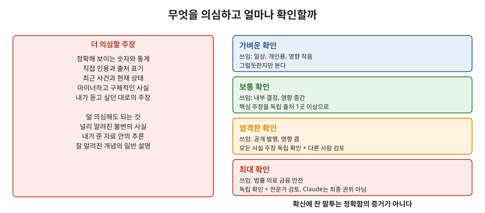

# 18장 사실 확인과 검증 (Fact-Checking, Verification, and Knowing When Not to Trust It)

이 장은 앞선 거의 모든 장을 관통해 온 실을 하나의 일관된 틀로 모은다. 1장의 환각 소개, 9장의 검색(회수) 규율, 13장의 마케팅 사실 확인, 15장의 조사 점검 단계, 16장의 숫자 검증이다. 개별 레슨을 적용해 왔다면 이 장은 정리처럼 느껴질 것이다. 건너뛰어 왔다면, 그 모든 규율이 왜 중요한지를 한자리에서 설득하는 장이다.

핵심 아이디어는 말하기는 쉽지만 실천에서는 과소평가되기 쉽다. **Claude의 확신과 Claude의 정확성은 같지 않다.** 지나치지도 소홀하지도 않게 알맞게 검증하는 습관이, AI와 한 일을 그저 그럴듯한 것이 아니라 정말 믿을 만한 것으로 만든다.

> **참고(노트 작성자)** 이 장의 단계별 검증 기준(가벼움부터 최대까지)은 책이 제시한 틀이다. 구체적인 법률, 의료, 금융 기준은 나라와 분야마다 다르므로 해당 전문가의 안내를 따른다.

---

## 1. 학습 목표와 핵심 용어

이 장을 마치면 다음을 할 수 있다. 틀릴 가능성이 가장 큰 주장의 구체적 범주를 식별한다. 모든 것을 똑같이 또는 아무것도 검증하지 않는 대신 실제 위험에 맞춘 단계별 검증을 적용한다. Claude의 자기 평가에만 지나치게 기대지 않고 Claude 자체를 내 검증 과정의 일부로 쓴다. Claude 응답에서 확신과 정확성의 차이를 알아본다. 검증을 사후 생각이 아니라 상시 워크플로에 넣는다.

| 용어 | 뜻 |
|------|----|
| 검증(Verification) | 의지하기 전에 주장의 정확성을 독립적으로 확인하는 과정 |
| 확신 대 정확성 | 얼마나 확실하게 들리는지와 실제로 맞는지는 별개라는 구분 |
| 단계별 검증(Tiered Verification) | 주장이 쓰이는 실제 위험도와 노출 정도에 맞춰 사실 확인의 깊이를 조절하는 것 |
| 독립 출처(Independent Source) | 확인하려는 원래 주장과 별개이고 그것에서 파생되지 않은 확인 출처 |

## 2. Lesson 1 가장 의심해야 할 주장의 범주

모든 주장이 틀릴 위험이 같지는 않다. 어떤 범주는 유독 검증이 필요하다.

**위험이 높은 범주**

- **구체적인 숫자와 통계**, 특히 출처가 분명히 제시되지 않은 정밀해 보이는 숫자.
- **직접 인용과 출처 표기**, 특히 특정 인물이나 문서에 돌린 정확한 문구.
- **최근 사건이나 현재 상태**: 학습 이후 바뀌었을 수 있거나 최신 정보가 필요한 모든 것.
- **틈새의 매우 구체적인 사실**: 널리 퍼진 학습 자료에 잘 나오지 않을 법한 것.
- **내가 원하던 바를 공교롭게 확인해 주는 모든 것**: 덜 알려졌지만 유용한 점검이다. 원하는 결론에 끌리는 추론(motivated reasoning) 때문에 반가운 주장일수록 덜 따져 보게 되기 때문이다.

**위험이 낮은 범주**

- 잘 확립된, 시간이 지나도 변하지 않는 널리 알려진 사실.
- 대화에서 내가 직접 제공한 자료에 대한 추론과 분석.
- 잘 이해된 개념에 대한 일반 설명.

이렇게 분류하는 이유는, 모든 것을 같은 강도로 검증하는 것은 지속 가능하지도 필요하지도 않기 때문이다. 목표는 한정된 검증 노력을 실제로 틀릴 가능성이 높고 틀리면 문제가 되는 곳에 쓰는 것이다.

## 3. Lesson 2 단계별 검증 접근

주장이 쓰일 실제 위험도에 검증 깊이를 맞춘다. 14장에서 편집 엄격성을 위험도에 맞춘 논의와 같은 방식이다.

| 위험도 | 검증 방식 |
|--------|-----------|
| 일상적, 개인적, 영향 작음 | 가벼움: 그럴듯한지 보는 정도면 보통 충분 |
| 내부 결정에 쓰임, 영향 중간 | 보통: 핵심 주장을 최소 하나 이상의 독립 출처로 확인 |
| 공개, 발행, 영향 큼 | 엄격: 모든 구체적 사실 주장을 독립 확인, 가능하면 다른 사람이 검토 |
| 법률, 의료, 금융, 안전 관련 | 최대: 독립 확인에 더해 자격 있는 전문가 검토. Claude를 최종 권위로 삼지 않는다 |

흔한 실수는 비공개 저위험 상황에나 맞을 가벼운 기준을 공개용 주장에 그대로 적용하는 것이다.

## 4. Lesson 3 내 검증 과정에 Claude를 쓰기

Claude는 검증을 의미 있게 도울 수 있다. 다만 Claude가 내 검증을 돕는 것과, Claude가 자기 앞선 주장을 안심시켜 주는 것은 중요하게 다르다. 유용한 검증 요청은 세 가지다.

- **"이 구체적 주장에 대한 독립 확인을 검색해 줘."** 처음 주장을 낳은 같은 내부 지식에 기대지 않고 실시간 웹 검색(9장)을 쓴다.
- **"이 주장이 틀리려면 무엇이 맞아야 해? 의심할 가장 강한 이유는 뭐야?"** 확인을 구하는 대신 약점을 적극적으로 찔러 본다.
- **"이 구체적 주장에 대한 확신 정도를 평가하고, 그 확신이 무엇에 근거하는지 설명해 줘."** 15장처럼 분류에 유용하지만, Claude의 자기 평가이지 독립 검증이 아니므로 그에 맞게 다룬다.

**진짜 검증이 아닌 것**: Claude에게 자기 주장이 "확실해?"라고 묻고 재확인하는 답을 받아들이는 것은 독립 검증이 아니다. 같은 출처에게 자기 작업을 채점하게 하는 것이어서 오류가 남을 위험이 의미 있게 줄지 않는다. 흔한 실수는 Claude가 자기 앞선 주장을 확신 있게 재확인하는 것을 진짜 독립 검증으로 착각하는 것이다.

## 5. Lesson 4 확신은 정확성이 아니다

어떤 AI 시스템과 일하든 가장 중요한 정신적 조정 하나는, 유창하고 확신에 찬 말이 정확함의 증거가 아니라는 점이다. 사람의 글에도 마찬가지지만, 속한 주장의 확실한 정도와 관계없이 늘 다듬어진 확신 있는 문장을 내놓는 시스템에서는 특히 잊기 쉽다.

이것이 중요한 이유는, 단정적이고 얼버무림 없는 문장과 조심스럽게 얼버무린 문장이 똑같이 맞을 수도 똑같이 틀릴 수도 있기 때문이다. 얼버무리는 표현의 유무는 유용한 신호이지만(3장에서 다뤘다) 어느 쪽이든 보장은 아니다. 구체적인 사실 주장은 얼마나 자신 있게 서술됐든 검증해야 한다.

실용적 습관은 이렇다. 구체적이고 중요한 주장을 받아들이기 전에 "이게 얼마나 확신 있게 들리나"와 "이것이 사실임을 내가 실제로 확인했나"를 머릿속으로 나눈다. 이 둘은 정말 다른 질문이고, 의지해도 되는지는 둘째만 알려 준다.

## 6. Lesson 5 상시 워크플로에 검증을 넣기

책은 줄곧 좋은 습관을 매번 기억하는 데 의존하지 말고 상시 절차에 넣으라고 강조해 왔다. 검증은 그 가장 분명한 예다. 구체적인 방법은 세 가지다.

- **공개용이거나 위험이 큰 결과를 내는 모든 워크플로에 필수 검증 단계를 넣는다.** 13장의 마케팅 사실 확인 패스, 15장의 조사 점검 단계와 같은 방식이다.
- **"내가 늘 검증하는 주장 유형" 개인 목록을 둔다.** 내 일에서 중요했던 것을 바탕으로 하고, 9장의 지식 베이스에 넣는다.
- **"이게 사실인 걸 어떻게 알지?"를 불신의 표시가 아닌 표준 질문으로 삼는다.** 신중한 전문가가 사람이든 도구든 모든 출처에 던질 질문과 같다.

책의 권장 사항은 검증 규율을 교정, 계산 재확인, 중요한 문서의 두 번째 사람 검토 같은 다른 전문 품질 관리 습관처럼 다루라는 것이다. 도구를 믿지 않는다는 표시가 아니라, 결과물을 확실히 해 둘 만큼 진지하게 여긴다는 표시다.

## 7. 비즈니스 예시: 특집 기사를 쓰는 기자

한 기자는 특집 기사의 배경 부분 초안과 전문가 출처 후보를 찾는 데 Claude를 쓴다. 그녀는 전 과정에 단계별 검증을 적용한다. 일반적 배경 설명은 가볍게 그럴듯한지만 보지만, 구체적인 통계, 인용, 지명된 출처는 모두 발행될 초안에 가까이 가기 전에 1차 자료로 독립 검증한다. 이것은 Lesson 2의 "공개, 영향 큼" 단계에 정확히 해당하기 때문이다.

이 과정에서 그녀는 그럴듯하고 자신 있게 제시됐지만, Claude가 알려 준 1차 자료에서 찾은 내용과 맞지 않는 통계 하나를 잡아냈다. 원자료를 미묘하게 잘못 읽은 것이었다. 검증이 가끔 하는 사후 생각이 아니라 이런 고위험 주장에 필수적인 상시 절차였기에, 오류는 인쇄되지 않았다.

교훈은 이렇다. 이 포착은 Claude가 자기 오류를 알려서가 아니라, 독립 검증이 이 부류의 고위험 주장에 대한 필수적인 상시 과정이었기에 일어났다.

## 8. Claude 대화 예시

> **사용자**: 그 통계 정말 맞아?
>
> **Claude**: 제가 그것을 만들어 낸 근거로는 맞다고 믿습니다. 하지만 분명히 말씀드리면, 제가 "네, 확실합니다"라고 하는 것은 독립 검증이 아닙니다. 저는 자신 있게 틀릴 수 있습니다. 공개적이거나 중요한 곳에 쓰신다면, 제 안심시키는 말에만 기대지 마시고 직접 검색해 독립 출처로 확인하시길 권합니다. 원하시면 지금 그 검색을 해 보겠습니다.

이 답이 좋은 이유는 "확실해?"라는 질문이 검증이 아님을 Claude 스스로 짚고, 독립 확인 방법으로 안내하기 때문이다.

## 9. 연습과 미니 프로젝트

- **범주 분류 연습**: 최근 Claude로 만든 글이나 분석에서, Lesson 1의 위험이 높은 범주에 드는 주장을 찾는다.
- **단계별 검증 연습**: 최근이나 현재 진행 중인 서로 다른 작업 세 가지에 Lesson 2의 접근을 적용해, 검증 깊이를 실제 위험도에 맞춘다.
- **진짜 검증 대 안심**: "확실해?"라고 묻는 대신 Claude에게 주장에 대한 독립 확인을 검색해 달라고 요청하는 차이를 연습한다.
- **확신 대 정확성 감사**: 최근 Claude 응답을 검토해, 주장마다 얼마나 확신 있게 들렸는지와 내가 실제로 확인했는지를 나눠 본다.

**미니 프로젝트 "검증 기준 세우기"**: 반 쪽짜리 개인 검증 기준을 쓴다. 어떤 것은 가벼운 검증, 어떤 것은 독립 출처 확인, 어떤 것은 Claude가 얼마나 자신 있게 들리든 항상 전문가 검토가 필요한지를 단계별로 정한다. 다음 실제 작업에 적용해 본다.

## 10. 흔한 실수와 문제 해결

| 문제 | 가능한 원인 | 해결 |
|------|------------|------|
| 자신 있게 들렸던 주장이 나중에 틀렸다 | 확신을 정확성으로 착각했다 | Lesson 4 습관으로 확신과 검증 상태를 명시적으로 분리한다 |
| 검증이 모든 작업을 느리게 만드는 것 같다 | 위험도와 무관하게 같은 강도로 검증한다 | Lesson 2의 단계별 접근으로 엄격함을 위험이 큰 주장에 아낀다 |
| 오류가 발행물이나 고위험 작업에 들어갔다 | 워크플로에 필수 검증 단계가 없었다 | 고위험 워크플로에 상시 검증 단계를 넣는다 |
| 검증이라고는 "확실해?"라고 묻는 것뿐이다 | 자기 재확인을 독립 검증으로 혼동한다 | 검색 기반 검증이나 독립 출처를 쓴다 |

책이 꼽는 실수 목록은 위험에 맞추지 않고 모든 것을 똑같은 강도로 또는 아무것도 검증하지 않는 것, Claude의 자기 재확인을 독립 검증으로 착각하는 것, 유창하고 얼버무림 없는 표현을 정확성의 증거로 보는 것, 내가 이미 믿던 바를 공교롭게 확인해 주는 주장의 검증을 특히 건너뛰는 것, 상시 워크플로에 검증을 넣지 않고 매번 기억에 의존하는 것이다.

## 11. 장 요약

- 구체적 숫자, 인용, 최근 사건, 틈새 사실, 공교롭게 내 생각을 확인해 주는 주장은 불균형하게 더 의심한다.
- 모든 것 또는 아무것도 아닌 같은 강도 대신, 단계별 접근으로 검증 깊이를 실제 위험도에 맞춘다.
- Claude는 진짜 검증(독립 검색, 약점 찌르기)에 쓰고, 자기 재확인을 확인으로 착각하지 않는다.
- 확신과 정확성은 같지 않다. 유창하고 얼버무림 없는 말은 정확함의 증거가 아니다.
- 공개용이나 고위험 작업은 매번 기억에 기대지 말고 상시 워크플로에 검증을 넣는다.

퀴즈 네 문항은 가장 의심할 범주(출처 없는 구체적 통계나 인용), "확실해?"만으로 검증하는 것의 문제(자기 재확인일 뿐), 얼버무림 없는 표현이 정확함의 근거인지(아니다), 최대 엄격함이 필요한 경우(법률, 의료, 금융, 안전)를 묻는다.

## 12. 실행 체크리스트

- [ ] 추가로 의심할 위험이 높은 주장 범주를 식별한다.
- [ ] 실제 위험도에 맞춘 단계별 검증을 적용한다.
- [ ] 중요한 주장에는 자기 재확인이 아닌 진짜 독립 검증을 쓴다.
- [ ] Claude 응답을 평가할 때 확신과 정확성을 분리한다.
- [ ] 고위험이거나 공개용인 작업의 상시 워크플로에 검증을 넣었다.

더 해 볼 것으로 책은 앞으로 한 달간 공개용이거나 고위험인 모든 작업에 내 검증 기준을 적용해 의식적인 노력이 아닌 자동 단계가 되게 하라고 한다. 확인하지 않은 주장에 유독 확신이 든다고 느껴질 때마다 이 장의 원칙으로 돌아오라고도 한다. 그 느낌 자체가 살펴볼 대상이다. 다음 장은 코드 없이 만들기, 곧 웹사이트와 도구와 대화형 아티팩트다.

 
 
 

[Mastering Claude AI](../)
