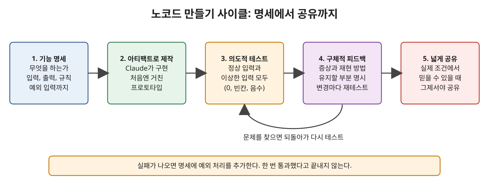

# 19장 노코드 만들기

19장은 책의 분위기가 바뀌는 지점이다. 앞 장들은 글, 분석, 조사처럼 더 나은 내용물을 만드는 법을 다뤘다. 이 장부터 5부는 더 나은 물건, 곧 실제로 돌아가는 도구와 자동화된 과정과 소프트웨어를 Claude와 함께 만드는 법을 다룬다. 책이 쓰인 시점 기준으로, 비개발자에게 가장 놀라운 능력이라고 소개한다.

핵심은 한 가지다. 만들고 싶은 도구를 평범한 말로 정확히 설명하면, 코드를 한 줄도 쓰지 않고 계산기, 퀴즈, 대시보드, 작은 웹 도구를 얻을 수 있다. 책은 이것을 신기한 구경거리가 아니라 연습해서 늘리는 기술로 다룬다.

> **쉽게 말하면**
> 설계도(기능 명세)를 잘 그리고, 만든 뒤에 일부러 괴롭혀 보고(테스트), 고칠 곳을 정확히 짚어 주면 된다. 코딩 실력보다 설명과 점검 실력이 결과를 좌우한다.

## 이 장에서 쓰는 용어

| 용어 | 쉬운 풀이 |
|------|-----------|
| 노코드 만들기(no-code building) | 코드를 직접 쓰지 않고 원하는 바를 설명해서 도구나 웹페이지를 만드는 일 |
| 프로토타입(prototype) | 아이디어가 통하는지 보려고 만든 초기의 작동하는 버전 |
| 기능 명세(functional specification) | 도구가 무엇을 하는지, 입력과 출력과 동작을 적은 설계도 |
| 예외 상황(edge case) | 평소 사용 범위를 벗어난 이상하거나 극단적인 입력 |

---

## 1. 레슨 1: 노코드 만들기가 여기서 뜻하는 것

도구를 분명하게 설명하면 Claude가 실제로 돌아가는 구현을 만든다. 보통 8장에서 배운 아티팩트(Artifact, 대화 옆에 따로 열리는 결과물 창) 형태다. 기술적인 구현은 Claude가 맡고, 사용자는 도구가 무엇을 해야 하는지에 집중한다.

책은 작은 맞춤 도구를 만들려면 코딩을 배우거나 개발자를 고용해야 한다는 장벽이 상당히 무너졌다고 본다. 모든 소프트웨어 개발이 쉬워졌다는 뜻은 아니다. 더 큰 코딩 작업은 22장 이후에서 다룬다. 다만 작고 실용적인 도구의 한 범주는 설명만 잘하면 누구나 손에 넣을 수 있다.

책이 드는 현실적인 예는 다음과 같다.

- 맞춤 계산 논리가 들어간 가격 또는 견적 계산기.
- 상호작용하는 체크리스트나 계획 도구.
- 내가 준 데이터를 요약해 보여 주는 간단한 내부 대시보드.
- 맞춤 논리가 있는 퀴즈, 설문, 피드백 양식.
- 작은 게임이나 상호작용형 설명 자료.

## 2. 레슨 2: 기능 명세 쓰기

기능 명세는 4장의 프롬프트 네 가지 재료를 글이 아닌 도구에 맞춰 쓰는 것이다. 명세에는 도구가 하는 일, 받는 입력, 나오는 출력이나 동작, 특별한 규칙과 예외 상황이 들어간다.

책이 보여 주는 좋은 명세의 예는 배송비 계산기다. 아래는 그 취지를 옮긴 것이다.

```text
택배 무게와 도착 구역으로 배송비를 계산하는 도구를 만들어 줘.
입력: 무게(파운드, 숫자 칸), 도착 구역(A, B, C 드롭다운).
규칙: A구역은 기본 5달러에 파운드당 0.50달러,
      B구역은 기본 8달러에 파운드당 0.75달러,
      C구역은 기본 12달러에 파운드당 1달러.
무게가 0이거나 음수면 계산하지 말고 오류 메시지를 보여 줘.
결과는 기본 요금과 무게 요금으로 나눠서 총액과 함께 표시해 줘.
```

여기서 눈여겨볼 점은 0이나 음수 무게를 어떻게 처리할지 미리 적은 부분이다. 데모에서만 되는 도구와 거칠고 지저분한 실제 사용에서도 버티는 도구의 차이가 이런 세부 사항에서 갈린다. 예상 밖 입력이 들어오면 어떻게 할지 먼저 생각해 두면 수정 한 바퀴를 아낄 수 있다.

흔한 실수는 정상 경로(happy path)만 적는 것이다. 평범한 사용만 설명하고 이상한 입력의 처리를 빼먹으면, 도구가 그런 입력에서 매끄럽게 동작하지 않을 때 놀라게 된다.



## 3. 레슨 3: 구체적이고 구조화된 피드백으로 고쳐 가기

이 레슨은 8장의 아티팩트 수정 요령을 문서나 도식이 아닌 기능 도구에 적용한 것이다. 쓸모 있는 피드백에는 세 가지 습관이 있다.

- **문제를 정확히 설명하고 무엇을 했을 때 생겼는지 적는다.** 책의 예는 "무게 15를 넣고 B구역을 고르면 기대한 19.25달러 대신 0달러가 나온다"이다. "계산이 이상하다"보다 훨씬 쓸모 있다. 참고로 B구역 기본 8달러에 15파운드의 0.75달러씩 11.25달러를 더하면 19.25달러다.
- **그대로 둘 부분을 말한다.** "레이아웃과 A, C구역 계산은 그대로 두고 B구역 논리만 고쳐 줘"처럼 쓴다.
- **의미 있는 변경마다 테스트한다.** 마지막에 한 번만 보면 안 된다. 변경 직후에 잡은 문제가 여러 수정이 쌓인 뒤에 발견한 문제보다 원인을 찾기 쉽다.

책의 또 다른 예는 고객 접수 양식이다. 제출 버튼을 눌러도 접수됐는지 분명하지 않았다. 사용자는 "더 좋게 해 줘" 대신 이렇게 요청한다. "제출을 누르면 확인 메시지를 분명히 보여 주고 버튼을 비활성화해서 두 번 눌리지 않게 해 줘. 양식의 나머지는 그대로 둬."

## 4. 레슨 4: 현실적인 한계, 어디까지 가능한가

노코드 만들기가 잘 맞는 범위가 어디까지인지 솔직히 알아 두면, 일이 그 범위를 넘어 더 큰 수단(22장부터 25장 또는 실제 개발자)이 필요한 때를 알아챌 수 있다.

| 구분 | 내용 |
|------|------|
| 잘 맞는 경우 | 논리가 분명한 독립형 도구. 여러 사용자의 데이터를 영구 저장할 필요가 없거나, 개인이나 소규모용 단순 저장이면 충분한 도구. 동작을 평범한 말로 완전히 설명할 수 있는 도구. |
| 더 필요한 경우 | 외부의 전문 업무 시스템과의 연동. 민감한 데이터를 대규모로 다루는 강한 보안. 권한 구조와 많은 동시 사용이 있는 복잡한 다중 사용자 시스템. |

흔한 실수는 평범한 말 설명으로 못 만들 것이 없다고 믿는 것이다. 그러면 프로젝트가 노코드의 한계를 넘었다는 사실을 깨닫지 못하고 도구의 한계에 짜증만 내게 된다.

## 5. 레슨 5: 프로토타입에서 믿고 쓸 수 있는 도구로

시연용 프로토타입과 반복해서 실제로 쓸 만큼 튼튼한 도구는 다르다. 지금 어느 쪽을 만드는지 의식적으로 구분하라는 것이 책의 말이다. 권하는 순서는 네 단계다.

1. **거친 프로토타입을 먼저 만든다.** 핵심 기능에 집중해서 생각대로 되는지 본다.
2. **현실적인 조건에서 직접 철저히 테스트한다.** 정상 경로뿐 아니라 실제 사용자가 해 볼 법한 예외와 이상한 입력도 넣는다.
3. **테스트가 드러낸 것을 근거로 고친다.** 추상적으로 짐작해서 개선하지 않는다.
4. **그런 다음에야 넓게 공유한다.** 8장의 공유 지침이 그대로 적용된다. 5분 테스트에서 된 프로토타입이 곧바로 팀이나 대중에게 내놓을 수준은 아니다.

책의 모범 사례는 이렇다. 처음 만든 버전이 한 번 작동했다고 바로 공유하고 싶은 유혹을 참아라. 내 테스트에서 작동하는 것과 다른 사람이 실제 조건에서 믿고 쓰는 것 사이의 간극이 철저한 테스트가 값어치를 하는 자리다.

---

## 6. 비즈니스 예시: 웨딩 플래너 오달리스의 견적 도구

웨딩 플래너 오달리스는 예비 고객이 하객 수, 계절, 장소 유형만 넣으면 대략의 견적을 즉시 받는 도구를 원했다. 첫 명세는 정상 경로를 분명히 설명했다. 그런데 테스트해 보니 두 가지 문제가 나왔다.

- 하객 수에 0을 넣으면 음수처럼 보이는 엉뚱한 견적이 나왔다.
- 장소 유형을 고르지 않아도 오류 없이 기본값으로 조용히 계산해서, 실제 고객을 오도할 수 있었다.

그는 명세로 돌아가 최소 하객 수 검증과, 견적 계산 전에 장소 유형을 반드시 고르게 하는 조건을 추가했다. 일부러 이상한 입력을 넣는 테스트를 한 바퀴 더 한 뒤에야 실제 사업 웹사이트에 링크를 올릴 자신이 생겼다.

이 사례의 교훈은 도구가 고객 앞에서 망신을 줄 뻔한 것과 자신 있게 공개할 만한 것의 차이가 처음 만든 것이 아니라 의도적인 테스트와 예외 보완에 있었다는 점이다.

## 7. Claude 대화 예시

도구가 정상 입력에서는 되는데 정말 튼튼한지 알고 싶다고 묻는 장면이다. Claude의 답은 대략 이렇다.

> 좋은 생각이에요. 완성이라고 보기 전에 몇 가지를 일부러 시험해 보세요. 빈 칸, 0, 음수, 아주 큰 숫자 같은 이상한 값을 넣어 보세요. 버튼을 빠르게 여러 번 눌러 보세요. 드롭다운이나 선택 입력은 기본값이나 빈 상태로 둬도 결과가 말이 되는지 보세요. 예상 밖으로 동작하는 것을 찾으면, 정확히 무엇을 넣었고 무엇이 일어났는지 알려 주세요. 그 부분만 고칠게요.

## 8. 연습과 미니 프로젝트

연습 문제는 네 가지다.

1. 기능 명세 연습: 내게 필요한 작은 도구의 명세를 예외 상황 두 개 이상 포함해 끝까지 쓴다.
2. 만들고 테스트하기: 그 도구를 아티팩트로 만들고 정상 입력뿐 아니라 이상한 입력으로 일부러 시험한다.
3. 구조화된 피드백 연습: 막연한 수정 요청 대신 레슨 3 방식의 정확한 피드백을 한 번 이상 준다.
4. 한계 점검: 더 야심찬 도구 아이디어를 레슨 4 틀로 평가해, 노코드에 맞는지 아니면 한계를 넘었는지 판단한다.

미니 프로젝트 "진짜 도구"는 업무나 생활에 실제로 쓸 도구 하나를 끝까지 만드는 것이다. 예외 상황이 들어간 기능 명세를 쓰고, 아티팩트로 만들고, 정상 입력과 이상한 입력으로 테스트하고, 구체적 피드백으로 최소 두 번 고친다. 적절하다면 쓸 수 있는 사람에게 공유한다. 결과물은 직접 써 본 검증 기록이 붙은 작동하는 도구다.

## 9. 흔한 실수와 문제 해결

| 문제 | 가능한 원인 | 해결 |
|------|-------------|------|
| 정상 입력에서는 되는데 이상한 입력에서 깨짐 | 예외 상황을 명세하거나 테스트하지 않음 | 명세에 예외 처리를 명시하고 일부러 테스트 |
| 수정해도 문제를 계속 놓침 | 구체성 없는 막연한 피드백 | 정확한 문제와 유발 조건을 설명 |
| 만들기가 막히고 원하는 결과가 안 나옴 | 노코드의 적정 범위를 넘었을 수 있음 | 레슨 4로 재평가, 22장부터 25장이나 개발자 고려 |
| 공유한 도구가 예상 못한 버그로 망신 | 넓게 공유하기 전 테스트 부족 | 공유 전에 이상한 입력으로 의도적 테스트 |

책이 꼽는 그 밖의 실수는 단 한 번의 정상 경로 성공 뒤에 도구를 널리 공유하는 것, 그리고 마지막에 한 번만 테스트하는 것이다.

## 10. 장 요약

- 노코드 만들기는 코드를 쓰지 않고 원하는 동작을 설명해서 쓸 만한 도구를 만드는 방식이다.
- 좋은 기능 명세에는 입력, 출력, 논리, 그리고 예외 상황의 명시적 처리가 들어간다.
- 피드백은 문제와 유발 조건을 구체적으로 적고, 의미 있는 변경마다 테스트한다.
- 논리가 분명한 독립형 도구가 알맞은 범위이고, 복잡하거나 다중 사용자이거나 보안이 높은 시스템은 더 많은 것이 필요하다.
- 작동하는 프로토타입에서 검증된 튼튼한 도구로 단계적으로 옮긴 뒤 널리 공유한다.

퀴즈의 취지는 네 가지다. 정상 경로 외에 명세에 넣을 것(예외 처리), 가장 쓸모 있는 피드백의 형태(정확한 문제와 유발 조건), 노코드에 한계가 없다는 말의 참거짓(거짓), 널리 공유하기 전에 할 일(이상한 입력까지 의도적 테스트)이다.

더 연습하려면 한 달에 작은 도구 하나를 실제 필요에 맞춰 명세, 제작, 테스트, 수정의 순환으로 만들어 본다. 그리고 빈 입력, 0, 중복 클릭 같은 예외 목록을 계속 쌓아 간다. 도구를 만들수록 이 목록의 값어치가 커진다.

## 11. 실행 체크리스트

- [ ] 만들기 전에 예외 상황이 포함된 기능 명세를 쓴다.
- [ ] 정상 입력뿐 아니라 이상하고 잘못된 입력으로 의도적으로 테스트한다.
- [ ] 막연한 수정 요청 대신 구체적이고 구조화된 피드백을 준다.
- [ ] 프로젝트가 노코드의 현실적 한계를 넘었음을 알아챈다.
- [ ] 미니 프로젝트 "진짜 도구"를 완료했다.

<br>
<br>
<br>

[Mastering Claude AI](../)
