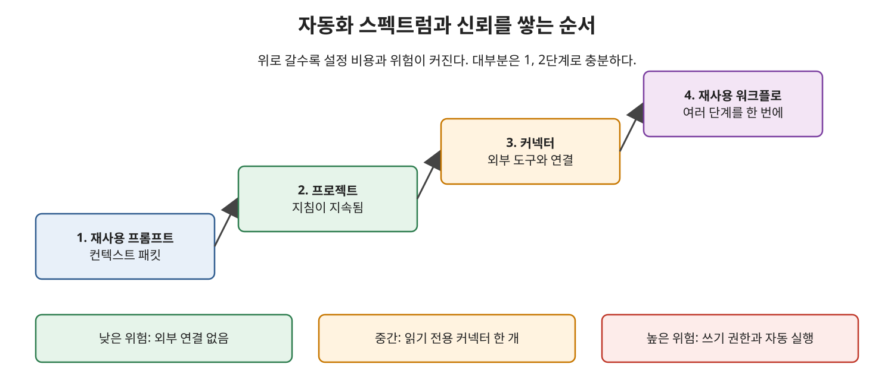

# 20장 자동화 입문 스킬 커넥터 재사용 동작

지금까지의 책은 대체로 사용자가 모든 대화를 직접 끌고 간다고 가정했다. 20장은 질문을 바꾼다. 반복되는 업무 중 어느 부분을, 설정만 잘 해 두면 내가 매 순간 붙어 있지 않아도 돌아가게 할 수 있을까? 이 장은 자동화의 개념, 자동화할 가치가 있는 일을 가리는 기준, 커넥터의 원리, 권한과 감독, 작게 시작하는 법을 다룬다.

저자는 이 영역이 책 전체에서 가장 빨리 변하는 부분이라고 먼저 밝힌다. 책이 쓰인 시점 기준으로 쓴 이 장의 도구 이름이나 설정 단계는 독자가 읽을 때 달라져 있을 가능성이 높다. 그래서 오래 가는 개념과 판단 기준에 집중하고, 실제 설정은 계정이나 Anthropic 공식 문서에서 직접 확인하라고 안내한다.

참고(노트 작성자): 장 제목에는 스킬(Skills)이 들어 있지만, 이 장의 본문은 스킬을 따로 설명하지 않는다. 대신 재사용 프롬프트, 프로젝트, 커넥터, 재사용 워크플로로 이어지는 개념을 다룬다.

> **쉽게 말하면**
> 자동화는 한 번에 크게 지르는 일이 아니다. 신입 직원에게 새 업무를 맡길 때처럼 처음엔 꼼꼼히 지켜보고, 믿을 만하다는 기록이 쌓일 때만 감독을 줄이는 것이 책의 태도다.

## 이 장에서 쓰는 용어

| 용어 | 쉬운 풀이 |
|------|-----------|
| 자동화(automation) | 매번 사람이 반복하는 수고를 줄이도록 과정을 미리 설정해 두는 것 |
| 커넥터(connector) | Claude와 외부 도구나 서비스(캘린더, 업무 추적기, 문서 저장소 등)를 잇도록 설정한 연결 |
| 재사용 동작(reusable action) | 매번 처음부터 설명하지 않고 반복해서 실행할 수 있게 정의한 작업이나 흐름 |
| 권한 범위(permission scope) | 자동화된 연결에 허용된 접근과 행동의 범위. 필요한 만큼만 좁게 주는 것이 이상적 |

---

## 1. 레슨 1: 여기서 말하는 자동화

여기서 자동화는 반복 업무를 매번 다시 설명하거나 다시 시작해야 하는 수고를 줄이는 것이다. 단순한 재사용 프롬프트 틀에서 시작해 Claude가 다른 도구와 직접 상호작용하는 커넥터까지 폭이 넓다. 책이 제시하는 스펙트럼은 가장 단순한 것부터 네 단계다.

1. **저장해 둔 재사용 프롬프트나 컨텍스트 패킷(5장).** 엄밀히는 자동화가 아니지만, 반복 업무를 처음부터 다시 설명하지 않겠다는 같은 목표의 가장 쉬운 형태다.
2. **강한 맞춤 지침이 있는 프로젝트(6장).** 컨텍스트가 계속 남아 설명 수고를 더 줄인다.
3. **외부 도구와의 커넥터.** 대화 안에서 Claude가 캘린더, 업무 추적기, 문서 저장소 같은 다른 시스템을 읽거나 조작할 수 있다.
4. **정의된 재사용 다단계 워크플로.** 매번 손으로 지휘하지 않고 하나의 단위로 실행하는 일련의 동작이다.

처음부터 단순하게 시작해야 하는 이유는 많은 반복 업무가 1단계나 2단계만으로 충분하기 때문이다. 외부 시스템과 실제로 상호작용해야 할 때에만 커넥터와 더 복잡한 자동화를 쓰고, 기본값으로 삼지 않는다.

## 2. 레슨 2: 자동화할 가치가 있는 일 가리기

반복되는 일이라고 모두 자동화에 투자할 가치가 있지는 않다. 책은 일반 생산성 사고에서 빌린 거름망을 직접 적용한다.

| 구분 | 기준 |
|------|------|
| 좋은 후보 | 자주 해서 설정 시간을 금방 회수할 수 있는 일. 매번 구조가 꽤 일정하고 설명 가능한 일. 일 자체뿐 아니라 반복하는 수고가 시간과 주의를 많이 갉아먹는 일. |
| 나쁜 후보 | 드물게 해서 설정 시간이 절약 시간보다 클 일. 매번 크게 달라서 일정한 구조가 맞지 않는 일. 건마다 사람의 판단이 꼭 필요하고 그 판단을 없애면 위험해지는 일. |

책의 사례에서 고객 지원 팀장은 주문 상태 문의처럼 자주 반복되고 답 형식이 예측 가능하며 위험이 낮은 질문의 응답을 자동화하기로 한다. 반면 불만 상향 처리(에스컬레이션)는 빈도가 높아도 자동화하지 않기로 한다. 건마다 크게 다르고 개별 판단이 도움이 되므로, 판단이 필요하다는 나쁜 조건이 빈도라는 좋은 조건을 이기기 때문이다.

흔한 실수는 기술적으로 가능하다는 이유만으로 자동화하는 것이다. 빈도, 일관성, 개별 판단의 중요성을 따져 보지 않고 시작하면 안 된다.

## 3. 레슨 3: 커넥터가 개념적으로 어떻게 동작하나

커넥터는 Claude가 대화 중에 외부 도구나 서비스의 정보를 읽거나, 경우에 따라 그 안에서 행동할 수 있게 하는 설정된 연결이다. 내가 정보를 일일이 복사해 붙여 넣지 않아도 된다.

예를 들어 지금은 캘린더를 직접 확인해 필요한 내용을 대화에 옮기고, Claude와 일정을 짜고, 결과를 다시 캘린더에 손으로 입력한다. 캘린더 커넥터가 있으면 Claude가 일정을 직접 읽고 필요하면 고칠 수도 있어서 여러 수작업이 한 번의 매끄러운 상호작용으로 줄어든다.

어떤 커넥터든 아래 세 질문을 던져 평가하라는 것이 책의 틀이다.

| 질문 | 왜 중요한가 |
|------|-------------|
| 이 커넥터가 무엇을 읽을 수 있는가 | 어떤 컨텍스트를 쓸 수 있는지 결정한다 |
| 이 커넥터가 실제로 무엇을 하거나 바꿀 수 있는가 | 행동이 현실에 미치는 영향을 결정한다 |
| 문제가 생기면 어떻게 되는가 | 이 접근을 허용하는 위험의 크기를 결정한다 |

사용 가능한 커넥터의 종류, 정확한 기능, 설정 방법이 계속 바뀌므로, 어떤 책의 고정된 목록(이 책도 포함)에 의지하지 말고 항상 최신 문서나 계정 설정을 직접 확인하라고 책은 당부한다.

## 4. 레슨 4: 권한과 감독, 조심스럽게 접근하기

자동화가 Claude가 제안하고 내가 실행하는 방식에서 Claude가 직접 행동하는 방식으로 옮겨 갈수록, 권한을 이해하고 의도적으로 범위를 정하는 일의 중요성이 크게 커진다. 조심스러운 접근에는 세 가지 원칙이 있다.

- **필요를 이루는 가장 좁은 권한 범위를 준다.** 커넥터가 읽기 전용과 읽기-쓰기를 모두 제공하는데 내 용도가 읽기뿐이라면 더 제한된 쪽을 고른다.
- **현실에 영향을 주는 일에는 사람의 확인 단계를 둔다.** 특정 자동화에 대한 신뢰가 반복적이고 검토된 사용으로 쌓이기 전까지는 확실히 유지한다. 이메일 보내기, 공유 문서 수정, 구매는 워크플로가 자리 잡은 뒤에도 확인 단계를 둘 만한 대표적 행동이다.
- **무엇을 왜 연결했는지 주기적으로 점검한다.** 6장의 프로젝트 지식, 7장의 메모리처럼 연결된 권한도 낡을 수 있다. 끝난 프로젝트를 위해 만든 커넥터를 계속 켜 둘 이유는 없다.

흔한 실수는 나중에 쓸모 있을지 모른다며 필요 이상의 넓은 권한을 미리 주는 것이다.

## 5. 레슨 5: 작게 시작하기

이 분야는 변화가 빠르고 권한과 범위를 정하는 데 판단이 많이 필요하므로, 야심 찬 한 번에 만들기보다 의도적으로 점진적인 접근이 대부분의 독자에게 맞다. 책이 권하는 순서는 세 단계다.

1. **가장 위험이 낮은 형태부터 시작한다.** 외부 연결이 전혀 필요 없는 재사용 컨텍스트 패킷과 잘 짜인 프로젝트(5장, 6장).
2. **정말 자주 하는, 분명한 일 하나에 이해하기 쉬운 커넥터 하나를 붙인다.** 처음에는 사람의 확인 단계를 둔다.
3. **서서히 넓힌다.** 그 워크플로가 어떻게 동작하는지 실제 확신이 생긴 뒤에, 그리고 레슨 2의 좋은 후보 기준에 분명히 맞는 일에 한해서다.

책의 모범 사례는 첫 자동화를 새 직원에게 새 유형의 일을 맡길 때처럼 다루라는 것이다. 처음에는 실제 감독을 하고, 믿을 만한 성과를 관찰하면서 신뢰가 쌓일수록 감독을 줄인다. 처음부터 믿음으로 주지 않는다.

---

## 6. 비즈니스 예시: 임대 관리 회사의 유지보수 요청 분류

작은 임대 관리 회사가 세입자의 유지보수 요청 분류를 자동화하려 한다. 요청을 읽고 곧바로 업체 방문 일정까지 잡는 완전 자동 시스템을 만들지 않고, 보수적으로 시작했다.

- 처음에는 커넥터로 Claude가 들어오는 요청을 읽고 분류와 우선순위를 제안만 한다. 일정은 담당 직원이 검토하고 확정한 뒤에 잡는다.
- 몇 달 동안 제안이 계속 정확하자 조금 넓혔다. 전구 교체처럼 정말 일상적이고 위험이 낮은 분류는 자동으로 일정을 잡는다.
- 우선순위가 높거나 모호하다고 표시된 요청은 계속 사람의 확인을 받는다.

교훈은 확대가 점진적이고 증거에 기반했으며 신뢰가 실제로 쌓인 곳에만 적용됐다는 점이다. 첫날부터 가능한 모든 것을 자동화하지 않고, 자동화에 두는 신뢰를 관찰된 신뢰성에 맞춰 올렸다.

## 7. Claude 대화 예시

연결할 수 있는 건 다 연결해서 자동화에 최대한 맡기면 되느냐는 질문에 Claude가 이렇게 답하는 장면이다.

> 시작 방식으로는 오히려 권하지 않아요. 구체적이고 자주 하는 일 하나에 좁고 이해하기 쉬운 연결로 시작하고, 처음에는 사람의 검토 단계를 두고, 성과를 보며 확신이 쌓이면 서서히 넓히는 편이 낫습니다. 많은 도구를 넓은 권한으로 한꺼번에 연결하면 무엇이 어디서 잘못될지 따져 보기 어려워져요. 좁게 시작하면 무엇이 잘 되는지 훨씬 분명히 보인 뒤에 넓힐 수 있습니다.

## 8. 연습과 미니 프로젝트

연습 문제는 네 가지다.

1. 자동화 후보 점검: 내 업무의 반복 작업 다섯 가지를 적고, 레슨 2의 거름망으로 좋은 후보와 아닌 것을 가른다.
2. 권한 범위 연습: 떠오른 자동화 아이디어 하나에 필요를 실제로 이루는 가장 좁은 권한 범위를 적는다. "혹시 몰라서" 넓히고 싶은 마음을 참는다.
3. 감독 설계: 자동화를 고려하는 일에 사람의 확인 단계를 어떻게 둘지, 어떤 조건이 되면 편하게 뺄 수 있을지 설계한다.
4. 문서 확인: 내 계정이나 Anthropic 문서에서 지금 쓸 수 있는 커넥터와 자동화 기능을 직접 찾아본다. 세부가 빨리 바뀌기 때문이다.

미니 프로젝트 "첫 번째 작은 자동화"는 반복 업무 중 좋은 후보 하나를 골라 가장 위험이 낮은 형태, 곧 탄탄한 컨텍스트 패킷이나 프로젝트로 먼저 완성하는 것이다. 알맞은 커넥터가 있고 적절하다면 좁은 권한 범위와 사람의 확인 단계를 두고 설정하고, 더 넓히기 전에 실제 사례 몇 건 이상을 돌려 본다. 결과물은 사람의 확인을 거치며 몇 번 돌아간 작은 자동화다.

## 9. 흔한 실수와 문제 해결

| 문제 | 가능한 원인 | 해결 |
|------|-------------|------|
| 자동화된 작업을 아직 못 믿겠음 | 현재 신뢰 수준을 정당화할 관찰 기록이 부족 | 증거가 더 쌓일 때까지 사람의 확인 단계를 두거나 다시 도입 |
| 커넥터가 너무 많아 파악이 어려움 | 너무 넓은 자동화를 동시에 도입 | 이해하기 쉬운 커넥터 하나씩으로 줄임 |
| 커넥터가 필요 이상의 접근 권한을 가짐 | 권한 범위를 의도적으로 최소화하지 않음 | 필요한 범위로 줄이도록 점검 |
| 설정 안내가 내 화면과 안 맞음 | 기능과 설정 단계가 빨리 바뀜 | 최신 문서나 계정 설정을 직접 확인 |

그 밖의 실수로는 신뢰성이 입증되기 전에 확인 단계를 없애는 것, 한 곳의 고정된 목록에 의지하는 것, 한꺼번에 야심 차게 만드는 것이 있다.

## 10. 장 요약

- 자동화는 단순한 재사용 컨텍스트 패킷에서 커넥터와 정의된 다단계 워크플로까지 이어지는 스펙트럼이다.
- 반복되는 일이라고 모두 가치가 있지는 않다. 투자 전에 빈도, 일관성, 개별 판단의 중요성을 따진다.
- 커넥터는 외부 도구를 읽고 조작하게 한다. 무엇을 읽는지, 무엇을 하는지, 문제가 생기면 어떻게 되는지 항상 평가한다.
- 필요를 이루는 가장 좁은 권한을 주고, 신뢰성이 입증될 때까지 사람의 확인을 유지한다.
- 작게 시작하고, 가정이 아니라 증거를 근거로 서서히 넓힌다.

퀴즈의 취지는 네 가지다. 좋은 자동화 후보의 조건(자주 하고 일정하며 반복 자체가 부담), 커넥터에 줄 권한 범위(필요를 이루는 가장 좁은 범위), 설정 즉시 사람의 확인을 없애라는 말의 참거짓(거짓), 자동화를 시작하는 권장 방식(이해하기 쉬운 커넥터 하나로 작게 시작해 증거로 확대)이다.

더 연습하려면 몇 달마다 자동화 후보 목록을 다시 본다. 6개월 전에는 가치가 없던 일이 지금은 가치가 있을 수 있고 그 반대도 있다. 또 이 책에서 가장 빨리 변하는 영역이니 Anthropic 문서를 주기적으로 확인한다.

## 11. 실행 체크리스트

- [ ] 빈도, 일관성, 판단 필요 기준으로 자동화 후보를 평가한다.
- [ ] 커넥터를 개념적으로 이해한다. 무엇을 읽고, 무엇을 하며, 문제가 생기면 어떤 위험이 있는지 안다.
- [ ] 넓은 "혹시 모를" 접근 대신 좁은 권한 범위를 준다.
- [ ] 워크플로의 신뢰성이 입증될 때까지 사람의 확인 단계를 유지한다.
- [ ] 자동화를 작게 시작하고 증거를 근거로 서서히 넓힌다.

 
 
 

[Mastering Claude AI](../)
