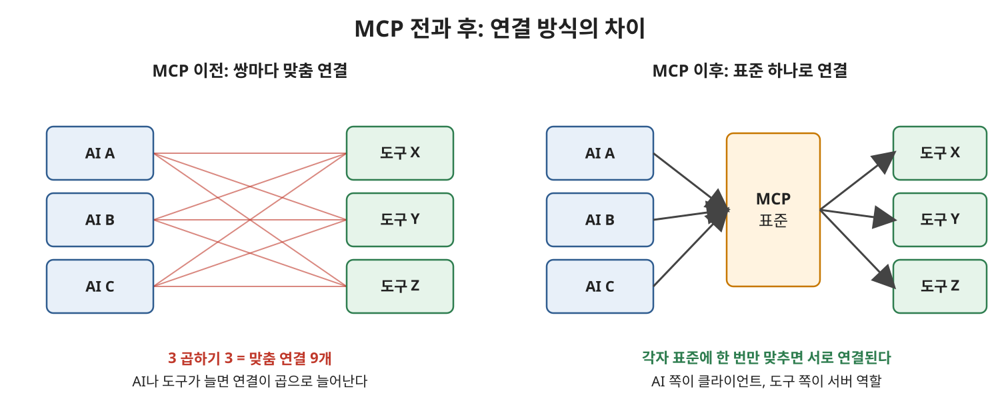

# 21장 MCP 쉽게 이해하기

MCP는 요즘 AI 도구 이야기에 자주 나오는 말이다. 21장은 직접 MCP 서버를 설치할 일이 없더라도, 개념 수준에서는 알아 두자는 취지의 장이다. 일부러 평범한 말과 개념 수준에 머문다. MCP는 기술 표준이고 정확한 규격과 생태계는 책에 외워 두기보다 최신 기술 문서에서 새로 찾아보는 편이 맞다고 저자는 말한다. 새 서버와 기능이 계속 추가되기 때문이다.

이 장을 읽고 나면 회의나 제품 설명에서 MCP라는 말이 나왔을 때 대략 무슨 뜻이고 왜 중요한지 알게 된다. 직접 만들 수 있게 되는 것은 아니며, 그러려면 더 기술적인 자료가 필요하다.

> **쉽게 말하면**
> MCP는 AI와 도구를 잇는 표준 콘센트 규격이다. 우리는 콘센트 규격이 아니라 램프가 켜지는 것만 경험한다. 마찬가지로 일상에서는 MCP가 아니라 그 위에 만들어진 개별 커넥터를 쓴다.

## 이 장에서 쓰는 용어

| 용어 | 쉬운 풀이 |
|------|-----------|
| MCP(Model Context Protocol) | Claude 같은 AI가 외부 도구와 데이터 원천에 공통된 방식으로 연결되게 하는 공개 표준 |
| 표준(standard) | 서로 다른 시스템이 매번 맞춤 해결 없이 함께 일하도록 합의한 공통 방식 |
| 서버(이 맥락에서) | 특정 도구나 데이터 원천을 MCP 호환 AI가 쓸 수 있는 형태로 내놓는 서비스(MCP 서버) |
| 클라이언트(이 맥락에서) | MCP 서버에 연결해서 쓰는 AI 시스템이나 앱. Claude가 여기에 해당 |

---

## 1. 레슨 1: MCP가 푸는 문제

공통 표준이 없던 시절에는 AI 시스템을 어떤 외부 도구나 데이터 원천에 연결하려면, 그 한 쌍만을 위한 맞춤 개발이 필요했다. 예를 들어 이 AI와 저 업무 관리 도구를 잇는 전용 다리를 각각 만들고 따로 유지해야 했다.

이것이 풀 만한 문제인 이유는 이렇다. AI 시스템마다 도구마다 맞춤 연결이 필요하면, 둘이 늘어날수록 필요한 연결 수가 아주 빠르게 늘고 같은 개발이 중복된다. AI가 셋이고 도구가 셋이면 연결은 아홉 개가 된다. 각 쌍을 처음부터 다시 만드는 셈이다.

책이 붙들라고 권하는 비유는 표준 전기 콘센트다. 표준이 없던 시절에는 가전마다 전원과의 전용 연결을 따로 만들어야 했을 것이다. 표준 콘센트가 있으면 규격을 지킨 어떤 가전도 규격을 지킨 어떤 콘센트에 꽂힌다. MCP는 AI와 외부 도구에서 비슷한 일을 하려는 것이다. 조합마다 새로 배선하지 않고 공통의 꽂는 방식을 쓴다.

## 2. 레슨 2: MCP가 실제로 표준화하는 것

MCP는 두 대상이 소통하는 공통 방식을 정한다. 한쪽은 AI 시스템(Claude)으로, 이 맥락에서 클라이언트라 부른다. 다른 쪽은 외부 도구나 데이터 원천으로, 서버로 내놓아진다.

도구나 데이터 원천에 MCP 서버가 한 번 만들어지면, MCP를 지원하는 어떤 AI 시스템이든 같은 표준으로 연결할 수 있다. 도구마다 AI 시스템별 맞춤 연동을 따로 만들 필요가 없다. 이득은 양쪽에 간다. 도구를 만드는 쪽은 여러 연동 대신 MCP 서버 하나만 만들면 되고, AI 쪽은 도구마다 특별 작업을 하지 않고도 늘어나는 도구 생태계에 연결할 수 있다.

책의 비교표를 정리하면 다음과 같다.

| 항목 | 공통 표준이 없을 때 | MCP가 있을 때 |
|------|---------------------|---------------|
| 연결 방식 | AI와 도구의 쌍마다 맞춤 연동 | MCP 호환 AI는 표준에 맞춘 어떤 MCP 서버든 사용 |
| 노력의 증가 | 도구와 AI가 늘수록 빠르게 증가 | 도구당 대체로 한 번 만들고 널리 재사용 |

## 3. 레슨 3: 표준으로서의 MCP와 내가 쓰는 개별 커넥터

헷갈리기 쉬운 두 가지를 분명히 나눌 필요가 있다. 하나는 MCP 자체, 곧 일반 표준이다. 다른 하나는 내 Claude 계정에서 실제로 켜는 개별 커넥터, 곧 특정 도구나 서비스를 위해 그 표준으로 만든 구체적인 구현이다.

일상 사용자는 보통 MCP를 직접 만지지 않는다. 내부적으로 MCP로 만들어진 개별 커넥터를 만날 뿐이다. 램프를 꽂을 때 전기 규격 자체를 생각하지 않고 꽂으면 켜진다는 것만 경험하는 것과 같다.

따라서 독자는 MCP의 기술 규격을 몰라도 MCP 기반 커넥터를 잘 쓸 수 있다. 20장에서 다룬 커넥터 평가, 권한 범위 정하기, 작게 시작하기는 기반 표준을 다시 떠올리지 않아도 그대로 현실에 적용된다.

## 4. 레슨 4: MCP 기반 연결이 알맞은 해법일 때

개념을 이해하면 한 가지 상황을 알아볼 수 있다. 문제가 본질적으로 Claude가 특정 외부 도구나 데이터 원천과 구조적이고 지속적으로 믿을 만하게 상호작용하게 하고 싶다는 것일 때다. 해당 도구에 MCP 기반 커넥터가 있다면, 수작업 복사 붙여넣기나 임시방편으로 풀려는 것보다 대개 더 견고하고 지원이 좋은 해법이다.

간단한 테스트는 이 질문이다. "나는 Claude와 이 다른 도구 사이에서 정보를 일정하고 설명 가능한 방식으로 정기적으로 손으로 옮기고 있는가?" 그렇다면, 계속 수작업을 하거나 맞춤 해법을 만들 것이라고 가정하기 전에 그 도구용 MCP 기반 커넥터가 있는지 확인해 볼 만하다. 몇 분이면 된다. 흔한 실수는 쓰는 도구에 잘 지원되는 표준 커넥터가 이미 있다는 사실을 모르고 비효율적인 수작업을 무기한 이어 가는 것이다.

## 5. 레슨 5: 최신의 정확한 정보는 어디서 얻나

MCP는 계속 발전하는 공개 표준이고 서버와 커넥터 생태계도 계속 커진다. 그래서 어떤 고정된 설명, 이 장 포함, 보다 최신의 권위 있는 출처를 확인하는 편이 낫다. 책이 안내하는 방법은 두 가지다.

- Anthropic의 현재 공식 문서를 확인한다. 공식 지원 범위와 설정 방법에 대한 가장 정확하고 최신의 그림을 준다.
- 기술에 밝아 규격 자체를 파고들고 싶다면, 2차 요약이 아니라 공식 프로토콜 문서를 직접 찾는다. 요약은 실제 변화보다 늦을 수 있다.

책의 모범 사례는 이 장을 기술 설치 설명서가 아니라 MCP가 나오는 대화를 이해하게 해 주는 개념 어휘로 쓰라는 것이다. 실제로 무엇을 구현할 때가 되면 구체적인 사항은 최신의 권위 있는 문서로 간다. 참고(노트 작성자): 책이 쓰인 시점 이후 MCP 생태계가 크게 달라졌을 수 있으므로, 이 노트의 설명도 개념 수준으로만 받아들이고 세부는 공식 문서로 확인한다.

---

## 6. 비즈니스 예시: 웨비나에서 MCP를 자주 들은 운영 책임자

작은 컨설팅 회사의 운영 책임자는 웨비나와 기사에서 MCP라는 말을 자주 들었지만 정확히 무슨 뜻인지, 자기 사업과 관련 있는지 감이 없었다. 쌍마다 맞춤 연동 없이 AI가 도구에 연결되게 하는 공유 표준이라는 개념을 이해하고 나니, 실제 질문이 달라졌다.

바뀐 질문은 "우리에게 MCP가 필요한가"가 아니었다. "우리 팀이 이미 쓰는 업무 관리 도구에 쓸 수 있는 표준 커넥터가 있는가, 그래서 정보를 손으로 복사하는 대신 Claude가 그 도구와 직접 일하게 할 수 있는가"였다. 이것은 직접 조사해 볼 수 있는 구체적이고 확인 가능한 질문이다. 교훈은 개념 이해의 가치가 그 자체보다, 막연하고 유행어에 끌려가던 질문을 실제로 답할 수 있는 질문으로 바꿔 준 데 있다는 점이다.

## 7. Claude 대화 예시

Claude를 잘 쓰려면 MCP를 이해해야 하느냐는 질문에 Claude가 답하는 장면이다.

> 꼭 그럴 필요는 없어요. 일상 사용자는 MCP로 만들어진 개별 커넥터를 쓰게 될 뿐이고, 기반 표준을 따로 생각하지 않아도 됩니다. 뭔가를 꽂을 때 전기 규격을 생각하지 않는 것과 비슷해요. 대략적으로 이해해 두면 "이 도구용 커넥터가 있나?"를 물어볼 만한 때를 알아보고, 용어가 나와도 겁먹지 않는 데 도움이 됩니다. 그 이상으로는 커넥터 평가, 권한 범위 신중히 정하기, 작게 시작하기 같은 실무 기술이 표준의 기술적 세부보다 매일 훨씬 중요해요.

## 8. 연습과 미니 프로젝트

연습 문제는 네 가지다.

1. 쉬운 말 설명: 기술에 밝지 않은 동료에게 쓸 수 있도록, MCP가 무엇인지 두 문장으로 쓴다.
2. 비유 연습: 전기 콘센트 말고 나만의 비유를 만들고, 몇 가지 후속 질문에도 맞는지 시험한다.
3. 커넥터 확인: Claude와 함께 정기적으로 쓰는 도구 하나를 골라, 그 도구용 표준 커넥터가 있는지 최신 문서에서 확인한다.
4. 유행어 재구성: 최근 접한 막연한 AI 유행어(MCP든 다른 것이든)를 내 상황에서 구체적으로 답할 수 있는 질문으로 바꿔 본다.

미니 프로젝트 "구체적인 질문"은 업무에서 Claude와 정보를 손으로 주고받고 있는 도구나 시스템 하나를 찾는 것이다. 최신 문서로 표준 커넥터가 있는지 조사한다. 있다면 쓰기 전에 20장의 틀(무엇을 읽는지, 무엇을 하는지, 권한 범위)로 평가한다. 결과물은 조사와 평가를 기록한 짧은 메모다.

## 9. 흔한 실수와 문제 해결

| 문제 | 가능한 원인 | 해결 |
|------|-------------|------|
| MCP가 나오면 무슨 뜻인지 혼란 | 쉬운 말의 개념 기반이 없음 | 레슨 1의 전기 콘센트 비유로 돌아감 |
| 특정 도구용 커넥터 유무가 불확실 | 확인하지 않고 가정함 | Anthropic의 최신 문서를 직접 확인 |
| MCP의 기술적 세부에 압도됨 | 규격 전체를 불필요하게 익히려 함 | 이 장의 개념 이해에 집중하고, 실제로 기술적인 것을 만들 때만 더 깊이 |
| 반복되는 수작업이 불필요하게 이어짐 | 표준 커넥터가 대체할 수 있음을 모름 | 레슨 4의 간단한 테스트를 적용하고 기존 커넥터를 확인 |

그 밖의 실수로는 MCP를 Claude를 잘 쓰기 위해 기술적으로 이해해야 하는 것으로 여기는 것, 일반 표준(MCP)과 그것으로 만든 개별 커넥터를 혼동하는 것, 정확한 최신 규격을 책에서 찾으려는 것이 있다.

## 10. 장 요약

- MCP는 AI 시스템과 외부 도구가 공통 방식으로 연결되게 해서, 쌍마다 맞춤 연동을 만들 필요를 없애는 공개 표준이다.
- 개념적으로 표준 전기 콘센트와 같다. 조합마다 새로 배선하지 않고 폭넓은 호환성을 준다.
- 일상 사용자는 표준 자체가 아니라 MCP로 만들어진 개별 커넥터와 상호작용한다.
- 실용 테스트: Claude와 다른 도구 사이에서 정보를 정기적으로 손으로 옮기고 있다면, 표준 커넥터가 이미 있는지 확인한다.
- MCP와 생태계는 빨리 변하므로, 기술적 세부는 고정된 설명이 아니라 최신의 권위 있는 문서에 의지한다.

퀴즈의 취지는 네 가지다. MCP가 주로 푸는 문제(AI와 도구의 모든 쌍마다 맞춤 연동이 필요한 것), MCP와 개별 커넥터의 관계(표준과 그 구현), 일상 사용자가 규격을 기술적으로 알아야 하느냐는 말의 참거짓(거짓), MCP 기반 커넥터가 도움이 될지 가늠하는 실용 테스트(Claude와 다른 도구 사이에서 정보를 정기적으로 손으로 옮기는가)다.

더 연습하려면 다음에 기사나 웨비나에서 MCP를 들으면 검색 전에 이 장의 쉬운 말 개념으로 먼저 옮겨 보고, 이미 쓰는 도구에 새 커넥터가 생겼는지 주기적으로 확인한다.

## 11. 실행 체크리스트

- [ ] 비유를 써서 MCP를 쉬운 말로 설명할 수 있다.
- [ ] 표준으로서의 MCP와 그것으로 만든 개별 커넥터의 차이를 이해한다.
- [ ] 수작업 우회책을 만들거나 유지하기 전에 기존 표준 커넥터가 있는지 확인한다.
- [ ] 기술적 세부가 필요할 때 최신의 권위 있는 문서를 어디서 찾는지 안다.
- [ ] 미니 프로젝트 "구체적인 질문"을 완료했다.

 
 
 

[Mastering Claude AI](../)
