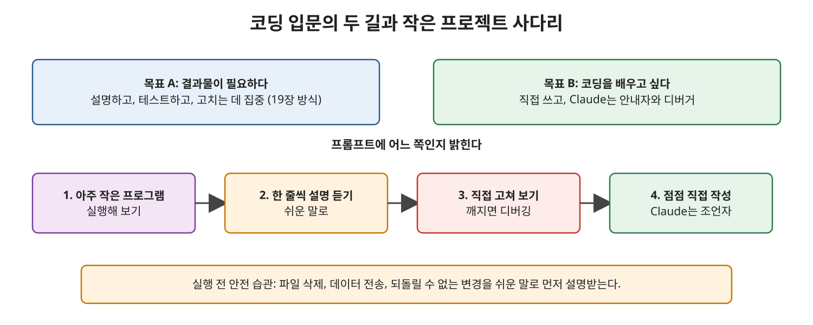

# 22장 코딩 입문 경로

22장은 스스로 기술 쪽 사람이 아니라고 생각하는 독자도 읽을 만한 장이다. Claude가 코드를 쓰는 문턱을 크게 낮췄다는 것이 논지다. 이해할 필요가 아예 없어졌다는 뜻이 아니라, 개념을 설명하고, 출발점이 되는 코드를 쓰고, 디버깅을 돕는 참을성 있고 언제든 곁에 있는 협력자가 생겼다는 뜻이다. 속도와 깊이는 내가 준비된 만큼 고를 수 있다.

이 장은 두 독자를 동시에 겨냥한다. 가능성과 시작법이 궁금한 완전 초보자와, Claude와 더 효과적으로 일하는 방식을 원하는 경험자다. 두 흐름이 모든 레슨에 함께 흐른다.

> **쉽게 말하면**
> 코드를 받아 쓰는 것과 코드를 배우는 것은 다른 목표다. 어느 쪽인지 정하고, 작지만 진짜인 프로그램을 실행해 보면서 배우는 것이 가장 빠르고 오래 남는다.

## 이 장에서 쓰는 용어

| 용어 | 쉬운 풀이 |
|------|-----------|
| 프로그래밍 언어(programming language) | 컴퓨터가 실행할 지시를 쓰는 형식 언어(Python, JavaScript 등) |
| 문법(syntax) | 언어가 요구하는 규칙과 구조. 말하자면 문법 |
| 디버깅(debugging) | 코드의 오류를 찾아 고치는 과정. 자세한 내용은 24장 |
| 함수(function) | 특정 작업을 하는, 이름 붙은 재사용 가능한 코드 덩어리 |

---

## 1. 레슨 1: 두 가지 다른 목표, 코드를 받기와 코딩을 배우기

시작 전에 지금 내 목표가 무엇인지 솔직히 정해야 한다. 목표에 따라 Claude를 쓰는 방법이 달라지기 때문이다.

- **목표 A: "이것을 만들어야 하고, 내가 코딩을 배울 필요는 없다."** 19장의 노코드 만들기와 가깝다. 필요한 것을 분명히 설명하고 Claude가 구현을 만들게 한다. 한 줄 한 줄 이해하기보다 테스트하고 고치는 데 힘을 쓴다.
- **목표 B: "Claude를 선생님 삼아 실제로 코딩을 배우고 싶다."** 접근이 다르다. 결과만 달라고 하지 않고 설명을 요청한다. Claude가 주 저자가 아니라 안내자이자 디버거가 되고 내가 직접 코드를 쓴다. 완성된 답을 달라고 하는 것이 더 빠를 때에도 이해를 의도적으로 쌓는다.

구분이 중요한 이유는 이렇다. 목표가 배움인데 그냥 만들어 달라고 하면 작동하는 코드는 얻어도 오래 가는 이해는 얻지 못한다. 반대로 오늘 안에 쓸 도구가 필요한데 모든 것을 깊이 설명해 달라고 하면 쓸데없이 느려진다. 어느 쪽도 틀리지 않았다. 목적에 맞을 뿐이다. 지금 어느 쪽인지 스스로에게, 그리고 프롬프트에서 Claude에게 분명히 밝히라는 것이 책의 조언이다.



## 2. 레슨 2: 처음부터 시작하기, 초보자의 첫 실전 세션

코드를 한 줄도 써 본 적이 없다면, Claude를 참을성 있는 안내자로 삼아 부담 없이 시작하는 구체적 방법이 있다. 네 단계다.

1. **실제 목표와 경험 수준을 솔직히 말한다.** 책의 예문은 이렇다. "프로그래밍 경험이 전혀 없어요. 언젠가 19장 같은 간단한 도구를 직접 만들 수 있게 되고 싶은데 처음부터 시작합니다. 어디서부터 해야 할까요?"
2. **추상적인 강의 말고 작고 완전하게 작동하는 첫 프로그램을 요청한다.** 이름을 묻고 인사하는 정도로 단순해도 된다. 실행하고, 바꾸고, 망가뜨려 볼 진짜가 있으면 개념을 읽기만 할 때보다 이해가 빨리 쌓인다.
3. **프로그램을 한 줄씩 쉬운 말로 설명해 달라고 한다.** "코드를 한 번도 본 적 없는 사람에게 설명하듯, 각 줄이 무엇을 하는지 차근차근 알려 줘."
4. **직접 고쳐 보고, 막히면 Claude의 도움을 받는다.** 인사 메시지 같은 작은 것부터 바꿔 보고 무슨 일이 일어나는지 본다. 무언가 깨지면(깨질 것이고 그것이 정상이며 유익하다) 그것이 첫 디버깅 경험이다. 24장에서 더 자세히 다룬다.

흔한 실수는 실제로 작동하는 코드를 한 번도 돌려 보지 않고 프로그래밍 개념을 추상적으로만 흡수하려는 것이다. 작은 실제 프로그램으로 손을 움직여 보는 편이 수동적인 읽기보다 이해를 훨씬 빠르게 만든다.

## 3. 레슨 3: 코드를 위한 분명한 요청 쓰기

이 레슨은 4장의 프롬프트 네 가지 재료와 19장의 기능 명세를 코드 요청에 적용한 것이다. 좋은 코드 요청에는 네 가지가 들어간다.

- **프로그램이 무엇을 해야 하는지**를 분명하고 구체적으로.
- **어떤 언어나 환경**에서 돌아가야 하는지(내 상황에서 중요하다면).
- **제약 조건.** 성능 요구, 호환성, 원하는 스타일.
- **실제로 어떻게 실행하거나 쓸지.** 어떤 해법이 알맞은지에 영향을 준다.

책의 비교 예는 다음과 같다. 약한 요청은 "내 파일을 정리하는 스크립트 써 줘"다. 강한 요청은 아래와 같다.

```text
폴더를 훑어서 파일을 확장자별 하위 폴더
(이미지, 문서, 스프레드시트 등)로 정리하는 Python 스크립트를 써 줘.
대상 폴더에 같은 이름의 파일이 이미 있으면 옮기거나 덮어쓰지 말고
경고를 출력하고 건너뛰어 줘.
내 컴퓨터에서 가끔 직접 실행할 거고, 자동 예약은 안 할 거야.
```

세부가 더 필요한 이유는 강한 버전이 실제로 중요한 예외 상황, 곧 같은 파일 이름을 미리 예상했기 때문이다. 이런 세부가 매끄럽게 작동하는 코드와 처음 현실 상황을 만났을 때 짜증스러운 사고를 내는 코드를 가른다.

## 4. 레슨 4: 초보자도 코드를 읽기

코드를 처음부터 쓸 줄 몰라도, 코드가 대략 무엇을 하는지 알아보는 정도의 읽기만으로 큰 도움을 받는다. 문법에 완전히 능숙하지 않아도 된다.

실용적인 습관은 특히 초반에는 실행 전에 코드의 쉬운 말 설명을 요청하는 것이다. 책의 예문이다. "실행하기 전에, 이 코드가 무엇을 하는지 쉬운 말로 설명해 줘. 특히 파일을 바꾸거나 지우는 것, 정보를 어딘가로 보내는 것, 쉽게 되돌릴 수 없는 변경이 있으면 짚어 줘."

배움을 넘어 진짜 안전 습관이기도 하다. 내 파일이나 계정을 건드리거나 데이터를 어딘가로 보내는 코드를 전혀 이해하지 못한 채 실행하면 실제 위험이 있다. 낯선 코드를 돌리기 전의 짧은 쉬운 말 설명은 노력이 적고 가치가 큰 점검이며, 18장의 검증 규율과 취지가 비슷하다. 흔한 실수는 파일 삭제, 데이터 전송, 설정 변경 같은 현실적 부작용이 있는 코드를 설명을 듣기 전에 그냥 실행하는 것이다.

## 5. 레슨 5: 배우면서 작고 진짜인 것을 만들기

Claude의 도움으로 코딩 실력을 쌓는 가장 빠르고 오래 가는 방법은 작고 진짜이며 나에게 의미 있는 프로그램을 만드는 것이다. 추상적이고 일반적인 튜토리얼 연습만 하는 것이 아니다.

진짜 프로젝트가 낫다고 보는 이유는, 정말 있었으면 하는 것(사진 파일 이름을 특정 방식으로 바꾸는 스크립트, 내가 신경 쓰는 것을 기록하는 작은 도구)이 있으면 피할 수 없는 혼란과 디버깅을 헤쳐 나갈 진짜 동기가 생기기 때문이다. 1부터 100까지 출력하기 같은 일반 연습은 그 동기를 주지 못할 때가 많다.

책이 권하는 순서는 네 가지다.

1. 나에게 정말 작고 쓸모 있는 것으로 시작한다.
2. Claude를 저자이자 선생님으로 쓴다. 특히 초반에는 결과만이 아니라 선택의 이유를 설명해 달라고 한다.
3. 익숙해질수록 직접 쓰는 몫을 늘리고, Claude는 주 저자에서 디버거이자 조언자로 옮겨 간다.
4. 나중에 초기 프로젝트를 다시 보며 얼마나 더 이해하는지 알아본다. 자신의 진척을 보는 구체적이고 힘이 나는 방법이다.

책의 예로, 완전 초보자가 하루 물 섭취량을 손으로 입력하고 주간 합계를 보여 주는 작은 프로그램을 Claude와 만든다. 작고, 본인에게 쓸모 있고, 한 줄씩 이해할 만큼 단순하다. 몇 달 동안 조금씩 야심 찬 비슷한 프로젝트를 이어 가면서, 코드의 더 많은 부분을 직접 쓰게 되고 Claude는 주 저자에서 디버깅 동반자로 바뀐다.

---

## 6. 비즈니스 예시: 외주 의존을 줄이려는 사업주 류번

코딩 배경이 없는 작은 사업주 류번은 회사의 단순한 내부 도구에 작은 수정은 직접 하고 싶었다. 사소한 변경마다 외부 계약자에게 전적으로 의존하고 싶지 않았다. 이 장의 방식대로 작고 진짜인 프로젝트로 시작했다.

- 첫째는 제품 사진 묶음의 이름을 일관되게 바꾸는 스크립트였다.
- 둘째는 재고 스프레드시트를 읽어 재고가 적은 품목을 표시하는, 조금 더 복잡한 도구였다.

여섯 달 뒤에도 그는 전문 개발자와는 거리가 멀다. 그러나 계약자의 코드를 대략 무슨 일을 하는지 알 만큼 읽을 수 있고, Claude의 도움으로 위험이 낮은 작은 수정을 직접 하며, 자신이 실제로 무엇을 원하는지 계약자와 훨씬 잘 아는 상태로 대화한다. 출발점과는 의미 있게 다른 위치다.

교훈은 목표가 완전한 숙달이 아니었다는 점이다. 작고 진짜인 프로젝트를 통해 자기 사업의 기술적 결정에 더 유능하고 자신 있게 참여할 만큼의 실질적 이해를 쌓은 것이다.

## 7. Claude 대화 예시

코딩 경험은 없지만 정말 배우고 싶은데 어디서 시작하느냐는 질문에 Claude가 답하는 장면이다.

> 추상적인 연습보다는 나에게 작고 진짜로 쓸모 있는 것으로 시작하는 게 좋아요. 일이나 생활에서 작은 프로그램이 처리해 줬으면 하는 반복 작업 하나를 알려 주세요. 파일 정리나 자주 확인하는 것을 기록하는 정도면 충분해요. 그것을 함께 첫 실제 프로젝트로 만들고, 가면서 각 부분을 쉬운 말로 설명할게요. 추상적인 이론으로 시작하지 않고 구체적인 것에서 배우게 됩니다.

## 8. 연습과 미니 프로젝트

연습 문제는 네 가지다.

1. 목표 분명히 하기: 다음 코딩 요청 전에 목표 A(만들기)인지 B(배우기)인지 정하고, 프롬프트에 직접 밝힌다.
2. 첫 프로그램 해설: 초보라면 작고 완전한 프로그램 하나를 Claude와 만들고, 한 줄씩 쉬운 말 설명을 요청한다.
3. 강한 코드 요청 연습: 필요한 코딩 작업을 레슨 3의 구조로 요청문으로 쓰고, 예상한 예외 상황을 하나 이상 넣는다.
4. 안전 습관 연습: 이번 주에 Claude가 준 코드는 실행 전에 무엇을 하는지 쉬운 말 설명을 요청한다. 특히 현실적 부작용이 있는 것을 짚는다.

미니 프로젝트 "작은 진짜"는 레슨 5의 순서에 따라 내 삶이나 일에 쓸모 있는 작은 프로그램 하나를 만드는 것이다. 추상적이지 않고 개인적으로 의미 있는 것을 고르고, 코드만이 아니라 이유와 코드를 설명해 달라고 요청하고, 막히면 Claude를 안내자 삼아 최소 한 군데를 직접 고치고, 시작 전과 지금 달라진 이해를 되돌아본다. 결과물은 직접 고쳐 본 흔적이 있는 작동하는 작은 프로그램이다.

## 9. 흔한 실수와 문제 해결

| 문제 | 가능한 원인 | 해결 |
|------|-------------|------|
| 배움이 추상적이고 남지 않음 | 실제로 작동하는 코드를 다루지 않음 | 작고 의미 있는 진짜 프로젝트를 바로 시작 |
| 코드가 처음엔 되다가 실제 사용에서 깨짐 | 원래 요청에서 예외 상황을 예상하지 못함 | 레슨 3대로 예외 처리를 명시 |
| 코드가 안전한지 불확실 | 먼저 쉬운 말 설명을 요청하지 않음 | 실행 전에 코드가 하는 일의 설명을 요청 |
| 진척이 느리거나 불분명 | 만들기와 배우기 중 어느 쪽인지 정하지 않음 | 요청 전에 실제 목표를 분명히 함 |

그 밖의 실수로는 일반적인 튜토리얼 연습만 하는 것이 있다.

## 10. 장 요약

- 코드를 받을 것인지 배울 것인지 목표를 분명히 한다. 목표마다 맞는 접근이 다르다.
- 초보자는 추상적 개념만이 아니라 한 줄씩 설명된 작고 완전한 작동 프로그램으로 시작하면 이득이다.
- 좋은 코드 요청은 프로그램이 할 일, 환경, 제약, 현실적 예외 상황을 정한다.
- 낯선 코드는 실행 전에 쉬운 말 설명을 요청한다. 부작용이 있는 경우에 특히 그렇다. 배움의 습관이자 안전 습관이다.
- 작고 개인적으로 의미 있는 진짜 프로젝트가 코딩 실력을 쌓는 가장 빠르고 오래 가는 길이다.

퀴즈의 취지는 네 가지다. 받기와 배우기를 구분하는 이유(목표에 따라 Claude와 일하는 방식이 다름), 낯선 코드를 실행하기 전의 안전 습관(쉬운 말 설명 요청), 일반 튜토리얼이 진짜 프로젝트보다 효과적이라는 말의 참거짓(거짓), 기본 설명 외에 좋은 코드 요청에 들어갈 것(환경, 제약, 현실적 예외 상황)이다.

더 연습하려면 매달 새로운 작고 진짜인 프로그램을 하나씩, 내 삶이나 일에 쓸모 있는 것으로 만든다. 몇 달 뒤 첫 프로젝트를 다시 열어 보면 얼마나 더 이해하는지 놀랄 것이다.

## 11. 실행 체크리스트

- [ ] 코드를 받을지 배울지 목표를 분명히 하고 명시적으로 밝힌다.
- [ ] 작고 완전한 프로그램을 최소 하나 만들고 한 줄씩 설명을 들었다.
- [ ] 현실적 예외 상황을 예상한 코드 요청을 쓴다.
- [ ] 낯선 코드는 실행 전에 쉬운 말 설명을 요청한다.
- [ ] 미니 프로젝트 "작은 진짜"를 완료했다.

<br>
<br>
<br>

[Mastering Claude AI](../)
