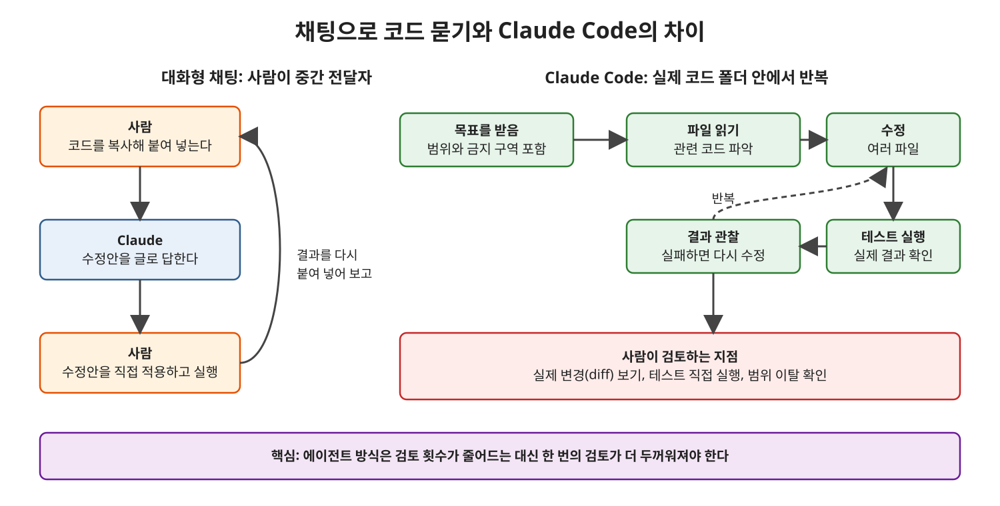
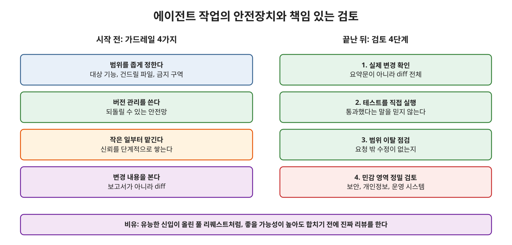

# 23장 Claude Code 에이전트 개발 기초

22장까지는 사람이 묻고 Claude가 답하고, 사람이 검토한 뒤 다시 묻는 대화 방식을 다뤘다. 이 장의 Claude Code는 방식이 다르다. "이 테스트가 실패하는 버그를 고쳐라", "관련된 파일들에 이 기능을 추가하라"처럼 넓은 목표를 주면, Claude가 파일을 읽고, 여러 곳을 고치고, 테스트를 돌리고, 결과를 보며 다시 고친 뒤 더 완성된 결과물을 들고 돌아온다.

이 장은 두 부류의 독자를 위해 쓰였다. 하나는 Claude Code를 직접 쓸 개발자이고, 다른 하나는 "에이전트형(agentic) AI"라는 말을 막연한 유행어가 아니라 구체적인 작업 방식으로 이해하려는 비기술 독자다. 핵심은 **맡기는 만큼 검토를 두껍게 하라**는 것이다. 책이 쓰인 시점 기준의 설명이므로, 도구의 세부 기능은 공식 문서로 다시 확인한다.

---

## 1. 레슨 1. Claude Code가 다른 점

Claude Code는 도구 이름이다. 명령줄이나 통합 개발 환경 안에서 **실제 코드 폴더(codebase, 프로젝트를 이루는 코드 파일 전체)**를 직접 읽고, 고치고, 명령(예: 테스트)을 실행한다.

일반 채팅에서는 사람이 중간 전달자가 된다. 파일을 붙여 넣고, 답으로 받은 수정안을 손으로 적용하고, 실행해 본 결과를 다시 알려야 한다. Claude Code는 이 전달 작업을 대부분 없앤다. 실제 파일을 직접 읽고 직접 고치며, 테스트 결과도 직접 본다. 이 모두가 한 번의 작업 세션 안에서 이어진다.

이 차이가 크게 느껴지는 때는 정해져 있다.

- 여러 파일에 걸치는 큰 작업일 때
- 기존 코드의 각 부분이 어떻게 얽혀 있는지 알아야 할 때
- "고치고, 테스트하고, 실패한 부분을 다시 고친다"는 반복이 필요할 때

반대로 작고 독립적인 코드 조각 정도는 22장의 대화 방식으로 충분하다.



## 2. 레슨 2. 에이전트형 작업이란

**에이전트형(agentic)**은 넓은 목표가 주어졌을 때 Claude가 계획을 세우고 여러 단계를 스스로 이어 가는 방식을 말한다. 필요한 것을 읽고, 행동하고, 결과를 관찰하고, 다음 행동을 조정하는 일을 고리처럼 반복한다. 단계마다 허락을 구하며 멈추지 않는다.

복잡한 다단계 작업에는 아주 강력하다. 대신 잘못된 길로 들어서도 일찍 잡아낼 기회가 줄어든다. 대화에서는 매 단계 확인하고 승인하지만, 여기서는 사이 단계를 건너뛰고 결과를 먼저 보기 때문이다. 그래서 감독의 리듬이 바뀐다. 작은 단계 하나하나보다 **결과와 굵직한 점검 지점**을 본다.

책은 신입 직원에게 일을 맡기는 비유를 쓴다. 모든 동작을 하나하나 지시하는 방식이 있고, 분명한 목표만 주고 중요한 갈림길이나 점검 지점에서 보고하게 하는 방식이 있다. 에이전트형은 두 번째에 가깝다. 잘 맞는 일에서는 더 효율적이지만, 신뢰할 만한 절차와 의도적인 점검 지점이 더 필요하다. 감독이 줄어드는 것이 아니라 감독의 모양이 달라진다.

## 3. 레슨 3. 가드레일 세우기

**가드레일(guardrail)**은 자율적인 작업을 안전하고 검토 가능한 범위 안에 두려고 미리 걸어 두는 한계와 점검 지점이다. 자율성이 클수록 더 중요하다. 책이 권하는 네 가지는 다음과 같다.

1. **목표를 구체적이고 좁게 정한다.** 4장의 프롬프트 기본기와 19장의 기능 명세를 더 엄격하게 적용하는 일이다. 모호하고 넓은 목표는 사람이 결과를 보기 전에 더 많은 자율 행동이 일어나므로 더 멀리 빗나간다.
2. **버전 관리를 쓴다.** 버전 관리(version control)는 변경 내역을 기록하고 되돌릴 수 있게 하는 표준 개발 관행이다. 에이전트가 한 변경을 검토하고 필요하면 되돌리는 기본 안전망이므로 선택이 아니라 필수다.
3. **보고가 아니라 실제 변경을 검토한다.** "완료"라고 보고된 작업에도 다른 곳에 미묘한 문제가 생겼을 수 있다. 실제 변경 내용(diff)을 보는 일은 "목표를 이뤘다"는 말만 확인하는 일과 질적으로 다르다.
4. **좁은 일부터 시작한다.** 넓고 열린 일을 맡기기 전에 범위가 분명한 일로 신뢰를 쌓는다. 20장의 "작게 시작" 원칙을 코딩에 적용한 것이다.

흔한 실수는 일부러 막연하고 넓은 목표를 주고 나서 예상 밖의 큰 변경에 놀라는 것이다. 목표가 느슨할수록 "그럴듯하지만 원하지 않은 해석"이 자리 잡을 여지가 커진다.

## 4. 레슨 4. 어떤 일에 Claude Code가 맞는가

도구는 일에 맞춰 골라야 한다. 이 책이 계속 강조한 원칙이다.

| 작업 유형 | 더 맞는 도구 |
|---|---|
| 작고 독립적인 코드 조각, 함수 하나 질문 | 대화형 채팅 (22장) |
| 낯선 개념 이해, 학습 | 설명을 요청하는 채팅 |
| 기존 코드의 여러 파일을 건드리는 변경 | Claude Code |
| 테스트를 돌리며 반복해야 하는 버그 수정 | Claude Code |
| "이게 대체 어떤 모양이어야 하나" 같은 열린 설계 질문 | 먼저 채팅, 설계가 서면 구현은 Claude Code |

흔한 실수는 간단한 일에 무거운 자율 작업을 쓰는 것이다. 짧은 대화로 더 빨리, 더 쉽게 전부 검토할 수 있는 일이었을 수 있다.

## 5. 레슨 5. 에이전트형 작업을 책임 있게 검토하기

책은 이것을 이 장에서 가장 중요한 레슨으로 꼽는다. 18장의 검증 규율과 같은 맥락이다. **작업이 성공적으로 끝났다고 보고된 것과 작업이 실제로 올바르고 안전하고 범위에 맞는 것은 다르다.**

1. 요약이 아니라 **실제 변경**을 검토한다.
2. 테스트를 **직접 실행**하거나, 진짜 돌았는지(통과했다는 말만이 아니라) 확인한다.
3. **범위 이탈(scope creep)**을 점검한다. 요청하지 않은 변경이 더 있지 않은지 본다.
4. 보안, 데이터 처리, 운영 시스템과 닿는 코드는 **추가로 엄격히** 본다. 18장의 단계별 검증에서 가장 높은 엄격도를 요구한 바로 그 상황이다.

모범 태도는 경험 많은 개발 리드가 유능한 신입의 풀 리퀘스트(변경 병합 요청)를 대하는 방식이다. 좋은 결과일 가능성이 크지만, 중요한 것일수록 내보내기 전에 진짜 리뷰를 한다.



## 6. 비즈니스 예시

작은 소프트웨어 팀이 기존 앱에 여러 파일에 걸친 중간 규모 기능을 Claude Code로 구현한다. 리드 개발자는 넓고 열린 목표 대신 구현할 기능, 관련 있을 법한 파일, 그리고 "먼저 상의 없이 건드리면 안 되는 민감한 부분"을 분명하게 적어 맡긴다.

작업이 끝났다고 보고되자 리드는 요약이 아니라 실제 diff를 읽고, "테스트 통과" 보고를 믿지 않고 전체 테스트를 직접 돌리고, 민감 영역에 손이 가지 않았는지 따로 확인한다. 검토 중에 기능에 꼭 필요하지 않았던 공용 유틸리티 파일의 작은 변경이 하나 나왔고, 병합 전에 되돌렸다.

여기서 배울 점은 두 가지다. 범위를 분명히 하면 원치 않는 해석의 여지가 줄고, 보고된 결과가 아니라 실제 변경을 보면 피상적인 검토가 놓칠 것을 잡는다.

## 7. Claude 대화 예시

> **사용자:** 기능이 끝났어. 그냥 병합해도 될까?
>
> **Claude:** 병합 전에 제 요약에만 기대지 말고 실제 변경을 직접 검토하길 권합니다. 원하시면 파일별로 무엇이 바뀌었는지 설명해 드릴게요. 전체 테스트를 직접 돌려도 통과하는지, 앞서 표시한 민감한 영역을 포함해 의도한 범위 밖이 수정되지 않았는지도 확인하세요. 작업이 성공적으로 보고되었더라도 꼭 거칠 가치가 있는 단계입니다.


참고(노트 작성자): 다음은 책의 예시가 아니라 레슨 3의 원칙을 적용해 만든 요청 문장 예시다.

```text
목표: 주문 목록 화면에 날짜 필터를 추가한다.
범위: orders 폴더 안의 파일만 수정한다.
금지: 결제 관련 파일은 수정 전에 먼저 나에게 물어본다.
완료 조건: 기존 테스트가 모두 통과하고, 새 필터 테스트가 하나 이상 있다.
끝나면: 바뀐 파일 목록과 이유를 파일별로 요약한다.
```

## 8. 연습과 미니 프로젝트

연습은 네 가지다.

1. **일 맞추기 점검**: 앞으로 할 코딩 작업 세 개를 레슨 4의 표로 분류한다.
2. **가드레일 계획**: 실제 또는 가상의 작업에 범위, 버전 관리, 검토 지점을 적는다.
3. **범위 지정 연습**: 막연한 목표를 하나 골라 금지 사항까지 넣어 다시 쓴다.
4. **검토 연습**: Claude Code나 비슷한 도구가 있다면 작은 작업 하나를 돌려 5번 절의 검토를 전부 해 본다.

미니 프로젝트 "검토를 마친 에이전트 작업"은 작고 분명한 작업을 경계와 함께 맡기고, 실제 변경 확인, 테스트 재실행, 범위 이탈 점검을 마친 뒤에야 끝으로 인정하는 것이다. 도구가 없다면 같은 원칙을 적용해 어떻게 범위를 정하고 검토할지 자세히 글로 쓴다.

## 9. 흔한 실수와 문제 해결

| 문제 | 가능한 원인 | 해결 |
|---|---|---|
| 예상 밖으로 넓은 변경이 생김 | 목표를 막연하게 정함 | 명확한 경계로 다시 범위를 정해 재시도 |
| 보고된 성공이 맞는지 불확실 | 실제 변경과 테스트를 독립 확인하지 않음 | diff를 읽고 테스트를 직접 실행 |
| 간단한 일이 오래 걸림 | 대화로 충분한 일이었음 | 레슨 4의 표로 도구 선택 |
| 무관한 곳이 바뀜 | 범위 이탈 점검을 하지 않음 | 검토 절차에 범위 이탈 점검 추가 |

그 밖의 흔한 실수는 버전 관리를 건너뛰어 안전망을 없애는 것, 그리고 보안이나 운영에 닿는 작업에 저위험 작업과 같은 가벼운 검토를 적용하는 것이다.

## 10. 장 요약

- Claude Code는 실제 코드 폴더에서 직접 일하므로 정보를 손으로 옮기는 수고가 줄어든다.
- 에이전트형은 넓은 목표를 향해 여러 행동을 이어 가는 방식이며, 감독이 줄지 않고 점검 지점 중심으로 바뀐다.
- 명확한 범위, 버전 관리, 실제 변경 검토로 가드레일을 세우고 좁은 일부터 신뢰를 쌓는다.
- 도구를 일에 맞춘다. 작고 독립적인 질문은 채팅이 낫다.
- "작업 완료"나 "테스트 통과" 보고를 그대로 믿지 말고 변경과 결과를 직접 확인한다.

## 11. 실행 체크리스트

- ☐ Claude Code와 대화형 코딩 도움의 차이를 설명할 수 있다.
- ☐ 에이전트형 작업이 왜 점검 지점 중심의 감독을 요구하는지 안다.
- ☐ 작업 전에 범위, 버전 관리, 검토 지점을 정했다.
- ☐ 복잡도와 범위로 채팅과 Claude Code 중 맞는 쪽을 고른다.
- ☐ 보고서가 아니라 실제 변경과 결과를 독립적으로 검토한다.

퀴즈는 네 문제다. Claude Code와 일반 대화형 코딩 도움의 핵심 차이, "에이전트형"의 뜻, "작업 완료" 요약만으로 검증이 충분한지(참/거짓), 권장되는 가드레일이 무엇인지를 묻는다.

다음 장은 오류를 만났을 때의 대응을 다루는 24장이다.

<br>
<br>
<br>

[Mastering Claude AI](../)
