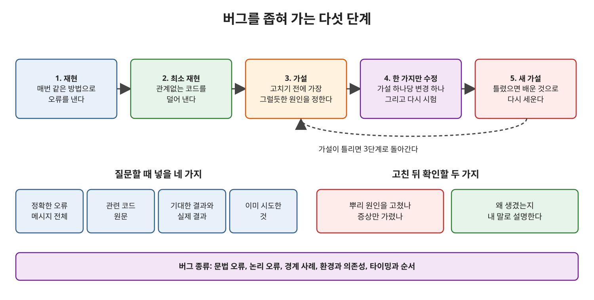

# 24장 디버깅과 오류 해결

디버깅(debugging, 코드의 오류를 찾아 고치는 일)은 코딩이 레시피를 따르는 일에서 탐정 일로 바뀌는 순간이다. 초보자는 물론 경험 많은 개발자도 여기서 가장 오래 막힌다. 아무 데나 고쳐 보며 운에 맡기는 일도 흔하다. Claude는 이 과정을 크게 줄여 줄 수 있다. 다만 올바른 정보를 주고 체계적인 절차를 따를 때만 그렇다. "고쳐 줘" 버튼처럼 쓰면 얕고 일시적인 해결에 그친다.

이 장은 22장의 코딩 기초와 23장의 검토 규율 위에 서 있다. 실제 코딩에서 문제가 생기는 것은 드문 예외가 아니라 늘 있는 과정이라는 전제로 시작한다. 책이 쓰인 시점 기준의 설명이지만, 이 장의 방법은 도구가 바뀌어도 거의 그대로 통한다.

---

## 1. 이 장의 용어

- **오류 메시지(error message)**: 프로그램이 무언가 잘못됐다고 알리는 글. 어디서 왜 틀렸는지 단서가 들어 있다.
- **버그 재현(reproducing a bug)**: 같은 오류를 믿을 수 있게 다시 일으키는 것. 진단의 필수 단계다.
- **뿌리 원인(root cause)**: 눈에 보이는 증상이 아니라 그 밑에 있는 실제 이유.
- **최소 재현(minimal reproduction)**: 관계없는 복잡함을 덜어 내고도 같은 버그가 나는 작고 단순한 형태.

## 2. 레슨 1. 디버깅 도움을 청할 때 줄 정보

도움의 질을 가장 크게 좌우하는 것은 **완전하고 구체적인 정보**다. 4장의 프롬프트 틀을, 정보가 부족할 때 비용이 특히 큰 상황에 적용한 것이다. 매번 넣을 네 가지는 다음과 같다.

- **오류 메시지 전체를 그대로**: 요약이나 말바꿈을 하지 않는다. 줄 번호와 정확한 단어가 바꿔 쓰는 순간 사라진다.
- **관련 코드 원문**: 코드가 무엇을 하려는지 설명하는 글이 아니라 코드 자체를 준다. Claude는 실제 코드를 봐야 실제 문제를 짚는다.
- **기대한 결과와 실제 결과**: 둘의 차이가 각각보다 더 많은 정보를 준다.
- **이미 시도한 것**: 이미 배제한 방법에 한 바퀴를 낭비하지 않게 한다.

약한 요청과 강한 요청의 차이는 이렇다.

> 약함: "내 코드가 안 돼요. 도와줄 수 있나요?"
>
> 강함: "정확히 이런 오류가 납니다: [오류 메시지 전체]. 관련 함수는 이렇습니다: [코드]. 정렬된 목록을 돌려줄 줄 알았는데, 입력 목록이 비어 있을 때 이 오류가 납니다. 원인을 몰라 아직 아무것도 시도하지 않았습니다."

흔한 실수는 오류 메시지를 기억에 의존해 바꿔 쓰는 것이다. 사소해 보이는 세부가 의외로 중요할 때가 많다.

## 3. 레슨 2. 버그를 좁혀 가는 체계적 절차

문서(10장), 조사(15장), 데이터(16장)에서 쓴 단계적 방식을 디버깅에도 쓴다. 무작위로 고쳐 보지 말고 다섯 단계를 밟는다.

1. **안정적으로 재현한다.** "가끔 난다"는 "X를 하면 매번 난다"보다 훨씬 어렵다. 다른 무엇보다 먼저 같은 오류를 일관되게 일으킬 수 있어야 한다.
2. **최소 재현을 만든다.** Claude에게 버그와 직접 관계없는 부분을 걷어 내게 해서, 같은 오류가 나는 가장 작은 코드만 남긴다. 복잡함이 사라져 진단이 크게 쉬워진다.
3. **고치기 전에 가설을 세운다.** "이 오류와 코드를 보면 가장 그럴듯한 원인은 무엇인가?"라고 묻고 구체적인 가설을 얻은 뒤에 손댄다. 무엇을 시도했고 어떤 효과가 있었는지 놓치는 함정을 막는다.
4. **가장 작은 변경으로 가설을 시험한다.** 가설 하나에 변경 하나를 하고 다시 시험한다. 여러 개를 한꺼번에 바꾸면 무엇이 고쳤는지 알 수 없다.
5. **가설이 틀렸으면 배운 것으로 새 가설을 세운다.** 틀린 가설도 가능성을 좁혀 준 정보이지 헛수고가 아니다.

흔한 실수는 오류에 여러 변경을 동시에 가하고 나서 무엇이 고쳤는지 모르게 되는 것이다. 더 나쁜 경우, 뿌리 원인은 그대로인데 증상만 우연히 사라진 것일 수도 있다.

## 4. 레슨 3. 버그의 흔한 종류와 나타나는 모습

종류를 알면 Claude와 함께 원인을 더 효율적으로 추론할 수 있다.

| 종류 | 전형적인 모습 |
|---|---|
| 문법 오류 | 코드가 아예 실행되지 않고, 줄 번호가 문제 위치를 가리킴 |
| 논리 오류 | 멈추지 않고 실행되지만 결과가 틀림 |
| 경계 사례 실패 | 보통 입력은 되는데 빈 값, 극단값에서 실패 (19장의 경계 사례와 연결) |
| 환경과 의존성 문제 | 전에 되던 코드가 갑자기 실패, 코드가 아니라 주변 시스템이 바뀐 경우가 많음 |
| 타이밍과 순서 문제 | 불규칙하게 나는 오류, 작업 순서나 시점과 관련 |

이 분류가 도움이 되는 이유는, "간헐적이고 재현이 어렵다"와 "같은 입력에서 매번 실패한다"는 말만으로도 가능한 범주가 곧바로 좁혀져 처음부터 다시 시작하지 않아도 되기 때문이다.

## 5. 레슨 4. 뿌리 원인을 건너뛰는 해결 피하기

시간에 쫓길수록, 왜 생겼는지는 모른 채 당장의 증상만 없애는 해결에 끌린다. 이런 해결은 같은 문제가 다른 모습으로, 더 추적하기 어려운 곳에서 다시 나타나게 만든다.

막는 방법은 두 가지다.

- Claude에게 직접 묻는다. **"이 해결이 실제 뿌리 원인을 다루나, 이번 증상만 처리하나?"** 스스로에게도 던질 좋은 질문이다.
- 고쳐졌다는 사실만이 아니라 **왜 생겼는지 이해**한다. 원래 코드가 왜 실패했고 해결이 왜 그 이유를 다루는지 내 말로 설명하지 못하면 아직 뿌리 원인에 닿지 못한 것이다.

책의 예가 있다. 초보자의 프로그램이 목록이 비면 멈춘다. 뿌리를 건너뛰는 해결은 멈추는 줄을 넓은 오류 처리기로 감싸 실패해도 조용히 넘기게 하는 것이다. 멈춤은 사라지지만 비어 있는 경우를 의미 있게 다루지 않는 문제는 남아 나중에 엉뚱한 곳에서 혼란을 부른다. 뿌리 해결은 비어 있는 경우를 실제로 필요한 곳에서 명시적으로 확인하고 처리하는 것이다.

## 6. 레슨 5. 디버깅마다 이해 쌓기

디버깅을 빨리 넘길 문제가 아니라 작은 배움의 기회로 다룬다. 22장의 "만들어 내는 것보다 이해가 중요하다"는 강조를 잇는다.

- 고친 뒤에 **왜 버그가 생겼는지 내 말로 설명해 달라**고 Claude에게 부탁한다. 해결책만이 아니다.
- **만난 버그 패턴을 개인 노트**에 적는다. 9장의 지식 관리와 이어지며, 시간이 지나면 익숙한 유형을 스스로 더 빨리 알아본다.
- **반복되는 유형을 알아챈다.** 같은 종류의 경계 사례 버그를 자꾸 만난다면, 매번 고치기보다 19장처럼 경계 사례부터 명세를 쓰는 습관으로 유형 자체를 막을 신호다.

## 7. 비즈니스 예시

혼자 독학한 개발자 시모네의 재고 추적 스크립트가 "가끔" 오류를 낸다. 처음에는 안정적으로 재현할 수 없었다. 이 장의 절차대로 Claude와 먼저 언제 나는지를 좁혔더니, 사실 무작위가 아니라 특정 데이터 내보내기 직후에 스크립트를 돌릴 때만 났다. 이 재현 단계만으로도 진단 범위가 크게 줄었다.

그다음 구체적인 가설을 세웠다. 다른 프로세스가 파일을 다 쓰기 전에 스크립트가 읽으려 하는 타이밍 문제일 것이라는 가설이다. 변경 하나로 시험하고 해결을 확인했다. 거기서 멈추지 않고 Claude에게 왜 그런 타이밍 문제가 생겼는지 설명해 달라고 했고, "다른 프로세스가 방금 쓴 파일을 바로 읽기"라는 유형을 자신의 버그 패턴 목록에 추가해 이후 스크립트에서 미리 조심하게 되었다.

배울 점은 체계적인 재현과 가설 시험이 정체 모를 "가끔 나는" 버그를 구체적이고 이해되고 예방 가능한 패턴으로 바꿨다는 것이다. 설명 없는 빠른 수정과는 결과가 다르다.

## 8. Claude 대화 예시

> **사용자:** 뭔가 바꿨더니 오류가 사라졌는데, 왜인지는 잘 모르겠어. 그냥 넘어가도 될까?
>
> **Claude:** 잠깐 멈추고 확인해 보길 권합니다. 그 변경이 뿌리 원인을 실제로 해결한 것인지, 이번 증상만 우연히 사라지게 한 것인지 가려 봐야 합니다. 무엇을 바꿨는지 알려 주시겠어요? 진짜 해결인지, 나중에 다른 모습으로 다시 나타날 일인지 함께 판단해 볼게요. 지금 잠깐 설명을 듣는 것이 나중에 연관된 버그를 모르는 채 다시 쫓는 것보다 훨씬 쌉니다.

## 9. 연습과 미니 프로젝트

연습은 네 가지다.

1. **완전한 정보 연습**: 다음에 실제 버그를 만나면 첫 요청에 레슨 1의 네 가지를 모두 넣는다.
2. **체계적 절차 연습**: 실제 버그에 레슨 2의 다섯 단계를 밟고, 무작위로 고쳐 보고 싶은 충동을 참는다.
3. **종류 알아보기**: 다음 버그 세 개를 레슨 3의 표로 먼저 분류하고, 분류가 진단을 빠르게 하는지 본다.
4. **뿌리 원인 점검**: 다음 해결 뒤에 뿌리를 다뤘는지 증상만 가렸는지 Claude나 스스로에게 묻는다.

미니 프로젝트 "이해한 버그"는 실제 버그를 만나면(혹은 작은 연습 프로그램에 일부러 버그를 넣어) 안정적 재현, 최소 재현, 행동 전 가설, 한 가지 시험, 뿌리 원인을 내 말로 설명하기까지 전 과정을 밟고, 그 패턴을 개인 버그 노트에 추가하는 것이다.

## 10. 흔한 실수와 문제 해결

| 문제 | 가능한 원인 | 해결 |
|---|---|---|
| 디버깅 도움이 두루뭉술함 | 정보가 불완전함 (바꿔 쓴 오류, 코드 없음) | 정확한 오류, 실제 코드, 기대와 실제를 제공 |
| 여러 변경 중 무엇이 고쳤는지 모름 | 한꺼번에 여러 개를 바꿈 | 가설 하나에 변경 하나씩 시험 |
| 버그가 나중에 다른 모습으로 재발 | 증상만 해결함 | 해결 전에 뿌리 원인 이해를 확인 |
| 간헐적 버그를 진단하기 어려움 | 재현 방법을 아직 못 찾음 | 먼저 일관되게 나는 조건을 찾음 |

그 밖에 "이제 된다"만으로 만족하고 왜 고장 났는지 이해하지 않는 것, 반복 패턴을 기록하지 않아 한 유형을 통째로 예방할 기회를 놓치는 것도 흔한 실수다.

## 11. 장 요약

- 도움을 청할 때 오류 메시지 전체, 실제 코드, 기대와 실제 동작, 이미 시도한 것을 준다.
- 재현, 최소 재현, 가설, 한 가지 시험, 새 가설의 순서로 체계적으로 좁힌다.
- 버그 유형(문법, 논리, 경계 사례, 환경, 타이밍)을 알면 진단이 빨라진다.
- 증상만 가리는 해결을 경계하고 왜 생겼는지 이해한다.
- 모든 디버깅을 배움의 기회로 삼고 반복 패턴을 기록해 유형 자체를 막는다.

## 12. 실행 체크리스트

- ☐ 도움을 청할 때 정확한 오류, 실제 코드, 기대와 실제 동작을 준다.
- ☐ 무작위 수정 대신 체계적으로 버그를 좁힌다.
- ☐ 버그 유형을 알아보고 진단 속도를 높인다.
- ☐ 해결이 증상이 아니라 뿌리 원인을 다뤘는지 확인한다.
- ☐ 반복되는 버그 패턴을 기록해 미리 예방한다.

퀴즈는 네 문제다. 도움을 청할 때 반드시 줄 정보, 한 번에 변경 하나만 시험하는 이유, 오류가 사라졌으면 뿌리 원인이 해결됐다는 말의 참/거짓, "최소 재현"의 뜻을 묻는다. 더 연습하려면 앞으로 한 달간 사소하지 않은 버그마다 다섯 단계를 지키고, 개인 버그 노트를 주기적으로 되짚는다.

다음 장은 채팅 창 너머로 나아가는 Claude API를 다루는 25장이다.

 
 
 

[Mastering Claude AI](../)
