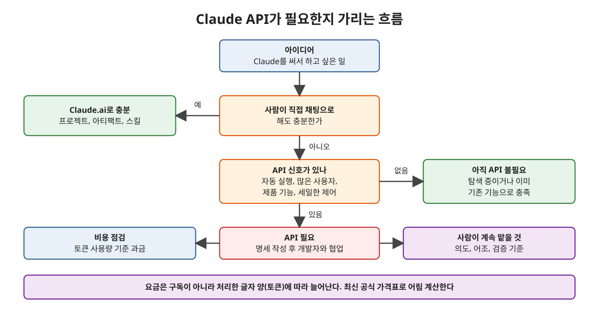

# 25장 Claude API

이 책이 지금까지 다룬 프로젝트, 아티팩트, 메모리, Claude Code는 모두 Anthropic이 사람이 직접 쓰도록 만든 화면 안에서 일어난다. **Claude API**는 전혀 다른 관계다. 개발자와 기업이 Claude의 능력을 자기 제품과 내부 도구 안에 넣는 방법이며, 채팅 창 앞에 앉은 사람이 아예 없다.

이 책의 독자 대부분은 API 코드를 직접 한 줄도 쓰지 않을 것이고, 그래도 괜찮다. 이 장의 목적은 두 가지다. 내 필요가 "API가 필요한 영역"으로 넘어갔는지 알아보게 하는 것, 그리고 그때가 오면 개발자나 기술 파트너와 막연한 블랙박스가 아니라 정보를 가진 상태로 대화하게 하는 것이다. 가격과 기능 같은 세부는 책이 쓰인 시점 기준이며 바뀔 수 있다.

---

## 1. 이 장의 용어

- **API(Application Programming Interface)**: 사람이 채팅 창에 입력하지 않고도 소프트웨어가 Claude와 주고받을 수 있게 하는 통로.
- **통합(integration)**: Claude의 능력을 다른 제품, 앱, 내부 도구 안에 직접 넣는 것.
- **토큰 기반 요금(token-based pricing)**: 사용자당 정액 구독이 아니라 처리한 글의 양(토큰 단위)에 따라 매기는 방식.
- **API 수준의 프롬프트 설계**: 사람이 매번 입력하는 대신 소프트웨어가 자동으로 Claude에게 보내는 지시문을 설계하는 일.

## 2. 레슨 1. API란 무엇인가

Claude API는 소프트웨어가 Claude에게 요청을 직접 보내고 응답을 받게 한다. 앱이 평소처럼 돌아가는 과정의 일부로 프로그램이 처리하며, 사람이 Claude.ai 채팅에 입력하는 방식이 아니다.

지금까지의 모든 내용은 내가 Claude와 직접 대화하는 것이었다. API는 Claude의 능력이 **다른 무언가 안에 들어가야** 할 때를 위한 것이다. 회사 웹사이트의 고객 지원 챗봇, 들어오는 지원 요청을 자동으로 요약하는 내부 도구, 사용자마다 맞춤 콘텐츠를 만들어 주는 모바일 앱 기능처럼, 사람이 건마다 Claude.ai를 손으로 조작하지 않는 경우다.

간단한 기준은 이렇다. 내 필요가 "Claude로 어떤 일을 하고 싶다"라면 출발점은 거의 확실히 Claude.ai다. "내 제품이나 회사 소프트웨어가 사람 개입 없이 수많은 건을 자동으로 Claude로 처리하게 하고 싶다"라면 API 영역이다.

## 3. 레슨 2. API 영역으로 넘어갔음을 알아보기

프로젝트가 Claude.ai의 한계를 넘었다는 실용적 신호가 있다.

**API가 필요하다는 신호**

- 새 고객 가입이나 들어온 지원 요청 같은 **이벤트가 일어나면 자동으로** Claude의 능력이 돌아야 한다. 사람이 대화를 하나씩 시작하지 않는다.
- 사람이 채팅을 손으로 운영해서는 감당 못 할 규모로 **많은 사용자가 동시에**, 각자 따로 상호작용해야 한다.
- 고객이 직접 쓰는 **제품 기능**이며 Claude의 개입이 눈에 보이지 않아야 한다. 채팅 창이 아니라 내 화면에 들어간 기능이다.
- Claude.ai의 프로젝트와 사용자 지침으로 설정 가능한 것보다 **프롬프트와 응답 처리를 더 세밀하게 통제**해야 한다.

**아직 API가 필요 없을 가능성이 큰 신호**

- 필요가 나나 동료가 Claude.ai를 직접 쓰는 것, 설령 반복적이더라도 그것으로 충족된다.
- 아직 아이디어를 탐색하거나 시제품을 만드는 단계이고, 자동으로 대규모로 돌아야 한다는 것이 검증되지 않았다.
- 잘 설정한 프로젝트(6장)나 아티팩트 기반 도구(8장, 19장)가 이미 실제 필요를 충족한다.

책의 사업 예시를 보자. 소매 회사가 고객 서비스 직원이 흔한 문의에 더 빨리 답하도록 돕고 싶다면, 직원이 회사 정책과 말투 안내서가 담긴 프로젝트에서 Claude.ai를 직접 쓰는 것으로 충분하다. 반면 구매마다 개인 맞춤 주문 확인 메시지를 사람 개입 없이 자동 생성하려는 것은 정확히 API 영역이다.

## 4. 레슨 3. API 사용과 비용은 대체로 어떻게 돌아가나

Claude.ai의 보통 정액 구독과 달리 API 사용은 대체로 **실제 처리한 글의 양**에 따라 청구된다. 흔히 Claude에게 보내고 받은 토큰(1장) 양으로 설명한다.

이것이 계획에 의미하는 바는 비용이 실제 사용량에 따라 늘어난다는 점이다. 요청이 많고, 프롬프트가 길고, 응답이 길수록 대체로 비용이 더 든다. 사용량과 상관없는 단일 정액이 아니다. API 기반 기능이 타당한지 따져 보는 기업에는 이 비용 구조를 개념으로라도 이해하는 것이 현실적인 계획의 기본이며, Claude.ai 구독의 고정되고 예측 가능한 비용과 구별해서 봐야 한다.

비개발자가 API 프로젝트를 평가할 때의 실용 습관이 있다. 구현할 사람에게 **예상 사용량과 비용 범위의 대략적 추정**을 설명해 달라고 하고, 만들기로 약속하기 전에 받는다. 클라우드 호스팅이나 결제 수수료처럼 사용량에 따라 늘어나는 다른 비용에 하는 기본 재무 점검과 같다. 정확한 현재 요금 구조는 Anthropic이 시간이 지나며 바꾸는 종류의 정보이므로, 책의 고정된 수치에 의존하지 말고 항상 최신 공식 가격 문서로 계획한다. 책은 구체적인 가격 수치를 싣지 않았다.

## 5. 레슨 4. API로 만든다는 것은 실제로 무엇을 뜻하나

기술적 깊이는 이 책의 범위를 넘으며 Anthropic의 개발자 문서가 다룰 몫이다. 개념 수준에서, API로 만든다는 것은 개발자가 Claude에게 **신중하게 설계한 프롬프트를 보내고 응답을 프로그램으로 처리하는 코드**를 쓰는 일이다. 흔히 다른 도구, 데이터 출처, 제품 고유의 업무 규칙과 결합한다.

왜 API 수준에서도 "신중하게 설계한 프롬프트"가 중요한가. 4장의 프롬프트 기본기가 그대로 적용된다. 오히려 판돈이 더 크다. 제품 코드에 들어간 프롬프트는 대화 중에 그때그때 고칠 수 있는 Claude.ai와 달리, 모든 사용자에게 자동으로 대규모로 돌기 때문이다. API 수준의 잘못 설계한 프롬프트는 실망스러운 채팅 응답 하나로 끝나지 않는다. 고쳐질 때까지 모든 사용자 상호작용에 걸쳐 체계적으로 약한 경험을 만들 수 있다.

코드를 쓰지 않는 이해관계자가 더하는 실질 가치도 있다. 프롬프트 기본기, 컨텍스트 엔지니어링(5장), 검증 규율(18장)에 대한 이해는 API 기반 기능을 어떻게 설계할지에 매우 값진 입력이다. "이 프롬프트는 실제로 무엇을 말해야 하나", "잘 돌아가는지 어떻게 검증하나"에 코드를 만지지 않고도 의미 있게 기여할 수 있다.

## 6. 레슨 5. 개발자를 언제 부를지 정하기

대부분의 독자에게 실용적 질문은 "API 코드를 내가 어떻게 쓰나"가 아니라 "이 일에 개발자나 기술 파트너를 언제 부르나"다. 합리적인 판단 순서는 세 단계다.

1. **먼저 정말로 API가 필요한지 확인한다.** 레슨 2의 신호로 따진다. 잘 설정한 프로젝트나 아티팩트 도구로 충분한데 개발자와 API 수준의 복잡함으로 달려가지 않는다.
2. **필요하다면 목표와 제약을 내가 먼저 분명히 정의한다.** 19장의 기능 명세 규율이며, 개발자와의 모든 대화를 더 생산적으로 만든다.
3. **실제 구현은 기술 인력에게 맡기되**, 기능이 무엇을 해야 하는지, 어떻게 검증할지, "좋다"는 것이 무엇인지 정의하는 데는 계속 참여한다. 코딩을 다른 사람이 한다고 해서 내 분야 전문성이 덜 중요해지지 않는다.

흔한 실수는 API 작업을 "넘겨 놓고 잊어도 되는" 순수 기술 문제로 여기는 것이다. 프롬프트 설계 의도, 검증 기준, 현실의 경계 사례처럼 내 전문성이 꼭 필요한 부분이 있다.

## 7. 비즈니스 예시

정기 구독 밀키트 회사가 수천 명 고객 각각의 과거 선호와 식이 제한을 바탕으로 매주 개인 맞춤 레시피 추천 이메일을 자동으로 만들고 싶어 한다. Claude.ai를 손으로 운영해서는 감당할 수 없는 규모가 분명하다. 그래서 개발자를 불러 API 통합을 만들게 하되, 마케팅 책임자는 내내 깊이 관여한다.

이메일의 어조를 정하는 일(13장의 브랜드 목소리 개요서 개념), 식이 제한은 오류를 전혀 허용하지 않고 처리해야 한다는 요구(18장에 따른 고위험 검증 요구), 전체 고객에게 기능을 열기 전에 실제 생성된 이메일 표본을 검토하는 일을 맡았다.

기술적 구현은 개발자가 필요했지만, 실제 기능의 품질과 안전은 이 책 전체에서 다룬 프롬프트, 컨텍스트, 검증 원칙에 크게 좌우되었다. 마케팅 책임자는 코드를 한 줄도 쓰지 않고 그 전문성을 직접 보탰다.

## 8. Claude 대화 예시

> **사용자:** 내 사업 아이디어는 사람 개입 없이 하루 수백 건의 고객 메시지에 Claude가 자동으로 답해야 해. API가 필요할까?
>
> **Claude:** Claude.ai보다 API가 맞는 강한 후보로 들립니다. 사람이 매번 채팅 창을 조작하지 않는 자동 대량 응답이 정확히 API가 쓰이는 상황이니까요. 실제 구현은 개발자에게 맡기길 권하지만, 그 대화 전에 이 응답들이 무엇을 이뤄야 하는지, 어떤 어조와 정보를 담아야 하는지, 그리고 중요하게는 모호하거나 위험도가 높아 완전 자동으로 처리하면 안 될 메시지는 어떻게 할지를 먼저 분명히 정의해 두세요. 이런 명확함이 있으면 기술적 구현이 처음부터 성공할 가능성이 훨씬 커집니다.

## 9. 연습과 미니 프로젝트

연습은 네 가지다.

1. **신호 점검**: 내 프로젝트 아이디어를 레슨 2의 신호에 비춰 정말 API가 필요한지, Claude.ai 기존 기능으로 충분한지 평가한다.
2. **비용 의식**: API 기반 프로젝트가 있거나 고려 중이라면 현재 공식 가격 문서를 찾아 대략적인 사용 비용을 추정해 본다.
3. **비기술 기여 지도**: API 기반 기능 아이디어에서 코드를 쓰지 않고도 설계와 검증에 기여할 수 있는 것을 구체적으로 적는다.
4. **개발자 대화 준비**: API 기반 기능 아이디어의 명확한 기능 명세를 19장 방식으로 써 본다. 개발자에게 설명할 준비로 쓴다.

미니 프로젝트 "API 준비도 점검"은 API가 필요할 수도 있는 아이디어 하나를 골라 레슨 2의 신호로 정말 필요한지 가리는 것이다. 필요하다면 명확한 기능 명세와, 개발자가 구현하더라도 내가 계속 관여하고 싶은 것의 목록(프롬프트 설계 의도, 검증 기준)을 작성한다.

## 10. 흔한 실수와 문제 해결

| 문제 | 가능한 원인 | 해결 |
|---|---|---|
| 프로젝트에 API가 필요한지 불확실 | 레슨 2의 신호를 명시적으로 따져 보지 않음 | 결정 전에 신호 점검표를 따라가 본다 |
| API 프로젝트 비용이 불명확하거나 뜻밖 | 약속 전에 사용량 기준 비용 추정을 안 함 | 현재 공식 가격 문서로 대략 추정 |
| 개발자가 만든 기능이 기대와 다름 | 비기술 이해관계자가 의도와 검증 기준 정의에 빠짐 | 구현을 맡기더라도 의도와 검증에 계속 참여 |
| 개발자와의 대화가 모호하고 비생산적 | 사전에 분명한 기능 명세가 없음 | 대화 전에 19장 방식으로 명세를 작성 |

그 밖에 진지한 Claude 사용이면 전부 API가 필요하다고 가정하는 것도 흔한 실수다. Claude.ai의 기존 기능으로 충분한 경우가 많다.

## 11. 장 요약

- Claude API는 소프트웨어가 제품이나 내부 도구 안에서, 사람이 채팅 창을 운영하지 않고 Claude를 쓰게 한다.
- API 영역은 자동 대규모 실행, 많은 동시 사용자, 제품 내 기능, 깊은 프롬프트 맞춤 필요라는 신호로 알아본다.
- API는 대체로 실제 사용량(처리한 토큰)에 따라 청구되며 정액 구독과 다르므로, 최신 공식 가격으로 계획한다.
- 앞선 장의 프롬프트와 컨텍스트 원칙은 API 수준에서도 적용되며, 자동화 규모 때문에 판돈이 더 큰 경우가 많다.
- 구현은 개발자에게 맡기되 의도, 어조, 검증 기준 정의에는 내가 계속 참여한다.

## 12. 실행 체크리스트

- ☐ Claude API가 무엇이고 Claude.ai와 어떻게 다른지 설명할 수 있다.
- ☐ 분명한 신호로 프로젝트에 정말 API가 필요한지 평가할 수 있다.
- ☐ 사용량 기반 API 비용이 개념적으로 어떻게 돌아가는지 이해한다.
- ☐ API 프로젝트에서 내 비기술 전문성이 값진 곳을 안다.
- ☐ "API 준비도 점검" 미니 프로젝트를 마쳤다.

퀴즈는 네 문제다. Claude API의 주된 용도, Claude.ai 대신 API가 필요하다는 분명한 신호, API 사용이 사용량과 무관한 단일 정액인지의 참/거짓, 개발자가 통합을 맡아도 비기술 이해관계자가 계속 관여해야 할 것(의도, 어조, 검증 기준)을 묻는다. 더 연습하려면 API가 필요할 수도 있는 제품 아이디어가 있을 때 기술 대화 전에 기능 명세부터 스스로 정의하고, API 기반 프로젝트를 평가하거나 유지한다면 공식 문서와 가격을 주기적으로 확인한다.

다음 장부터는 6부로 넘어가 보안과 개인정보, 데이터 처리를 다루는 26장이 이어진다.

 
 
 

[Mastering Claude AI](../)
