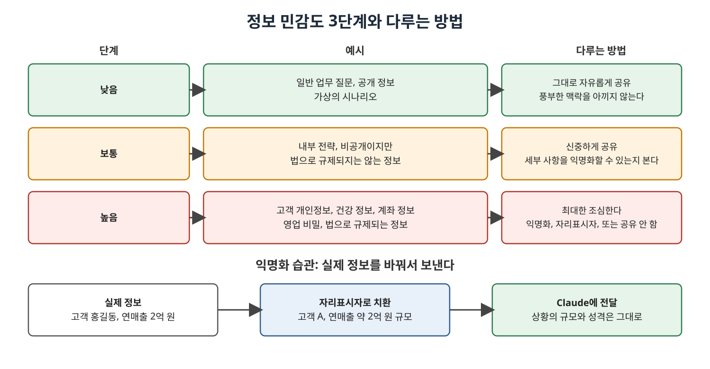

# 26장 보안과 개인정보와 데이터 처리 (Security, Privacy, and Data Handling)

26장은 "Claude에게 무엇을 보여 줘도 되는가"라는 질문에 겁먹지도 방심하지도 않고 답하는 장이다. 이 책은 지금까지 실제 문서, 실제 숫자, 실제 사례처럼 구체적인 맥락을 줘야 좋은 결과가 나온다고 말해 왔다. 이 장은 그 습관을 유지하면서도 정말 조심해야 할 정보만 가려내는 방법을 다룬다.

데이터 처리 정책, 설정 항목, 규정 인증은 자주 바뀌고 잘못 이해하면 대가가 크다. 그래서 이 장은 오래가는 원칙과 습관에 집중하고, 구체적인 최신 정책은 공식 자료에서 직접 확인하라고 안내한다.

> **쉽게 말하면**
> 모든 서류를 금고에 넣을 필요도, 모든 서류를 길거리에 둘 필요도 없다. 서류마다 등급을 매겨 등급에 맞게 다루면 된다.

> **참고(노트 작성자)** 이 장은 법률 자문이 아니다. 원서도 일반 정보일 뿐 자격 있는 법률, 규정 준수 전문가의 조언을 대신하지 못한다고 밝힌다. 데이터 보관 기간이나 학습 활용 여부 같은 구체적 정책은 이 노트에도 적지 않았다. 책이 쓰인 시점과 지금이 다를 수 있기 때문이다.

## 이 장의 흐름

1. 민감도 틀 만들기
2. 익명화와 자리표시자 습관
3. 데이터 처리에서 확인할 것과 확인할 곳
4. 규제 대상, 기밀 정보에 대한 특별한 주의
5. 사용성을 해치지 않는 보호 습관

---

## 1. 실용적인 민감도 틀 만들기

모든 정보를 똑같이 민감하게 다루면 두 가지 중 하나로 흐른다. 지나치게 조심해서 Claude를 쓸모없게 만들거나, 지나치게 느슨해서 진짜 위험을 만든다. 책은 정보를 세 단계로 나누는 틀을 권한다.

| 단계 | 예시 | 기본 방침 |
|------|------|-----------|
| 낮음 | 일반 업무 질문, 공개 정보, 가상 시나리오 | 필요한 만큼 자유롭게 공유 |
| 보통 | 내부 사업 전략, 비공개이지만 법으로 규제되지는 않는 정보 | 신중히 공유하고 세부 사항을 익명화할 수 있는지 검토 |
| 높음 | 고객 개인정보, 건강 정보, 금융 계좌 정보, 영업 비밀, 법으로 규제되는 정보 | 최대한 조심, 익명화하거나 자리표시자 사용, 의무가 확실하지 않으면 공유 안 함 |

이 틀의 이점은 분명하다. 업무 대부분은 낮음과 보통에 속하므로 앞선 장들에서 배운 풍부한 맥락 습관을 그대로 쓸 수 있다. 그리고 진짜 조심할 높음 단계에만 의식적인 주의를 집중한다. 한 가지 방침으로 모든 것을 덮는 것보다 낫다는 뜻이다.



## 2. 익명화와 자리표시자 습관

많은 작업은 실제 식별 정보 없이도 충분히 도움을 받을 수 있다. 책은 세 가지 요령을 든다.

- 이름이 꼭 필요하지 않다면 실명 대신 "고객 A" 같은 일반 자리표시자(placeholder, 대신 넣는 이름표)를 쓴다.
- 패턴이나 구조를 이해시키는 것이 목적이면 현실적이지만 가상의 숫자를 쓴다. 실제 기밀 수치는 넣지 않는다.
- 민감한 문서를 통째로 붙여 넣는 대신 상황을 일반적으로 설명한다. 설명만으로 충분한 경우가 많다.

원서의 예시는 이렇다. 고객의 실제 재무 정보를 붙여 넣는 대신 "연매출이 대략 200만 달러인 고객이 어떤 분야에 15만 달러를 투자하려 한다"처럼 적는다. 결정의 규모와 성격이라는 핵심은 그대로 전달되고 실제 기밀 수치는 노출되지 않는다.

흔한 실수는 자리표시자로도 충분한데 습관적으로 실제 식별 정보를 붙여 넣는 것이다.

**프로젝트에 습관 심기.** 원서의 팁은 이 습관을 반복 사용하는 프로젝트(6장)의 사용자 지침에 적어 두라는 것이다. "특정 작업에서 내가 실제 값을 직접 주지 않는 한 항상 자리표시자 이름과 수치를 써라"라고 쓰면, 매번 기억에 의존하지 않고 작업 흐름에 조심성이 내장된다.

```text
[프로젝트 사용자 지침에 넣을 한 줄 예시]
고객 이름과 실제 금액이 필요해 보이면 먼저 "고객 A, 약 N원 규모"처럼
자리표시자로 처리해서 작업하고, 내가 실제 값을 직접 줄 때만 그 값을 쓴다.
```

## 3. 데이터 처리: 무엇을 어디서 확인하나

이 책은 데이터가 정확히 어떻게 보관되고 쓰이는지 단정하지 않는다. 오래되어 틀린 주장이 될 수 있기 때문이다. 대신 Anthropic이 계속 관리하고 갱신하는 항목이므로 공식 자료를 직접 보라고 한다. 확인할 만한 것은 세 가지다.

- 대화가 모델 개선에 쓰일 수 있는지에 대한 현재 정책과 이를 조절하는 설정
- 데이터가 얼마나 오래 보관되는지, 보기, 내보내기, 삭제 방법은 무엇인지
- 쓰는 요금제, 특히 비즈니스와 기업용 요금제에 적용되는 추가 약속과 인증

원서의 모범 사례는 민감한 정보를 한 번이 아니라 일상적으로 다루기 전에 10분을 들여 최신 문서와 내 계정 설정을 직접 살펴보라는 것이다. 어떤 책의 주장이 계속 맞을 것이라 가정하는 것보다 훨씬 믿을 만하다.

## 4. 규제 대상과 기밀 정보에 대한 특별한 주의

건강 정보, 금융 계좌 정보, 변호사와 의뢰인 사이의 비밀유지 특권 같은 고객 기밀 정보는 일반적 판단을 넘어서는 법적, 규제적, 직업적 의무가 따른다. 다루는 방법은 세 가지다.

1. 내 법적, 직업적 의무를 먼저 이해한다. 업종, 지역, 직업마다 다르며 책이 특정 상황의 법적 조언을 줄 수는 없다.
2. 확신이 없으면 익명화하거나 아예 공유하지 않는다. 맥락이 조금 줄어들더라도 규제 대상이나 특권 정보에서는 그 편이 낫다.
3. 조직에 AI 도구 사용 지침이 있는지 확인한다. 특히 의료, 금융, 법률 분야에서는 조직의 내부 지침이 이 책의 일반 습관보다 우선한다.

흔한 실수는 의료 기록, 계좌번호, 법적 특권 통신에 일반 업무 정보와 같은 상식 수준의 판단을 적용하는 것이다. 이런 범주는 일반 상식이 아니라 실제 법적, 직업적 의무에 근거한 질적으로 더 높은 기준이 필요하다.

## 5. 쓸모를 잃지 않으면서 지키는 습관

앞의 네 가지를 상시 습관으로 묶으면 다섯 줄 점검표가 된다.

- 공유하기 전에 민감도를 분류한다. 무조건 열거나 무조건 닫지 않는다.
- 쓸모가 크게 줄지 않는 한 자리표시자와 익명화를 기본으로 한다.
- 새로운 종류의 민감한 사용을 하기 전에는 특히 계정의 데이터 처리 설정을 다시 본다.
- 규제 정보와 기밀 정보에는 실제 직업적 의무에 맞춰 더 높은 주의를 둔다.
- 이 습관을 프로젝트 지침과 개인 루틴에 넣어 기억에 기대지 않는다. 13장, 15장, 18장에서 나온 "작업 흐름에 내장하라"는 원칙의 반복이다.

## 6. 비즈니스 예시

심리상담 개인 의원의 행정 담당자가 고객 안내 문서 양식과 일정 관리 흐름을 개선하려고 Claude를 쓴다. 그녀는 이 장의 틀을 정확히 적용했다. 일반 안내문 양식과 일정 로직은 낮은 민감도라서 실제 운영 세부 사항을 자유롭게 넣었다. 실제 고객 이름, 상담 내용, 건강 정보가 들어갈 일은 아예 피하거나 엄격한 자리표시자 데이터로만 처리했다. 이 기준은 인터넷의 일반적인 조언을 믿지 않고 의원의 자체 규정 준수 지침으로 직접 확인한 직업적 비밀유지 의무에 맞춘 것이다.

교훈은 같은 도구가 실제 업무 요구(양식, 흐름 개선)를 충족하면서도 법적, 직업적 무게가 있는 정보만큼은 분명히 보호했다는 것이다. 하나의 일괄 방침 대신 등급별 접근을 썼기 때문이다.

## 7. Claude와의 대화 예시

> **사용자**: 고객 제안서 작성을 도와 달라고 하고 싶은데, 실제 정보를 얼마나 알려 줘야 할지 모르겠어요.
>
> **Claude**: 상황의 윤곽을 이해하는 데 실제로 도움이 되는 정보, 곧 업종, 대략적 규모, 일반 목표는 그대로 알려 주세요. 이름은 자리표시자로, 숫자 자체가 민감하다면 현실적인 가상 수치로 바꾸면 됩니다. 그러면 강한 제안서를 쓰는 데 필요한 것은 모두 유지되고 감추고 싶은 것은 노출되지 않습니다. 이번 작업에서 실제 식별 수치가 꼭 필요하다면 그건 당신이 정할 일입니다. 다만 자동으로 전부 공유하기보다 의도적으로 고르라는 뜻입니다.

## 8. 연습과 미니 프로젝트

**연습**

1. 민감도 감사: 최근 대화 열 개를 골라, 공유한 정보를 세 단계로 분류한다.
2. 자리표시자 연습: 평소 실제 정보로 하던 작업을 자리표시자로 다시 해 보고 쓸모가 정말 줄었는지 평가한다.
3. 설정 점검: 10분을 들여 계정의 데이터 처리 설정과 문서를 직접 확인한다.
4. 규제 정보 확인: 업무에 규제나 기밀 범주가 있다면 내 직업적 의무를 정리하고 AI 사용 방식에 어떻게 반영할지 쓴다.

**미니 프로젝트: "민감도 정책"** 반 쪽 분량의 개인 또는 팀 정책을 쓴다. 내용은 자기 업무에 적용되는 민감도 단계, 자리표시자와 익명화의 기본 방침, 특별 처리가 필요한 규제, 기밀 범주, 그리고 데이터 처리 설정을 주기적으로 다시 보라는 메모다. 팀이 있다면 모두가 같은 기준을 쓰도록 공유한다. 결과물은 한 장짜리 정책 문서이며, 27장의 팀 표준에도 그대로 들어간다.

## 9. 흔한 실수와 문제 해결

| 문제 | 가능한 원인 | 해결 |
|------|-------------|------|
| 무엇을 공유해도 안전한지 모르겠다 | 민감도 틀이 없다 | 공유 전에 세 단계로 분류한다 |
| 식별 정보를 불필요하게 올렸다 | 자리표시자 습관이 없다 | 프로젝트 지침에 자리표시자 사용을 적는다 |
| 보관, 활용 정책이 헷갈린다 | 오래되었거나 추측한 정보에 의존 | 공식 문서를 직접 확인한다 |
| 규제 정보를 일반 기준으로 다뤘다 | 직업별 의무를 확인하지 않았다 | 법적, 직업적 의무를 확인하고 더 높은 주의를 적용한다 |

그 밖의 실수는 모든 정보를 똑같이 민감하게 취급하는 것, 어떤 책의 주장에 기대 정책을 단정하는 것, 습관을 작업 흐름에 넣지 않고 기억에만 맡기는 것이다.

## 10. 퀴즈 취지

- 이 장이 권하는 민감도 접근법은 무엇인가(실제 민감도에 따른 단계별 틀).
- 자리표시자나 익명화 데이터는 언제 쓰는가(쓸모를 유지하면서 불필요한 노출을 줄일 수 있을 때).
- 규제 정보에 일반적인 업무 판단만으로 충분한가(아니다, 직업적 의무를 따로 확인해야 한다).
- 최신 데이터 처리 정책은 어디서 찾는가(Anthropic의 공식 문서와 내 계정 설정).

## 11. 더 연습하기

한 달 동안 민감도 정책을 일관되게 적용하고, 일이나 팀이 바뀌면 다시 본다. 7장의 메모리 점검과 함께 데이터 처리 문서를 주기적으로 확인하도록 반복 알림을 설정한다. 이 분야는 계속 변하기 때문이다.

## 핵심 정리

- 모든 정보를 똑같이 다루지 말고 실용적인 단계별 민감도 틀을 세운다.
- 쓸모가 유지되는 한 자리표시자와 익명화 데이터를 기본으로 한다.
- 데이터 처리의 세부 사항은 고정된 주장에 기대지 말고 최신 공식 문서에서 직접 확인한다.
- 규제 정보와 기밀 정보에는 실제 직업적 의무에 맞춘 질적으로 더 높은 주의를 둔다.
- 이 습관을 상시 작업 흐름과 프로젝트 지침에 넣어 기억에만 의존하지 않는다.

## 실행 체크리스트

- [ ] 정보를 Claude에게 주기 전에 단계별 민감도 틀을 적용한다.
- [ ] 쓸모가 유지되는 곳에서는 자리표시자와 익명화 데이터를 기본으로 쓴다.
- [ ] 계정의 현재 데이터 처리 설정을 직접 확인했다.
- [ ] 규제 정보와 기밀 정보에는 실제 의무에 맞춰 더 높은 주의를 둔다.
- [ ] 민감도 정책 미니 프로젝트를 완료했다.

<br>
<br>
<br>

이전: [25장 Claude API](../05.%205%EB%B6%80%20%EB%A7%8C%EB%93%A4%EA%B8%B0%EC%99%80%20%EC%9E%90%EB%8F%99%ED%99%94/25%EC%9E%A5%20Claude%20API.md) | 다음: [27장 팀 협업과 공유 워크플로](27%EC%9E%A5%20%ED%8C%80%20%ED%98%91%EC%97%85%EA%B3%BC%20%EA%B3%B5%EC%9C%A0%20%EC%9B%8C%ED%81%AC%ED%94%8C%EB%A1%9C.md)

<br>

[Mastering Claude AI](../)
