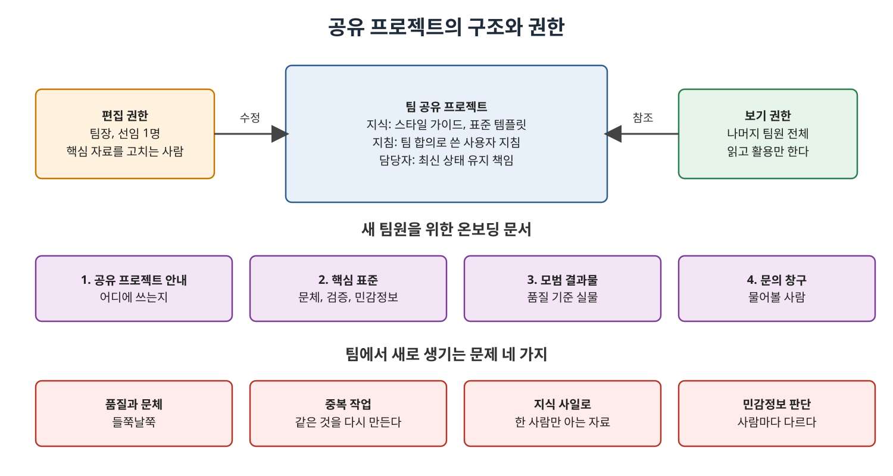

# 27장 팀 협업과 공유 워크플로 (Team Collaboration and Shared Workflows)

지금까지의 기법은 모두 혼자 쓰는 사람을 전제로 했다. 팀, 소규모 사업체, 부서처럼 여러 사람이 Claude를 함께 쓰기 시작하면 혼자일 때는 없던 조정 문제가 생긴다. 사람마다 결과물의 품질이 다르고, 동료가 이미 만든 것을 몰라 같은 일을 또 하고, 쓸모 있는 지식이 한 사람의 머리나 이름 없는 대화 기록 속에만 남는다.

이 장은 팀의 Claude 사용을 다른 공유 업무 시스템처럼 의도적으로 설계할 대상으로 본다. 개인 습관에 인원수를 곱한 것으로 취급하지 않는다는 뜻이다.

> **쉽게 말하면**
> 실력 좋은 요리사 열 명이 각자 다른 레시피로 요리하면 식당 맛은 들쭉날쭉하다. 공통 레시피북, 주방장, 신입 교육 자료가 있어야 식당이 된다.

> **참고(노트 작성자)** 요금제별 권한 기능과 공유 프로젝트의 구체적 동작은 책이 쓰인 시점 기준이다. 원서도 "Team 및 Enterprise 요금제는 보통 권한 제어를 제공한다"고만 쓴다. 현재 지원 범위는 공식 문서에서 확인하자.

## 이 장의 흐름

1. 팀에서만 생기는 조정 문제
2. 공유 프로젝트 잘 쓰기
3. 권한 수준과 접근 설계
4. 실제로 쓰이는 온보딩 자료
5. 품질과 검증의 팀 표준

---

## 1. 팀에서만 생기는 조정 문제

앞선 장들의 내용 위에 팀이라서 생기는 새 문제가 네 가지 있다.

- **품질과 문체의 불일치**: 관련된 일을 해도 사람마다 결과물의 문체와 수준이 다르다.
- **중복 작업**: 두 사람이 같은 문제를 따로 풀거나 같은 컨텍스트 패킷을 처음부터 따로 만든다.
- **지식 사일로(silo, 칸막이)**: 쓸모 있는 컨텍스트 패킷, 프롬프트, 작업 흐름이 한 사람만 아는 상태로 있어 팀에게는 사실상 사라진 자원이 된다.
- **민감 정보 판단의 불일치**: 26장의 민감도 판단이 사람마다 조심하는 정도와 인식에 따라 다르다.

팀은 개인 실력의 합이 아니다. 의도적인 조정이 없으면 구성원 각자가 Claude를 잘 써도 불일치와 중복이라는 단점을 그대로 얻는다.

## 2. 공유 프로젝트 잘 쓰기

공유 프로젝트는 6장의 프로젝트에 여러 팀원이 접근하게 한 것이다. 팀 일관성을 위한 핵심 도구이며, 앞의 지식 사일로와 중복 작업 문제를 직접 줄여 준다. 잘 세우는 방법은 세 가지다.

1. **진짜 공유할 맥락을 한곳에 모은다.** 팀 스타일 가이드, 표준 템플릿, 공통 고객과 제품 지식을 공유 프로젝트 지식 베이스에 둔다. 모두가 각자 낡았을지 모르는 개인 사본이 아닌 같은 최신 원본을 쓰게 한다.
2. **사용자 지침은 팀 합의로 쓴다.** 한 사람의 취향이 아니다. 실제로 팀원 사이의 논의가 필요할 수 있다. 프로젝트를 만든 사람이 혼자 자기 문체를 팀 기본값으로 박아 넣으면 안 된다.
3. **최신 상태를 지킬 담당자를 정한다.** 낡은 공유 맥락은 5장의 컨텍스트 부패가 팀 규모로 커진 것이며, 더 많은 사람이 정확하다고 믿고 쓰기 때문에 개인의 낡은 맥락보다 오히려 더 나쁘다.

흔한 실수는 공유 프로젝트를 한 번 만들어 놓고 다시 보지 않아, 팀이 최신이라 믿는 사이 조용히 낡아 가게 두는 것이다.

## 3. 권한 수준과 접근 설계

6장에서 잠시 다룬 대로 Team과 Enterprise 요금제의 공유 프로젝트와 작업 공간은 보통 권한 제어(누가 볼 수 있고, 고칠 수 있고, 관리하는가)를 제공한다. 설계 원칙은 세 가지다.

- **편의가 아닌 실제 역할과 책임에 맞춘다.** 공유 맥락을 참고만 하면 되는 사람에게 편집 권한은 필요 없다.
- **기초 자료의 넓은 편집 권한을 제한한다.** 핵심 브랜드 문체 지침이나 공통 고객 프로젝트의 핵심 지식은 정확하게 유지할 책임이 있는 사람만 고칠 수 있게 하고, 보기 권한은 넓게 열어 모두가 혜택을 보게 한다.
- **권한을 주기적으로 점검한다.** 역할이 바뀌었거나 팀을 떠난 사람이 접근 권한을 계속 갖지 않게 한다. 6장, 7장, 20장의 "점검하고 가지치기하라"는 원칙과 같다.

**예시**: 마케팅 팀의 공유 브랜드 문체 프로젝트는 모든 팀원에게 보기 권한을 줘서 누구나 일관된 브랜드 문체로 초안을 쓸 수 있게 한다. 핵심 문체 지침 자체의 편집 권한은 마케팅 팀장과 선임 카피라이터 한 명에게만 준다. 선의지만 조율되지 않은 수정이 쌓여 공통 기준이 서로 다른 방향으로 흘러가는 것을 막기 위해서다.

## 4. 실제로 쓰이는 온보딩 자료

온보딩(onboarding, 새 구성원이 적응하도록 돕는 과정)이 비공식 구두 설명에 의존하면 누가 마침 한가하냐에 따라 내용이 달라진다. 새 팀원이 첫 몇 주 동안 시행착오로 모든 것을 재구성하게 해서는 안 된다. 좋은 온보딩 자료에 들어갈 것은 네 가지다.

- **공유 프로젝트의 짧은 안내**: 각 프로젝트가 무엇에 쓰이고 언제 쓰는지.
- **팀의 핵심 표준**: 문체 지침, 검증 기대 수준(18장), 민감 정보 처리 정책(26장).
- **정말 훌륭한 결과물 몇 개**: 추상적 지침만이 아니라 목표로 삼을 구체적 품질 기준.
- **문의 창구**: 자료에 없는 질문을 누구에게 하면 되는지 한 명을 정해 둔다.

이것이 없으면 새 팀원은 공유 자원이 있는 줄 몰라서 Claude를 덜 쓰거나, 팀 기준과 다르게 써서 문체나 검증 기대에 맞지 않는 결과를 낸다. 둘 다 좋은 온보딩 자료가 막아 주는 실제 비용이다. 흔한 실수는 누가 설명해 주느냐에 따라 달라지는 비공식 구두 온보딩에 전적으로 기대는 것이다. 모두가 참조할 일관된 문서가 필요하다.

## 5. 품질과 검증의 팀 표준

14장과 18장은 개인의 편집과 검증 규율을 다뤘다. 팀 단계에서는 이것이 사람마다 달라질 개인 판단이 아니라 명시적으로 공유되는 표준이 되어야 한다. 표준으로 만들 것은 세 가지다.

- **공유 자기 편집 점검표**: 14장의 구조화된 자기 편집을 확장해, 대외 콘텐츠가 나가기 전에 모두가 적용한다.
- **명확한 검증 단계**: 18장의 단계별 접근을 확장해, 우리 사업에서 무엇이 "고위험"인지 팀이 합의하고 단계마다 어떤 검증이 필수인지 정한다.
- **공유 민감도 정책**: 26장을 확장해 구성원 모두가 같은 기준으로 공유 가능한 정보를 판단하게 한다.

모범 사례는 이 표준들을 온보딩 자료와 같은 곳에 문서화하는 것이다. 처음 논의할 때 자리에 있던 사람만 아는 표준이 아니라, 누구나 찾을 수 있고 일관되게 적용되는 표준이 된다.

## 6. 비즈니스 예시

직원 열 명의 마케팅 에이전시가 Claude 사용을 몇몇 열성적인 개인에서 팀 전체의 표준 관행으로 확장했다. 활성 고객마다 공유 프로젝트를 하나씩 만들었다(6장의 격리 원칙을 팀 규모로 적용한 것이다). 역할에 맞춘 보기와 편집 권한을 설정했고, 핵심 표준(문체, 검증, 민감 정보 처리)을 다룬 온보딩 문서를 작성했다. 각 고객 프로젝트의 지식을 최신으로 유지할 담당자도 지정했다.

여섯 달 뒤 신입 사원은 첫 주 안에 일을 시작할 수 있었다. 온보딩 자료를 읽고, 이미 있는 공유 프로젝트 안에서 일하며, 에이전시의 첫 Claude 사용자가 몇 달의 개별적이고 안내 없는 시행착오 끝에 도달한 속도보다 빨리 고객에게 보낼 만한 결과물을 냈다. 모두가 개인 습관 대신 같은 공유 표준으로 일하기 때문에 팀 결과물의 일관성도 눈에 띄게 높아졌다.

교훈은 의도적인 팀 단위 설계의 가치가 효율에 그치지 않았다는 것이다. 이 책의 각 장에서 쌓은 개인의 좋은 습관을 공유되고 오래가는 팀의 자산으로 바꿔 주었다. 개인 습관 속에 갇혀 동료에게 자동으로 전해지지 않는 상태가 되지 않게 해 주었다.

## 7. Claude와의 대화 예시

> **사용자**: 저희는 작은 팀인데 모두 Claude를 조금씩 다르게 써요. 어떻게 하면 더 일관되게 만들까요?
>
> **Claude**: 먼저 무엇이 불일치를 만드는지 가려내는 것이 좋습니다. 문체와 어조가 다른 건지, 검증 습관이 다른 건지, 이미 있는 것을 몰라 중복 작업을 하는 건지에 따라 해법이 다릅니다. 구체적인 틈이 정해지면, 브랜드 문체 지침과 검증 기준이 들어 있는 공유 프로젝트와 짧은 온보딩 문서만으로 대부분 해결되는 경우가 많습니다. 팀의 작업 방식을 한꺼번에 표준화하려 하기보다 지금 가장 마찰이 큰 불일치부터 시작하길 권합니다.

## 8. 연습과 미니 프로젝트

**연습**

1. 조정 문제 진단: 1절의 문제(불일치, 중복, 사일로, 민감 정보 판단 차이) 중 우리 팀에 지금 나타나는 것을 가려낸다.
2. 공유 프로젝트 설계: 공유 프로젝트 하나를 만들거나 다시 설계한다. 맥락을 한곳에 모으고, 팀 합의 지침을 쓰고, 담당자를 정한다.
3. 권한 점검: 팀이 쓰는 공유 Claude 자원의 현재 권한을 점검해 실제 역할과 책임에 맞게 고친다.
4. 온보딩 초안: 공유 프로젝트, 핵심 표준, 모범 결과물을 담은 온보딩 자료의 첫 초안을 쓴다.

**미니 프로젝트: "팀 표준"** 완결된 서면 팀 표준 문서를 만든다. 담을 내용은 공유 프로젝트와 그 용도의 개요, 문체와 품질 기대, 검증 단계와 요구 사항, 민감 정보 처리 정책이다. 팀(두 명이라도)과 공유하고 주기적으로 다시 보는 살아 있는 문서로 다룬다.

## 9. 흔한 실수와 문제 해결

| 문제 | 가능한 원인 | 해결 |
|------|-------------|------|
| 결과물의 문체와 품질이 들쭉날쭉하다 | 팀 합의 표준이 없다 | 명시적 팀 표준을 만들어 문서화한다 |
| 팀원이 같은 자원을 다시 만든다 | 공유 프로젝트나 지식 베이스가 없다 | 공유 맥락을 잘 관리하는 공유 프로젝트에 모은다 |
| 신입이 적응하는 데 오래 걸린다 | 서면 온보딩 자료가 없다 | 4절 구성으로 온보딩 자료를 만든다 |
| 공유 프로젝트가 낡았거나 어긋났다 | 담당자와 점검 일정이 없다 | 명확한 담당자와 점검 일정을 정한다 |

그 밖의 실수는 개인의 모범 사례가 조정 없이 팀에 자동으로 옮겨진다고 가정하는 것, 핵심 자료의 넓은 편집 권한을 책임과 맞추지 않고 주는 것, 품질과 검증 기준을 개인 판단에 맡기는 것이다.

## 10. 퀴즈 취지

- 팀 사용에서만 생기는 조정 문제는 무엇인가(지식 사일로와 중복 작업).
- 공유 자원의 권한 수준은 무엇이 정해야 하는가(실제 역할과 책임).
- 구두 온보딩이 서면 온보딩만큼 효과적인가(아니다).
- 공유 프로젝트가 낡지 않으려면 무엇이 필요한가(담당자와 점검 일정).

## 11. 더 연습하기

팀 표준 문서를 분기마다 다시 보고, 팀의 필요와 구성이 바뀌면 고친다. 다음 신입을 온보딩할 때는 자료에서 무엇이 빠졌는지 직접 피드백을 받아 다음 사람을 위해 개선한다.

## 핵심 정리

- 팀 사용은 불일치, 중복, 지식 사일로, 민감 정보 판단 차이라는 혼자일 때 없던 조정 문제를 만든다.
- 공유 프로젝트는 중앙 집중 지식과 팀 합의 지침으로 이 문제들을 줄여 주지만, 담당자가 있어야 최신 상태를 지킨다.
- 권한은 실제 역할과 책임에 맞게 설계하고, 팀 구성이 바뀌면 점검한다.
- 서면 온보딩 자료가 구두 설명보다 신입을 더 빠르고 일관되게 일하게 한다.
- 품질, 검증, 민감 정보 처리를 개인 판단이 아닌 팀 전체의 명시적 표준으로 정한다.

## 실행 체크리스트

- [ ] 우리 팀에 현재 나타나는 조정 문제를 가려냈다.
- [ ] 중앙 집중 지식, 팀 합의 지침, 지정된 담당자를 갖춘 공유 프로젝트가 있다.
- [ ] 권한 수준을 실제 역할과 책임에 맞게 점검했다.
- [ ] 공유 자원과 핵심 표준을 다룬 서면 온보딩 자료가 있다.
- [ ] 팀 표준 미니 프로젝트를 완료했다.

 
 
 

이전: [26장 보안과 개인정보와 데이터 처리](26%EC%9E%A5%20%EB%B3%B4%EC%95%88%EA%B3%BC%20%EA%B0%9C%EC%9D%B8%EC%A0%95%EB%B3%B4%EC%99%80%20%EB%8D%B0%EC%9D%B4%ED%84%B0%20%EC%B2%98%EB%A6%AC.md) | 다음: [28장 신뢰와 검증과 장기 품질 관리](28%EC%9E%A5%20%EC%8B%A0%EB%A2%B0%EC%99%80%20%EA%B2%80%EC%A6%9D%EA%B3%BC%20%EC%9E%A5%EA%B8%B0%20%ED%92%88%EC%A7%88%20%EA%B4%80%EB%A6%AC.md)

 

[Mastering Claude AI](../)
