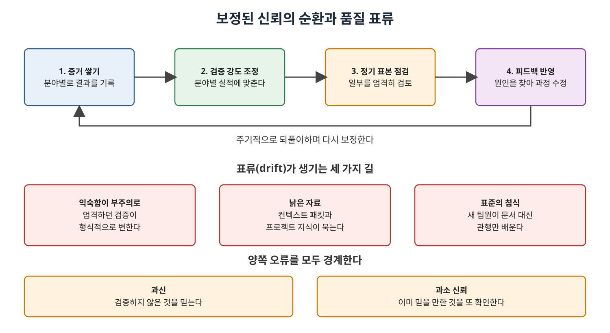

# 28장 신뢰와 검증과 장기 품질 관리 (Trust, Verification, and Long-Term Quality Control)

28장은 책 전체의 종합에 해당하는 장이다. 1장은 Claude가 마법도 단순한 챗봇도 아니며 신뢰는 가정이 아니라 의도적으로 쌓아야 한다는 생각으로 시작했다. 이후 각 장은 컨텍스트 엔지니어링, 검증, 편집, 팀 표준이라는 규율을 하나씩 더했고, 모두 같은 목표로 모인다. 보정된 신뢰(calibrated trust)다. 맹신도 반사적 의심도 아니고 현실과 맞는 확신을 뜻한다.

이 장의 주제는 그 보정 상태를 오래 유지하는 일이다. 사용량이 늘고, 도구 자체가 바뀌고, 맡기는 일의 위험이 커져도 신뢰가 현실과 어긋나지 않게 하는 방법을 다룬다.

> **쉽게 말하면**
> 새 직원을 믿는 방식과 같다. 첫날 전부 맡기지도, 1년이 지나도 전부 다시 하지도 않는다. 일의 종류별로 실적을 보고 확인 강도를 조절한다.

> **참고(노트 작성자)** 이 장의 사례는 모두 원서의 가상 시나리오이며, 사례 속 효과는 일반화할 수 있는 통계가 아니다.

## 이 장의 흐름

1. 보정된 신뢰란 무엇인가
2. 신뢰는 증거로 쌓는다
3. 지속적인 품질 관리 설계
4. 품질 표류 알아보기
5. 이 책은 점검표가 아니라 시스템이다

---

## 1. 보정된 신뢰란 무엇인가

보정된 신뢰란 Claude 결과물 하나에 대한 내 확신이 그 결과물의 실제 신뢰도와 대체로 일치하는 상태다. 받아들이면 안 될 것을 받아들이는 과신도 아니고, 이미 믿을 만한 것까지 되풀이해서 확인해 도구의 효율을 버리는 과소 신뢰도 아니다.

왜 별도의 목표로 삼는가. 두 방향 모두 대가가 있기 때문이다. 과신은 18장에서 다룬 오류로 이어진다. 확신에 찬 틀린 주장이 실제 결정이나 공개 콘텐츠에 들어간다. 과소 신뢰는 이 책이 쌓아 온 효율과 품질의 이득을 얻지 못하게 한다. Claude가 이미 믿을 만하게 해 둔 일을 다시 하고 있기 때문이다.

실용적인 자기 점검 질문이 있다. 가끔 이렇게 물어본다. "나는 위험 때문이 아니라 습관 때문에 굳이 필요 없는 것을 확인하고 있지 않은가? 아니면 확신이 있어서가 아니라 편해서, 확인하지 않은 것을 믿고 있지 않은가?" 둘 다 알아차리고 바로잡을 가치가 있다.

## 2. 신뢰는 증거로 쌓는다

보정된 신뢰는 새 동료나 외주 업체를 신뢰하게 되는 과정과 같다. 특정 분야에서 믿을 만하다는 관찰된 증거가 쌓이면서 생긴다. 평판만 보고 처음부터 주지도, 계속 좋은 성과를 내는데도 무한정 유보하지도 않는다. 실용적인 절차는 네 단계다.

1. **위험이 큰 분야는 처음엔 의심으로 시작한다.** 18장의 단계별 검증을 엄격히 적용한다. 새로운 종류의 일을 시작한 초기에 특히 그렇다.
2. **결과를 시간에 따라 기록한다.** Claude의 작업이 면밀한 검토에서 어디가 잘 버텼는가? 어디서 오류나 문제를 발견했는가?
3. **관찰된 실적에 따라 검증 강도를 조절한다.** Claude 전체에 대한 일괄 판단이 아니라 작업 분야별로 한다. 내 문체에 맞춘 글쓰기 지원에는 높은 신뢰를 갖되, 구체적인 사실 주장은 엄격히 검증할 수 있다. 위험의 성격이 다른 분야이기 때문이다.
4. **주기적으로 다시 보정한다.** 내 사용 방식과 도구 자체가 모두 변하기 때문이다.

흔한 실수는 신뢰를 "Claude를 믿는다/안 믿는다"라는 하나의 판단으로 다루는 것이다. 실제 관찰 증거에서 나온 분야별의 섬세한 보정이어야 한다.

## 3. 지속적인 품질 관리 설계

Claude에 대한 의존이 커지면, 즉 맡기는 일이 많아지고 위험이 높아지고 팀 전체가 공유 작업 흐름(27장)에 기대게 되면, 사안별 비공식 검증만으로는 부족하다. 설계된 지속적 품질 관리 과정이 필요하다. 실용적인 체계는 세 가지로 이뤄진다.

- **정기 표본 점검(spot-check)**: 대체로 믿는 작업도 주기적으로 표본을 골라 자세히 검토한다. 실적이 좋은 분야도 포함한다. 잘 운영되는 모든 과정에서 정기 감사를 하는 이유와 같다. 표류가 실제 문제로 쌓이기 전에 잡는다.
- **높은 위험 단계의 지정 검토 단계**: 18장의 높은 단계로 넘어가는 모든 것에 검토 단계를 일관되게 적용한다. 시간에 쫓길 때 사안별로 판단하게 두면, 익숙해질수록 느슨해져서 점차 무너진다.
- **피드백 순환(feedback loop)**: 표본 점검이나 검토에서 문제가 발견되면 왜 생겼는지 이해하고 과정을 고친다. 더 강한 컨텍스트 패킷, 갱신된 프로젝트 지침, 고친 검증 단계가 그 예다. 그 한 건만 고치고 넘어가면 안 된다.

**예시**: 1년 동안 Claude 보조 초안 작성에 크게 의존해 온 콘텐츠 마케팅 팀이 정례 관행을 만들었다. 매달 한 건을 거의 무작위로 골라(이미 문제로 지적된 건이 아닌 것으로) 품질 기준에 따라 철저히 검토한다. 일반 작업 흐름이 아무리 일상적이고 믿을 만해졌어도 한다. 이 관행은 날마다 하는 덜 엄격한 검토에서 천천히 스며들어 눈치채지 못했던 미묘한 문체 표류(14장)를 잡아냈다.

## 4. 품질 표류 알아보기

품질 표류(quality drift)는 문체의 일관성, 검증의 엄격함, 전반적 기준에서 서서히 일어나는 쉽게 놓치는 하락이다. 일상 업무에서는 경고 신호를 느낄 순간이 거의 없기 때문에 생긴다. 알리는 것 없이 천천히 쌓인다. 흔한 원인은 세 가지다.

- **익숙함이 부주의로 변함**: 처음엔 엄격했던 검증 단계가 신뢰가 쌓이면서(때로는 적절하게, 때로는 아니게) 점점 형식적이 된다.
- **낡은 컨텍스트 패킷과 프로젝트 지식**: 5장의 컨텍스트 부패가 장기 사용에서 나타난 것이다. 결과물이 겉으로는 그럴듯해서 아무도 모른다.
- **팀 표준의 침식**: 새 팀원이 들어오면서 문서화된 표준이 아닌 "우리가 실제로 하는 방식"을 비공식적으로 배워서 원래 의도에서 점점 벗어난다(27장).

잡는 방법은 3절의 표본 점검과 정기 검토 습관이 주된 방어선이다. 표류는 본질적으로 일상 업무 속에서는 알아채기 어렵기 때문이다. 일상에서 조금 떨어져 있는 사람이 가끔 의도적으로 더 엄격하게 살펴보면, 일상의 익숙함이 놓친 것을 잡아낸다.

## 5. 이 책은 점검표가 아니라 시스템이다

여기서 한 걸음 물러나 보면 앞의 27개 장의 기법은 독립된 요령이 아니다. 하나의 일관된 시스템을 이루며 서로를 강화한다. 책이 짚는 연결은 다음과 같다.

- 강한 프롬프트(4장)와 컨텍스트 엔지니어링(5장)이 더 좋은 원재료 결과물을 만든다.
- 조직 구조(프로젝트, 메모리, 6장과 7장)가 그 품질을 매번 처음부터 다시 만들지 않고 일관되고 재사용할 수 있게 한다.
- 편집 규율(14장)과 검증(18장)이 원재료만으로는 보장되지 않는 것을 잡는다.
- 팀 표준(27장)이 개인의 좋은 습관을 오래가는 공유 관행으로 키운다.
- 이 장의 지속적 품질 관리가 전체 시스템을 보정되고 믿을 만한 상태로 유지하며, 서서히 무너지지 않게 한다.

책을 마무리하며 기억할 점은 어떤 기법도 혼자서 만능열쇠가 아니라는 것이다. 진짜 가치는 이들을 함께, 일관되게, 내 필요에 맞게 조정된 하나의 작업 시스템으로 적용하고, 실제 증거에 따라 계속 다시 보정하는 데서 나온다.

## 6. 비즈니스 예시

1년 동안 조사, 고객 소통 초안, 내부 분석에 Claude를 폭넓게 쓴 금융 자문 회사가 연례 종합 검토를 했다. 최근 결과물의 품질뿐 아니라 처음에 세운 26장식 민감도 정책, 18장식 검증 단계, 27장식 팀 표준이 1년이 지난 지금도 일관되게 지켜지는지, 익숙함 속에서 조용히 무너지지 않았는지를 확인했다.

고객용 숫자 주장에 대한 검증 단계가 설계보다 실제로는 덜 엄격해졌음을 발견했다. 팀이 도구에 익숙해지면서 더 많은 일이 "당연히 괜찮은 것"으로 취급되어, 원래 의도했던 확인이 빠졌다. 그들은 원래 기준으로 돌아가기로 했고, 온보딩 자료(27장)에 짧은 복습 내용을 넣었으며, 이 종합 검토를 일회성 교정이 아닌 연례 정례 관행으로 예약했다.

교훈은 이 책의 원칙으로 신중히 설계한 훌륭한 시스템도 주기적이고 의도적인 재보정의 혜택을 본다는 것이다. 처음에 잘 설계했다고 해서 유지 관리 없이 시간이 지나도 온전하게 남는 것은 아니다.

## 7. Claude와의 대화 예시

> **사용자**: 1년 동안 Claude를 많이 써 왔는데, 우리 과정이 시작했을 때만큼 여전히 좋은지 어떻게 알 수 있을까요?
>
> **Claude**: 주기적으로 던질 만한 아주 좋은 질문입니다. 점진적인 표류는 일상 업무 안에서는 알아채기 어렵기 때문입니다. 구조적인 검토를 권합니다. 최근 결과물 표본을 골라 문체, 검증의 엄격함, 민감 정보 처리라는 처음의 기준과 비교해 보세요. 지금 괜찮게 느껴지는지만 묻는 방식은 안 됩니다. 익숙함이 표류한 과정까지 정상으로 느끼게 만들 수 있기 때문입니다. 틈이 발견되면 그 한 건만 고치지 말고 왜 생겼는지 구체적으로 이해해서, 가장 최근 증상이 아니라 근본 원인을 해결하세요.

## 8. 연습과 미니 프로젝트

**연습**

1. 보정 자기 점검: 1절의 질문으로, Claude를 쓰는 여러 분야에서 내가 과신, 과소 신뢰, 적절한 보정 중 어디에 있는지 솔직하게 평가한다.
2. 표본 점검 실습: 최근의 대체로 믿는 작업 하나를 골라, 처음 보는 것처럼 철저히 검토한다.
3. 표류 감사: 내 상시 관행(컨텍스트 패킷, 검증 습관, 해당되면 팀 표준)을 처음 세울 때의 의도와 비교한다.
4. 시스템 지도 그리기: 이 책의 장 목록을 되짚어, 내가 채택한 기법들이 실제 실무에서 어떻게 서로 연결되고 강화하는지 정리한다.

**미니 프로젝트: "연례 검토"** 나(또는 팀)의 Claude 사용에 대한 정례 종합 검토 과정을 설계한다. 무엇을 표본으로 뽑는지, 얼마나 자주 하는지, 어떤 기준으로 평가하는지, 발견한 것이 구체적 과정 개선으로 어떻게 이어지는지를 담는다. 첫 검토 일정은 몇 달 뒤라도 지금 잡아서 일회성 연습이 아닌 상시 관행으로 만든다.

## 9. 흔한 실수와 문제 해결

| 문제 | 가능한 원인 | 해결 |
|------|-------------|------|
| 신뢰가 어긋난 것 같은데 어느 쪽인지 모르겠다 | 구조적 자기 점검을 안 했다 | 1절의 질문을 분야별로 적용한다 |
| 품질이 떨어진 것 같은데 바뀐 게 없다 | 일상 속에서 눈치채지 못한 서서한 표류 | 처음 기준에 맞춰 엄격한 표본 점검을 한다 |
| 몇 달 전의 좋은 과정이 지금 실무와 안 맞는다 | 정기 검토와 재보정이 없다 | 정례 종합 검토를 만든다 |
| 개별 좋은 습관이 기대한 누적 효과를 못 낸다 | 기법들을 서로 이어지지 않은 요령으로 썼다 | 5절의 시스템 지도 그리기로 연결을 다시 본다 |

그 밖의 실수는 신뢰를 분야 구분 없는 하나의 판단으로 다루는 것, 익숙해지며 검증이 느슨해지는데 모르는 것, 정기 검토 없이 일상의 인상에만 기대는 것, 잘 설계한 시스템은 유지 관리 없이도 온전하리라 가정하는 것이다.

## 10. 퀴즈 취지

- "보정된 신뢰"는 무슨 뜻인가(확신이 실제 관찰된 신뢰도와 일치하는 것).
- 신뢰하는 작업에도 표본 점검을 권하는 이유는 무엇인가(표류가 쌓이기 전에 잡기 위해).
- 잘 설계한 품질 과정은 유지 관리 없이도 유지되는가(아니다).
- 품질 표류란 무엇인가(서서히 일어나 놓치기 쉬운 하락).

## 11. 더 연습하기

다음 분기 안에 첫 종합 검토를 비공식적으로라도 해서, 급해지기 전에 습관을 세운다. Claude에 의존하는 정도나 방식이 크게 바뀐 뒤에는 보정 자기 점검을 다시 해 본다.

## 핵심 정리

- 보정된 신뢰는 확신이 실제 신뢰도와 맞는 것이다. 맹목적 수용도 반사적 과잉 검증도 아니다.
- 신뢰는 분야별로 쌓인 증거로 만들며, 하나의 일괄 판단이 아니다.
- 의존이 커질수록 정기 표본 점검, 높은 위험의 일관된 검토, 진짜 피드백 순환을 갖춘 품질 관리를 설계한다.
- 품질 표류는 서서히 일어나 놓치기 쉬우며, 주기적이고 의도적인 검토가 주된 방어다.
- 이 책의 기법은 점검표가 아니라 서로 강화하는 일관된 시스템이며, 보정을 유지하려면 지속적인 관리가 필요하다.

## 실행 체크리스트

- [ ] 신뢰를 일괄 판단이 아닌 구체적 작업 분야별로 평가한다.
- [ ] 시간에 걸쳐 관찰된 증거로 신뢰를 쌓는다.
- [ ] 정기 표본 점검을 포함한 지속적 품질 관리 과정이 있다.
- [ ] 좋은 과정이 저절로 유지된다고 가정하지 않고 품질 표류를 적극 살핀다.
- [ ] 연례 검토 미니 프로젝트를 완료하고 정례 일정을 잡았다.

 
 
 

이전: [27장 팀 협업과 공유 워크플로](27%EC%9E%A5%20%ED%8C%80%20%ED%98%91%EC%97%85%EA%B3%BC%20%EA%B3%B5%EC%9C%A0%20%EC%9B%8C%ED%81%AC%ED%94%8C%EB%A1%9C.md) | 다음: [29장 나만의 생산성 시스템](29%EC%9E%A5%20%EB%82%98%EB%A7%8C%EC%9D%98%20%EC%83%9D%EC%82%B0%EC%84%B1%20%EC%8B%9C%EC%8A%A4%ED%85%9C.md)

 

[Mastering Claude AI](../)
