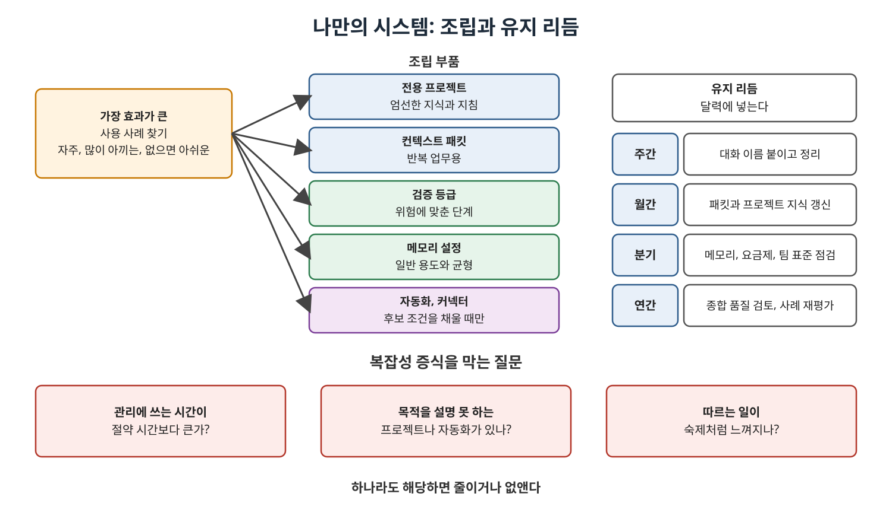

# 29장 나만의 생산성 시스템 (Building Your Own Productivity System Around Claude)

29장은 통합의 장이다. 앞의 28개 장에서 배운 것을 모두 모아, 모든 기법을 일률적으로 쓰려 하지 않고 내 실제 업무에 맞는 하나로 조립한다. 모든 독자에게 무거운 자동화 설정(20장)이 필요하지 않고, 깊은 코딩 능력(22장부터 24장)이 필요하지 않다. 효과적인 개인 시스템은 책의 모든 장을 무차별적으로 적용한 점검표가 아니라 내 진짜 효과가 큰 사용 사례를 중심으로 짜인다.

이 장은 "이제 직접 만들어 보라"는 마무리 과제다. 새로운 기법을 더하기보다 이미 배운 것을 신중하게 조립하는 일에 가깝다.

> **쉽게 말하면**
> 공구 상자의 도구를 전부 벽에 걸어 두는 대신, 매일 쓰는 세 개를 손 닿는 곳에 두고 나머지는 서랍에 넣는 것과 같다.

> **참고(노트 작성자)** 유지 리듬 표의 주기(주간, 월간, 분기, 연간)는 원서가 제안한 예시다. 정해진 규칙이 아니므로 내 일의 속도에 맞게 조정하면 된다. 요금제 점검 같은 항목의 구체적 내용은 책이 쓰인 시점 기준이다.

## 이 장의 흐름

1. 나의 가장 효과가 큰 사용 사례 찾기
2. 개인 시스템 조립
3. 지속 가능한 유지 리듬
4. 시간에 따라 시스템 조정
5. 복잡성 증식 피하기

---

## 1. 나의 가장 효과가 큰 사용 사례 찾기

정교한 시스템을 만들기 전에, 내 업무에서 Claude가 실제로 가장 큰 가치를 주는 곳이 어디인지 먼저 분명히 한다. 역할, 업종, 개인의 작업 방식에 따라 크게 다르다. 지금까지의 실제 사용을 돌아보고(처음이라면 예상되는 필요를 떠올려) 세 가지를 묻는다.

- 어떤 작업에서 Claude의 도움을 가장 자주 받는가?
- 한 번 쓸 때마다 시간과 노력을 가장 많이 아껴 주는 작업은 무엇인가?
- 내일 Claude의 도움이 사라진다면 가장 아쉬울 작업은 무엇인가?

여기서 시작해야 하는 이유가 있다. 드물게 하고 가치가 낮은 작업을 중심으로 무거운 프로젝트 구조, 방대한 컨텍스트 패킷, 자동화를 쌓으면, 정말 효과가 큰 사용 사례에 썼어야 할 준비 노력이 낭비된다. 이 장의 핵심 원칙은 이렇다. 가치가 있는 곳에는 깊이 투자하고, 나머지에는 가볍게 대응한다.

**예시**: 컨설턴트는 고객 납품물 초안 작성(11장, 12장)과 조사 종합(15장)이 효과가 크고, 가끔 받는 코딩 도움(22장)은 실제로 쓸모 있지만 드문 일임을 알 수 있다. 필요할 때 잘 쓰는 법은 알아 두되, 자주 하는 핵심 업무만큼 깊이 시스템을 짤 가치는 없다.

## 2. 개인 시스템 조립

효과가 큰 사용 사례를 알았다면, 책 전체에서 관련된 기법을 골라 일관된 개인 시스템으로 의도적으로 조립한다. 모든 장을 균일하게 적용하려 하지 않는다. 조립 과정은 다섯 단계다.

1. 효과가 큰 사용 사례마다 **전용 프로젝트**(6장)를 만든다. 지식은 엄선하고 사용자 지침은 구체적으로 쓴다.
2. 그 사용 사례 안에서 반복되는 것에는 **컨텍스트 패킷**(5장)을 만든다.
3. 사용 사례마다 실제 위험에 맞춰 **개인 검증 단계**(18장)를 정한다.
4. 이런 집중 사용 사례와 일반적인 일상 용도 모두에 맞는 **메모리 설정**(7장)을 의도적으로 결정한다.
5. **자동화나 커넥터**(20장)는 특정 사용 사례가 "좋은 자동화 후보" 조건을 실제로 충족할 때만 추가한다. 모든 작업 흐름의 기본값으로 넣지 않는다.

흔한 실수는 모든 사용 사례에 똑같이 최대한 정교한 시스템을 만들려 하는 것이다. 정말 효과가 큰 영역에 노력을 모으고 나머지는 적절히 가볍게 두는 편이 낫다.

## 3. 지속 가능한 유지 리듬

이 책에서 상시 시스템(프로젝트 지식, 메모리, 컨텍스트 패킷, 팀 표준)을 소개한 장은 모두 주기적인 점검과 유지 관리를 강조했다. 이를 하나의 지속 가능한 개인 리듬으로 묶으면 유지 관리가 그 자체로 감당 못 할 짐이 되지 않는다. 원서가 제안한 통합 리듬은 다음과 같다.

| 주기 | 점검 내용 |
|------|-----------|
| 주간 | 그 주의 쓸 만한 대화에 이름을 붙이고 정리한다(2장) |
| 월간 | 활성 사용 사례의 컨텍스트 패킷과 프로젝트 지식을 점검하고 갱신한다(5장, 6장) |
| 분기 | 메모리 항목을 점검하고(7장), 요금제를 다시 평가하고(2장), 팀 표준을 점검한다(27장) |
| 연간 | 종합 품질 검토(28장)를 하고, 어떤 사용 사례가 정말 효과가 큰지 다시 평가한다(이 장 1절) |

하나로 통합하는 이유는 이렇다. 각 장의 유지 관리 권고를 별개의 분리된 일로 다루면 실제로는 아무것도 안 하게 될 위험이 있다. 달력 알림에 연결된 단일 통합 개인 유지 리듬이 일관되게 지켜질 가능성이 훨씬 높다.

## 4. 시간에 따라 시스템 조정

효과가 큰 사용 사례, 내 역할, Claude의 기능은 모두 계속 변한다. 한 번 만들고 다시 보지 않은 개인 시스템은 처음에 잘 설계되었어도 점차 맞지 않게 된다. 다시 살펴보고 조정할 신호는 다음과 같다.

- 역할, 책임, 사업에 큰 변화가 생겼다.
- 기존 작업 흐름을 의미 있게 개선할 새 Claude 기능이 나왔다(7장, 8장, 20장처럼 빨리 변하는 장에서 강조했듯 최신 문서를 주기적으로 확인할 가치가 있다).
- 한때 효과가 크다고 여긴 사용 사례가 내 실제 업무에서 덜 중요해졌고, 다른 것이 커졌다.

**처음부터 다시 하지 않고 조정하는 법**: 1절의 효과가 큰 사용 사례 찾기를 주기적으로 다시 한다(3절의 연례 검토에 포함된다). 그 결과에 맞춰 시스템의 깊이와 초점을 바꾼다. 더 이상 핵심이 아닌 사용 사례의 시스템은 없애거나 가볍게 줄이고, 새로 중요해진 곳에는 더 의도적으로 투자한다.

## 5. 복잡성 증식(complexity creep) 피하기

시스템 구축에 지나치게 투자할 수도 있다. 프로젝트, 컨텍스트 패킷, 자동화된 작업 흐름의 정교한 구조가 쌓여, 절약해 주는 것보다 유지하는 데 더 많은 노력이 들고 실제 필요에 쓸모가 없어지는 경우다. 알아보는 신호는 세 가지다.

- 시스템이 실제로 절약해 주는 시간보다 유지에 쓰는 시간이 더 많다.
- 지금의 목적을 분명히 설명하지 못하는 프로젝트, 컨텍스트 패킷, 자동화가 있다.
- 내 "시스템"을 따르는 것이 효율이 아니라 잡일처럼 느껴지기 시작한다.

막는 방법은 시스템의 각 구성 요소가 여전히 제 몫을 하는지 솔직하게 주기적으로 묻는 것이다. 몫을 못 하는 것은, 처음 만드는 데 실제로 공이 들었더라도, 단순화하거나 없앨 마음이 있어야 한다. 시스템의 가치는 완성도나 정교함이 아니라 실제로 아껴 주는 것으로 잰다.

모범 사례는 어정쩡하게 관리되는 수많은 주변 요소보다 잘 관리되는 소수의 정말 가치 있는 구성 요소를 선호하는 것이다. 6장의 프로젝트 지식 엄선 원칙을 개인 시스템 전체에 적용한 것이다.

## 6. 비즈니스 예시

프리랜서 보조금 신청서 작성자가 Claude를 쓴 첫해에 점점 정교한 시스템을 만들었다. 몇 가지 반복 고객 유형마다 전용 프로젝트, 방대한 컨텍스트 패킷, 일상 서신에 쓰는 일부 자동화까지 있었다. 첫 연례 검토(28장의 관행을 여기에 적용했다)에서 두 고객 유형의 프로젝트를 몇 달째 열어 보지 않았음을 알았다. 그 사업 분야는 실제로 바뀌었고, 그녀는 더 이상 하지 않는 일을 위한 기반 시설을 유지하고 있었던 것이다.

그녀는 그 두 프로젝트를 없애고, 여전히 쓸모 있는 일반 내용은 핵심 컨텍스트 패킷으로 합쳤다. 그리고 지난 한 해 사이 실제 가장 효과가 큰 사용 사례로 성장한 새 고객 유형의 프로젝트에 새로 공을 들였다. 그 유형은 연초에는 그녀의 업무에 거의 없던 것이었다.

교훈은 한 시점에 신중하게 만든 시스템도 현재 현실에 비춘 주기적이고 솔직한 재평가가 필요하다는 것이다. 목표는 항상 지금의 실제 필요를 돕는 것이지, 관성 때문에 과거의 기반 시설을 지키는 것이 아니다.

## 7. Claude와의 대화 예시

> **사용자**: 프로젝트와 컨텍스트 패킷을 많이 만들어 뒀는데, 아직도 다 도움이 되는지 모르겠어요. 어떻게 해야 할까요?
>
> **Claude**: 더 쌓아 두기만 하지 말고 진지하게 살펴볼 만한 일입니다. 하나씩 보면서 솔직하게 물어보는 연습이 좋습니다. 마지막으로 실제로 쓴 게 언제인가, 지금의 내 업무를 반영하는가? 몇 달째 손대지 않았거나 지금은 핵심이 아닌 고객이나 작업 유형을 다루는 것은 없애거나 합칠 후보일 가능성이 큽니다. 일하는 방식이 변하면서 시스템도 주기적으로 가지치기가 필요한 것은 아주 정상입니다. 목표는 남아 있는 모든 것이 과거에 정당했던 것이 아니라 지금 실제로 제 몫을 하게 하는 것입니다.

## 8. 연습과 미니 프로젝트

**연습**

1. 효과가 큰 사용 사례 찾기: 1절의 질문으로, 가정이 아닌 실제 빈도와 가치에 근거해 내 효과가 큰 Claude 사용 사례 상위 세 가지를 솔직히 정한다.
2. 시스템 조립: 최상위 사용 사례에 대해 2절 절차를 따라 프로젝트, 컨텍스트 패킷, 검증 단계를 갖춘 완전한 개인 시스템을 의도적으로 조립한다.
3. 유지 리듬 설정: 3절의 표를 따라 나만의 통합 유지 일정을 만들고, 첫 일정들을 지금 실제 달력에 넣는다.
4. 복잡성 감사: 현재의 프로젝트, 컨텍스트 패킷, 자동화를 살펴 최근 쓸모가 없었던 것을 찾아 없애거나 합치는 것을 고려한다.

**미니 프로젝트: "개인 시스템 검토"** 현재의 Claude 사용을 전면 검토한다. 진짜 효과가 큰 사용 사례를 가려내고, 그 주위에 전용 시스템을 조립하거나 다듬고, 복잡성 증식에 빠진 것은 없애고, 통합 유지 리듬을 실제 달력에 설정한다. 이 책의 모든 내용을 내 일에 맞춘 것으로 모으는 실무 마무리 과제로 다룬다.

## 9. 흔한 실수와 문제 해결

| 문제 | 가능한 원인 | 해결 |
|------|-------------|------|
| 개인 시스템이 절약하는 것보다 노력이 더 든다 | 복잡성 증식, 또는 효과가 낮은 곳에 노력을 분산 | 솔직하게 감사해서 덜 쓰는 구성 요소를 없애거나 합친다 |
| 유지 작업이 계속 건너뛰어진다 | 단일 통합 유지 리듬이 없다 | 3절을 따라 달력 기반 통합 리듬을 만든다 |
| 한때 유용했던 시스템이 지금 업무에 안 맞는다 | 역할이나 사용 사례가 바뀌었는데 시스템이 적응하지 않았다 | 효과가 큰 사용 사례를 주기적으로 다시 보고 시스템을 조정한다 |
| 어디에 구축 노력을 둘지 모르겠다 | 효과가 큰 사용 사례를 명시적으로 가려내지 않았다 | 1절의 질문으로 솔직히 가려낸다 |

그 밖의 실수는 모든 장의 유지 권고를 서로 단절된 별개 일로 다루는 것, 시스템을 다시 보지 않고 방치하는 것, 관성으로 구성 요소를 보존하는 것이다.

## 10. 퀴즈 취지

- 시스템 구축 노력을 어디에 가장 많이 쓸지 무엇이 정하는가(진짜 효과가 큰 사용 사례).
- 단일 통합 유지 리듬을 권하는 이유는 무엇인가(별개로 두면 일관되게 이뤄지지 않을 위험이 있어서).
- 잘 만든 개인 시스템은 한 번 세우면 그대로 두는가(아니다).
- 복잡성 증식이란 무엇인가(시스템이 목적에 도움이 되는 지점을 넘어 서서히 복잡해지는 것).

## 11. 더 연습하기

여섯 달에서 1년마다 효과가 큰 사용 사례를 다시 점검하고, 일이 바뀌는 대로 시스템의 초점을 옮긴다. 이 장의 감사 과정을 동료나 팀과 나눈다. 복잡성 증식은 개인 시스템보다 공유 시스템(27장)에서 더 빨리 커지는 경향이 있기 때문이다.

## 핵심 정리

- 정교한 시스템에 투자하기 전에 진짜 효과가 큰 사용 사례를 가려내고, 그곳에 깊이를 모은다.
- 프로젝트, 컨텍스트 패킷, 검증 단계, 선택적 자동화를 그 사용 사례에 맞춰 일관된 시스템으로 조립한다.
- 각 장의 유지 권고를 흩어 두지 않고 하나의 지속 가능한 리듬으로 통합한다.
- 역할, 필요, Claude의 기능이 변하면 시스템도 조정한다. 한 번 만든 시스템이 영원하지 않다.
- 각 구성 요소가 제 몫을 하는지 솔직하게 주기적으로 다시 평가해 복잡성 증식을 막는다.

## 실행 체크리스트

- [ ] 진짜 효과가 큰 Claude 사용 사례를 가려냈다.
- [ ] 그 사용 사례 위에 일관된 개인 시스템을 조립했다.
- [ ] 실제 달력에 단일 통합 유지 리듬이 있다.
- [ ] 필요가 변하면 시스템을 주기적으로 다시 보고 조정한다.
- [ ] 복잡성 증식을 감사하고 제 몫을 못 하는 것을 없앴다.

 
 
 

이전: [28장 신뢰와 검증과 장기 품질 관리](28%EC%9E%A5%20%EC%8B%A0%EB%A2%B0%EC%99%80%20%EA%B2%80%EC%A6%9D%EA%B3%BC%20%EC%9E%A5%EA%B8%B0%20%ED%92%88%EC%A7%88%20%EA%B4%80%EB%A6%AC.md) | 다음: [30장 앞으로 최신 상태 유지하기](30%EC%9E%A5%20%EC%95%9E%EC%9C%BC%EB%A1%9C%20%EC%B5%9C%EC%8B%A0%20%EC%83%81%ED%83%9C%20%EC%9C%A0%EC%A7%80%ED%95%98%EA%B8%B0.md)

 

[Mastering Claude AI](../)
