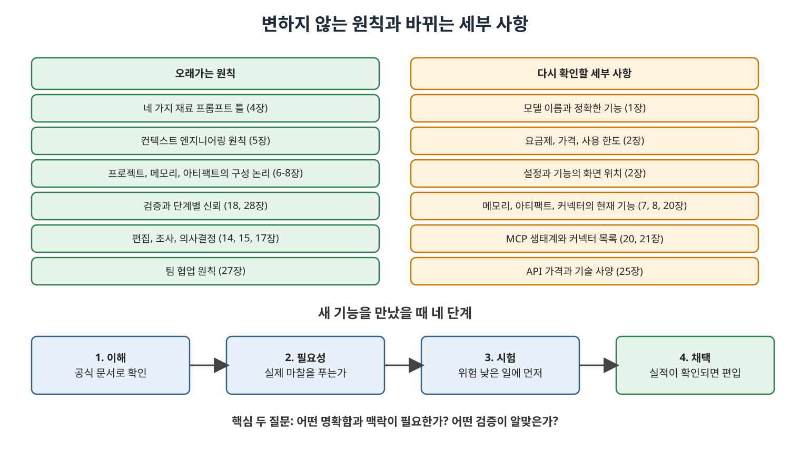

# 30장 앞으로 최신 상태 유지하기 (What's Next: Staying Current as Claude Evolves)

마지막 장은 이 책 전체가 안고 있던 긴장을 정면으로 다룬다. Claude는 제품이어서 새 기능, 새 모델, 새 능력이 자주 나오지만, 책은 본래 한 시점에 고정된 기록이다. 이 장은 그 긴장을 없는 척하지 않는다.

좋은 소식이자 가장 중요한 것은 이 책에서 배운 대부분이 오래간다는 점이다. 명확하게 프롬프트하기, 컨텍스트를 의도적으로 설계하기, 알맞게 검증하기, 반복 업무를 구조화하기, 보정된 신뢰 쌓기는 어느 버튼의 위치나 기능의 현재 이름에 달려 있지 않다. 이 장은 계속 쓸모 있을 것과 주기적으로 다시 확인할 것을 가르는 일을 한다.

> **쉽게 말하면**
> 지도의 도로는 공사로 바뀌어도 "방향을 읽는 법"은 그대로다. 책의 버튼 위치는 낡을 수 있지만 쓰는 방식은 남는다.

> **참고(노트 작성자)** 이 노트 자체도 책이 쓰인 시점을 기준으로 정리한 것이다. 요금제, 모델 이름, 기능의 현재 상태는 이 노트가 아닌 Anthropic 공식 문서에서 확인하자. 원서의 사례(소기업 대표)는 가상 시나리오다.

## 이 장의 흐름

1. 이 책에서 오래가는 것과 변하는 것
2. 지속 가능한 "최신 상태 유지" 습관
3. 새 기능을 신중하게 평가하기
4. 1장의 성찰 다시 보기
5. 앞으로 가져갈 멘탈 모델

---

## 1. 이 책에서 오래가는 것과 변하는 것

두 범주를 분명히 나눠 두면 무엇을 계속 믿고 무엇을 주기적으로 확인할지 알 수 있다.

**오래가는 것**(인터페이스가 바뀌어도 쓸모가 있다)

- 네 가지 재료 프롬프트 틀(4장)
- 컨텍스트 엔지니어링 원칙(5장)
- 프로젝트, 메모리, 아티팩트의 구성 논리(6장부터 8장). 개념으로서의 논리이며 구체 구현은 변한다.
- 검증과 단계별 신뢰 규율(18장, 28장)
- 편집과 문체 맞추기 기법(14장)
- 의사결정 틀과 조사 규율(15장, 17장)
- 팀 조정 원칙(27장)

**시간에 민감한 것**(최신의 믿을 만한 자료로 주기적으로 다시 확인한다)

- 구체적인 모델 이름과 정확한 기능(1장)
- 정확한 요금제 단계, 가격, 사용 한도(2장)
- 설정과 기능의 구체적 화면 위치(2장)
- 메모리, 아티팩트, 커넥터의 정확한 현재 기능(7장, 8장, 20장)
- MCP 생태계의 구체 내용과 쓸 수 있는 커넥터(20장, 21장)
- Claude API 가격과 기술 사양(25장)

이 구분이 중요한 이유가 있다. 앞 장의 구체적인 내용이 이 글을 읽을 때쯤 바뀌었어도 책의 가치가 흔들리지 않는다. 버튼이 옮겨졌거나 이름이 바뀌었더라도 그 밑의 원칙은 거의 틀림없이 여전히 적용된다. 책이 시간에 민감한 구체 사항에 대해서는 현재 문서를 확인하라고 거듭 안내해 온 이유다. 영구적으로 고정된 참고서인 척하지 않은 것이다.

## 2. 지속 가능한 "최신 상태 유지" 습관

새 소식을 완전히 무시하거나 모든 업데이트를 불안하게 추적하는 대신, 29장의 유지 리듬 개념을 이어서 의도적이고 지속 가능한 습관을 만든다. 실용적인 방법은 세 가지다.

- **Anthropic의 공식 문서와 발표를 주기적으로 확인한다.** 집착하지 않고, 분기 점검 리듬(29장)의 일부로 정해 둔다.
- **새 기능 소식을 들으면 먼저 내 효과가 큰 사용 사례(29장의 틀)에 비춰 평가한다.** 채택에 시간을 쓰기 전에 하는 일이다. 모든 새 기능이 내 일과 관련 있는 것은 아니며 그래도 괜찮다.
- **지금 살펴볼 가치가 있는 기능과 알아만 두면 되는 기능을 구분한다.** 효과가 큰 사용 사례와 직접 관련 있으면 바로 탐색하고, 언젠가 쓸모 있겠지만 급하지 않은 것은 알고만 둔다. 모든 발표를 똑같이 급하게 대하면 금방 피로와 복잡성 증식(29장)으로 이어진다.

흔한 실수는 책을 끝낸 뒤 업데이트에서 완전히 손을 떼거나, 내 일과의 관련성과 상관없이 새 기능 발표를 반사적으로 좇는 것이다. 둘 다 각기 지속될 수 없는 방식이다.

## 3. 새 기능을 신중하게 평가하기

정말 새로운 능력이 나타나면, 무비판적인 열광이나 자동적인 무시 대신 책 전체에서 쓴 평가 규율을 그대로 적용한다. 네 단계다.

1. **기능이 실제로 무엇을 하는지 이해한다.** 2차 요약이나 과장 광고가 아닌 공식 문서로 확인한다.
2. **내 현재 작업 흐름의 실제 마찰을 해결하는지 판단한다.** 20장의 "좋은 자동화 후보" 식 사고를 쓴다.
3. **실제지만 위험이 낮은 작업에 먼저 시험한다.** 효과가 크거나 위험이 큰 어떤 일에 통합하기 전의 단계다.
4. **실제 관찰된 가치가 확인되면 비로소 내 상시 시스템(29장)에 완전히 채택한다.** 28장의 증거 기반 신뢰 쌓기를 새 기능에 맞춰 적용하는 것이다.

**예시**: 한 사용자가 Claude의 새 기능에 대한 글을 읽는다. 곧바로 작업 흐름 전체를 그 기능 중심으로 개편하지 않고, 실제이지만 중요하지 않은 작업 하나에 먼저 써 본다. 정말 쓸모 있다고 확인한 뒤에야 개인 시스템(29장)에 의도적으로 넣는다. 무시하지도, 성능을 알기 전에 지나치게 매달리지도 않은 것이다.

## 4. 1장의 성찰 다시 보기

1장에서 여러분은 "내가 Claude를 쓸 방식과 쓰지 않을 방식"이라는 짧은 문서를 썼다. 맡길 일, 절대 완전히 맡기지 않을 일, 이 책이 답해 주기를 바라는 열린 질문 하나가 담겨 있었다. 이제 그 문서를 진지하게 다시 꺼내 본다.

- 책을 읽고 실습한 결과, 자신 있게 맡길 수 있는 일의 목록이 늘어났는가?
- 검증 없이는 완전히 맡기지 않을 일의 목록이, 18장의 검증 단계를 더 정확히 이해한 지금 더 세밀하게 바뀌었는가?
- 열린 질문에 책 어딘가에서 답을 얻었는가? 아니라면 Anthropic의 문서, 계속된 실습, 직접 실험으로 더 파고들 만한 질문이다.

마무리 연습으로 중요한 이유는 1장의 출발점과 지금 도달한 지점을 비교하는 것이 책이 이끈 실제 거리를 알아보는 구체적이고 개인적인 방법이기 때문이다. 추상적이 아니라 내 구체적 출발 가정에서 내 말로 확인한다.

## 5. 앞으로 가져갈 멘탈 모델

다른 모든 것을 잊더라도 단 하나 기억할 멘탈 모델(mental model, 사물이 어떻게 작동하는지에 대한 전이 가능한 이해)은 이것이다.

> Claude는 정말 유능한 협업자이며, 결과물의 품질은 내가 상호작용에 가져오는 명확함, 맥락, 구조에 크게 좌우된다. 믿을 만한 사용에는 맹신도 반사적 의심도 아닌 보정된 증거 기반 검증이 필요하다.

이 하나의 모델이 책의 나머지 대부분을 낳는 이유가 있다. 이 서른 장의 거의 모든 구체 기법은 이 핵심 아이디어의 구체적 적용이다. 명확한 프롬프트(4장)는 명확함을 가져오는 일이고, 컨텍스트 엔지니어링(5장)과 프로젝트(6장)는 풍부하고 정리된 맥락을 가져오는 일이다. 검증과 신뢰 보정(18장, 28장)은 모델의 증거 기반 신뢰 절반에 해당한다. 더 고급 내용인 자동화(20장), Claude Code(23장), API(25장)도 같은 핵심 모델을 점점 더 자율적이고 기술적인 맥락에 적용한 것이다.

**앞으로의 모범 사례**: 책이 다루지 않은 새 Claude 능력을 만나도 새 멘탈 모델은 필요 없다. 같은 것을 적용한다. 두 가지 질문을 던진다.

1. 이 새 능력이 잘 작동하려면 나는 어떤 명확함과 맥락을 줘야 하는가?
2. 이 구체적 용도에 알맞은 보정된 신뢰와 검증은 어떤 모습인가?

이 두 질문은 인터페이스가 어떻게 계속 바뀌더라도 믿을 만하게 도움이 된다.

## 6. 비즈니스 예시

소기업 대표인 한 독자가 책을 집어 든 지 약 1년 뒤에 전체를 다 읽었다. 그동안 개인 시스템(29장)을 실제로 만들었다. 그 1년 사이 앞 장의 구체적 인터페이스 세부 사항 몇 가지는 이미 달라졌다. 설정 메뉴가 재구성되었고 기능 하나의 이름이 바뀌었다. 이 중 어느 것도 그녀의 실제 실무를 의미 있게 방해하지 않았다. 그녀가 내면화한 것은 버튼의 위치가 아니라 밑바탕의 습관이었기 때문이다. 명확한 프롬프트, 선별된 맥락, 알맞은 검증, 주기적인 시스템 유지였다.

책에 전혀 없던 새로운 능력을 만났을 때, 그녀는 이 마지막 장의 평가 과정을 자연스럽게 적용했다. 문서를 확인하고, 위험이 낮은 작업에 시험하고, 의도적으로 채택했다. "새 기능을 어떻게 생각할지"를 알려 줄 외부 자료는 필요 없었다. 그 사고방식이 이미 그녀 자신의 것이 되었기 때문이다.

교훈은 이 책의 성공 척도가 모든 구체적 세부 사항이 계속 정확했는지가 아니라는 것이다. 밑바탕의 멘탈 모델과 습관이 독자 자신의 독립된 실무로 오래가게 옮겨졌는지가 척도다.

## 7. Claude와의 대화 예시

> **사용자**: 방금 당신을 잘 쓰는 법에 관한 책 한 권을 다 읽었는데, 당신이 계속 바뀔 거라는 걸 알아요. 시간 낭비였나요?
>
> **Claude**: 전혀 아닙니다. 빠르게 변하는 도구에 관한 책의 구체적인 인터페이스 세부 사항은 어쩔 수 없이 주기적으로 갱신되어야 합니다. 하지만 근본 기술은, 명확히 프롬프트하기, 컨텍스트를 의도적으로 설계하기, 알맞게 검증하기, 정리되고 재사용할 수 있는 시스템 만들기는, 구체 기능이 어떻게 바뀌든 전이되는 오래가는 능력입니다. 오히려 그 원칙을 내면화했으니 다음에 무엇이 오든 처음부터 다시 시작하지 않고 신중하게 평가하고 채택할 수 있습니다. 투자한 시간에 대한 아주 오래가는 보상입니다.

## 8. 연습과 미니 프로젝트

**연습**

1. 오래가는 것과 변하는 것 감사: 이 책에서 쓴 내 노트나 표시해 둔 부분을 1절의 두 범주로 분류한다.
2. 최신 상태 유지 습관: 29장의 유지 리듬에 "새 Claude 기능 확인" 단계를 지속 가능한 주기로 더한다(분기마다가 흔히 알맞다).
3. 1장 다시 보기: 처음 썼던 "내가 Claude를 쓸 방식과 쓰지 않을 방식" 문서를 꺼내 무엇이 달라졌는지 짧은 성찰을 쓴다.
4. 멘탈 모델 적용: 다음에 낯선 Claude 기능을 만나면 다른 무엇보다 먼저 5절의 두 질문을 의식적으로 적용해 보고, 다른 안내 없이 얼마나 멀리 갈 수 있는지 살핀다.

**미니 프로젝트: "한 바퀴 돌아온 성찰"** 한 쪽 이내의 마지막 성찰을 쓴다. 이 책을 시작한 뒤 Claude를 쓰는 방식에서 무엇이 달라졌는지, 앞으로 계속 의지할 오래가는 원칙은 무엇인지, 29장의 유지 리듬과 연결한 앞으로의 최신 상태 유지 계획을 담는다. 1장의 연습을 마무리하고, 이 책이 실제로 무엇을 바꿨는지에 대한 개인 기록이 된다.

## 9. 흔한 실수와 문제 해결

| 문제 | 가능한 원인 | 해결 |
|------|-------------|------|
| 책의 구체적 내용이 현재 화면과 맞지 않는다 | 빠르게 변하는 제품의 자연스러운 변화 | 현재 문서를 확인한다. 밑의 원칙은 대체로 여전히 적용된다 |
| 모든 새 기능을 따라가느라 부담스럽다 | 지속 가능하고 한정된 습관이 없다 | 유지 리듬에 주기적이고 한정된 점검을 넣는다(2절) |
| 새 기능을 채택할지 모르겠다 | 평가 과정을 적용하지 않았다 | 3절의 네 단계 평가를 쓴다 |
| 안내가 없는 낯선 새 Claude 기능이 나왔다 | 책이 이를 다루지 않았다 | 5절의 핵심 멘탈 모델과 두 질문을 적용한다 |

그 밖의 실수는 책의 모든 세부를 영구히 고정된 것으로 보는 것, 책을 끝낸 뒤 새 소식에서 손을 떼는 것, 효과가 큰 사용 사례와의 관련성을 따지지 않고 모든 새 기능을 채택하는 것, 1장 다시 보기를 건너뛰어 내 진척의 구체적 척도를 놓치는 것, 구체 기법에 몰두해 핵심 멘탈 모델을 놓치는 것이다.

## 10. 퀴즈 취지

- 책의 구체적 인터페이스 정보가 현실과 안 맞으면 어떻게 하는가(현재 문서를 확인한다. 원칙은 대체로 유효하다).
- 새 기능 채택의 권장 방식은 무엇인가(이해, 관련성 평가, 낮은 위험의 작업에 시험, 그 뒤 의도적 채택).
- 이 책의 핵심 멘탈 모델이 책에서 다룬 구체적 기능에만 쓸모 있는가(아니다).
- 이 장이 앞으로 가져가라는 핵심 멘탈 모델은 무엇인가(명확함과 맥락을 가져오고, 알맞은 검증으로 신뢰를 보정한다).

## 11. 더 연습하기

새롭거나 낯선 Claude 기능 앞에서 확신이 없을 때마다 이 장의 핵심 멘탈 모델로 돌아온다. 무엇이 구체적으로 바뀌었든 오래가는 출발점이 되도록 설계된 모델이다.

## 핵심 정리

- 책의 구체적 인터페이스 세부 사항은 시간에 민감해 주기적 재확인이 필요하고, 밑의 원칙은 오래가며 인터페이스가 바뀌어도 쓸모가 있다.
- 업데이트에서 완전히 손을 떼거나 모든 것을 반사적으로 좇지 말고, 지속 가능하고 한정된 최신 상태 유지 습관을 만든다.
- 새 기능은 이해하고, 관련성을 따지고, 위험이 낮은 일에 시험한 뒤 채택한다. 무비판적으로도 무시로도 대하지 않는다.
- 1장의 성찰을 다시 보며 내 이해와 실무가 실제로 얼마나 나아갔는지 구체적으로 확인한다.
- 하나의 핵심 멘탈 모델을 가져간다. 명확함과 맥락을 가져오고 알맞은 검증으로 신뢰를 보정한다. 이 하나의 생각이 책의 거의 모든 것을 낳고 앞으로 올 것에도 적용된다.

## 실행 체크리스트

- [ ] 이 책의 오래가는 원칙과 시간에 민감한 세부 사항을 구분한다.
- [ ] 새 Claude 기능을 따라가는 지속 가능하고 한정된 습관이 있다.
- [ ] 새 기능을 작업 흐름에 채택하기 전에 의도적으로 평가한다.
- [ ] 1장의 성찰을 다시 보고 무엇이 달라졌는지 기록했다.
- [ ] 이 책의 핵심 멘탈 모델을 내 말로 설명할 수 있다.

 
 
 

이전: [29장 나만의 생산성 시스템](29%EC%9E%A5%20%EB%82%98%EB%A7%8C%EC%9D%98%20%EC%83%9D%EC%82%B0%EC%84%B1%20%EC%8B%9C%EC%8A%A4%ED%85%9C.md) | 다음: [보너스 저자의 맺음말](../07.%20%EB%B3%B4%EB%84%88%EC%8A%A4/%EC%A0%80%EC%9E%90%EC%9D%98%20%EB%A7%BA%EC%9D%8C%EB%A7%90.md)

 

[Mastering Claude AI](../)
