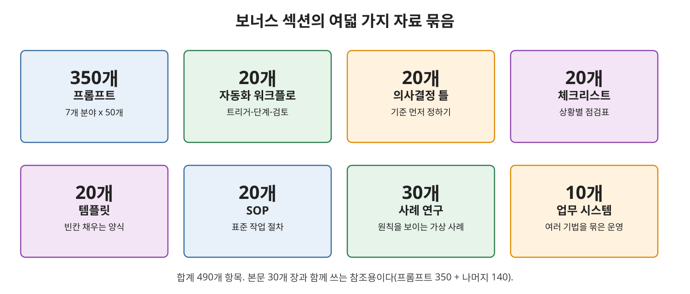

# 보너스 섹션 개요 (Bonus)

Cade Corwin의 『Mastering Claude AI』 맨 뒤에는 30개 본문 장과 별도로 붙은 참조용 자료집이 있다. 프롬프트 350개, 자동화 워크플로 20개, 의사결정 틀 20개, 체크리스트 20개, 템플릿 20개, SOP 20개, 사례 연구 30개, 완결된 업무 시스템 10개가 들어 있고, 끝에는 저자의 맺음말이 따른다. 원서로는 418쪽부터 464쪽까지다.

저자는 이 섹션을 처음부터 끝까지 읽는 용도가 아니라, 구체적인 일이 생길 때마다 찾아서 꺼내 쓰는 용도로 설계했다. 이 노트는 항목 전체를 옮기지 않고, 범주별 구성과 대표 예시와 쓰는 법을 정리한다. 가격이나 기능 이름은 책이 쓰인 시점 기준이고, 사례는 저자가 지어낸 가상 사례다.

> **이 섹션을 한 문장으로**
> 보너스는 답안지가 아니라 틀 모음이다. 대괄호를 내 상황으로 채우고 본문 5장의 맥락을 더해야 비로소 쓸 만해진다.

---

## 1. 핵심 요점

- **구성**: 프롬프트가 7개 분야에 각 50개씩 350개이고, 나머지 일곱 묶음이 합쳐 140개다. 모두 본문 장의 원칙을 가리키는 쪽수 표시를 달고 있다.
- **쓰는 방식**: 프롬프트의 대괄호 자리표시자를 실제 상황으로 바꾸고, 5장에서 배운 대로 문서, 예시, 숫자를 붙여서 쓴다.
- **공통 안전장치**: 20개 자동화 워크플로는 거의 모두 마지막 단계가 사람의 검토이며, 검토 없는 자동 발송을 금지한다.
- **기준 먼저**: 20개 의사결정 틀은 17장의 원칙대로 비교하기 전에 기준과 가중치를 먼저 정한다.
- **사례는 원칙의 그림**: 30개 사례는 실제 기업이 아니라 원칙 하나를 보이려고 만든 가상 합성 사례다.
- **시스템은 조립품**: 10개 업무 시스템은 여러 장의 기법을 하나의 운영으로 묶은 것이며, 한 번 만들고 유지 리듬(29장)대로 돌보라고 한다.
- **맺음말**: 이 책의 목표는 책이 습관 속으로 사라지는 것이며, 끝까지 붙잡을 틀은 과제, 맥락, 형식, 예시의 네 재료다.

## 2. 문서 목록

- [핵심 정리](%ED%95%B5%EC%8B%AC%20%EC%A0%95%EB%A6%AC.md) - 보너스 전체의 요점과 쓰는 순서를 한 장으로 정리한다.
- [프롬프트 모음 요약](%ED%94%84%EB%A1%AC%ED%94%84%ED%8A%B8%20%EB%AA%A8%EC%9D%8C%20%EC%9A%94%EC%95%BD.md) - 7개 분야 350개 프롬프트의 구성, 대표 예시, 활용법.
- [자동화 워크플로와 의사결정 틀](%EC%9E%90%EB%8F%99%ED%99%94%20%EC%9B%8C%ED%81%AC%ED%94%8C%EB%A1%9C%EC%99%80%20%EC%9D%98%EC%82%AC%EA%B2%B0%EC%A0%95%20%ED%8B%80.md) - 워크플로 20개와 의사결정 틀 20개의 구조.
- [체크리스트와 템플릿과 SOP](%EC%B2%B4%ED%81%AC%EB%A6%AC%EC%8A%A4%ED%8A%B8%EC%99%80%20%ED%85%9C%ED%94%8C%EB%A6%BF%EA%B3%BC%20SOP.md) - 점검표, 양식, 표준 절차 각 20개.
- [사례 연구와 업무 시스템](%EC%82%AC%EB%A1%80%20%EC%97%B0%EA%B5%AC%EC%99%80%20%EC%97%85%EB%AC%B4%20%EC%8B%9C%EC%8A%A4%ED%85%9C.md) - 가상 사례 30개와 업무 시스템 10개.
- [저자의 맺음말](%EC%A0%80%EC%9E%90%EC%9D%98%20%EB%A7%BA%EC%9D%8C%EB%A7%90.md) - 감사 인사, 후기 요청, 마지막 당부.

 
 
 

[Mastering Claude AI](../)
