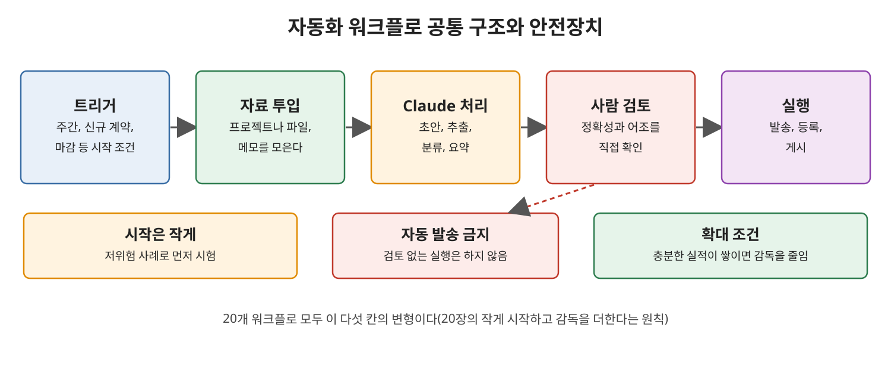

# 자동화 워크플로와 의사결정 틀

보너스의 두 번째와 세 번째 묶음은 자동화 워크플로 20개와 의사결정 틀 20개다. 원서로는 443쪽부터 447쪽까지다. 앞쪽은 20장의 "작게 시작하고 감독을 더한다"는 원칙을, 뒤쪽은 17장의 "비교하기 전에 기준과 가중치를 정한다"는 원칙을 따른다. 이 문서는 두 묶음의 구조와 항목별 핵심을 정리한다.

저자는 워크플로의 도구와 커넥터(connector, Claude를 외부 서비스에 잇는 연결 장치)는 지금 계정에서 쓸 수 있는 것에 맞춰 바꾸라고 당부한다. 책이 쓰인 시점의 기능과 다를 수 있다.

---

## 1. 자동화 워크플로 20개



모든 워크플로가 같은 틀을 쓴다. 시작 조건(Trigger)이 있고, 몇 단계의 처리를 하며, 마지막에 사람이 검토한다. 책은 일부 항목에 "검토 없이 자동 발송하지 않는다"는 안전장치(Guardrail)를 명시했고, 20개 모두 사람 확인 단계를 포함한다.

| 번호와 이름 | 시작 조건 | 처리와 사람 검토 |
|---|---|---|
| 1. 주간 보고 조립 | 주말 | 지표를 프로젝트에 모아 지난주 양식 대비 초안 작성, 사람이 검토 후 발송 |
| 2. 고객 온보딩 문서 | 신규 고객 계약 | 접수 답변을 고객 유형 컨텍스트 패킷에 넣어 환영 자료, 첫 미팅 안건, 초기 브리프를 아티팩트로 생성, 검토 후 발송 |
| 3. 받은편지함 분류 초안 | 매일 | 메시지 묶음의 분류와 우선순위 제안, 사람이 확인하기 전에는 어떤 조치도 하지 않음 |
| 4. 회의록의 할 일 추출 | 회의 후 | 노트나 녹취에서 담당자와 기한이 있는 할 일 추출, 정확성 확인 후 공유 보드에 게시 |
| 5. 콘텐츠 재가공 | 긴 글 게시 | 소셜 글 3-5개, 이메일 문구 1개, 짧은 영상 개요 1개 생성, 어조 확인 후 예약 |
| 6. 반복 데이터 정리 | 새 데이터 수령 | 16장의 표준 정리 목록 실행, 판단이 필요한 문제는 표시하고 승인 후에만 분석 |
| 7. 계약서 1차 검토 | 새 계약 수령 | 핵심 조건, 기한, 위험 조항 추출(10장), 표시된 항목은 사람이나 법무가 검토 |
| 8. 주간 조사 요약 | 매주 | 정해진 주제의 동향을 검색하고 이견을 표시해 종합(15장), 검토 후 배포 |
| 9. 고객 피드백 종합 | 매월 또는 설문 종료 | 응답에서 주요 주제와 대표 인용 추출, 이해관계자 공유 전 사람이 확인 |
| 10. 초안에서 게시까지 블로그 | 개요 승인 | 절 단위 작성(12장)과 구조적 수정, 사람이 최종 읽고 게시 |
| 11. 미납 청구서 독촉 초안 | 청구서 X일 연체 | 연체 정도에 맞춘 어조의 메일 초안, 고액이나 민감 계정은 특히 사람이 검토 후 발송 |
| 12. 신규 입사자 자료 | 입사일 확정 | 직무별 체크리스트와 환영문을 표준 양식에서 생성, 인사팀이 개인화해 발송 |
| 13. 경쟁사 모니터링 | 매주 또는 매월 | 지정한 경쟁사의 공개 동향을 짧은 브리프로, 사내 배포 전 정확성 확인 |
| 14. 표준 제안서 조립 | 새 적격 리드 | 리드 정보를 제안서 프로젝트에 넣고 표준 양식으로 초안, 영업 담당이 고쳐서 발송 |
| 15. 버그 신고 분류 | 새 버그 접수 | 심각도와 범주 제안, 개발 리드가 확인한 뒤 스프린트에 진입 |
| 16. 분기 사업 검토 준비 | 분기 말 | 데이터와 메모를 모아 서술과 슬라이드 개요 초안, 발표자가 검토하고 다듬음 |
| 17. 소셜 콘텐츠 캘린더 | 월초 | 브랜드 어조 브리프로 한 달치 아이디어 생성, 마케팅 리드가 선택, 수정, 예약 |
| 18. 퇴사 문서 | 사직 접수 | 인수인계 체크리스트와 지식 이전 문서 양식 생성, 관리자가 검토하고 맞춤 수정 |
| 19. 반복 공급사 비교 | 계약 갱신 시기 | 현 조건과 시장 대안 비교(10장), 협상 전에 구매 담당이 검토 |
| 20. 개인 주간 회고 | 금요일 오후 | 한 주의 완료 작업과 메모로 개인 양식에 맞춘 회고 초안(29장), 본인이 읽고 되짚은 뒤 보관 |

비즈니스 예시로 1번을 보자. 마케팅 컨설팅 회사가 금요일마다 고객별 지표를 프로젝트에 모아 두면, Claude가 지난주 양식에 맞춰 요약 초안을 만든다. 담당자가 숫자를 대조하고 고쳐서 직접 보낸다. 자동 발송은 하지 않는다.

## 2. 워크플로를 쓰는 순서

1. **시작 조건을 정한다.** 매주, 신규 접수처럼 사건이나 날짜로 명확히 정의한다.
2. **저위험 사례로 시험한다.** 처음에는 틀려도 피해가 적은 실제 사례에서 돌려 본다.
3. **사람 확인 관문을 둔다.** 발송, 게시, 접수 같은 되돌리기 어려운 동작 직전에 사람이 본다.
4. **실적을 모은다.** 일정 횟수 정확했다는 증거가 쌓이면 일상적인 범주에 한해 감독을 줄인다.

참고(노트 작성자): 3번(받은편지함 분류)과 11번(독촉 초안)처럼 고객과 닿는 항목은 책이 특별히 "처음에는 자동 발송 금지"를 강조한다. 이 순서는 20장의 원칙과 SOP 8번(새 자동화 도입)을 합쳐 정리한 것이다.

## 3. 의사결정 틀 20개

모두 17장의 원칙을 따른다. 기준을 정하고 가중치를 준 뒤 선택지를 비교하며, 혼자 정하기 어려울 때 Claude에게 후보 기준을 묻거나 점수표를 만들게 한다. 아래 표는 기준과 책이 붙인 주의를 요약한다.

| 번호와 이름 | 기준 | 책의 주의 |
|---|---|---|
| 1. 공급사 선정 | 비용, 신뢰 실적, 연동 용이성, 지원 품질, 계약 유연성 | 비전문가 팀이면 지원 품질에 더 큰 가중치 |
| 2. 채용 | 직무 적합, 가치 일치, 성장 궤적, 검증 가능한 실적, 보상 적합 | 결정 전에 2순위 후보를 가장 강하게 변호해 본다 |
| 3. 새 프로젝트 진행 여부 | 전략 적합, 자원, 기대 수익, 대신 미루는 일의 기회비용, 실패 위험 | 평가 전에 "안 한다" 기준선을 정해 원하는 결론에 끼워 맞추는 추론을 막는다 |
| 4. 가격 모델 | 지불 의사, 경쟁 위치, 마진 영향, 운영 복잡도, 공정하다는 인식 | 소규모 팀이면 복잡도에 큰 가중치 |
| 5. 만들까 살까 | 총소유비용, 가치 실현 시간, 맞춤 필요, 내부 전문성, 장기 유지 부담 | - |
| 6. 자동화 후보 | 빈도, 작업 구조의 일관성, 수작업 반복 비용, 개별 판단 필요(역가중) | 20장의 기준 |
| 7. 콘텐츠 주제 우선순위 | 독자 수요 신호, 경쟁 공백, 내부 전문성, 핵심 메시지 부합 | - |
| 8. 출근과 원격 정책 | 협업 필요, 인재 풀 접근, 비용 영향, 직원 선호 자료, 문화 형성 | - |
| 9. 기능 우선순위 | 사용자 영향(폭과 깊이), 개발 비용, 전략 부합, 긴급성과 경쟁 압력 | - |
| 10. 고객 수락 | 전략 적합, 수익성, 팀 여력, 관계 위험, 평판 적합 | - |
| 11. 투자와 지출 승인 | 기대 수익, 회수 기간, 틀렸을 때의 위험, 기회비용, 되돌릴 수 있는지 | - |
| 12. 제휴 평가 | 독자 겹침과 보완성, 브랜드 정렬, 파트너 신뢰 실적, 장기 관계 가능성 | - |
| 13. 지역과 시장 확장 | 시장 규모, 경쟁 강도, 규제 복잡도, 운영 준비, 문화와 언어 적합 | - |
| 14. 도구 도입 | 지금 실제 불편을 푸는가, 팀 학습 곡선, 기존 환경과 연동, 가치 대비 비용 | - |
| 15. 구조조정 우선순위 | 직무 핵심도, 성과 이력, 다른 직무와의 중복, 법적 공정성 | 각별한 주의와 사람 판단 필요, 항상 인사와 법무 검토와 함께 |
| 16. 개인 진로 | 성장 가능성, 보상, 장기 목표 부합, 일과 삶의 균형, 위험 감수 성향 | - |
| 17. 큰 구매 | 필요와 욕구의 구분, 총소유비용, 포기하는 대안, 재판매와 되돌림 | - |
| 18. 갈등 해결 접근 | 관계 중요도, 긴급도, 직접 대화로 풀릴 가능성 대 상향 보고, 남길 선례 | - |
| 19. 위임 | 과제 복잡도, 팀의 현재 역량, 위임받는 사람의 성장 기회, 불완전할 때의 위험 | - |
| 20. 게시할지 말지 | 사실 정확성 확신, 해악과 오해 가능성, 법적과 평판 위험, 독자에게 주는 진짜 가치 | 정확성과 해악 가능성에 큰 가중치, 기본값은 사람 검토로 올리기 |

대화 예시를 하나 들면 이렇다.

```text
나: 새 클라이언트를 받을지 정하려 해. 기준은 전략 적합, 수익성,
    팀 여력, 관계 위험, 평판 적합이고 가중치는 10점 만점으로 내가 줄게.
    두 후보를 점수표로 비교하고 점수가 낮은 쪽의 가장 강한 논거도 써 줘.
```

## 4. 흔한 실수와 문제 해결

| 실수 | 증상 | 대응 |
|---|---|---|
| 선택지부터 본다 | 이미 마음에 둔 쪽에 맞게 기준을 끼워 맞춘다 | 기준과 "안 한다" 기준선을 먼저 적는다 |
| 결과가 직관과 다르다 | 점수표 1위가 어딘가 아니다 | 빠진 기준이 있는지 찾는다(사례 13) |
| 자동 발송을 풀어 준다 | 검토 없는 실수가 외부로 나간다 | 실적이 쌓이기 전에는 사람 확인을 유지한다 |

## 5. 장 요약

- 워크플로 20개는 시작 조건, 처리, 사람 검토의 공통 구조이며 자동 발송을 하지 않는다.
- 감독은 실적이 쌓인 일상 범주에만 줄인다.
- 의사결정 틀 20개는 기준과 가중치를 먼저 정하고, 구조조정과 게시 여부처럼 민감한 것은 사람 검토를 기본으로 한다.

## 6. 실행 체크리스트

- [ ] 반복하는 일 하나를 골라 시작 조건과 사람 확인 지점을 적었다.
- [ ] 자주 내리는 결정 유형 한 가지의 기준과 가중치를 적어 두었다.
- [ ] 점수 결과가 직관과 다르면 빠진 기준부터 점검하기로 했다.

<br>
<br>
<br>

[Mastering Claude AI](../)
