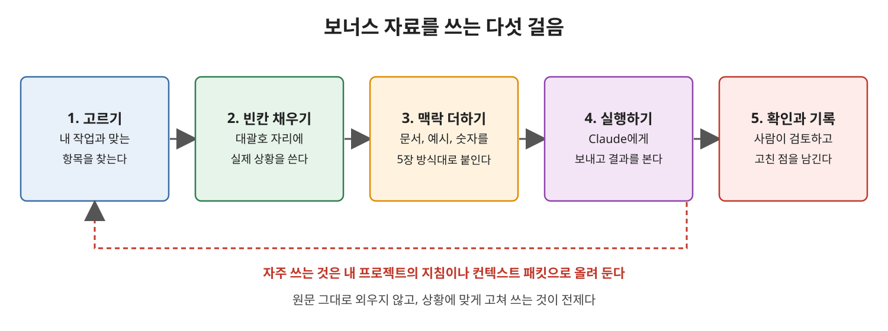

# 프롬프트 모음 요약 (350개 Ready-to-Use Prompts)

보너스의 첫 묶음은 업무, 마케팅, 글쓰기, 코딩, 조사, 교육, 생산성의 일곱 분야에 각 50개씩, 모두 350개의 프롬프트다. 원서의 418쪽부터 442쪽까지를 차지한다. 이 문서는 목록을 통째로 옮기지 않고, 분야별 구성과 대표 예시와 쓰는 법을 정리한다. 대표 예시는 원문을 한국어로 풀어 다시 쓴 것이다.

저자는 앞머리에서 두 가지를 전제로 못 박는다. 이 자료는 처음부터 끝까지 읽는 용도가 아니라 필요한 일이 생길 때 찾아 꺼내 쓰는 용도이고, 모든 프롬프트의 대괄호 자리표시자(placeholder, 내 상황으로 바꿔 넣을 빈칸)는 실제 상황으로 채워야 하며 5장의 방식대로 문서, 예시, 숫자 같은 진짜 맥락을 더해야 한다는 것이다.

---

## 1. 분야별 구성

| 분야(원서 쪽) | 무엇을 다루나 | 눈에 띄는 특징 |
|---|---|---|
| 업무 Business (418) | 요약, 메일, 회의, 인사, 계약, 보고 | 결정부터 먼저 말하기, 과하게 사과하지 않기 |
| 마케팅 Marketing (422) | 헤드라인, 이메일 시퀀스, 광고, 소셜, 발표문 | 각도가 진짜로 다른 여러 안, 솔직한 긴박감 |
| 글쓰기 Writing (425) | 개요, 첫 문장, 고쳐 쓰기, 어조 바꾸기, 연설문 | 군더더기 서두 금지, 특정 상황과 사실 근거 |
| 코딩 Coding (429) | 스크립트, 디버깅, 리팩터링, 테스트, 보안 검토 | 오류 문구와 코드와 기대 동작을 한꺼번에 제공 |
| 조사 Research (432) | 질문 구성, 출처 비교, 주장 검증, 요약 | 출처 종류 표시, 이견과 불확실성 보존 |
| 교육 Education (436) | 설명, 퀴즈, 수업 계획, 루브릭, 학습 가이드 | 비유와 단계별 풀이, 이유까지 설명 |
| 생산성 Productivity (439) | 우선순위, 템플릿, 회고, 위임, 주간 점검 | 막힘의 진짜 원인 찾기, 충분히 좋은 수준 정하기 |

## 2. 분야별 대표 예시

각 분야에서 하나씩 골랐다. 대괄호는 그대로 둔 자리표시자다.

1. **업무**: "첨부한 보고서의 한 페이지 경영 요약을 써 줘. 읽는 사람은 90초밖에 없다고 가정해."
2. **마케팅**: "[제품 또는 제안]의 헤드라인 다섯 개를 써 줘. 각각 전략적으로 정말 다른 각도여야 한다."
3. **글쓰기**: "[주제]에 대한 에세이 첫 문단을 써 줘. 서두에서 뜸 들이지 말고 곧바로 요점으로 들어가."
4. **코딩**: "이 오류를 디버깅해 줘. 정확한 오류 문구와 코드와 내가 기대한 동작을 모두 붙인다."
5. **조사**: "이 다섯 출처를 하나의 요약으로 종합하되, 서로 어긋나는 부분을 표시해 줘."
6. **교육**: "[개념]을 완전 초보자에게 설명해 줘. 실생활 비유를 하나 써서."
7. **생산성**: "이 크고 막연한 목표를 작고 범위가 분명한 단계의 순서로 쪼개 줘: [목표]."
8. **생산성(자기 시스템)**: "29장의 틀에 따라, 내 시스템을 주기적으로 점검하고 고치는 개인 유지 리듬을 짜 줘."

여덟 번째는 생산성 분야의 마지막(50번) 항목이며, 보너스가 본문 29장과 짝을 이룬다는 점을 보여 준다.

## 3. 프롬프트에서 발견되는 공통 패턴

350개를 훑으면 같은 설계 원리가 반복된다. 이 패턴을 알아 두면 목록에 없는 일도 스스로 프롬프트로 만들 수 있다.

- **독자와 분량을 못 박는다.** "90초밖에 없는 독자", "100단어 이내", "280자 이하"처럼 받는 사람과 길이를 먼저 정한다.
- **금지할 습관을 말한다.** "과하게 사과하지 말고", "서두에서 뜸 들이지 말고", "조작적이지 않게"처럼 피해야 할 흔한 실패를 미리 막는다.
- **여러 안을 요구하되 달라야 한다고 못 박는다.** 헤드라인, 제목, 비유를 각각 "다른 각도"로 요구해 겉만 다른 변형을 막는다.
- **재료를 함께 준다.** 계약서, 노트, 오류 문구, 이전 문체 예시 같은 실제 자료를 붙이라고 안내한다.
- **검증을 요구한다.** 조사 분야는 출처의 종류를 적게 하고, 잘 확립된 주장과 아직 논쟁 중인 주장을 나누게 한다.
- **재사용 틀을 만들게 한다.** 일회성 답이 아니라 다음에도 쓸 템플릿, 구조, 체크리스트를 뽑게 하는 항목이 많다.

## 4. 활용법

1. **내 작업과 같은 분야에서 찾는다.** 키워드(요약, 협상, 디버깅 등)로 쉽게 찾을 수 있다. 이 노트의 분야별 표가 색인 구실을 한다.
2. **빈칸을 채운다.** 대괄호를 실제 사람, 기간, 제품, 상황으로 바꾼다. 비워 두면 일반론이 돌아온다.
3. **맥락을 더한다.** 5장의 맥락 패킷(context packet, 목표와 예시와 제약을 묶은 입력 묶음) 방식대로 좋은 예시 두세 개와 피할 예시 하나를 붙인다.
4. **결과를 검증한다.** 숫자, 인용, 법률 내용은 직접 확인한다. 특히 대외 공개 문서와 계약은 사람이 마지막으로 읽는다.
5. **잘 먹힌 것은 올려 둔다.** 자주 쓸 프롬프트는 프로젝트(Project) 지침이나 컨텍스트 패킷에 저장해 다음에 다시 찾지 않게 한다.

## 5. 자주 하는 실수와 대응

| 실수 | 왜 문제인가 | 대응 |
|---|---|---|
| 대괄호를 비운 채 보낸다 | 일반론이 돌아와 쓸모가 없다 | 사람, 기간, 제품을 구체적으로 채운다 |
| 목록을 그대로 외우려 한다 | 상황이 바뀌면 쓸 수 없다 | 공통 패턴을 익히고 필요할 때 찾는다 |
| 결과를 검증 없이 보낸다 | 틀린 숫자와 어색한 어조가 나간다 | 체크리스트의 보내기 전 점검을 쓴다 |

## 6. 장 요약

- 프롬프트 350개는 7개 분야 x 50개이며, 분야마다 독자, 분량, 금지 습관, 재료, 검증의 설계 원리가 반복된다.
- 대괄호를 채우고 5장식 맥락을 더해야 쓸 만해진다.
- 잘 되는 프롬프트는 프로젝트 지침으로 올려 재사용한다.
- 마지막 생산성 프롬프트는 29장의 유지 리듬과 연결된다.

## 7. 실행 체크리스트

- [ ] 이번 주 반복하는 일 하나를 골라 해당 분야의 프롬프트 한 개를 채워 보냈다.
- [ ] 결과에서 숫자와 사실을 직접 검증했다.
- [ ] 잘 먹힌 프롬프트를 프로젝트 지침이나 노트에 저장했다.
- [ ] 목록에 없는 일을 위해 공통 패턴 하나(독자와 분량 정하기 등)를 적용해 직접 프롬프트를 만들었다.

 
 
 

[Mastering Claude AI](../)
