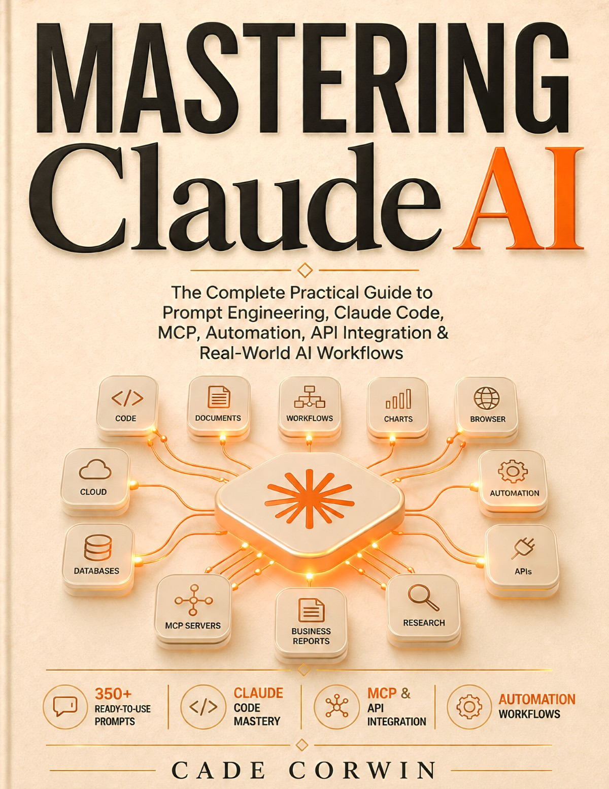
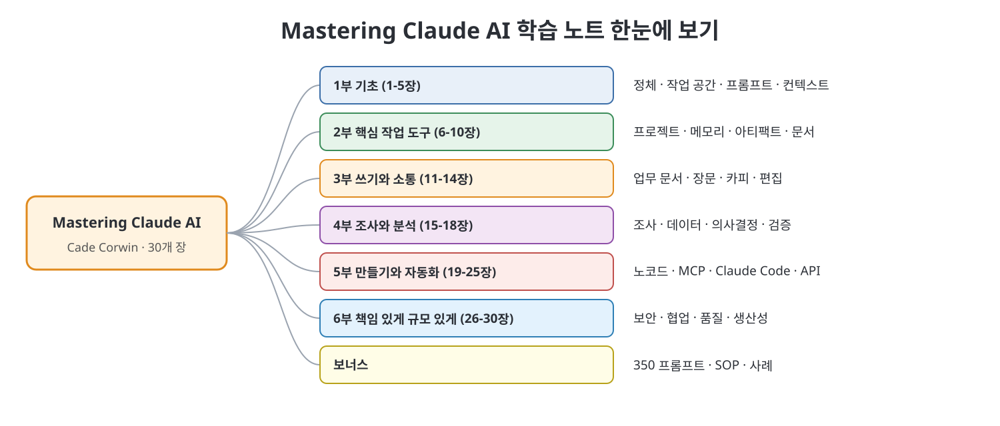

# **Mastering Claude AI 학습 노트**
(Mastering Claude AI: The Complete Practical Guide to Prompt Engineering, Projects, Artifacts, Claude Code, MCP, Automation, API, 장별 정리 노트)
<br>

<p align="center"></p>
<br>
<br>

이 문서는 Cade Corwin의 『Mastering Claude AI: The Complete Practical Guide to Prompt Engineering, Projects, Artifacts, Claude Code, MCP, Automation, API Integration & Real-World AI Workflows』를 장별로 정리한 한국어 학습 노트입니다. 원문을 번역한 것이 아니라 내용을 우리말로 풀어서 다시 설명했고, 처음 나오는 용어에는 쉬운 풀이를 붙였습니다. 책은 Claude가 무엇이고 무엇이 아닌지에서 출발해 작업 공간 설정, 프롬프트와 컨텍스트 엔지니어링, 프로젝트와 메모리와 아티팩트, 쓰기와 조사와 데이터 분석, 노코드 만들기와 자동화와 MCP와 Claude Code와 API, 보안과 팀 협업과 품질 관리까지 6개 부 30개 장으로 안내합니다. 장마다 학습 목표, 레슨, 비즈니스 예시, 연습, 흔한 실수, 체크리스트가 있고, 끝에 350개 프롬프트와 SOP와 사례를 모은 보너스가 있습니다. 이 노트는 책의 부 구성을 그대로 따라 부마다 폴더 하나로 정리했고, 이해를 돕기 위해 표와 직접 그린 그림을 넣었습니다.

<p align="center"></p>

> **이 노트를 읽을 때 유의할 점**
> - 이 노트는 원서의 **요약·해설본**이며 원서를 대신하지 않습니다. 화면 구성, 요금제, 기능 이름처럼 자주 바뀌는 내용은 반드시 Anthropic 공식 문서에서 확인하세요.
> - 원서의 프롬프트와 예시는 취지를 살려 우리말로 옮겼습니다. 보너스의 350개 프롬프트는 전부 옮기지 않고 범주별 대표 예시만 정리했습니다.
> - 책에 없는 보충 설명은 `참고(노트 작성자)`로 따로 표시했습니다.
> - 원서의 그림 자리표시(Visual Diagram Placeholder)에는 내용이 없어, 본문을 바탕으로 새로 그린 그림을 넣었습니다. 표지 이미지만 책 소개용으로 넣었습니다.
> - 책이 쓰인 시점의 기능과 요금제 기준입니다. 지금과 다를 수 있습니다.
<br>

---

## 목차

- [00. 머리말과 이 책에 대하여](00.%20%EB%A8%B8%EB%A6%AC%EB%A7%90%EA%B3%BC%20%EC%9D%B4%20%EC%B1%85%EC%97%90%20%EB%8C%80%ED%95%98%EC%97%AC/Readme.md) — 책의 정체, 대상 독자, 약속, 학습 로드맵, 장별 목표

### 1부 기초 (1-5장)

- [01. 1부 기초](01.%201%EB%B6%80%20%EA%B8%B0%EC%B4%88/Readme.md) — Claude의 정체와 한계, 작업 공간, 대화 인터페이스, 프롬프트 기본기, 컨텍스트 엔지니어링
  - [핵심 정리](01.%201%EB%B6%80%20%EA%B8%B0%EC%B4%88/%ED%95%B5%EC%8B%AC%20%EC%A0%95%EB%A6%AC.md)
  - [01장 Claude의 정체와 한계](01.%201%EB%B6%80%20%EA%B8%B0%EC%B4%88/01%EC%9E%A5%20Claude%EC%9D%98%20%EC%A0%95%EC%B2%B4%EC%99%80%20%ED%95%9C%EA%B3%84.md)
  - [02장 작업 공간 제대로 세우기](01.%201%EB%B6%80%20%EA%B8%B0%EC%B4%88/02%EC%9E%A5%20%EC%9E%91%EC%97%85%20%EA%B3%B5%EA%B0%84%20%EC%A0%9C%EB%8C%80%EB%A1%9C%20%EC%84%B8%EC%9A%B0%EA%B8%B0.md)
  - [03장 대화 인터페이스 제대로 이해하기](01.%201%EB%B6%80%20%EA%B8%B0%EC%B4%88/03%EC%9E%A5%20%EB%8C%80%ED%99%94%20%EC%9D%B8%ED%84%B0%ED%8E%98%EC%9D%B4%EC%8A%A4%20%EC%A0%9C%EB%8C%80%EB%A1%9C%20%EC%9D%B4%ED%95%B4%ED%95%98%EA%B8%B0.md)
  - [04장 프롬프트 기본기](01.%201%EB%B6%80%20%EA%B8%B0%EC%B4%88/04%EC%9E%A5%20%ED%94%84%EB%A1%AC%ED%94%84%ED%8A%B8%20%EA%B8%B0%EB%B3%B8%EA%B8%B0.md)
  - [05장 컨텍스트 엔지니어링](01.%201%EB%B6%80%20%EA%B8%B0%EC%B4%88/05%EC%9E%A5%20%EC%BB%A8%ED%85%8D%EC%8A%A4%ED%8A%B8%20%EC%97%94%EC%A7%80%EB%8B%88%EC%96%B4%EB%A7%81.md)

### 2부 핵심 작업 도구 (6-10장)

- [02. 2부 핵심 작업 도구](02.%202%EB%B6%80%20%ED%95%B5%EC%8B%AC%20%EC%9E%91%EC%97%85%20%EB%8F%84%EA%B5%AC/Readme.md) — 프로젝트, 메모리, 아티팩트, 지식 관리, 긴 문서와 PDF 분석
  - [핵심 정리](02.%202%EB%B6%80%20%ED%95%B5%EC%8B%AC%20%EC%9E%91%EC%97%85%20%EB%8F%84%EA%B5%AC/%ED%95%B5%EC%8B%AC%20%EC%A0%95%EB%A6%AC.md)
  - [06장 프로젝트](02.%202%EB%B6%80%20%ED%95%B5%EC%8B%AC%20%EC%9E%91%EC%97%85%20%EB%8F%84%EA%B5%AC/06%EC%9E%A5%20%ED%94%84%EB%A1%9C%EC%A0%9D%ED%8A%B8.md)
  - [07장 메모리](02.%202%EB%B6%80%20%ED%95%B5%EC%8B%AC%20%EC%9E%91%EC%97%85%20%EB%8F%84%EA%B5%AC/07%EC%9E%A5%20%EB%A9%94%EB%AA%A8%EB%A6%AC.md)
  - [08장 아티팩트](02.%202%EB%B6%80%20%ED%95%B5%EC%8B%AC%20%EC%9E%91%EC%97%85%20%EB%8F%84%EA%B5%AC/08%EC%9E%A5%20%EC%95%84%ED%8B%B0%ED%8C%A9%ED%8A%B8.md)
  - [09장 지식 관리](02.%202%EB%B6%80%20%ED%95%B5%EC%8B%AC%20%EC%9E%91%EC%97%85%20%EB%8F%84%EA%B5%AC/09%EC%9E%A5%20%EC%A7%80%EC%8B%9D%20%EA%B4%80%EB%A6%AC.md)
  - [10장 긴 문서와 PDF 분석 워크플로](02.%202%EB%B6%80%20%ED%95%B5%EC%8B%AC%20%EC%9E%91%EC%97%85%20%EB%8F%84%EA%B5%AC/10%EC%9E%A5%20%EA%B8%B4%20%EB%AC%B8%EC%84%9C%EC%99%80%20PDF%20%EB%B6%84%EC%84%9D%20%EC%9B%8C%ED%81%AC%ED%94%8C%EB%A1%9C.md)

### 3부 쓰기와 소통 (11-14장)

- [03. 3부 쓰기와 소통](03.%203%EB%B6%80%20%EC%93%B0%EA%B8%B0%EC%99%80%20%EC%86%8C%ED%86%B5/Readme.md) — 업무 문서, 장문 글쓰기, 마케팅 카피, 편집과 문체 맞추기
  - [핵심 정리](03.%203%EB%B6%80%20%EC%93%B0%EA%B8%B0%EC%99%80%20%EC%86%8C%ED%86%B5/%ED%95%B5%EC%8B%AC%20%EC%A0%95%EB%A6%AC.md)
  - [11장 업무 문서 쓰기](03.%203%EB%B6%80%20%EC%93%B0%EA%B8%B0%EC%99%80%20%EC%86%8C%ED%86%B5/11%EC%9E%A5%20%EC%97%85%EB%AC%B4%20%EB%AC%B8%EC%84%9C%20%EC%93%B0%EA%B8%B0.md)
  - [12장 장문 글쓰기](03.%203%EB%B6%80%20%EC%93%B0%EA%B8%B0%EC%99%80%20%EC%86%8C%ED%86%B5/12%EC%9E%A5%20%EC%9E%A5%EB%AC%B8%20%EA%B8%80%EC%93%B0%EA%B8%B0.md)
  - [13장 마케팅 카피와 캠페인](03.%203%EB%B6%80%20%EC%93%B0%EA%B8%B0%EC%99%80%20%EC%86%8C%ED%86%B5/13%EC%9E%A5%20%EB%A7%88%EC%BC%80%ED%8C%85%20%EC%B9%B4%ED%94%BC%EC%99%80%20%EC%BA%A0%ED%8E%98%EC%9D%B8.md)
  - [14장 편집과 문체 맞추기와 AI 티 지우기](03.%203%EB%B6%80%20%EC%93%B0%EA%B8%B0%EC%99%80%20%EC%86%8C%ED%86%B5/14%EC%9E%A5%20%ED%8E%B8%EC%A7%91%EA%B3%BC%20%EB%AC%B8%EC%B2%B4%20%EB%A7%9E%EC%B6%94%EA%B8%B0%EC%99%80%20AI%20%ED%8B%B0%20%EC%A7%80%EC%9A%B0%EA%B8%B0.md)

### 4부 조사와 분석 (15-18장)

- [04. 4부 조사와 분석](04.%204%EB%B6%80%20%EC%A1%B0%EC%82%AC%EC%99%80%20%EB%B6%84%EC%84%9D/Readme.md) — 조사 워크플로, 데이터 분석, 의사결정 틀, 사실 확인과 검증
  - [핵심 정리](04.%204%EB%B6%80%20%EC%A1%B0%EC%82%AC%EC%99%80%20%EB%B6%84%EC%84%9D/%ED%95%B5%EC%8B%AC%20%EC%A0%95%EB%A6%AC.md)
  - [15장 믿을 만한 조사 워크플로](04.%204%EB%B6%80%20%EC%A1%B0%EC%82%AC%EC%99%80%20%EB%B6%84%EC%84%9D/15%EC%9E%A5%20%EB%AF%BF%EC%9D%84%20%EB%A7%8C%ED%95%9C%20%EC%A1%B0%EC%82%AC%20%EC%9B%8C%ED%81%AC%ED%94%8C%EB%A1%9C.md)
  - [16장 데이터 분석과 스프레드시트](04.%204%EB%B6%80%20%EC%A1%B0%EC%82%AC%EC%99%80%20%EB%B6%84%EC%84%9D/16%EC%9E%A5%20%EB%8D%B0%EC%9D%B4%ED%84%B0%20%EB%B6%84%EC%84%9D%EA%B3%BC%20%EC%8A%A4%ED%94%84%EB%A0%88%EB%93%9C%EC%8B%9C%ED%8A%B8.md)
  - [17장 의사결정 틀과 비교](04.%204%EB%B6%80%20%EC%A1%B0%EC%82%AC%EC%99%80%20%EB%B6%84%EC%84%9D/17%EC%9E%A5%20%EC%9D%98%EC%82%AC%EA%B2%B0%EC%A0%95%20%ED%8B%80%EA%B3%BC%20%EB%B9%84%EA%B5%90.md)
  - [18장 사실 확인과 검증](04.%204%EB%B6%80%20%EC%A1%B0%EC%82%AC%EC%99%80%20%EB%B6%84%EC%84%9D/18%EC%9E%A5%20%EC%82%AC%EC%8B%A4%20%ED%99%95%EC%9D%B8%EA%B3%BC%20%EA%B2%80%EC%A6%9D.md)

### 5부 만들기와 자동화 (19-25장)

- [05. 5부 만들기와 자동화](05.%205%EB%B6%80%20%EB%A7%8C%EB%93%A4%EA%B8%B0%EC%99%80%20%EC%9E%90%EB%8F%99%ED%99%94/Readme.md) — 노코드 만들기, 자동화와 커넥터, MCP, 코딩 입문, Claude Code, 디버깅, API
  - [핵심 정리](05.%205%EB%B6%80%20%EB%A7%8C%EB%93%A4%EA%B8%B0%EC%99%80%20%EC%9E%90%EB%8F%99%ED%99%94/%ED%95%B5%EC%8B%AC%20%EC%A0%95%EB%A6%AC.md)
  - [19장 노코드 만들기](05.%205%EB%B6%80%20%EB%A7%8C%EB%93%A4%EA%B8%B0%EC%99%80%20%EC%9E%90%EB%8F%99%ED%99%94/19%EC%9E%A5%20%EB%85%B8%EC%BD%94%EB%93%9C%20%EB%A7%8C%EB%93%A4%EA%B8%B0.md)
  - [20장 자동화 입문 스킬 커넥터 재사용 동작](05.%205%EB%B6%80%20%EB%A7%8C%EB%93%A4%EA%B8%B0%EC%99%80%20%EC%9E%90%EB%8F%99%ED%99%94/20%EC%9E%A5%20%EC%9E%90%EB%8F%99%ED%99%94%20%EC%9E%85%EB%AC%B8%20%EC%8A%A4%ED%82%AC%20%EC%BB%A4%EB%84%A5%ED%84%B0%20%EC%9E%AC%EC%82%AC%EC%9A%A9%20%EB%8F%99%EC%9E%91.md)
  - [21장 MCP 쉽게 이해하기](05.%205%EB%B6%80%20%EB%A7%8C%EB%93%A4%EA%B8%B0%EC%99%80%20%EC%9E%90%EB%8F%99%ED%99%94/21%EC%9E%A5%20MCP%20%EC%89%BD%EA%B2%8C%20%EC%9D%B4%ED%95%B4%ED%95%98%EA%B8%B0.md)
  - [22장 코딩 입문 경로](05.%205%EB%B6%80%20%EB%A7%8C%EB%93%A4%EA%B8%B0%EC%99%80%20%EC%9E%90%EB%8F%99%ED%99%94/22%EC%9E%A5%20%EC%BD%94%EB%94%A9%20%EC%9E%85%EB%AC%B8%20%EA%B2%BD%EB%A1%9C.md)
  - [23장 Claude Code 에이전트 개발 기초](05.%205%EB%B6%80%20%EB%A7%8C%EB%93%A4%EA%B8%B0%EC%99%80%20%EC%9E%90%EB%8F%99%ED%99%94/23%EC%9E%A5%20Claude%20Code%20%EC%97%90%EC%9D%B4%EC%A0%84%ED%8A%B8%20%EA%B0%9C%EB%B0%9C%20%EA%B8%B0%EC%B4%88.md)
  - [24장 디버깅과 오류 해결](05.%205%EB%B6%80%20%EB%A7%8C%EB%93%A4%EA%B8%B0%EC%99%80%20%EC%9E%90%EB%8F%99%ED%99%94/24%EC%9E%A5%20%EB%94%94%EB%B2%84%EA%B9%85%EA%B3%BC%20%EC%98%A4%EB%A5%98%20%ED%95%B4%EA%B2%B0.md)
  - [25장 Claude API](05.%205%EB%B6%80%20%EB%A7%8C%EB%93%A4%EA%B8%B0%EC%99%80%20%EC%9E%90%EB%8F%99%ED%99%94/25%EC%9E%A5%20Claude%20API.md)

### 6부 책임 있게 규모 있게 (26-30장)

- [06. 6부 책임 있게 규모 있게](06.%206%EB%B6%80%20%EC%B1%85%EC%9E%84%20%EC%9E%88%EA%B2%8C%20%EA%B7%9C%EB%AA%A8%20%EC%9E%88%EA%B2%8C/Readme.md) — 보안과 개인정보, 팀 협업, 신뢰와 품질 관리, 생산성 시스템, 최신 상태 유지
  - [핵심 정리](06.%206%EB%B6%80%20%EC%B1%85%EC%9E%84%20%EC%9E%88%EA%B2%8C%20%EA%B7%9C%EB%AA%A8%20%EC%9E%88%EA%B2%8C/%ED%95%B5%EC%8B%AC%20%EC%A0%95%EB%A6%AC.md)
  - [26장 보안과 개인정보와 데이터 처리](06.%206%EB%B6%80%20%EC%B1%85%EC%9E%84%20%EC%9E%88%EA%B2%8C%20%EA%B7%9C%EB%AA%A8%20%EC%9E%88%EA%B2%8C/26%EC%9E%A5%20%EB%B3%B4%EC%95%88%EA%B3%BC%20%EA%B0%9C%EC%9D%B8%EC%A0%95%EB%B3%B4%EC%99%80%20%EB%8D%B0%EC%9D%B4%ED%84%B0%20%EC%B2%98%EB%A6%AC.md)
  - [27장 팀 협업과 공유 워크플로](06.%206%EB%B6%80%20%EC%B1%85%EC%9E%84%20%EC%9E%88%EA%B2%8C%20%EA%B7%9C%EB%AA%A8%20%EC%9E%88%EA%B2%8C/27%EC%9E%A5%20%ED%8C%80%20%ED%98%91%EC%97%85%EA%B3%BC%20%EA%B3%B5%EC%9C%A0%20%EC%9B%8C%ED%81%AC%ED%94%8C%EB%A1%9C.md)
  - [28장 신뢰와 검증과 장기 품질 관리](06.%206%EB%B6%80%20%EC%B1%85%EC%9E%84%20%EC%9E%88%EA%B2%8C%20%EA%B7%9C%EB%AA%A8%20%EC%9E%88%EA%B2%8C/28%EC%9E%A5%20%EC%8B%A0%EB%A2%B0%EC%99%80%20%EA%B2%80%EC%A6%9D%EA%B3%BC%20%EC%9E%A5%EA%B8%B0%20%ED%92%88%EC%A7%88%20%EA%B4%80%EB%A6%AC.md)
  - [29장 나만의 생산성 시스템](06.%206%EB%B6%80%20%EC%B1%85%EC%9E%84%20%EC%9E%88%EA%B2%8C%20%EA%B7%9C%EB%AA%A8%20%EC%9E%88%EA%B2%8C/29%EC%9E%A5%20%EB%82%98%EB%A7%8C%EC%9D%98%20%EC%83%9D%EC%82%B0%EC%84%B1%20%EC%8B%9C%EC%8A%A4%ED%85%9C.md)
  - [30장 앞으로 최신 상태 유지하기](06.%206%EB%B6%80%20%EC%B1%85%EC%9E%84%20%EC%9E%88%EA%B2%8C%20%EA%B7%9C%EB%AA%A8%20%EC%9E%88%EA%B2%8C/30%EC%9E%A5%20%EC%95%9E%EC%9C%BC%EB%A1%9C%20%EC%B5%9C%EC%8B%A0%20%EC%83%81%ED%83%9C%20%EC%9C%A0%EC%A7%80%ED%95%98%EA%B8%B0.md)

### 보너스

- [07. 보너스](07.%20%EB%B3%B4%EB%84%88%EC%8A%A4/Readme.md) — 프롬프트 모음, 자동화 워크플로, 의사결정 틀, 체크리스트와 템플릿과 SOP, 사례 연구
  - [핵심 정리](07.%20%EB%B3%B4%EB%84%88%EC%8A%A4/%ED%95%B5%EC%8B%AC%20%EC%A0%95%EB%A6%AC.md)
  - [사례 연구와 업무 시스템](07.%20%EB%B3%B4%EB%84%88%EC%8A%A4/%EC%82%AC%EB%A1%80%20%EC%97%B0%EA%B5%AC%EC%99%80%20%EC%97%85%EB%AC%B4%20%EC%8B%9C%EC%8A%A4%ED%85%9C.md)
  - [자동화 워크플로와 의사결정 틀](07.%20%EB%B3%B4%EB%84%88%EC%8A%A4/%EC%9E%90%EB%8F%99%ED%99%94%20%EC%9B%8C%ED%81%AC%ED%94%8C%EB%A1%9C%EC%99%80%20%EC%9D%98%EC%82%AC%EA%B2%B0%EC%A0%95%20%ED%8B%80.md)
  - [저자의 맺음말](07.%20%EB%B3%B4%EB%84%88%EC%8A%A4/%EC%A0%80%EC%9E%90%EC%9D%98%20%EB%A7%BA%EC%9D%8C%EB%A7%90.md)
  - [체크리스트와 템플릿과 SOP](07.%20%EB%B3%B4%EB%84%88%EC%8A%A4/%EC%B2%B4%ED%81%AC%EB%A6%AC%EC%8A%A4%ED%8A%B8%EC%99%80%20%ED%85%9C%ED%94%8C%EB%A6%BF%EA%B3%BC%20SOP.md)
  - [프롬프트 모음 요약](07.%20%EB%B3%B4%EB%84%88%EC%8A%A4/%ED%94%84%EB%A1%AC%ED%94%84%ED%8A%B8%20%EB%AA%A8%EC%9D%8C%20%EC%9A%94%EC%95%BD.md)

---

## 읽는 순서 제안

| 목적 | 추천 경로 |
|------|-----------|
| Claude를 처음 쓰고 기본기를 잡고 싶다 | 1부(1장부터 5장) |
| 반복 업무를 프로젝트와 메모리로 정리하고 싶다 | 2부(6장부터 10장) |
| 이메일, 보고서, 마케팅 글을 잘 쓰고 싶다 | 3부(11장부터 14장) |
| 조사, 데이터 분석, 사실 확인을 맡기고 싶다 | 4부(15장부터 18장) |
| 앱을 만들거나 자동화, MCP, Claude Code, API까지 가고 싶다 | 5부(19장부터 25장) |
| 팀에 도입하고 안전하게 운영하고 싶다 | 6부(26장부터 30장) |
| 바로 쓸 프롬프트와 템플릿이 필요하다 | 07 보너스 |

## 용어 몇 가지

| 용어 | 쉬운 설명 |
|------|-----------|
| 컨텍스트 윈도우 | Claude가 한 번에 기억하고 볼 수 있는 대화와 자료의 범위. |
| 컨텍스트 엔지니어링 | Claude에게 필요한 정보를 골라 알맞게 넣어 주는 일. |
| 프로젝트 | 반복 업무용 자료와 지침을 모아 두는 Claude의 작업 공간. |
| 아티팩트 | 대화에서 만든 문서, 표, 웹 페이지 같은 결과물을 따로 보여 주는 기능. |
| 스킬과 커넥터 | 반복 동작을 재사용하게 하는 기능과, 외부 도구를 Claude에 잇는 연결. |
| MCP | AI와 외부 도구를 잇는 공개 표준 연결 방식. |
| 환각 | 그럴듯하지만 사실이 아닌 내용을 Claude가 만들어 내는 현상. |

---

## 이 노트를 만든 방법과 사용한 프롬프트

이 노트는 AI 코딩 도구(Claude Code)에 원서 PDF와 기존 노트 형식을 주고 작성하게 한 결과물입니다. 작성에 쓴 지시문을 아래에 정리합니다. 원문 텍스트는 PDF에서 추출했고, 부와 장 단위로 나눠 작성한 뒤 파일명과 링크, 그림 파일, 코드 블록, 비밀 값 유무를 기계적으로 점검했습니다.

### 1. 최초 요청

> 'Mastering Claude AI The Complete Practical Guide to Prompt Engineering, Projects, Artifacts, Claude Code, MCP, Automation, API (Cade Corwin)' PDF를 'ideaic-alex/Repo-books' 저장소의 다른 작성된 폴더와 md 파일들을 참고해서 'tech' 폴더에 문서를 작성합니다. 이해를 위해 표, 그림, 다이어그램을 넣습니다. 책 표지도 넣습니다.

### 2. 표지

최초 요청에 "책 표지도 넣습니다"가 포함되어 있었습니다. 같은 저장소의 다른 책 폴더가 `images/cover.jpg`를 책 소개 맨 위에 두는 관례를 따라, PDF 1쪽을 이미지로 변환해 `images/cover.jpg`로 넣었습니다.

### 3. 작업 방식

| 단계 | 내용 |
|---|---|
| 형식 조사 | 같은 저장소의 `Claude AI Automation and Monetization` 폴더(부 폴더, 부 Readme, 핵심 정리, 장 문서 한 개)를 견본으로 삼았다. |
| 원문 추출 | PDF 464쪽의 텍스트와 목차(북마크)를 추출해 부와 장의 쪽 범위를 정했다. |
| 부별 작성 | 부와 보너스를 8개 묶음으로 나눠 각각 별도 작성자(에이전트)가 같은 규격서에 따라 동시에 작성했다. |
| 그림 | 장마다 본문 내용을 근거로 구조도와 흐름도를 SVG로 새로 그리고, 헤드리스 브라우저로 렌더링해 글자 겹침을 확인했다. |
| 점검 | 문서 링크와 실제 파일명 일치, 그림 파일 존재, 금지 문자, 코드 블록 짝, 비밀 값을 점검했다. |

| 담당 묶음 | 범위 | PDF 쪽 범위 |
|---|---|---|
| 1 | 머리말, 보너스 | 4-13쪽, 418-464쪽 |
| 2 | 1부 (1-5장) | 14-91쪽 |
| 3 | 2부 (6-10장) | 92-158쪽 |
| 4 | 3부 (11-14장) | 159-209쪽 |
| 5 | 4부 (15-18장) | 210-261쪽 |
| 6, 7 | 5부 (19-22장, 23-25장과 부 문서) | 262-352쪽 |
| 8 | 6부 (26-30장) | 353-417쪽 |

### 4. 공통 작성 프롬프트(요지)

```text
역할: 영문 실용서 한 권을 한국어 학습 노트(마크다운 문서 묶음)로 정리하는 작성자다.
      담당 범위만 작성하고 저장소에는 올리지 않는다. 모든 문장은 한국어로 쓴다.
입력: 책 정보, PDF 추출 텍스트(쪽 구분), 담당 부와 쪽 범위, 출력 폴더명, 견본 문서.
      담당 쪽 범위를 처음부터 끝까지 읽는다.
형식: 부 폴더 = Readme.md(부 소개, 핵심 요점, 문서 목록) + 핵심 정리.md + 장 문서(장당 1개).
      장 문서 = 레슨 순서로 풀어 쓰기, 비즈니스 예시, 대화 예시, 연습, 흔한 실수 표, 체크리스트.
내용 규칙:
  1. 번역이 아니라 이해한 뒤 우리말로 다시 설명한다. 개념, 절차, 수치, 사례, 주의점의
     정보량은 줄이지 않는다.
  2. 영어 용어는 처음 나올 때 한국어 풀이를 붙이고, 제품명과 기능 이름은 영어 그대로 둔다.
  3. 원문에 없는 보충은 참고(노트 작성자)로 표시하고, 없는 사실을 지어내지 않는다.
     기능, 요금제, 화면 문구는 책이 쓰인 시점 기준임을 밝힌다.
  4. 보너스의 목록 350개는 통째로 옮기지 않고 범주별 대표 예시와 쓰는 법을 표로 정리한다.
  5. 표는 문서당 1~3개, 틸드 범위 표기와 금지 파일명 문자를 쓰지 않는다.
그림: 장마다 1개 이상의 구조도나 흐름도를 SVG로 새로 그린다(폭 1500, 흰 배경, 글자 19px 이상).
      본문에 이미지로 삽입하고, 렌더링해서 글자 겹침과 넘침을 확인한다.
보고: 작성 파일 목록과 글자 수, 복원한 부분, 다루지 못한 부분만 간결히 보고한다.
```

### 5. 이 프롬프트로 작성할 때의 한계

- 보너스의 350개 프롬프트와 목록류는 대표 예시만 정리해 원서의 전체 목록과 다릅니다.
- 퀴즈는 문제의 취지만 적고 정답 해설은 싣지 않았습니다.
- 기능 이름과 화면은 자주 바뀌므로 최신 내용은 Anthropic 공식 문서에서 확인하세요.

---

## 이 노트에 대하여

- 각 부 폴더는 Readme.md, 핵심 정리, 장별 문서로 구성됩니다.
- 같은 저장소의 다른 학습 노트와 같은 형식을 따릅니다.
