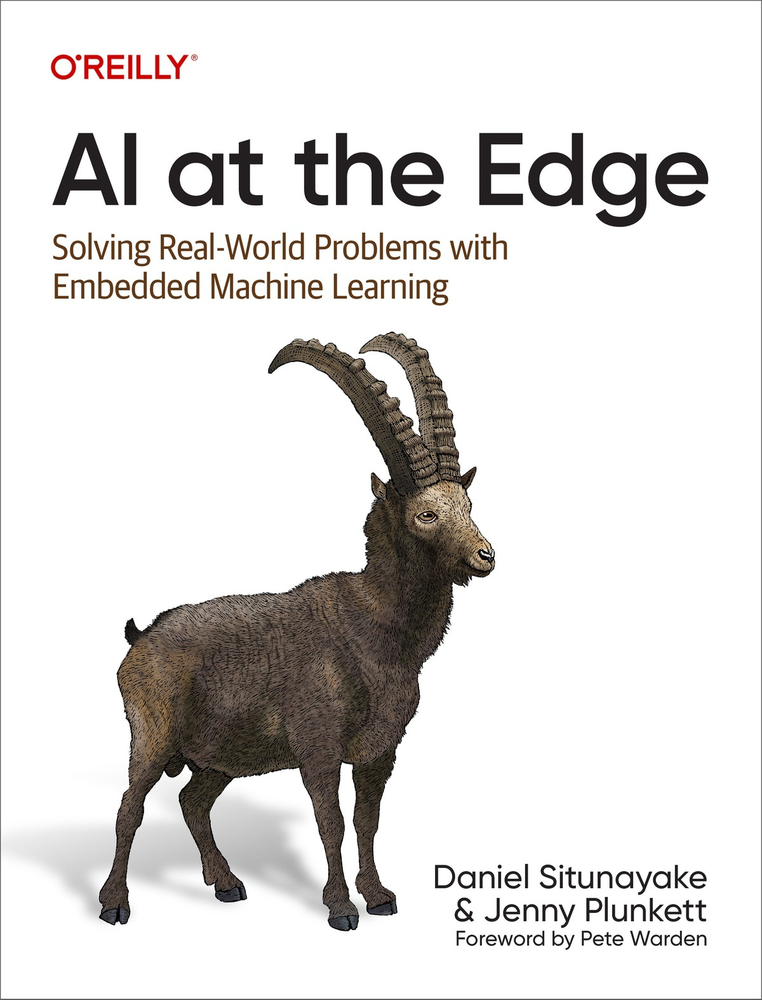
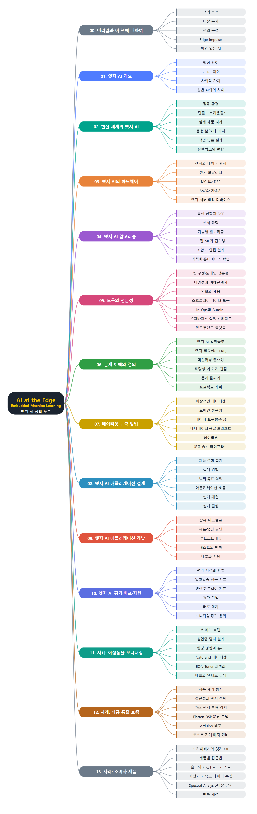

# **AI at the Edge**
(AI at the Edge: 임베디드 머신러닝으로 현실 세계의 문제 해결하기)
 

 
 

이 문서는 Daniel Situnayake와 Jenny Plunkett이 쓴 『AI at the Edge』(O'Reilly)를 장별로 정리한 한국어 학습 노트입니다. 원문을 그대로 번역한 것이 아니라 핵심 개념을 요약해 다시 정리했습니다. 엣지 AI의 개념과 이점, 실제 활용 사례와 책임 있는 설계에서 시작해 센서·프로세서 같은 하드웨어와 알고리즘을 살펴봅니다. 이어서 팀 구성과 도구, 문제 정의, 데이터셋 구축, 애플리케이션 설계·개발, 평가·배포·지원까지 엣지 AI 프로젝트의 전체 워크플로를 다룹니다. 마지막으로 야생동물 모니터링, 식품 품질 보증, 소비자 제품 세 가지 사례를 통해 이 과정을 실제로 적용해 봅니다.
 
 
 

---

- [00. 머리말과 이 책에 대하여](00.%20%EB%A8%B8%EB%A6%AC%EB%A7%90%EA%B3%BC%20%EC%9D%B4%20%EC%B1%85%EC%97%90%20%EB%8C%80%ED%95%98%EC%97%AC/Readme.md)
- [01. 엣지 AI 개요](01.%20%EC%97%A3%EC%A7%80%20AI%20%EA%B0%9C%EC%9A%94/Readme.md)
  - [핵심 용어 정리](01.%20%EC%97%A3%EC%A7%80%20AI%20%EA%B0%9C%EC%9A%94/%ED%95%B5%EC%8B%AC%20%EC%9A%A9%EC%96%B4%20%EC%A0%95%EB%A6%AC.md)
  - [엣지 AI가 필요한 이유 BLERP](01.%20%EC%97%A3%EC%A7%80%20AI%20%EA%B0%9C%EC%9A%94/%EC%97%A3%EC%A7%80%20AI%EA%B0%80%20%ED%95%84%EC%9A%94%ED%95%9C%20%EC%9D%B4%EC%9C%A0%20BLERP.md)
  - [사회적 가치와 엣지 AI](01.%20%EC%97%A3%EC%A7%80%20AI%20%EA%B0%9C%EC%9A%94/%EC%82%AC%ED%9A%8C%EC%A0%81%20%EA%B0%80%EC%B9%98%EC%99%80%20%EC%97%A3%EC%A7%80%20AI.md)
  - [일반 AI와의 차이점](01.%20%EC%97%A3%EC%A7%80%20AI%20%EA%B0%9C%EC%9A%94/%EC%9D%BC%EB%B0%98%20AI%EC%99%80%EC%9D%98%20%EC%B0%A8%EC%9D%B4%EC%A0%90.md)
- [02. 현실 세계의 엣지 AI](02.%20%ED%98%84%EC%8B%A4%20%EC%84%B8%EA%B3%84%EC%9D%98%20%EC%97%A3%EC%A7%80%20AI/Readme.md)
  - [활용 환경과 프로젝트 유형](02.%20%ED%98%84%EC%8B%A4%20%EC%84%B8%EA%B3%84%EC%9D%98%20%EC%97%A3%EC%A7%80%20AI/%ED%99%9C%EC%9A%A9%20%ED%99%98%EA%B2%BD%EA%B3%BC%20%ED%94%84%EB%A1%9C%EC%A0%9D%ED%8A%B8%20%EC%9C%A0%ED%98%95.md)
  - [실제 제품 사례](02.%20%ED%98%84%EC%8B%A4%20%EC%84%B8%EA%B3%84%EC%9D%98%20%EC%97%A3%EC%A7%80%20AI/%EC%8B%A4%EC%A0%9C%20%EC%A0%9C%ED%92%88%20%EC%82%AC%EB%A1%80.md)
  - [응용 분야 네 가지](02.%20%ED%98%84%EC%8B%A4%20%EC%84%B8%EA%B3%84%EC%9D%98%20%EC%97%A3%EC%A7%80%20AI/%EC%9D%91%EC%9A%A9%20%EB%B6%84%EC%95%BC%20%EB%84%A4%20%EA%B0%80%EC%A7%80.md)
  - [책임 있는 설계와 AI 윤리](02.%20%ED%98%84%EC%8B%A4%20%EC%84%B8%EA%B3%84%EC%9D%98%20%EC%97%A3%EC%A7%80%20AI/%EC%B1%85%EC%9E%84%20%EC%9E%88%EB%8A%94%20%EC%84%A4%EA%B3%84%EC%99%80%20AI%20%EC%9C%A4%EB%A6%AC.md)
  - [블랙박스 편향 사회적 피해](02.%20%ED%98%84%EC%8B%A4%20%EC%84%B8%EA%B3%84%EC%9D%98%20%EC%97%A3%EC%A7%80%20AI/%EB%B8%94%EB%9E%99%EB%B0%95%EC%8A%A4%20%ED%8E%B8%ED%96%A5%20%EC%82%AC%ED%9A%8C%EC%A0%81%20%ED%94%BC%ED%95%B4.md)
- [03. 엣지 AI의 하드웨어](03.%20%EC%97%A3%EC%A7%80%20AI%EC%9D%98%20%ED%95%98%EB%93%9C%EC%9B%A8%EC%96%B4/Readme.md)
  - [센서와 데이터 형식](03.%20%EC%97%A3%EC%A7%80%20AI%EC%9D%98%20%ED%95%98%EB%93%9C%EC%9B%A8%EC%96%B4/%EC%84%BC%EC%84%9C%EC%99%80%20%EB%8D%B0%EC%9D%B4%ED%84%B0%20%ED%98%95%EC%8B%9D.md)
  - [센서 종류와 기타 신호](03.%20%EC%97%A3%EC%A7%80%20AI%EC%9D%98%20%ED%95%98%EB%93%9C%EC%9B%A8%EC%96%B4/%EC%84%BC%EC%84%9C%20%EC%A2%85%EB%A5%98%EC%99%80%20%EA%B8%B0%ED%83%80%20%EC%8B%A0%ED%98%B8.md)
  - [하드웨어 구조와 마이크로컨트롤러](03.%20%EC%97%A3%EC%A7%80%20AI%EC%9D%98%20%ED%95%98%EB%93%9C%EC%9B%A8%EC%96%B4/%ED%95%98%EB%93%9C%EC%9B%A8%EC%96%B4%20%EA%B5%AC%EC%A1%B0%EC%99%80%20%EB%A7%88%EC%9D%B4%ED%81%AC%EB%A1%9C%EC%BB%A8%ED%8A%B8%EB%A1%A4%EB%9F%AC.md)
  - [SoC 가속기 맞춤 칩](03.%20%EC%97%A3%EC%A7%80%20AI%EC%9D%98%20%ED%95%98%EB%93%9C%EC%9B%A8%EC%96%B4/SoC%20%EA%B0%80%EC%86%8D%EA%B8%B0%20%EB%A7%9E%EC%B6%A4%20%EC%B9%A9.md)
  - [보드 서버 멀티 디바이스 구성](03.%20%EC%97%A3%EC%A7%80%20AI%EC%9D%98%20%ED%95%98%EB%93%9C%EC%9B%A8%EC%96%B4/%EB%B3%B4%EB%93%9C%20%EC%84%9C%EB%B2%84%20%EB%A9%80%ED%8B%B0%20%EB%94%94%EB%B0%94%EC%9D%B4%EC%8A%A4%20%EA%B5%AC%EC%84%B1.md)
- [04. 엣지 AI 알고리즘](04.%20%EC%97%A3%EC%A7%80%20AI%20%EC%95%8C%EA%B3%A0%EB%A6%AC%EC%A6%98/Readme.md)
  - [특징 공학과 신호 처리](04.%20%EC%97%A3%EC%A7%80%20AI%20%EC%95%8C%EA%B3%A0%EB%A6%AC%EC%A6%98/%ED%8A%B9%EC%A7%95%20%EA%B3%B5%ED%95%99%EA%B3%BC%20%EC%8B%A0%ED%98%B8%20%EC%B2%98%EB%A6%AC.md)
  - [영상 특징 센서 융합 스케일링](04.%20%EC%97%A3%EC%A7%80%20AI%20%EC%95%8C%EA%B3%A0%EB%A6%AC%EC%A6%98/%EC%98%81%EC%83%81%20%ED%8A%B9%EC%A7%95%20%EC%84%BC%EC%84%9C%20%EC%9C%B5%ED%95%A9%20%EC%8A%A4%EC%BC%80%EC%9D%BC%EB%A7%81.md)
  - [기능별 알고리즘 유형](04.%20%EC%97%A3%EC%A7%80%20AI%20%EC%95%8C%EA%B3%A0%EB%A6%AC%EC%A6%98/%EA%B8%B0%EB%8A%A5%EB%B3%84%20%EC%95%8C%EA%B3%A0%EB%A6%AC%EC%A6%98%20%EC%9C%A0%ED%98%95.md)
  - [구현 방식별 알고리즘](04.%20%EC%97%A3%EC%A7%80%20AI%20%EC%95%8C%EA%B3%A0%EB%A6%AC%EC%A6%98/%EA%B5%AC%ED%98%84%20%EB%B0%A9%EC%8B%9D%EB%B3%84%20%EC%95%8C%EA%B3%A0%EB%A6%AC%EC%A6%98.md)
  - [알고리즘 조합과 안전 설계](04.%20%EC%97%A3%EC%A7%80%20AI%20%EC%95%8C%EA%B3%A0%EB%A6%AC%EC%A6%98/%EC%95%8C%EA%B3%A0%EB%A6%AC%EC%A6%98%20%EC%A1%B0%ED%95%A9%EA%B3%BC%20%EC%95%88%EC%A0%84%20%EC%84%A4%EA%B3%84.md)
  - [최적화와 온디바이스 학습](04.%20%EC%97%A3%EC%A7%80%20AI%20%EC%95%8C%EA%B3%A0%EB%A6%AC%EC%A6%98/%EC%B5%9C%EC%A0%81%ED%99%94%EC%99%80%20%EC%98%A8%EB%94%94%EB%B0%94%EC%9D%B4%EC%8A%A4%20%ED%95%99%EC%8A%B5.md)
- [05. 도구와 전문성](05.%20%EB%8F%84%EA%B5%AC%EC%99%80%20%EC%A0%84%EB%AC%B8%EC%84%B1/Readme.md)
  - [팀 구성과 도메인 전문성 그리고 다양성](05.%20%EB%8F%84%EA%B5%AC%EC%99%80%20%EC%A0%84%EB%AC%B8%EC%84%B1/%ED%8C%80%20%EA%B5%AC%EC%84%B1%EA%B3%BC%20%EB%8F%84%EB%A9%94%EC%9D%B8%20%EC%A0%84%EB%AC%B8%EC%84%B1%20%EA%B7%B8%EB%A6%AC%EA%B3%A0%20%EB%8B%A4%EC%96%91%EC%84%B1.md)
  - [팀 역할과 채용 그리고 학습](05.%20%EB%8F%84%EA%B5%AC%EC%99%80%20%EC%A0%84%EB%AC%B8%EC%84%B1/%ED%8C%80%20%EC%97%AD%ED%95%A0%EA%B3%BC%20%EC%B1%84%EC%9A%A9%20%EA%B7%B8%EB%A6%AC%EA%B3%A0%20%ED%95%99%EC%8A%B5.md)
  - [소프트웨어 엔지니어링 도구](05.%20%EB%8F%84%EA%B5%AC%EC%99%80%20%EC%A0%84%EB%AC%B8%EC%84%B1/%EC%86%8C%ED%94%84%ED%8A%B8%EC%9B%A8%EC%96%B4%20%EC%97%94%EC%A7%80%EB%8B%88%EC%96%B4%EB%A7%81%20%EB%8F%84%EA%B5%AC.md)
  - [데이터 작업과 알고리즘 개발 도구](05.%20%EB%8F%84%EA%B5%AC%EC%99%80%20%EC%A0%84%EB%AC%B8%EC%84%B1/%EB%8D%B0%EC%9D%B4%ED%84%B0%20%EC%9E%91%EC%97%85%EA%B3%BC%20%EC%95%8C%EA%B3%A0%EB%A6%AC%EC%A6%98%20%EA%B0%9C%EB%B0%9C%20%EB%8F%84%EA%B5%AC.md)
  - [MLOps와 모델 최적화 도구](05.%20%EB%8F%84%EA%B5%AC%EC%99%80%20%EC%A0%84%EB%AC%B8%EC%84%B1/MLOps%EC%99%80%20%EB%AA%A8%EB%8D%B8%20%EC%B5%9C%EC%A0%81%ED%99%94%20%EB%8F%84%EA%B5%AC.md)
  - [온디바이스 알고리즘 실행 도구](05.%20%EB%8F%84%EA%B5%AC%EC%99%80%20%EC%A0%84%EB%AC%B8%EC%84%B1/%EC%98%A8%EB%94%94%EB%B0%94%EC%9D%B4%EC%8A%A4%20%EC%95%8C%EA%B3%A0%EB%A6%AC%EC%A6%98%20%EC%8B%A4%ED%96%89%20%EB%8F%84%EA%B5%AC.md)
  - [임베디드 개발과 전자 도구](05.%20%EB%8F%84%EA%B5%AC%EC%99%80%20%EC%A0%84%EB%AC%B8%EC%84%B1/%EC%9E%84%EB%B2%A0%EB%94%94%EB%93%9C%20%EA%B0%9C%EB%B0%9C%EA%B3%BC%20%EC%A0%84%EC%9E%90%20%EB%8F%84%EA%B5%AC.md)
  - [엔드투엔드 플랫폼](05.%20%EB%8F%84%EA%B5%AC%EC%99%80%20%EC%A0%84%EB%AC%B8%EC%84%B1/%EC%97%94%EB%93%9C%ED%88%AC%EC%97%94%EB%93%9C%20%ED%94%8C%EB%9E%AB%ED%8F%BC.md)
- [06. 문제 이해와 정의](06.%20%EB%AC%B8%EC%A0%9C%20%EC%9D%B4%ED%95%B4%EC%99%80%20%EC%A0%95%EC%9D%98/Readme.md)
  - [엣지 AI 워크플로와 책임 있는 AI](06.%20%EB%AC%B8%EC%A0%9C%20%EC%9D%B4%ED%95%B4%EC%99%80%20%EC%A0%95%EC%9D%98/%EC%97%A3%EC%A7%80%20AI%20%EC%9B%8C%ED%81%AC%ED%94%8C%EB%A1%9C%EC%99%80%20%EC%B1%85%EC%9E%84%20%EC%9E%88%EB%8A%94%20AI.md)
  - [엣지 AI가 필요한가](06.%20%EB%AC%B8%EC%A0%9C%20%EC%9D%B4%ED%95%B4%EC%99%80%20%EC%A0%95%EC%9D%98/%EC%97%A3%EC%A7%80%20AI%EA%B0%80%20%ED%95%84%EC%9A%94%ED%95%9C%EA%B0%80.md)
  - [머신러닝이 필요한가](06.%20%EB%AC%B8%EC%A0%9C%20%EC%9D%B4%ED%95%B4%EC%99%80%20%EC%A0%95%EC%9D%98/%EB%A8%B8%EC%8B%A0%EB%9F%AC%EB%8B%9D%EC%9D%B4%20%ED%95%84%EC%9A%94%ED%95%9C%EA%B0%80.md)
  - [타당성 검토 윤리 비즈니스 데이터셋](06.%20%EB%AC%B8%EC%A0%9C%20%EC%9D%B4%ED%95%B4%EC%99%80%20%EC%A0%95%EC%9D%98/%ED%83%80%EB%8B%B9%EC%84%B1%20%EA%B2%80%ED%86%A0%20%EC%9C%A4%EB%A6%AC%20%EB%B9%84%EC%A6%88%EB%8B%88%EC%8A%A4%20%EB%8D%B0%EC%9D%B4%ED%84%B0%EC%85%8B.md)
  - [기술 타당성과 문제 틀짜기](06.%20%EB%AC%B8%EC%A0%9C%20%EC%9D%B4%ED%95%B4%EC%99%80%20%EC%A0%95%EC%9D%98/%EA%B8%B0%EC%88%A0%20%ED%83%80%EB%8B%B9%EC%84%B1%EA%B3%BC%20%EB%AC%B8%EC%A0%9C%20%ED%8B%80%EC%A7%9C%EA%B8%B0.md)
  - [최종 결정과 프로젝트 계획](06.%20%EB%AC%B8%EC%A0%9C%20%EC%9D%B4%ED%95%B4%EC%99%80%20%EC%A0%95%EC%9D%98/%EC%B5%9C%EC%A2%85%20%EA%B2%B0%EC%A0%95%EA%B3%BC%20%ED%94%84%EB%A1%9C%EC%A0%9D%ED%8A%B8%20%EA%B3%84%ED%9A%8D.md)
- [07. 데이터셋 구축 방법](07.%20%EB%8D%B0%EC%9D%B4%ED%84%B0%EC%85%8B%20%EA%B5%AC%EC%B6%95%20%EB%B0%A9%EB%B2%95/Readme.md)
  - [데이터셋의 구성과 이상적인 조건](07.%20%EB%8D%B0%EC%9D%B4%ED%84%B0%EC%85%8B%20%EA%B5%AC%EC%B6%95%20%EB%B0%A9%EB%B2%95/%EB%8D%B0%EC%9D%B4%ED%84%B0%EC%85%8B%EC%9D%98%20%EA%B5%AC%EC%84%B1%EA%B3%BC%20%EC%9D%B4%EC%83%81%EC%A0%81%EC%9D%B8%20%EC%A1%B0%EA%B1%B4.md)
  - [도메인 전문성과 책임 있는 AI](07.%20%EB%8D%B0%EC%9D%B4%ED%84%B0%EC%85%8B%20%EA%B5%AC%EC%B6%95%20%EB%B0%A9%EB%B2%95/%EB%8F%84%EB%A9%94%EC%9D%B8%20%EC%A0%84%EB%AC%B8%EC%84%B1%EA%B3%BC%20%EC%B1%85%EC%9E%84%20%EC%9E%88%EB%8A%94%20AI.md)
  - [데이터 요구량 추정과 확보](07.%20%EB%8D%B0%EC%9D%B4%ED%84%B0%EC%85%8B%20%EA%B5%AC%EC%B6%95%20%EB%B0%A9%EB%B2%95/%EB%8D%B0%EC%9D%B4%ED%84%B0%20%EC%9A%94%EA%B5%AC%EB%9F%89%20%EC%B6%94%EC%A0%95%EA%B3%BC%20%ED%99%95%EB%B3%B4.md)
  - [데이터 저장과 메타데이터](07.%20%EB%8D%B0%EC%9D%B4%ED%84%B0%EC%85%8B%20%EA%B5%AC%EC%B6%95%20%EB%B0%A9%EB%B2%95/%EB%8D%B0%EC%9D%B4%ED%84%B0%20%EC%A0%80%EC%9E%A5%EA%B3%BC%20%EB%A9%94%ED%83%80%EB%8D%B0%EC%9D%B4%ED%84%B0.md)
  - [데이터 품질과 드리프트](07.%20%EB%8D%B0%EC%9D%B4%ED%84%B0%EC%85%8B%20%EA%B5%AC%EC%B6%95%20%EB%B0%A9%EB%B2%95/%EB%8D%B0%EC%9D%B4%ED%84%B0%20%ED%92%88%EC%A7%88%EA%B3%BC%20%EB%93%9C%EB%A6%AC%ED%94%84%ED%8A%B8.md)
  - [레이블링](07.%20%EB%8D%B0%EC%9D%B4%ED%84%B0%EC%85%8B%20%EA%B5%AC%EC%B6%95%20%EB%B0%A9%EB%B2%95/%EB%A0%88%EC%9D%B4%EB%B8%94%EB%A7%81.md)
  - [데이터 포맷과 정리와 균형 조정](07.%20%EB%8D%B0%EC%9D%B4%ED%84%B0%EC%85%8B%20%EA%B5%AC%EC%B6%95%20%EB%B0%A9%EB%B2%95/%EB%8D%B0%EC%9D%B4%ED%84%B0%20%ED%8F%AC%EB%A7%B7%EA%B3%BC%20%EC%A0%95%EB%A6%AC%EC%99%80%20%EA%B7%A0%ED%98%95%20%EC%A1%B0%EC%A0%95.md)
  - [데이터 분할과 증강과 파이프라인](07.%20%EB%8D%B0%EC%9D%B4%ED%84%B0%EC%85%8B%20%EA%B5%AC%EC%B6%95%20%EB%B0%A9%EB%B2%95/%EB%8D%B0%EC%9D%B4%ED%84%B0%20%EB%B6%84%ED%95%A0%EA%B3%BC%20%EC%A6%9D%EA%B0%95%EA%B3%BC%20%ED%8C%8C%EC%9D%B4%ED%94%84%EB%9D%BC%EC%9D%B8.md)
- [08. 엣지 AI 애플리케이션 설계](08.%20%EC%97%A3%EC%A7%80%20AI%20%EC%95%A0%ED%94%8C%EB%A6%AC%EC%BC%80%EC%9D%B4%EC%85%98%20%EC%84%A4%EA%B3%84/Readme.md)
  - [제품과 경험 설계](08.%20%EC%97%A3%EC%A7%80%20AI%20%EC%95%A0%ED%94%8C%EB%A6%AC%EC%BC%80%EC%9D%B4%EC%85%98%20%EC%84%A4%EA%B3%84/%EC%A0%9C%ED%92%88%EA%B3%BC%20%EA%B2%BD%ED%97%98%20%EC%84%A4%EA%B3%84.md)
  - [솔루션 범위 설정과 설계 목표](08.%20%EC%97%A3%EC%A7%80%20AI%20%EC%95%A0%ED%94%8C%EB%A6%AC%EC%BC%80%EC%9D%B4%EC%85%98%20%EC%84%A4%EA%B3%84/%EC%86%94%EB%A3%A8%EC%85%98%20%EB%B2%94%EC%9C%84%20%EC%84%A4%EC%A0%95%EA%B3%BC%20%EC%84%A4%EA%B3%84%20%EB%AA%A9%ED%91%9C.md)
  - [기본 애플리케이션 아키텍처와 흐름](08.%20%EC%97%A3%EC%A7%80%20AI%20%EC%95%A0%ED%94%8C%EB%A6%AC%EC%BC%80%EC%9D%B4%EC%85%98%20%EC%84%A4%EA%B3%84/%EA%B8%B0%EB%B3%B8%20%EC%95%A0%ED%94%8C%EB%A6%AC%EC%BC%80%EC%9D%B4%EC%85%98%20%EC%95%84%ED%82%A4%ED%85%8D%EC%B2%98%EC%99%80%20%ED%9D%90%EB%A6%84.md)
  - [복합 아키텍처와 설계 패턴](08.%20%EC%97%A3%EC%A7%80%20AI%20%EC%95%A0%ED%94%8C%EB%A6%AC%EC%BC%80%EC%9D%B4%EC%85%98%20%EC%84%A4%EA%B3%84/%EB%B3%B5%ED%95%A9%20%EC%95%84%ED%82%A4%ED%85%8D%EC%B2%98%EC%99%80%20%EC%84%A4%EA%B3%84%20%ED%8C%A8%ED%84%B4.md)
  - [설계 선택의 편향과 설계 산출물](08.%20%EC%97%A3%EC%A7%80%20AI%20%EC%95%A0%ED%94%8C%EB%A6%AC%EC%BC%80%EC%9D%B4%EC%85%98%20%EC%84%A4%EA%B3%84/%EC%84%A4%EA%B3%84%20%EC%84%A0%ED%83%9D%EC%9D%98%20%ED%8E%B8%ED%96%A5%EA%B3%BC%20%EC%84%A4%EA%B3%84%20%EC%82%B0%EC%B6%9C%EB%AC%BC.md)
- [09. 엣지 AI 애플리케이션 개발](09.%20%EC%97%A3%EC%A7%80%20AI%20%EC%95%A0%ED%94%8C%EB%A6%AC%EC%BC%80%EC%9D%B4%EC%85%98%20%EA%B0%9C%EB%B0%9C/Readme.md)
  - [반복 워크플로와 탐색](09.%20%EC%97%A3%EC%A7%80%20AI%20%EC%95%A0%ED%94%8C%EB%A6%AC%EC%BC%80%EC%9D%B4%EC%85%98%20%EA%B0%9C%EB%B0%9C/%EB%B0%98%EB%B3%B5%20%EC%9B%8C%ED%81%AC%ED%94%8C%EB%A1%9C%EC%99%80%20%ED%83%90%EC%83%89.md)
  - [목표 설정과 프로젝트 중단 판단](09.%20%EC%97%A3%EC%A7%80%20AI%20%EC%95%A0%ED%94%8C%EB%A6%AC%EC%BC%80%EC%9D%B4%EC%85%98%20%EA%B0%9C%EB%B0%9C/%EB%AA%A9%ED%91%9C%20%EC%84%A4%EC%A0%95%EA%B3%BC%20%ED%94%84%EB%A1%9C%EC%A0%9D%ED%8A%B8%20%EC%A4%91%EB%8B%A8%20%ED%8C%90%EB%8B%A8.md)
  - [부트스트래핑](09.%20%EC%97%A3%EC%A7%80%20AI%20%EC%95%A0%ED%94%8C%EB%A6%AC%EC%BC%80%EC%9D%B4%EC%85%98%20%EA%B0%9C%EB%B0%9C/%EB%B6%80%ED%8A%B8%EC%8A%A4%ED%8A%B8%EB%9E%98%ED%95%91.md)
  - [테스트와 반복](09.%20%EC%97%A3%EC%A7%80%20AI%20%EC%95%A0%ED%94%8C%EB%A6%AC%EC%BC%80%EC%9D%B4%EC%85%98%20%EA%B0%9C%EB%B0%9C/%ED%85%8C%EC%8A%A4%ED%8A%B8%EC%99%80%20%EB%B0%98%EB%B3%B5.md)
  - [배포와 지원](09.%20%EC%97%A3%EC%A7%80%20AI%20%EC%95%A0%ED%94%8C%EB%A6%AC%EC%BC%80%EC%9D%B4%EC%85%98%20%EA%B0%9C%EB%B0%9C/%EB%B0%B0%ED%8F%AC%EC%99%80%20%EC%A7%80%EC%9B%90.md)
- [10. 엣지 AI 평가·배포·지원](10.%20%EC%97%A3%EC%A7%80%20AI%20%ED%8F%89%EA%B0%80%C2%B7%EB%B0%B0%ED%8F%AC%C2%B7%EC%A7%80%EC%9B%90/Readme.md)
  - [평가의 시점과 방법](10.%20%EC%97%A3%EC%A7%80%20AI%20%ED%8F%89%EA%B0%80%C2%B7%EB%B0%B0%ED%8F%AC%C2%B7%EC%A7%80%EC%9B%90/%ED%8F%89%EA%B0%80%EC%9D%98%20%EC%8B%9C%EC%A0%90%EA%B3%BC%20%EB%B0%A9%EB%B2%95.md)
  - [알고리즘 성능 지표](10.%20%EC%97%A3%EC%A7%80%20AI%20%ED%8F%89%EA%B0%80%C2%B7%EB%B0%B0%ED%8F%AC%C2%B7%EC%A7%80%EC%9B%90/%EC%95%8C%EA%B3%A0%EB%A6%AC%EC%A6%98%20%EC%84%B1%EB%8A%A5%20%EC%A7%80%ED%91%9C.md)
  - [연산과 하드웨어 성능 지표](10.%20%EC%97%A3%EC%A7%80%20AI%20%ED%8F%89%EA%B0%80%C2%B7%EB%B0%B0%ED%8F%AC%C2%B7%EC%A7%80%EC%9B%90/%EC%97%B0%EC%82%B0%EA%B3%BC%20%ED%95%98%EB%93%9C%EC%9B%A8%EC%96%B4%20%EC%84%B1%EB%8A%A5%20%EC%A7%80%ED%91%9C.md)
  - [평가 기법](10.%20%EC%97%A3%EC%A7%80%20AI%20%ED%8F%89%EA%B0%80%C2%B7%EB%B0%B0%ED%8F%AC%C2%B7%EC%A7%80%EC%9B%90/%ED%8F%89%EA%B0%80%20%EA%B8%B0%EB%B2%95.md)
  - [배포 절차](10.%20%EC%97%A3%EC%A7%80%20AI%20%ED%8F%89%EA%B0%80%C2%B7%EB%B0%B0%ED%8F%AC%C2%B7%EC%A7%80%EC%9B%90/%EB%B0%B0%ED%8F%AC%20%EC%A0%88%EC%B0%A8.md)
  - [운영 지원과 장기 윤리](10.%20%EC%97%A3%EC%A7%80%20AI%20%ED%8F%89%EA%B0%80%C2%B7%EB%B0%B0%ED%8F%AC%C2%B7%EC%A7%80%EC%9B%90/%EC%9A%B4%EC%98%81%20%EC%A7%80%EC%9B%90%EA%B3%BC%20%EC%9E%A5%EA%B8%B0%20%EC%9C%A4%EB%A6%AC.md)
- [11. 사례 - 야생동물 모니터링](11.%20%EC%82%AC%EB%A1%80%20-%20%EC%95%BC%EC%83%9D%EB%8F%99%EB%AC%BC%20%EB%AA%A8%EB%8B%88%ED%84%B0%EB%A7%81/Readme.md)
  - [문제 탐색과 솔루션 설계](11.%20%EC%82%AC%EB%A1%80%20-%20%EC%95%BC%EC%83%9D%EB%8F%99%EB%AC%BC%20%EB%AA%A8%EB%8B%88%ED%84%B0%EB%A7%81/%EB%AC%B8%EC%A0%9C%20%ED%83%90%EC%83%89%EA%B3%BC%20%EC%86%94%EB%A3%A8%EC%85%98%20%EC%84%A4%EA%B3%84.md)
  - [설계 고려사항과 윤리](11.%20%EC%82%AC%EB%A1%80%20-%20%EC%95%BC%EC%83%9D%EB%8F%99%EB%AC%BC%20%EB%AA%A8%EB%8B%88%ED%84%B0%EB%A7%81/%EC%84%A4%EA%B3%84%20%EA%B3%A0%EB%A0%A4%EC%82%AC%ED%95%AD%EA%B3%BC%20%EC%9C%A4%EB%A6%AC.md)
  - [데이터셋 확보와 Edge Impulse 준비](11.%20%EC%82%AC%EB%A1%80%20-%20%EC%95%BC%EC%83%9D%EB%8F%99%EB%AC%BC%20%EB%AA%A8%EB%8B%88%ED%84%B0%EB%A7%81/%EB%8D%B0%EC%9D%B4%ED%84%B0%EC%85%8B%20%ED%99%95%EB%B3%B4%EC%99%80%20Edge%20Impulse%20%EC%A4%80%EB%B9%84.md)
  - [모델 개발과 EON Tuner](11.%20%EC%82%AC%EB%A1%80%20-%20%EC%95%BC%EC%83%9D%EB%8F%99%EB%AC%BC%20%EB%AA%A8%EB%8B%88%ED%84%B0%EB%A7%81/%EB%AA%A8%EB%8D%B8%20%EA%B0%9C%EB%B0%9C%EA%B3%BC%20EON%20Tuner.md)
  - [테스트 배포 그리고 반복 개선](11.%20%EC%82%AC%EB%A1%80%20-%20%EC%95%BC%EC%83%9D%EB%8F%99%EB%AC%BC%20%EB%AA%A8%EB%8B%88%ED%84%B0%EB%A7%81/%ED%85%8C%EC%8A%A4%ED%8A%B8%20%EB%B0%B0%ED%8F%AC%20%EA%B7%B8%EB%A6%AC%EA%B3%A0%20%EB%B0%98%EB%B3%B5%20%EA%B0%9C%EC%84%A0.md)
- [12. 사례 - 식품 품질 보증](12.%20%EC%82%AC%EB%A1%80%20-%20%EC%8B%9D%ED%92%88%20%ED%92%88%EC%A7%88%20%EB%B3%B4%EC%A6%9D/Readme.md)
  - [1. 문제 탐색과 목표 설정](12.%20%EC%82%AC%EB%A1%80%20-%20%EC%8B%9D%ED%92%88%20%ED%92%88%EC%A7%88%20%EB%B3%B4%EC%A6%9D/1.%20%EB%AC%B8%EC%A0%9C%20%ED%83%90%EC%83%89%EA%B3%BC%20%EB%AA%A9%ED%91%9C%20%EC%84%A4%EC%A0%95.md)
  - [2. 해결 접근법과 설계 고려사항](12.%20%EC%82%AC%EB%A1%80%20-%20%EC%8B%9D%ED%92%88%20%ED%92%88%EC%A7%88%20%EB%B3%B4%EC%A6%9D/2.%20%ED%95%B4%EA%B2%B0%20%EC%A0%91%EA%B7%BC%EB%B2%95%EA%B3%BC%20%EC%84%A4%EA%B3%84%20%EA%B3%A0%EB%A0%A4%EC%82%AC%ED%95%AD.md)
  - [3. 연어 부패 감지 데이터 수집](12.%20%EC%82%AC%EB%A1%80%20-%20%EC%8B%9D%ED%92%88%20%ED%92%88%EC%A7%88%20%EB%B3%B4%EC%A6%9D/3.%20%EC%97%B0%EC%96%B4%20%EB%B6%80%ED%8C%A8%20%EA%B0%90%EC%A7%80%20%EB%8D%B0%EC%9D%B4%ED%84%B0%20%EC%88%98%EC%A7%91.md)
  - [4. 모델 학습·테스트·배포와 반복 개선](12.%20%EC%82%AC%EB%A1%80%20-%20%EC%8B%9D%ED%92%88%20%ED%92%88%EC%A7%88%20%EB%B3%B4%EC%A6%9D/4.%20%EB%AA%A8%EB%8D%B8%20%ED%95%99%EC%8A%B5%C2%B7%ED%85%8C%EC%8A%A4%ED%8A%B8%C2%B7%EB%B0%B0%ED%8F%AC%EC%99%80%20%EB%B0%98%EB%B3%B5%20%EA%B0%9C%EC%84%A0.md)
- [13. 사례 - 소비자 제품](13.%20%EC%82%AC%EB%A1%80%20-%20%EC%86%8C%EB%B9%84%EC%9E%90%20%EC%A0%9C%ED%92%88/Readme.md)
  - [1. 문제 탐색과 목표 설정](13.%20%EC%82%AC%EB%A1%80%20-%20%EC%86%8C%EB%B9%84%EC%9E%90%20%EC%A0%9C%ED%92%88/1.%20%EB%AC%B8%EC%A0%9C%20%ED%83%90%EC%83%89%EA%B3%BC%20%EB%AA%A9%ED%91%9C%20%EC%84%A4%EC%A0%95.md)
  - [2. 해결 접근법과 윤리 고려사항](13.%20%EC%82%AC%EB%A1%80%20-%20%EC%86%8C%EB%B9%84%EC%9E%90%20%EC%A0%9C%ED%92%88/2.%20%ED%95%B4%EA%B2%B0%20%EC%A0%91%EA%B7%BC%EB%B2%95%EA%B3%BC%20%EC%9C%A4%EB%A6%AC%20%EA%B3%A0%EB%A0%A4%EC%82%AC%ED%95%AD.md)
  - [3. 자전거 모니터링 데이터 수집](13.%20%EC%82%AC%EB%A1%80%20-%20%EC%86%8C%EB%B9%84%EC%9E%90%20%EC%A0%9C%ED%92%88/3.%20%EC%9E%90%EC%A0%84%EA%B1%B0%20%EB%AA%A8%EB%8B%88%ED%84%B0%EB%A7%81%20%EB%8D%B0%EC%9D%B4%ED%84%B0%20%EC%88%98%EC%A7%91.md)
  - [4. 모델 학습·이상 감지·배포와 반복 개선](13.%20%EC%82%AC%EB%A1%80%20-%20%EC%86%8C%EB%B9%84%EC%9E%90%20%EC%A0%9C%ED%92%88/4.%20%EB%AA%A8%EB%8D%B8%20%ED%95%99%EC%8A%B5%C2%B7%EC%9D%B4%EC%83%81%20%EA%B0%90%EC%A7%80%C2%B7%EB%B0%B0%ED%8F%AC%EC%99%80%20%EB%B0%98%EB%B3%B5%20%EA%B0%9C%EC%84%A0.md)
