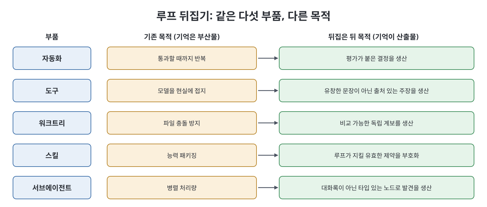

# 1장 모두가 루프를 만들지만 기억하는 루프는 거의 없다 (Everyone's Building Loops, Almost Nobody's Building the One That Remembers)

이 장은 책의 핵심 메시지를 세우는 장이다. 지난 1~2년 동안 업계는 에이전트 루프를 다듬는 데 힘을 쏟았지만, 루프가 남겨야 할 것인 기억에는 거의 신경 쓰지 않았다. 책은 이 불균형을 짚고, 기억과 루프의 관계를 뒤집어 보자고 제안한 뒤, "그래프 엔지니어링"이 정확히 무엇을 가리키는지 정의하고, 루프가 기억하는지 판별하는 한 문장 시험을 준다.

> **쉽게 말하면**
> 지금의 루프는 "무엇을 했는지"는 적어 두지만 "왜 그랬는지"는 적지 않는다. 이유는 어디에서도 복원되지 않으므로, 이유를 담는 구조가 따로 필요하다.

> **참고(노트 작성자)** 책은 2026년경의 에이전트 워크플로를 전제로 하며, 언급되는 글과 도구는 시점 기준이다. 책은 이 장의 핵심 논지가 저자의 기존 블로그 글에서 처음 나왔고, 세 가지 위험은 Addy Osmani의 프레이밍, 뒤집기와 래티스 논지는 저자 본인의 것이라고 밝힌다.

## 이 장의 흐름

1. 루프 엔지니어링의 다섯 부품과 "여섯 번째 부품"
2. 루프 메모리가 실제로 담는 것
3. 세 가지 정직한 위험
4. 뒤집기: 루프는 수단, 기억은 산출물
5. 마크다운 파일이 한계에 부딪히는 세 가지 압력
6. 그래프 엔지니어링의 정의와 한 문장 시험

## 1. 다섯 부품과 어깨를 으쓱하는 여섯 번째

책은 루프 엔지니어링이 약 1년 만에 다섯 부품으로 수렴했다고 정리한다.

| 부품 | 역할 |
|------|------|
| 자동화(Automations) | 루프 자체. 생성, 비평, 수정. 자기 검토 한 번이 더 똑똑한 모델의 무검토보다 낫다 |
| 도구(Tools) | 검색, 코드 실행, DB 접근, 파일 조작 |
| 워크트리(Worktrees) | 병렬 에이전트가 같은 저장소를 망가뜨리지 않게 격리 |
| 스킬과 플러그인 | 매 세션 테스트 실행 방법을 다시 알아내지 않게 능력을 묶어 둠 |
| 서브에이전트 | 팬아웃, 작업자마다 새 컨텍스트, 끝에 리듀서 |

책은 이런 목록 뒤에는 늘 "스크래치패드나 NOTES.md, 루프가 갱신하는 작업 목록 같은 기억도 있으면 좋겠다"는 한마디가 어깨를 으쓱하며 붙는다고 지적한다. 이 얼버무림이 문제의 전부라는 것이 책의 말이다.

## 2. 루프 메모리가 담는 것과 놓치는 것

기존 루프는 반복 사이에 거의 예외 없이 "완료한 일, 다음에 할 일" 체크리스트를 남긴다. 책은 이것을 작업 상태(work state) 원장이라 부르고, 유용하니 유지하라고 한다. 하지만 새 에이전트나 3월의 내가 이 목록에서 복원할 수 없는 것이 있다. 왜 이 방식을 택했는가, 왜 상한이 3인가, 90일 주기가 정책에서 나왔는가 아니면 그럴듯한 숫자인가, 이후 모든 것이 전제하는 불변식을 세운 커밋이 어느 것인가.

핵심 구분은 이렇다. 작업 상태는 저장소를 보면 다시 계산할 수 있다. git 로그가 NOTES.md보다 더 나은 작업 상태 원장이다. 반면 추론 상태(reasoning state)는 어디에서도 다시 계산할 수 없다. 컨텍스트 창이 닫히면 사라지고, 남은 사본은 아무도 읽지 않을 대화록뿐이다. 그리고 비싼 쪽이 바로 추론 상태다.

## 3. 세 가지 정직한 위험

책은 Addy Osmani가 꼽은 루프 엔지니어링의 세 가지 한계를 소개한다.

| 위험 | 내용 |
|------|------|
| 검증 부담이 엔지니어에게 남는다 | 루프가 사람이 읽을 수 있는 양보다 많은 diff를 만든다. 다 읽으면 처리량 이득이 사라지고, 훑으면 확신이 사라진다 |
| 이해가 주기마다 침식된다 | 각 반복은 국소적으로 정당하지만 전체적으로 기록되지 않는다. 마흔 번 뒤에는 코드베이스가 고고학이 된다 |
| 인지적 항복이 편안해진다 | 이해 못 한 diff를 승인하는 불편함이 첫 주에는 크지만 셋째 주에는 일상이 된다 |

책이 덧붙이는 관찰은, 세 위험 모두 모델 성능의 문제가 아니라는 점이다. 더 좋은 모델은 읽을 수 없는 diff를 더 많이 만들 뿐이다. 모델을 키우면 실패도 함께 커지므로 이는 아키텍처의 문제, 구체적으로는 기억과 평가가 어디에 사느냐의 문제라고 책은 결론짓는다.

## 4. 뒤집기

기존 틀은 기억을 루프의 보조 기능으로 여섯 번째에 둔다. 책은 이를 뒤집어 "루프는 장치이고, 기억이 산출물"이라고 말한다. 다섯 부품은 사라지지 않고 목적을 얻는다.

| 부품 | 기존 목적 | 뒤집은 뒤의 목적 |
|------|----------|----------------|
| 자동화 | 통과할 때까지 반복 | 평가가 붙은 결정을 생산 |
| 도구 | 모델을 현실에 접지 | 유창한 문장이 아니라 출처 있는 주장을 생산 |
| 워크트리 | 파일 충돌 방지 | 비교 가능한 독립 계보를 생산 |
| 스킬 | 능력 패키징 | 루프가 지켜야 할 유효한 제약을 부호화 |
| 서브에이전트 | 병렬 처리량 | 대화록이 아니라 타입 있는 노드로 발견을 생산 |

같은 다섯 부품이지만 전혀 다른 시스템이다. 첫 번째 시스템에서는 산출물이 목적이고 기억은 부산물이며, 두 번째에서는 기억이 목적이고 산출물이 부산물이다. 책은 이것이 전작에서 "명세가 지속되는 산출물이고 코드가 부산물"이라고 한 이동을 한 단계 깊이 적용한 것이라고 말한다. 명세는 코드보다 오래 가고, 그래프는 명세보다 오래 간다.

## 5. 마크다운 파일이 부족해지는 이유

책은 사람 속도의 파이프라인에서는 파일이 옳은 답이라고 인정한다. diff가 되고, 리뷰되고, 도구가 바뀌어도 살아남는다. 그러나 스웜은 세 가지 압력을 한꺼번에 가한다.

- **동시 작성자**: 두 에이전트가 각자 워크트리에서 같은 불변식을 발견해 같은 이름으로 만들면, 파일로는 병합 충돌이거나 갈라진 두 노드가 된다. 스웜은 래티스를 작업자마다, 시간당 열 번씩 갈라놓는다.
- **토큰 예산 아래의 검색**: 필요한 제약을 찾으려면 모든 파일을 읽어 예산을 날리거나, 재현율을 알 수 없는 grep을 써야 한다. 둘 다 검색이 아니라 컨텍스트 쏟아붓기다.
- **읽는 것이 아니라 검증해야 하는 주장**: 변경이 어떤 불변식을 "지킨다"고 파일에 적혀 있어도 확인하는 장치가 없다. 참조가 풀리는지 보는 lint는 첫 관문으로 옳지만, 풀린다고 만족되는 것은 아니다. 만족을 확인하려면 불변식, 주장, 증거가 서로 간선으로 이어진 주소 지정 가능한 객체여야 한다.

책의 진단은 이 모두가 파일시스템 옷을 입은 그래프 문제라는 것이다. 파일이 틀렸던 것이 아니라 하중에 맞지 않게 된 부호화 방식이었다.

## 6. 그래프 엔지니어링의 정의와 한 문장 시험

책은 요즘 소셜 미디어에서 근거 없는 "천 배 향상" 주장과 함께 이 용어가 퍼진다고 말한 뒤 정밀한 정의를 내린다. 그래프 엔지니어링이란 에이전트 시스템의 기억과 평가를 컨텍스트 창 밖으로 꺼내, 출처를 가진 명시적이고 타입이 있고 질의 가능한 구조에 담아, 한 에이전트가 배운 것을 이번 실행과 이후 모든 실행의 다른 에이전트가 주소로 찾게 하는 실천이다. 정의의 세 단어가 핵심이다.

| 단어 | 뜻 | 책의 기준 |
|------|----|----------|
| 명시적(Explicit) | 쓰여 있고 점검 가능 | `ls`로 볼 수 없으면 존재하지 않는 것 |
| 타입 있음(Typed) | 노드에 종류, 간선에 닫힌 집합의 이름 | 타입 없는 그래프는 화살표 달린 산문이라 게이트를 걸 수 없다 |
| 출처 있음(With provenance) | 어느 실행이 무엇을 근거로 만들었는지 앎 | 출처 없는 주장은 언젠가 사실로 오인될 의견이다 |

이 정의는 그래프 데이터베이스, 임베딩, 특정 벤더, 전면 재작성을 요구하지 않는다. 책의 구축 경로(13장)에서 첫날 할 일은 버전을 저장하는 반성형 루프 하나이고, 그래프는 첫 달에 파일과 인덱스로 도착한다.

판별법은 한 문장 시험이다. 시스템이 마지막으로 만든 자명하지 않은 산출물 하나를 골라 "이 산출물은 목표 __, 계획 __, 산출물 __, 출처 __, 그래프 경로 __, 평가자 판정 __, 실행 기록 __으로 추적된다"의 빈칸을 채워 본다. 모두 질의로 채우면 기억하는 루프, 대화록을 열어서 채우면 기록만 한 루프, 채울 수 없으면 잊는 루프이며, 에이전트를 더할수록 망각이 빨라지고 알아채기 어려워진다고 책은 경고한다.

## 핵심 정리

- 루프 엔지니어링은 다섯 부품으로 수렴했지만 기억은 "있으면 좋은 여섯 번째"로 취급된다.
- 작업 상태는 저장소에서 다시 계산할 수 있으나 추론 상태는 컨텍스트가 닫히면 복원할 수 없다.
- 세 위험(검증 부담, 이해 침식, 인지적 항복)은 모델이 아니라 기억과 평가의 위치라는 아키텍처 문제다.
- 책은 "루프는 장치, 기억은 산출물"로 뒤집어 다섯 부품 각각에 새 목적을 준다.
- 동시 작성, 토큰 예산 검색, 검증해야 할 주장 때문에 파일만으로는 스웜을 감당하지 못한다.
- 그래프 엔지니어링은 명시적, 타입 있음, 출처 있음의 세 조건을 만족하는 구조로 기억과 평가를 옮기는 실천이며, 한 문장 시험이 합격 기준이다.

 
 
 

이전: [머리말](%EB%A8%B8%EB%A6%AC%EB%A7%90.md) | 다음: [2장 사다리 다섯 가지 아키텍처 다섯 가지 병목](02%EC%9E%A5%20%EC%82%AC%EB%8B%A4%EB%A6%AC%20%EB%8B%A4%EC%84%AF%20%EA%B0%80%EC%A7%80%20%EC%95%84%ED%82%A4%ED%85%8D%EC%B2%98%20%EB%8B%A4%EC%84%AF%20%EA%B0%80%EC%A7%80%20%EB%B3%91%EB%AA%A9.md)

 

[Graph Engineering - The Loop Memory Model](../)
