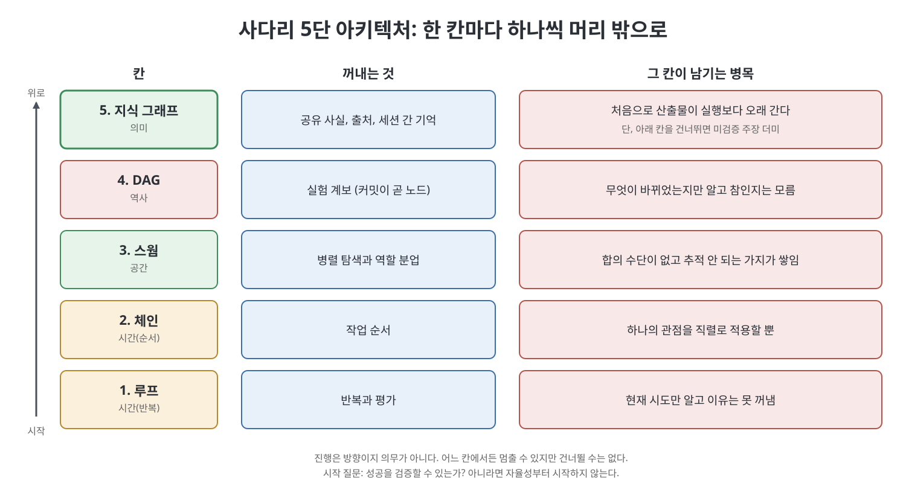

# 2장 사다리: 다섯 가지 아키텍처, 다섯 가지 병목 (The Ladder: Five Architectures, Five Bottlenecks)

이 장은 흔히 "메뉴"로 나열되는 에이전트 아키텍처를 하나의 사다리로 다시 정리한다. 책의 기준은 단순하다. 각 아키텍처는 모델의 머릿속에 있던 딱 한 가지를 바깥 세계로 꺼내기 위해 존재하고, 그래서 필요한 것이 무엇인지 이름 붙이면 아키텍처가 정해진다. 장은 다섯 칸(루프, 체인, 스웜, DAG, 지식 그래프)을 차례로 오르며 각 칸이 꺼내 주는 것과 남기는 병목을 보여 주고, 마지막에 어디서 시작할지 고르는 표를 준다.

> **쉽게 말하면**
> 사다리의 윗칸일수록 더 많은 것을 "머리 밖"에 둔다. 하지만 아랫칸을 건너뛰면 위에 세운 구조가 무너진다.

> **참고(노트 작성자)** 책이 소개하는 사례(Karpathy의 autoresearch)와 수치, 명령줄 도구 예시, "2026년의 전환"은 책이 서술한 시점 기준이며 노트가 검증하지 않았다.

## 이 장의 흐름

1. 다섯 칸과 꺼내는 것의 진행
2. 1칸 루프와 네 가지 조건
3. 2~3칸 체인과 스웜
4. 4칸 DAG가 곧 그래프
5. 5칸 지식 그래프
6. 어느 칸에서 시작할까
7. 이 사다리가 책에 말해 주는 것

## 1. 다섯 칸

| 칸 | 꺼내는 것 | 이럴 때 고른다 |
|----|----------|--------------|
| 루프 | 반복과 평가 | 출력을 검사할 수 있다 |
| 체인 | 작업 순서 | 순서가 안정적이고 시험 가능하다 |
| 스웜 | 병렬 탐색과 역할 분업 | 하위 작업이 정말 독립적이다 |
| DAG | 실험 계보 | 대안 가지를 살려 두어야 한다 |
| 지식 그래프 | 공유 사실, 출처, 세션 간 기억 | 관계와 지속성이 중요하다 |

"꺼내는 것" 열을 위에서 아래로 읽으면 시간(반복, 순서)에서 공간(병렬 작업자)으로, 이어 역사(계보)로, 마지막으로 의미(사실과 그 출처)로 올라가는 진행이다. 각 칸은 아래 칸이 만든 한계를 푼다. 루프는 한 번의 실수를 고치지만 현재 시도만 안다. 체인은 순서를 고치지만 하나의 관점을 직렬로 적용할 뿐이다. 스웜은 관점의 한계를 풀지만 아무도 추적하지 않는 가지를 낳는다. DAG는 계보를 고치지만 무엇이 바뀌었는지만 기록하고 무엇이 참인지는 기록하지 않는다. 지식 그래프는 공유 기억을 고치며, 산출물이 실행보다 오래 가는 첫 칸이다.

책은 이 진행이 의무가 아니라 방향이라고 한다. 어느 칸에서든 멈출 수 있고 대부분의 팀은 생각보다 낮은 칸에서 멈춰야 한다. 그러나 건너뛸 수는 없다. 루프 없는 스웜은 병렬로 만든 쓰레기이고, 평가되지 않은 작업자가 먹여 주는 지식 그래프는 잘 정리된 미검증 주장 더미다.

## 2. 1칸 루프와 네 가지 조건

루프는 기본형이며 네 조건이 성립할 때 잘 돈다. 이 조건은 어떤 작업이든 빠르게 가늠하는 분류 기준이다.

| 조건 | 의미 | 예 |
|------|------|-----|
| 검증 가능한 출력 | 테스트, 지표, 스키마 검사 같은 측정 결과가 있다 | 테스트 통과 여부 |
| 되돌릴 수 있는 행동 | 마지막 정상 상태로 복귀 가능 | `git reset` |
| 짧은 호흡 | 한 주기가 몇 시간이 아니라 몇 분 | 잦은 피드백 |
| 한정된 환경 | 행동 공간이 좁아 헤매지 않는다 | 파일 하나만 수정 |

책은 깨끗한 예로 Karpathy의 autoresearch를 든다. 고정된 지표, 수정 가능한 `train.py`, 자연어 제어 파일로 이루어진 작은 단일 GPU 하네스이고, 책에 따르면 핵심 코드 약 630줄로 이틀간 약 700번 실험하여 쓸 만한 최적화 약 20개를 남겼다.

밑바닥의 재사용 가능한 형태는 래칫(ratchet)이다. 제안, 적용, 평가, 유지 또는 되돌리기, 기록의 순서다. 책이 강조하는 세부는 둘이다. 첫째, 기록은 유지, 되돌림, 충돌 어느 분기에서든 남긴다. 되돌려진 시도는 낭비가 아니라 "이 아이디어는 시도했고 실패했다"는 기록이며, 미래 에이전트가 같은 시도를 반복하지 않는 데 필요한 지식이다. 승리만 기록하면 세션을 넘어 아무것도 배우지 못한다. 둘째, "무엇이 더 나은가"를 정하는 함수는 매개변수이고, 그것을 정하는 쪽이 시스템의 최적화 방향을 정한다. 12장이 다시 다루듯, 래칫은 보이는 지표만 개선하고 보이지 않는 모든 것은 기꺼이 맞바꾼다.

루프가 꺼내지 못하는 것은 이유다. 기록에는 diff와 점수만 있고 변경을 낳은 가설은 제안한 에이전트의 컨텍스트와 함께 사라진다.

## 3. 2~3칸 체인과 스웜

체인은 순서를 바깥으로 꺼낸다. 한 호출의 산출물이 다음 호출의 입력이 되는 고정된 순서이며, 추출, 해소, 조립처럼 단계가 안정적일 때 맞다. 고정 순서는 단계별로 시험할 수 있기 때문이다.

스웜은 병렬 탐색과 역할 분업을 꺼낸다. 책은 대부분의 "멀티 에이전트" 시스템이 아래 다섯 합성 패턴 중 하나가 변장한 것이라고 말한다.

| 패턴 | 한 줄 설명 |
|------|-----------|
| 프롬프트 체이닝 | 고정 순서, 앞 출력이 뒤 입력 |
| 라우팅 | 분류기가 특화된 프롬프트, 모델, 도구로 보냄 |
| 병렬화 | 독립 호출을 동시에 실행해 구획하거나 투표 |
| 오케스트레이터-작업자 | 중앙 모델이 동적으로 분해, 배정, 종합 |
| 평가자-최적화자 | 한 역할이 생성하고 다른 역할이 기준에 따라 평가, 루프 |

책은 2026년의 전환으로 오케스트레이션 스크립트 자체를 모델이 생성하는 흐름을 소개한다. 추상화의 경계는 움직였지만 엔지니어링 책임은 그대로여서, 사람이 목표, 범위 파일, 출력 계약, 권한, 검증 정책, 동시성과 토큰 예산, 롤백 규칙, 종합에 필요한 증거를 정해야 한다. 이를 지정하지 않고 워크플로만 생성하면 타이핑만 자동화하고 위험은 그대로 둔 셈이다.

스웜이 꺼내지 못하는 것은 합의다. 열 작업자는 열 개의 국소적 진실을 내고, 이를 조정하는 장치가 없다. 끝의 리듀서가 한 컨텍스트 창 안에서 산문으로 조정하게 되는데, 이는 스웜이 덜어 주려던 병목 그대로다.

## 4. 4칸 DAG가 곧 그래프

책은 많은 팀이 건너뛰는 칸이며 그래서 스웜이 어수선해진다고 한다. 통찰은 문자 그대로다. 커밋 DAG(방향 비순환 그래프)는 이미 그래프다. 커밋이 노드, 부모 링크가 방향 간선이어서 새로 만들 것이 없고, DAG를 배관이 아니라 질의 가능한 구조로 대하기만 하면 된다.

실험 루프의 커밋 노드에는 부모 커밋, 만든 에이전트, 가설, diff, 지표, 실행 시간, 메모리 사용량, 환경, 유지 또는 폐기 상태, 관련 실험 링크를 실을 수 있다. 그러면 브랜치 모델이 답하지 못하는 질문에 순회로 답한다. 메모리 제한 아래 가장 좋은 지표는 무엇인가, 배치 크기 변경에서 갈라진 실험은 무엇인가, 같은 최적화를 독립적으로 재발견한 에이전트는 누구인가, 평가가 없는 잎은 무엇인가.

책은 더 급진적으로, 사람 속도의 협업을 위한 추상화를 버리라고 말한다. 수천 에이전트가 동시에 탐색하고 대부분의 결과는 병합되지 않으며 실패한 실험에도 증거가 있으므로, 필수 메인 브랜치도 풀 리퀘스트도 병합 대기열도 없다. 핵심 연산은 "main에 병합"에서 "탐색 그래프 순회"로 바뀐다. 이런 인터페이스에는 `children`(이 결과 위에 무엇을 시도했나), `leaves`(자식이 없는 미탐색 최전선), `lineage`(루트까지의 조상 경로) 같은 명령이 생기며 브랜치 연산으로는 표현할 수 없다. 그러면 에이전트는 컨텍스트를 복사하지 않고 관련 계보를 질의하고 몇 개 요약을 읽어 이어 간다. 이것이 9장에서 완성될 그래프 기반 컨텍스트 구성의 시작이다.

DAG가 꺼내지 못하는 것은 의미다. 커밋 a81f가 92e0의 자손이고 0.83점이라는 것은 알아도, 둘 다 테넌트 격리를 전제한다거나 "주문"이라는 어휘의 정의가 둘 사이에 바뀌었다는 것은 모른다. 계보는 지식이 아니다.

## 5. 5칸 지식 그래프

최상위 칸은 공유 사실과 그 출처, 모순을 꺼낸다. 구축은 네 단계(8장)이며 모양은 지금 알아 둘 만하다.

| 단계 | 하는 일 |
|------|--------|
| 추출 | 싼 모델이 스키마 제약 아래 타입 있는 개체와 주어-술어-목적어 관계를 뽑는다. 문서당 한 번 호출 |
| 해소 | 더 강한 모델이 표면 형태를 정규 개체로 묶는다. 문자열 일치가 아니라 추론 과제 |
| 조립 | 정규 노드와 타입 있는 간선을 만들고 간선마다 출처와 신뢰도를 붙인다 |
| 질의 | 한정된 부분 그래프를 안정적 간선 ID와 함께 컨텍스트에 직렬화한다 |

마지막 항목이 평가를 바꾼다. 답이 간선 ID를 인용하면 평가자는 인용한 간선이 존재하고 주장을 뒷받침하는지 기계적으로 확인한다. 인용이 없으면 평가는 두 번째 모델이 문장이 그럴듯하다고 느끼는 것으로 무너진다.

## 6. 어느 칸에서 시작할까

| 상황 | 시작점 | 이유 |
|------|--------|------|
| 단순하고 위험 낮은 질문 | 제로샷 | 지연 최소, 구조는 비용일 뿐 |
| 출력을 검사할 수 있음 | 루프 | 반복 피드백이 산출물을 개선 |
| 순서가 안정적 | 체인 | 예측 가능하고 시험 가능한 단계 |
| 입력이 명확한 범주로 나뉨 | 라우터 | 정책과 모델 선택을 분리 |
| 하위 작업이 독립적 | 병렬화 | 벽시계 시간을 줄일 뿐 토큰 비용은 아님 |
| 분해가 작업마다 다름 | 오케스트레이터-작업자 | 동적 특화 |
| 대안이 살아 있어야 함 | 커밋 DAG | 하나를 강요하지 않고 가지를 보존 |
| 사실이 세션을 넘어 남아야 함 | 지식 그래프 | 지속되는 공유 기억 |
| 매우 큰 병렬 작업량 | 생성된 워크플로 | 팬아웃과 팬인 자동화 |

실무에서는 여섯 질문이 선택을 한다. 성공을 검증할 수 있는가(없으면 자율성부터 시작하지 말고 테스트, 루브릭, 출처 요건, 사람의 결정을 먼저 정한다). 단계가 안정적인가(그렇다면 체인, 아니라면 계획이나 오케스트레이터). 하위 작업이 독립적인가(그렇다면 병렬화, 아니라면 의존성을 명시하고 동시 쓰기를 제한). 대안 계보를 살려 둬야 하는가(그렇다면 DAG). 사실이 실행을 넘어 남아야 하는가(그렇다면 산출물과 그래프 상태를 저장하고 대화록 요약에 기대지 않는다). 비용과 지연을 감당할 수 있는가(작업자를 늘리기 전에 예산부터). 책은 첫 질문이 관문이고 나머지는 최적화라고 한다. "아니오"인데 진행하면 확신에 찬 검증 불가능한 출력을 대량으로 만드는 기계를 산 것이다.

예를 들어 "결제 웹훅 재시도 시 이중 청구" 버그를 고치는 일은 테스트로 검증되고 되돌릴 수 있으므로 루프로 충분하다. 반면 팀이 같은 불변식을 여러 번 재발견하는 문제라면 사실을 세션 너머에 두어야 하므로 지식 그래프가 필요해진다.

## 7. 이 사다리가 책에 말해 주는 것

4장부터는 모두 4~5칸에서 일어난다. 이는 의도된 선택이며 의무가 따른다. 루프가 버전을 저장하지 않고, 체인이 시험되지 않고, 스웜에 리듀서가 없다면, 지식 그래프는 무질서를 질의 가능한 형태로 부호화해 놓고 진전이라 부르게 된다. 13장의 구축 경로가 첫날 반성형 루프 하나에서 시작하고 그래프는 첫 달인 이유가 이것이며, 전작이 명세, 속성, ADR 순서로 해 온 것과 같은 순서를 산출물이 아닌 아키텍처에 적용한 것이다.

## 핵심 정리

- 아키텍처는 메뉴가 아니라 사다리이며, 각 칸은 모델의 머릿속에서 한 가지를 바깥으로 꺼낸다(반복, 순서, 병렬 탐색, 계보, 공유 사실).
- 건너뛸 수는 없다. 루프 없는 스웜은 병렬 쓰레기, 평가 없는 지식 그래프는 미검증 주장 더미다.
- 루프는 검증 가능, 되돌림 가능, 짧은 호흡, 한정된 환경의 네 조건에서 작동하며 실패한 시도도 기록해야 한다.
- 커밋 DAG는 이미 그래프이고 노드에 메타데이터를 달면 계보를 순회로 질의한다. 단 DAG는 의미를 기록하지 않는다.
- 지식 그래프는 간선 ID 인용으로 평가를 기계적 검사로 바꾼다.
- 여섯 질문 중 첫째(성공을 검증할 수 있는가)가 관문이며, 대부분의 팀은 생각보다 낮은 칸에서 멈춰야 한다.

 
 
 

이전: [1장 모두가 루프를 만들지만 기억하는 루프는 거의 없다](01%EC%9E%A5%20%EB%AA%A8%EB%91%90%EA%B0%80%20%EB%A3%A8%ED%94%84%EB%A5%BC%20%EB%A7%8C%EB%93%A4%EC%A7%80%EB%A7%8C%20%EA%B8%B0%EC%96%B5%ED%95%98%EB%8A%94%20%EB%A3%A8%ED%94%84%EB%8A%94%20%EA%B1%B0%EC%9D%98%20%EC%97%86%EB%8B%A4.md) | 다음: [3장 그래프는 하나가 아니라 둘](03%EC%9E%A5%20%EA%B7%B8%EB%9E%98%ED%94%84%EB%8A%94%20%ED%95%98%EB%82%98%EA%B0%80%20%EC%95%84%EB%8B%88%EB%9D%BC%20%EB%91%98.md)

 

[Graph Engineering - The Loop Memory Model](../)
