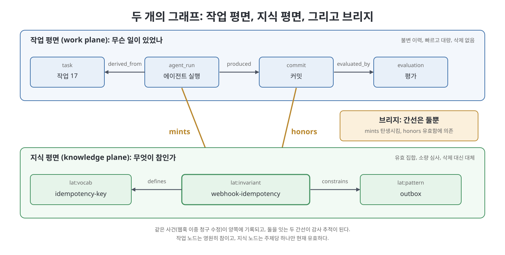

# 3장 그래프는 하나가 아니라 둘 (Two Graphs, Not One)

이 장은 책 전체가 기대는 구조적 아이디어 하나를 세운다. 진지한 에이전트 시스템에는 그래프가 두 개 필요하다. 하나는 "무슨 일이 있었나"를, 다른 하나는 "무엇이 참인가"를 답한다. 책은 둘이 묻는 질문, 수명, 쓰기 방식, 실패 양상이 모두 다르다고 보고, 하나로 합칠 때 생기는 두 가지 실패를 설명한 뒤, 둘을 잇는 작은 다리(bridge)와 구체적인 사례로 마무리한다.

> **쉽게 말하면**
> 하나는 일기장(무슨 일이 있었나), 하나는 현재 법전(지금 무엇이 유효한가)이다. 둘을 한 권에 섞으면 일기도 법전도 못 쓴다. 대신 둘을 잇는 몇 개의 연결 선이 감사 기록이 된다.

> **참고(노트 작성자)** 이 장의 노드 이름(예: `lat:invariant/...`)과 `honors`, `mints` 같은 술어는 책의 어휘이며, 정확한 정의는 7장과 부록 B에서 다룬다. 아래 예시는 개념을 보이기 위해 노트 작성자가 새로 쓴 것이다.

## 이 장의 흐름

1. 두 질문: 작업 그래프와 지식 그래프
2. 합칠 때의 두 가지 실패
3. 브리지: 두 평면을 잇는 간선
4. 이미 가진 두 그래프
5. 사례로 보는 분리
6. 규칙

## 1. 두 질문

작업 그래프(work graph)는 커밋 DAG에 실행과 평가 메타데이터를 얹은 것이며 "무슨 일이 있었나"에 답한다. 무엇이 바뀌었는가, 이 실험의 부모는 누구인가, 어떤 에이전트가 이 산출물을 만들었는가, 어느 계보가 아직 활발하고 어느 것이 정체했는가, 이미 시도해서 실패한 것은 무엇인가.

지식 그래프(knowledge graph)는 래티스를 승격한 것이며 "무엇이 참인가"에 답한다. 이 도메인에 어떤 개체가 있는가, 서로 어떻게 연결되는가, 어떤 출처가 그 관계를 뒷받침하는가, 어떤 주장이 서로 모순되는가, 지금 유효한 제약은 무엇인가.

말로 하면 당연하지만, 팀이 실제로 만들면 거의 즉시 합쳐진다. 같은 사건이 두 그래프를 모두 만들기 때문이다. 멱등성 요구를 발견한 에이전트 실행은 작업 그래프의 사건이면서 지식 그래프 불변식의 출처다. 한 번만 저장하고 싶은 유혹이 크다.

## 2. 합칠 때의 두 가지 실패

| 합치는 방향 | 결과 | 어디서 흔한가 |
|------------|------|--------------|
| 작업 쪽으로 | 훌륭하게 구조화된 이벤트 로그. "무슨 일이 있었나"는 잘 답하지만 "총액은 최소 통화 단위의 음이 아닌 정수다" 같은 사실을 담은 노드가 없어서, 아무것도 이를 지키거나 검사할 수 없고 열두 번째 변경이 세 번째와 모순돼도 게이트가 울리지 않는다 | 대부분의 에이전트 메모리 시스템(이벤트 로그가 계측하기 쉬워서) |
| 지식 쪽으로 | 이력 없는 깔끔한 온톨로지. 현재 불변식과 어휘는 알지만 어느 실행이 변경을 도입했는지, 이전 정의가 무엇이었는지, 근거가 무엇이었는지, 옛 정의를 전제한 실험이 무효가 되었는지 모른다. 대체(supersession)가 사건이 아니라 편집이 되어, 사실이 언제 참이 되었는지 말할 수 없으면 아무것도 감사할 수 없다 | 온톨로지 모델링에서 출발한 팀 |

두 그래프는 형태가 근본적으로 맞지 않는다.

| 항목 | 작업 그래프 | 지식 그래프 |
|------|------------|------------|
| 노드 종류 | 실행, 커밋, 작업, 산출물, 평가 | ADR, 어휘, 불변식, 패턴, 원칙, 주장, 출처 |
| 성장 | 단조롭고 빠르며 한계 없음 | 느리고 선별적, 대체를 동반한 추가 전용 |
| 쓰기 | 대량, 기계, 동시 | 소량, 게이트 통과, 리뷰 |
| 진리 모델 | 불변 이력(틀린 것은 없고 이후 사건에 대체될 뿐) | 유효 집합(주제당 현재 노드는 정확히 하나) |
| 삭제 | 하지 않음, 보관과 압축 | 하지 않음, 대체 |
| 핵심 연산 | 계보 순회 | 유효 집합 해소 |
| 없을 때의 실패 | 재현과 감사 불가 | 제약과 검증 불가 |

책은 논쟁을 끝내는 줄이 "진리 모델"이라고 한다. 작업 그래프는 이력이어서 모든 노드가 영원히 참이다. "실행 183이 시각 T에 산출물 X를 만들었다"는 사실은 참이기를 멈추지 않는다. 지식 그래프는 믿음 상태여서 "주문"의 현재 정의는 하나뿐이고 이전 정의는 얼어붙은 채 더는 유효하지 않다. 두 대상은 수학적으로 다르며, 하나에 넣으면 이력이 가져서는 안 될 "현재성"을 얻거나, 믿음이 쿼리로 우회할 수 없는 "누적"을 얻는다.

## 3. 브리지

분리가 쓸모 있으려면 연결되어야 한다. 연결은 평면 사이를 건너는 작은 고정 간선 집합이다. 책의 예는 이렇게 읽힌다. 작업 쪽에서 에이전트 실행 183이 산출물과 커밋을 만들고(produced, modified) 평가에 의해 평가된다(evaluated_by). 지식 쪽에서 주장 441은 어떤 개체에 대한 것이고(about) 어떤 출처가 뒷받침하며(supported_by) 이전 주장 238을 대체한다(supersedes). 두 평면을 가로지르는 간선이 감사 추적(audit trail)이다.

이것이 1장의 합격 시험을 기계적으로 검사 가능하게 만든다. "목표, 계획, 산출물, 평가자 판정, 실행 기록"은 모두 작업 그래프이고 "출처, 그래프 경로"는 지식 그래프다. 그 문장은 시가 아니라 두 평면에 걸친 조인(join)이며, 두 그래프와 브리지 간선이 있을 때만 만족된다.

그래서 7장은 브리지 술어를 정확히 둘만 정의한다. `honors`는 작업이 어떤 지식 노드의 유효함에 의존한다는 뜻이고, `mints`는 작업이 어떤 지식 노드를 존재하게 만들었다는 뜻이다. 다른 모든 평면 간 관계는 이 둘에서 유도되거나, 무언가 잘못된 평면에 모델링되었다는 신호라고 책은 말한다.

## 4. 이미 가진 두 그래프

책은 새로 만들 것이 없다고 안심시킨다. 두 그래프는 이미 모든 포지(forge) 저장소에 열화된 형태로 있다.

| 그래프 | 이미 있는 것 | 부족한 것 |
|--------|-------------|----------|
| 작업 그래프 | Git 이력과 `openspec/changes/<id>/` 변경 폴더(제안, 작업, 설계, 명세 델타) | 노드의 메타데이터: 어떤 에이전트가, 어떤 작업을, 평가가 무엇이었는지, 가설이 무엇이었는지. 구조는 있고 주석이 부족하다 |
| 지식 그래프 | `lat.md/` 래티스(노드 유형 5종, 이름 붙은 술어 5종, 대체를 동반한 추가 전용 규율, `lat:` 참조 규약) | 기계 질의 가능성, 간선의 출처, 유사도 개념. 구조는 있고 계측이 부족하다 |

그래서 이 책의 일은 "두 그래프 만들기"가 아니라 네 가지다. 가진 작업 그래프에 주석을 달고(7장), 가진 래티스를 파일에서 질의 가능한 메타그래프로 승격하고(4~7장), 두 술어로 둘을 잇고(7장), 결과를 질의해 컨텍스트를 조립하고 평가를 접지한다(9장). 누구도 `lat.md/`를 버릴 필요가 없다. 래티스가 `openspec/`의 형제 위치(sidecar)에 있는 것은 주변 도구보다 오래 살아남도록 정한 선택이었고, 이 책이 그 선택에 실제로 기대는 첫 시도라고 책은 말한다.

## 5. 사례로 보는 분리

워크트리 3의 에이전트가 결제 웹훅이 재시도되면 이중 청구가 일어남을 발견하고, 멱등성 키를 넣어 고치고, 테스트를 통과시킨다. 이를 제대로 분류하면 아래와 같다.

| 평면 | 기록하는 내용 |
|------|--------------|
| 작업 평면 | 실행이 커밋을 만들었다, 후속 실행의 부모다, 커밋은 평가(테스트 통과, 새 테스트 4개)에 의해 평가되었다, 실행은 작업 17에서 파생되었다 |
| 지식 평면 | 웹훅 멱등성 불변식이 아웃박스 패턴을 제약하고, 멱등성 키 어휘를 정의한다 |
| 브리지 | 실행이 그 불변식을 mints하고, 커밋이 그 불변식을 honors한다 |

이제 이전에는 답할 수 없던 질문에 답한다.

- 지금 어떤 코드가 멱등성 불변식을 지키는가: honors를 역방향으로 순회한다. 기계적 답이며 CI 게이트가 "비어 있지 않음"을 단언할 수 있다.
- 이 불변식은 어디서 왔는가: mints를 실행으로, 작업으로, 변경 제안으로 거슬러 간다. 고고학 없이 완전한 출처다.
- 이 불변식이 또 무엇을 제약하는가: 지식 평면만 순회한다. 작업 평면은 관련이 없어 참조하지 않는다.
- 다른 작업자가 독립적으로 같은 것을 발견했는가: 같은 노드를 honors하는 커밋을 만든 실행을 작업 평면에서 질의한다. 스웜의 중복 발견 탐지기이고 비용은 순회 한 번이다.

책은 이 네 질문이 NOTES.md, 대화록, 잘 정리된 마크다운 파일 어디에서도 답할 수 없고 두 개의 작은 그래프와 두 개의 브리지 간선에서는 모두 답할 수 있다고 말한다.

## 6. 규칙

책이 이후 내내 지키는 규칙은 이것이다. 커밋 DAG는 어떤 작업이 어떤 실험에서 이어졌는지를 기억하고, 지식 그래프는 어떤 주장이 어떤 개체와 출처에 연결되는지를 기억한다. 둘이 함께일 때 에이전트가 컨텍스트 창마다 세계를 처음부터 다시 짓는 일을 막는다. 따로 있으면 각각 이벤트 로그와 온톨로지일 뿐이고 어느 쪽도 기억이 아니다. 책은 2부가 지식 평면을 제대로 세운다고 예고한다. 먼저 포지가 남긴 래티스를 복습하고, 그것이 처음부터 메타그래프였음을 보이고, 빠져 있던 네 가지 관계를 부여한다.

## 핵심 정리

- 진지한 에이전트 시스템에는 "무슨 일이 있었나"의 작업 그래프와 "무엇이 참인가"의 지식 그래프가 따로 필요하다.
- 작업 쪽으로 합치면 이벤트 로그가 되어 지켜야 할 사실이 없고, 지식 쪽으로 합치면 이력 없는 온톨로지가 되어 감사가 불가능하다.
- 결정적 차이는 진리 모델이다. 작업 그래프는 불변 이력이고, 지식 그래프는 주제당 하나의 유효 노드를 가진 믿음 상태다.
- 두 평면은 `honors`와 `mints` 두 브리지 술어로 잇고, 이 간선이 1장의 한 문장 시험을 기계적으로 검사 가능하게 만든다.
- 두 그래프는 이미 Git 이력과 `lat.md/`로 열화된 형태로 있으므로 할 일은 주석 달기, 승격, 연결, 질의다.

 
 
 

이전: [2장 사다리 다섯 가지 아키텍처 다섯 가지 병목](02%EC%9E%A5%20%EC%82%AC%EB%8B%A4%EB%A6%AC%20%EB%8B%A4%EC%84%AF%20%EA%B0%80%EC%A7%80%20%EC%95%84%ED%82%A4%ED%85%8D%EC%B2%98%20%EB%8B%A4%EC%84%AF%20%EA%B0%80%EC%A7%80%20%EB%B3%91%EB%AA%A9.md) | 다음: [4장 이미 가진 래티스](../02.%202%EB%B6%80%20%EA%B5%AC%EC%A1%B0/04%EC%9E%A5%20%EC%9D%B4%EB%AF%B8%20%EA%B0%80%EC%A7%84%20%EB%9E%98%ED%8B%B0%EC%8A%A4.md)

 

[Graph Engineering - The Loop Memory Model](../)
