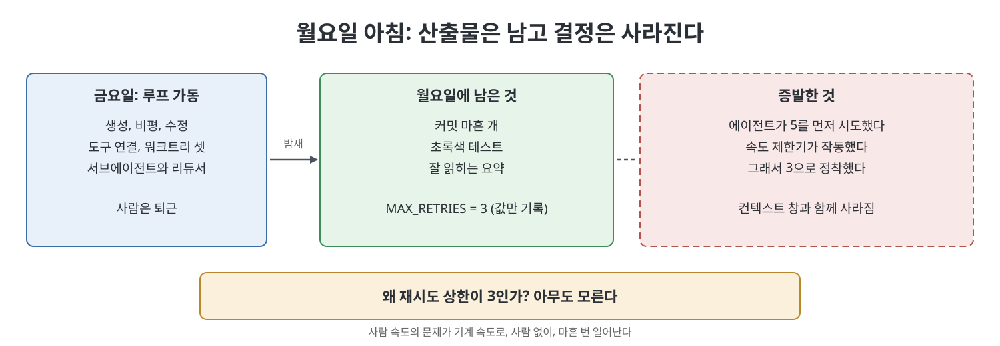

# 머리말 (Preface)

머리말은 이 책이 왜 쓰였고 무엇을 주장하며 어떻게 읽어야 하는지를 밝히는 짧은 글이다. 책은 한 장면으로 시작한다. 금요일에 에이전트 루프를 돌려 놓고 월요일에 돌아오니 커밋 마흔 개, 초록색 테스트, 매끄러운 요약이 와 있다. 그런데 "재시도 횟수는 왜 3인가?"라는 단 하나의 질문에 아무도 답하지 못한다. 이 장면이 책 전체의 문제의식이다.

> **쉽게 말하면**
> 에이전트가 밤새 일해 결과물은 남겼지만 "왜 그렇게 결정했는지"는 사라졌다. 이 책은 그 이유를 그래프에 남겨 두는 방법을 다룬다.

> **참고(노트 작성자)** 책은 2026년경의 에이전트 워크플로(생성, 비평, 수정을 도는 루프, 워크트리, 서브에이전트)를 전제로 쓰였다. 언급되는 도구와 관행은 시점 기준이다.

## 이 장의 흐름

1. 월요일 아침의 사라진 결정
2. 이 책이 하는 일: 래티스를 중심으로 옮기기
3. 이 책이 하지 않는 일
4. 통과하려는 단 하나의 시험
5. 읽는 방법

## 1. 사라진 결정

책은 재시도 상한이 `3`으로 정해진 사연을 예로 든다. 에이전트가 5를 시도해 보고, 속도 제한기가 작동하는 것을 보고, 3으로 정착했다. 그러나 커밋 기록에는 "3이라는 값이 쓰였다"만 남고, 그 과정은 컨텍스트 창이 닫히면서 함께 사라졌다. 책의 표현으로는 산출물은 살아남았고 결정은 증발했다.

책은 이것이 전작 『The Clarity Forge』에서 다룬 "월요일 아침" 문제, 곧 의도가 사라지고 코드만 배포되는 문제와 같은 실패라고 본다. 다른 점은 속도다. 이제는 사람이 없는 사이에 기계의 속도로, 그것도 마흔 번씩 일어난다. 전작은 명세(spec)를 지속되는 산출물로 두고 코드를 부산물로 보는 방식으로 사람의 속도에서 이 문제를 풀었다. 책은 그 해법이 스웜(swarm, 여러 에이전트가 병렬로 일하는 구조)을 만나면 통하지 않는다고 말한다. 명세는 문서일 뿐이고, 스웜에는 기반(substrate)이 필요하다.

## 2. 이 책이 하는 일

책이 말하는 기반의 씨앗은 `lat.md/` 디렉터리, 곧 래티스(lattice)다. 래티스는 ADR(아키텍처 결정 기록), 어휘, 불변식(invariant), 패턴, 원칙을 다섯 가지 이름 붙은 관계로 엮은 지식 모음이며, 명세와 ADR이 모두 놓치는 횡단 지식을 두는 곳이다.

책은 이 래티스를 아키텍처의 중심으로 옮기고 완성한다. 마크다운 파일 더미였던 래티스를 질의할 수 있고, 타입이 있으며, 출처 정보를 가진 메타그래프(metagraph)로 바꾸어 여러 에이전트가 동시에 읽고 쓰게 한다. 그리고 그 그래프를 OpenSpec 파이프라인의 처음(bootstrap)부터 끝(archive)까지 모든 단계에 연결한다.

책의 핵심 주장은 한 줄이다. 기억은 루프의 여섯 번째 부품이 아니라, 루프가 만들어 내려고 존재하는 바로 그것이다. 이후의 모든 내용이 이 한 줄을 진지하게 받아들인 결과다.

## 3. 이 책이 하지 않는 일

| 이 책은 아니다 | 책이 대신 말하는 것 |
|---------------|--------------------|
| 에이전트 프레임워크 비교 조사 | 아키텍처를 고르는 기준(2장) |
| 특정 그래프 데이터베이스 옹호 | 마크다운 파일과 200줄 정도의 인덱서로도 돌아간다 |
| 모든 팀에 지식 그래프가 필요하다는 주장 | 12장은 오히려 반대 논리에 많은 분량을 쓴다 |

책은 이 시대의 실패 양상이 구조가 너무 적은 것이 아니라, 구조 자체가 목적이 되어 도입되는 것이라고 본다.

## 4. 통과하려는 시험

책이 돕고자 하는 시험은 좁고 기계적이다. 중요한 산출물 하나를 골라 그것이 목표, 계획, 산출물, 출처, 그래프 경로, 평가자의 판정, 그리고 한정된 실행 기록으로 거슬러 올라가 추적되는지 본다. 이 문장이 참이면 에이전트를 더할수록 처리량이 늘고, 거짓이면 불투명성만 늘어난다는 것이 책의 설명이다. 이것이 그래프 엔지니어링(graph engineering)의 전부이고 나머지는 세부 사항이라고 한다.

예를 들어 "결제 웹훅이 재시도될 때 이중 청구가 발생한다"는 버그를 고친 커밋이 있다면, 그 커밋이 어떤 목표와 작업에서 나왔고 어떤 평가를 통과했으며 어떤 근거에 기댔는지를 질의로 채울 수 있어야 한다.

## 5. 읽는 방법

| 부 | 성격 | 책의 안내 |
|----|------|----------|
| 1부 논증 | 루프가 왜 잊는지, 대안이 무엇인지 | 짧은 세 장, 한 시간 이내에 쭉 읽기 |
| 2부 구조 | 래티스 복습, 메타그래프, 시맨틱 시공간, 스키마 | 모델링 방식이 바뀌는 부분 |
| 3부 메커니즘 | 그래프 구축, 컨텍스트 조립, 스웜, 재배선된 파이프라인 | 직접 구현하는 부분 |
| 4부 판단 | 지표, 실패 양상, 단계별 구축 경로 | 한 개 루프에서 그래프 기반 스웜까지 두 달 |

부록 세 개는 한 장 요약, 전체 스키마, 프롬프트를 담는다. 마음이 급한 독자에게 책은 3장을 읽고 부록 A를 본 뒤 나머지를 읽을지 정하라고 권한다. 5장과 6장은 각각 다른 책(Metagraph for AI Agents, Semantic Space Time for AI Agent Ready Graphs)을 형식적 근거로 삼지만 단독으로도 읽히게 쓰였고, 4장이 래티스를 처음부터 다시 요약하므로 사전 지식은 필요 없다고 책은 말한다.

## 핵심 정리

- 문제의 장면은 루프가 산출물은 남기고 결정의 이유를 남기지 못하는 것이다.
- 전작의 명세 중심 해법은 사람의 속도에서 통했지만 스웜에는 문서가 아니라 기반이 필요하다.
- 책은 래티스를 질의 가능하고 출처를 가진 메타그래프로 승격해 모든 파이프라인 단계에 연결한다.
- 핵심 주장은 기억이 루프의 부품이 아니라 루프의 산출물이라는 것이다.
- 합격 기준은 중요한 산출물이 목표, 계획, 근거, 평가, 실행 기록으로 추적되는 것이다.

 
 
 

이전: [책 Readme](../Readme.md) | 다음: [1장 모두가 루프를 만들지만 기억하는 루프는 거의 없다](01%EC%9E%A5%20%EB%AA%A8%EB%91%90%EA%B0%80%20%EB%A3%A8%ED%94%84%EB%A5%BC%20%EB%A7%8C%EB%93%A4%EC%A7%80%EB%A7%8C%20%EA%B8%B0%EC%96%B5%ED%95%98%EB%8A%94%20%EB%A3%A8%ED%94%84%EB%8A%94%20%EA%B1%B0%EC%9D%98%20%EC%97%86%EB%8B%A4.md)

 

[Graph Engineering - The Loop Memory Model](../)
