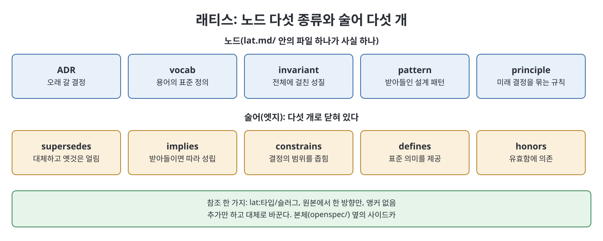
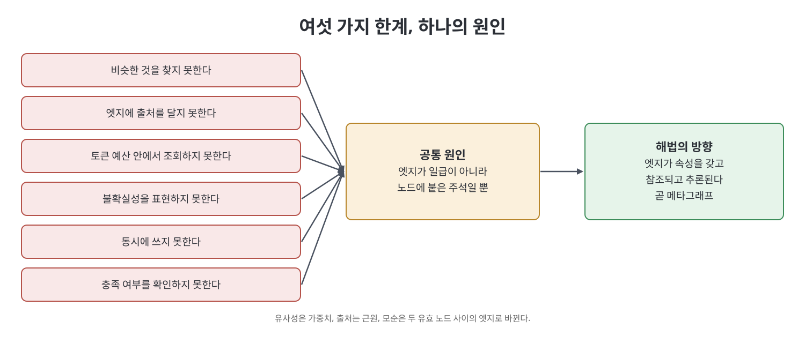

# 4장 이미 가진 래티스 (The Lattice You Already Have)

이 장은 2부의 출발점이다. 책은 먼저 앞선 책 시리즈의 작업 방식(The Clarity Forge)이 남긴 산출물, 곧 래티스(lattice, 파일로 관리하는 지식 노드 묶음)를 한 쪽으로 복습한다. 그다음 이 래티스가 에이전트 여러 개가 동시에 쓰기 시작하는 순간 무엇을 못 하게 되는지 여섯 가지로 고발한다. 나머지 장이 존재하는 이유가 이 고발이라고 책은 말한다. 이 장은 새 도구를 제안하지 않고, 이미 가진 것의 장점과 한계를 정확히 구분하는 장이다.

> **쉽게 말하면**
> 팀이 문서로 쌓아 온 결정·용어·규칙 모음집은 한 사람이 관리할 때는 잘 돌아간다. 하지만 에이전트 마흔 개가 동시에 쓰기 시작하면 "비슷한 게 뭐지?", "누가 언제 주장했지?" 같은 질문에 답하지 못한다. 이 장은 그 여섯 가지 빈틈을 하나의 원인으로 묶는다.

> **참고(노트 작성자)** 책은 2026년경의 에이전트 워크플로를 전제로 한다. `lat.md`, `openspec` 같은 도구 이름과 명령은 책이 쓰인 시점 기준이다. 용어 풀이: ADR(Architecture Decision Record)은 아키텍처 결정을 한 건씩 기록한 문서다.

## 이 장의 흐름

1. 한 쪽으로 보는 래티스: 노드 5종, 술어 5개, 참조 문법, 푸트프린트
2. 래티스가 잘하는 세 가지
3. 래티스가 못 하는 여섯 가지
4. 여섯 가지 실패의 공통 패턴: 엣지가 일급이어야 한다
5. 메타그래프로 승격해도 지켜지는 것과 새로 더해지는 것

## 1. 한 쪽으로 보는 래티스

책에 따르면 Clarity Forge가 오래 남기는 산출물은 두 가지다. 기능별 명세(살아 있는 스펙)와 ADR 모음이다. 그런데 이 둘 사이에는 빈틈이 있다. 명세는 각 기능이 하는 일을, ADR은 개별 결정을 기록하지만, 모든 기능과 결정을 가로지르는 용어, 불변식(invariant, 시스템 전체에서 항상 성립해야 하는 성질), 패턴, 원칙은 어디에도 없다. 그 지식은 보통 곧 퇴사할 사람의 머릿속에 있다. `lat.md/` 디렉터리는 이 지식을 파일로 꺼내 놓은 것이다.

### 노드 다섯 종류

| 노드 타입 | 담는 것 | 책의 예(요지) |
|-----------|---------|---------------|
| ADR | 오래 유지할 아키텍처 결정 | 카탈로그 데이터를 별도 Postgres에 둔다 |
| 용어(vocab) | 도메인 용어의 표준 정의 | 주문은 확정된 장바구니이며 항목 목록이 바뀌지 않는다 |
| 불변식(invariant) | 여러 기능에 걸쳐 성립하는 성질 | 금액은 가장 작은 화폐 단위의 음이 아닌 정수다 |
| 패턴(pattern) | 받아들인 설계 패턴과 적용 맥락 | 결제 흐름의 일관성을 위해 사가 패턴을 쓴다 |
| 원칙(principle) | 앞으로의 결정을 제약하는 팀 규칙 | 값싼 검증 수단(타입)을 비싼 수단(문장)보다 먼저 쓴다 |

### 엣지 술어 다섯 개

책은 술어를 일부러 다섯 개로 묶는다.

| 술어 | 의미 |
|------|------|
| supersedes | 같은 타입의 이전 노드를 대체한다. 옛 파일은 얼린다 |
| implies | 이 노드를 받아들이면 다른 노드도 성립해야 한다 |
| constrains | 다른 노드가 취할 수 있는 결정의 범위를 좁힌다 |
| defines | 다른 노드가 쓰는 표준 의미를 제공한다 |
| honors | 다른 노드가 유효하다는 것에 의존한다 |

참조 문법은 `lat:<타입>/<슬러그>` 하나다. grep으로 오탐 없이 찾히고 기계가 해석할 수 있기 때문이라고 책은 설명한다. 규칙은 세 가지다. 참조는 원본에서 한 방향으로만 적고(들어오는 엣지는 계산한다), 슬러그는 제목이 아닌 케밥 케이스로 쓰고, 앵커나 줄 번호는 쓰지 않는다. 마지막 규칙이 노드 원자성을 지킨다. 노드가 사실 하나이므로 통째로 교체할 수 있어야 한다.

래티스는 `openspec/` 옆에 놓이는 사이드카(sidecar, 본체 옆에 붙는 별도 디렉터리)다. 하위 폴더가 아니라서 스키마나 변경 절차가 바뀌어도 살아남는다. 또 추가만 하는(append-only) 방식이라 용어를 제자리에서 고치지 않고, 새 노드를 만들어 옛 노드를 가리키는 supersedes 엣지를 붙인다.

파이프라인과의 접점은 변경 설계서 맨 아래의 한 구역, 곧 Lattice Footprint다. 이 구역은 세 목록으로 이뤄진다.

| 목록 | 의미 |
|------|------|
| Honors | 이 변경이 의존하는 기존 노드 |
| Mints | 이 변경이 새로 만드는 노드 |
| Touches | 결과 항목을 갱신해야 하는 기존 노드 |

보관(archive) 명령은 세 작업을 순서대로 한다. 새 노드 생성(mint), 기존 노드 갱신(touch), 참조 해석(resolve)이다. 참조가 하나라도 풀리지 않으면 보관은 거부된다. 진행 중에는 느슨하고 보관 시점에는 엄격한 비대칭이다.

## 2. 래티스가 잘하는 세 가지

책은 아래 세 가지가 그래프 버전에서도 그대로 살아남는다고 강조한다.

- **대체하며 추가만 한다**: 이 성질이 가장 중요하고, 시간에 쫓길 때 가장 먼저 버려진다. 별도 이력 장치 없이 이력이 생기고, 어떤 변경이 의존한 사실이 몰래 바뀌지 않는다. 3장이 말한 지식 평면(knowledge plane)의 "현재 유효한 노드 집합"을 계산할 수 있는 이유도 대체가 수정이 아니라 엣지이기 때문이다.
- **닫힌 술어 집합**: 다섯 개로 충분하고, 새 관계가 안 맞으면 노드를 넓혀 관계를 안으로 넣거나 서술형 문장으로 남긴다. 책은 실패한 그래프 프로젝트가 대개 엣지 어휘를 무한히 늘리다가 탐색이 추측이 되었다고 지적한다.
- **노드 원자성**: 일부만 가리키고 싶다면 노드가 너무 큰 것이므로 쪼갠다. 노드는 통째로 교체할 수 있는 크기여야 의미가 있다.

책은 이 셋을 꼭 쥐고 있으라고 당부하며, 7장의 스키마는 래티스를 완화하지 않고 확장한다고 못박는다.

## 3. 래티스가 못 하는 여섯 가지

에이전트가 둘 이상 쓰는 순간부터 문제가 된다고 책은 말한다.

| 못 하는 것 | 왜 문제인가 | 해결이 나오는 곳 |
|------------|-------------|------------------|
| 비슷한 것 찾기 | 다섯 술어에는 유사성이 없어서, 같은 성질을 다른 말로 쓴 불변식 둘이 생겨도 구조가 알아채지 못한다 | 6장 |
| 엣지에 출처 달기 | 누가 언제 어떤 근거로 주장했는지 모른다. 에이전트가 쓰면 이력이 전부 같은 이름이 된다 | 5장 |
| 토큰 예산 안의 조회 | 읽기 수단이 cat과 grep뿐이다. 노드 40개면 괜찮지만 400개면 문맥 전체가 된다 | 9장 |
| 불확실성 표현 | 노드가 제안됨 아니면 수용됨뿐이라 "한 기능에선 성립, 다른 곳은 모름"을 쓸 곳이 없다 | 5장 |
| 동시 쓰기 | 노드 생성이 파일 생성이라 같은 슬러그를 동시에 만들면 먼저 보관한 쪽이 이기고 나머지는 사라진다 | 7장, 11장 |
| 충족 확인 | 린트는 참조가 존재하는지만 보고, 정말 지키는지는 모델이 글을 읽고 판단한다 | 9장 |

책은 마지막 항목에 부연한다. 변경 설계서가 어떤 불변식을 Honors에 적기만 하면, 실제 변경 내용과 무관해도 린트를 통과한다. 그래서 지금은 마지막 점검 단계에서 모델이 문장을 읽고 판단하는데, 9장은 이를 엣지에 대한 기계적 검사로 바꾼다.

## 4. 여섯 가지 안의 한 패턴

책은 여섯 가지가 서로 다른 문제가 아니라 한 문제의 여섯 가지 모습이라고 한다. 래티스는 노드를 일급으로, 엣지는 주석으로 다룬다. 못 하는 것은 모두 엣지가 일급이어야 풀린다.

| 못 하던 것 | 엣지로 보면 |
|------------|-------------|
| 유사성 | 가중치와 맥락이 있는 엣지 |
| 출처 | 근원과 실행 번호가 있는 엣지 |
| 제한된 조회 | 멈춤 규칙이 있는, 타입 있는 엣지의 탐색 |
| 모순 | 둘 다 유효한 두 노드 사이의 엣지 |
| 동시 병합 | 엣지가 객체이면 두 쓰기의 충돌을 해결할 수 있다 |
| 충족 확인 | 특정 엣지가 존재하고 뒷받침되는지 묻는 일 |

엣지가 속성을 가지고, 참조되고, 추론의 대상이 되는 구조는 라벨 그래프가 아니라 메타그래프(metagraph)다. 책은 래티스가 supersedes 술어를 얻은 날부터 이미 메타그래프였다고 말한다. 대체는 두 결정 사이의 관계에 관한 진술, 즉 엣지에 관한 진술이기 때문이다.

## 5. 승격해도 남는 것과 더해지는 것

책은 2부의 계약을 이렇게 정리한다. 래티스를 메타그래프로 올려도 아래는 그대로다.

- 지식 노드 다섯 종류와 술어 다섯 개의 의미
- 참조 문법, 추가만 하는 대체 방식, 노드 원자성
- `<repo>/lat.md/` 사이드카 위치
- 마크다운이 작성 형식이자 원본이라는 원칙

그리고 아래가 더해진다.

| 추가되는 것 | 설명 | 다루는 장 |
|-------------|------|-----------|
| 계산되는 유사 관계(NEAR) | 사람이 쓰지 않고 계산만 한다 | 6장 |
| 속성을 가진 엣지 객체 | 출처, 확신도, 유효 기간 | 5장, 7장 |
| 작업 평면(work plane) | 자체 술어 다섯 개와 브리지 둘 | 7장 |
| 파생 색인 | 마크다운에서 다시 만드는 데이터베이스 | 8장 |

마지막 항목이 이 이행의 탈출구라고 책은 말한다. 마크다운 파일이 계속 원본이고 그래프는 거기서 뽑아낸 투영이다. 색인이 틀리면 지우고 다시 만들면 되고, 도구가 죽어도 `lat.md/`는 남아 grep이 된다. 이 책은 그 내구성을 낭비하지 않는다.

## 핵심 정리

- 래티스는 노드 5종, 술어 5개, `lat:<타입>/<슬러그>` 참조 하나로 이루어진 파일 기반 지식 저장소이며, 사이드카로 놓여 변경 절차의 개편에도 살아남는다.
- 장점은 대체하며 추가만 하기, 닫힌 술어 집합, 노드 원자성이고, 이 셋은 이후에도 완화하지 않는다.
- 에이전트가 여럿 쓰면 유사성, 출처, 예산 조회, 불확실성, 동시 쓰기, 충족 확인 여섯 가지가 막힌다.
- 여섯 가지는 하나의 원인이다. 엣지가 일급이 아니라 주석이라는 점이다.
- 엣지가 속성을 가지면 이미 메타그래프이고, 이행은 마크다운을 원본으로 두고 색인을 투영으로 두기 때문에 안전하다.

---

이전: [3장 그래프는 하나가 아니라 둘](../01.%201%EB%B6%80%20%EB%85%BC%EC%A6%9D/03%EC%9E%A5%20%EA%B7%B8%EB%9E%98%ED%94%84%EB%8A%94%20%ED%95%98%EB%82%98%EA%B0%80%20%EC%95%84%EB%8B%88%EB%9D%BC%20%EB%91%98.md) | 다음: [5장 래티스 메타그래프](05%EC%9E%A5%20%EB%9E%98%ED%8B%B0%EC%8A%A4%20%EB%A9%94%ED%83%80%EA%B7%B8%EB%9E%98%ED%94%84.md)

 
 
 

[Graph Engineering - The Loop Memory Model](../)
