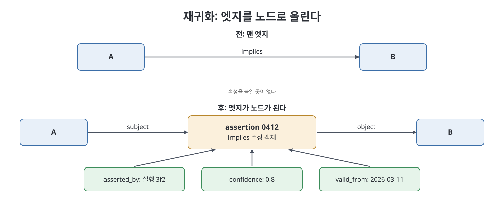
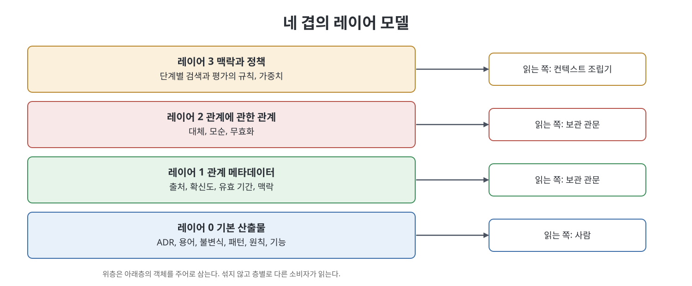

# 5장 래티스 메타그래프 (Lattice Metagraphs)

4장은 래티스의 한계 여섯 가지가 모두 "엣지가 일급이 아니다"라는 하나의 원인에서 나온다고 진단했다. 이 장은 그 진단을 받아들이면 무엇이 달라지는지를 다룬다. 책의 주장은 도발적이다. 래티스는 두 번째 술어를 얻은 날부터 이미 메타그래프(metagraph)였고, 이를 인정하면 구현이 오히려 쉬워진다. 그러면서도 메타그래프 전용 데이터베이스를 사지 않고 구현하는 현실적 방법을 제시한다. 장의 끝에서는 그래프가 이만큼 복잡할 필요가 없는 경우도 정직하게 알려 준다.

> **쉽게 말하면**
> "A가 B를 함의한다"는 선 하나에 "누가 언제 얼마나 확신하며 말했는가"를 붙이고 싶어지는 순간, 그 선은 이미 하나의 사물(객체)이다. 그 사물을 노드로 올려 주는 것이 이 장의 핵심 기술(reification)이다. 단, 필요한 선만 올린다.

> **참고(노트 작성자)** 책은 2026년경 에이전트 워크플로를 전제로 한다. 책이 언급하는 데이터베이스, 표준(RDF-Star 등), 시리즈 도서는 시점 기준이다. 책이 쓰는 SQL 예시는 옮기지 않고 컬럼 구조만 표로 정리했다.

## 이 장의 흐름

1. 그래프, 하이퍼그래프, 메타그래프의 세 단계
2. 래티스가 이미 메타그래프인 네 곳
3. 우연한 메타그래프와 세 가지 재귀화(reification) 패턴
4. 네 겹의 레이어 모델
5. 동형 표현(homoiconicity)의 이득과 주의
6. 메타그래프 데이터베이스 없이 구현하는 세 가지 인코딩
7. 풀 메타그래프가 필요 없을 때

## 1. 세 단계 계층

책은 독자가 그래프 이론에 약하다고 보고 짧게 복습한다.

- **그래프**: 노드와 엣지로 이루어지고, 모든 엣지는 정확히 두 노드를 잇는다. 이 이항 제약이 모든 확장이 벗어나려는 대상이다.
- **하이퍼그래프(hypergraph)**: 엣지가 정점의 임의의 부분집합이 된다. 사람 셋, 방, 날짜, 결정이 한 사건에 참여했다는 사실을 한 엣지로 쓸 수 있다. 그래프라면 쌍별 엣지 여섯 개가 필요하고 묶음 정보가 사라진다.
- **메타그래프(metagraph)**: 노드와 엣지의 구분 자체를 없앤다. 메타노드는 원자 개체이거나 하위 그래프 전체일 수 있고, 메타엣지는 노드와 노드, 노드와 엣지, 엣지와 엣지를 잇는다. 합성은 재귀적이다.

| 속성 | 속성 그래프 | 하이퍼그래프 | 메타그래프 |
|------|-------------|--------------|------------|
| 엣지가 잇는 개수 | 항상 2 | 임의 | 임의 |
| 엣지가 노드가 될 수 있는가 | 불가 | 불가 | 가능 |
| 노드가 하위 그래프를 품는가 | 불가 | 불가 | 가능 |
| 고차 추론 | 제한적 | 가능 | 완전 |
| 데이터베이스 지원 | 우수 | 부분적 | 드묾 |

책은 형식적 기반으로 Basu와 Blanning의 메타그래프 연구(2007)를 소개한다. 그래프를 다른 그래프 안의 데이터 객체로 다룰 수 있다는 것이 핵심이다. 이후 Gapanyuk의 주석 달린 메타그래프 모델과 Goertzel의 접기·펼치기(하위 그래프를 노드 하나로 접었다 다시 푸는 연산)가 속성 주석과 접기 메커니즘을 더했다고 한다. 책은 형식론 전체를 다른 시리즈 책에 맡기고, 이 장에서는 래티스에 필요한 부분만 가져온다.

## 2. 래티스가 이미 메타그래프인 네 곳

책은 "모델링할 수 있다"가 아니라 "지금 갖고 있는 파일이 이미 그렇다"고 주장하며 네 곳을 든다.

| 위치 | 왜 메타그래프적인가 | 지금의 임시 해법 |
|------|--------------------|------------------|
| supersedes | ADR 하나를 대체하는 일은 이전 결정이 시스템과 맺던 관계가 무효가 되었다는 2차 진술이다. 옛 결정이 제약하던 엣지에도 영향이 간다 | Touches 구역에 산문으로 폐기 메모를 붙임 |
| 노드 안의 하위 그래프 | 패턴 노드의 본문은 참가자(노드)와 상호작용(엣지)을 산문 한 단락에 눌러 담은 것 | 패턴이 일곱 단계 레시피로 변질되는 안티패턴 |
| 포함 관계 | 기능 안에 요구사항, 그 안에 시나리오, 그 안에 WHEN/THEN, 최종적으로 실행 가능한 속성이 있다. 4단계 포함이 제목 깊이로만 표현된다 | 다른 기능 사이의 교차 참조를 손으로 씀 |
| 엣지 속성 | 언제, 누가, 얼마나 확신하며 주장했는가를 쓸 곳이 없다 | 맨 포인터뿐 |

책은 두 번째 항목에서 의미 있는 관찰을 한다. 패턴이 레시피로 변질되는 이유는 작성자가 표현할 구조(의존하는 단계의 순서)가 있는데 산문 말고는 쓸 곳이 없었기 때문이다. 메타노드가 작은 그래프를 품을 수 있다면 레시피가 본문 단락이 아닌 곳에 살 수 있다. 네 번째 항목은 엣지를 객체로 보기로 결정하는 순간 바로 주석 달린 메타그래프가 된다고 말한다.

## 3. 우연한 메타그래프와 재귀화 패턴

책은 불안을 가라앉히는 사실 하나를 먼저 말한다. 라벨 속성 그래프(labelled property graph)는 이미 엣지에 메타데이터를 담고, 관계를 노드로 올려 다른 관계가 가리키게 하는 재귀화(reification)도 지원한다. RDF-Star는 삼중항에 같은 일을 하고, 여러 계층 그래프 구조들이 같은 압력에 수렴한다. 그래서 메타그래프 DB가 없어도 메타그래프 모델링은 할 수 있다. 어떤 표준 패턴을 쓰는지 알고 의도적으로 쓰면 된다. 책은 래티스에 필요한 패턴 세 가지를 든다.

| 패턴 | 상황 | 해법 | 예 |
|------|------|------|----|
| 1. 단순 속성 추출 | 엣지에 속성이 필요하다 | 엣지를 노드로 올리고, 원래 양 끝이 그 노드로 가는 엣지 둘이 된다 | implies 엣지를 주장 객체로 바꾸고 실행 번호, 확신도 0.8, 유효 시작일을 붙인다 |
| 2. 관계의 관계 | 엣지가 다른 엣지의 대상이어야 한다 | 같은 승격 후 승격된 노드를 가리킨다 | 대체 객체가 함의 객체를 무효화한다. Touches 산문이 엣지로 대체된다 |
| 3. 맥락 곱셈 | 같은 관계가 맥락마다 다르게 성립한다 | 한 번 승격하고 맥락별 주장을 여러 개 붙인다 | 테넌트 격리 불변식이 결제 기능에서는 확신도 1.0, 일괄 가져오기에서는 0.4이고 열린 질문이 달린다 |

패턴 3이 4장의 "불확실성을 표현하지 못한다"에 대한 답이다. 한 기능에서는 단단하고 다른 기능에서는 의심스러운 불변식은 억눌러야 할 모순이 아니라 모양이 있는 사실이고, 그 모양이 살 엣지 객체가 필요하다.

여기서 나오는 공학 규칙은 점진적 재귀화(gradual reification)다. 엣지는 속성이 필요해질 때까지 맨 술어로 두고, 필요해지면 그 엣지만 승격하고 나머지는 건드리지 않는다. 미리 승격하지 않는다. 모든 엣지가 노드인 래티스는 표현력은 크지만 읽을 수 없다.

## 4. 레이어 모델

메타그래프 구조는 자연스럽게 층으로 나뉘고, 책은 래티스가 그중 네 층에 깔끔히 대응한다고 한다. 7장 스키마를 읽을 때의 정신 모델이다.

| 레이어 | 내용 | 주 소비자 |
|--------|------|-----------|
| 0. 기본 산출물 | ADR, 용어, 불변식, 패턴, 원칙, 기능, 요구사항, 출처. 엣지는 지식 술어 다섯 개. 지금의 `lat.md/` 그대로 | 사람 |
| 1. 관계 메타데이터 | 재귀화된 엣지가 노드가 되어 출처, 확신도, 시간 유효성, 적용 맥락을 담는다 | 보관 관문 |
| 2. 관계에 관한 관계 | 대체, 모순, 무효화. 주어가 레이어 1 객체인 진술 | 보관 관문 |
| 3. 맥락과 정책 | 어떤 상황에서 검색과 평가가 어떻게 동작하는지에 대한 규칙. 예컨대 부트스트랩 단계에서는 용어 근접성에 큰 가중치를 둔다 | 컨텍스트 조립기 |

책은 층을 분리해 두어야 래티스가 구분 없는 노드 덩어리가 되는 것을 막는다고 한다. 이는 층 규율 없이 자란 모든 지식 그래프의 실패 양상이다. 레이어 3이 왜 필요한지는 6장이, 어떻게 쓰이는지는 9장이 보여 준다.

## 5. 동형 표현의 이득과 주의

메타그래프의 성질 하나가 에이전트 시스템에서 특히 값을 한다고 책은 말한다. 동형 표현(homoiconicity)은 데이터, 스키마, 질의 패턴, 추론 규칙이 모두 같은 형태로 표현되는 것이다. 예컨대 "사람이 기술을 표현한다"는 데이터, "사람은 기술을 표현할 수 있다"는 스키마, 변수를 쓴 질의, 그리고 "기술이 가까우면 학습 가능성을 추론한다"는 규칙이 모두 엣지로 쓰인다.

사람이 쓰는 지식베이스에서는 우아함에 그치지만 에이전트가 쓰는 시스템에서는 능력이 된다. 에이전트가 새 종류의 사물을 발견했을 때 기존 방식은 코드 수정, 저장소 마이그레이션, 재배포다. 동형 래티스에서는 새 타입을 설명하는 노드를 만들고 엣지로 연결하면 된다. 이 스키마 변경도 mint, touch, resolve 절차와 네 가지 규칙 관문을 거치고, 대체되지 수정되지 않는 버전 객체로 남고, 데이터로 조회된다. 책은 이것이 래티스가 스키마 파일이 아닌 마크다운에 속하는 깊은 이유라고 설명한다.

책은 두 가지 주의를 단다.

- **자기 수정에는 열정이 아니라 관문이 필요하다.** 온톨로지를 스스로 고칠 수 있는 시스템은 잘못 고칠 수도 있다. 12장의 원칙대로 그래프는 구축자가 고른 온톨로지와 출처 정책을 증폭한다. 온톨로지가 틀리면 동형 표현은 그 오류를 똑같은 효율로 키운다.
- **부트스트랩은 조심해서.** 스스로를 기술하는 구조는 우아하지만 새벽 2시에 디버깅하기는 혼란스럽다. 자기 기술 부분은 노드 타입, 엣지 타입, 네 규칙 관문 정도로 작게 유지하고 나머지는 평범한 데이터로 둔다.

## 6. 메타그래프 DB 없이 구현하기

책은 진정한 메타그래프 DB 지원이 드물다는 점을 숨기지 않는다. 그래프 DB는 그래프를 잘 다루고 하이퍼그래프를 대충 근사하지만, 메타그래프는 모델링 작업이 필요하다. 래티스는 작아서(큰 저장소도 수백 노드) 괜찮다고 한다. 세 인코딩은 노력이 늘어나는 순서다.

| 인코딩 | 방식 | 언제 | 비고 |
|--------|------|------|------|
| A. 마크다운 + 파생 색인 (권장) | 마크다운이 원본이고, 빌드 단계가 관계형 색인(노드 표, 엣지 표)으로 파싱한다. 재귀화된 엣지는 타입이 assertion인 노드 행이 된다 | 기본 선택 | 새 인프라 불필요, 파서 약 200줄과 스키마 약 100줄, 몇 초 만에 재생성 |
| B. 이분 투영 | 두 번째 노드 클래스(관계 인스턴스)를 도입해 엔티티와 관계 노드 사이에만 엣지가 있게 한다. 출처, 실행, 평가, 맥락 클래스를 더 붙일 수 있다 | 이미 그래프 DB를 쓰고 Cypher 식 탐색이 필요할 때 | 클래스로 탐색을 제한할 수 있다. 임베디드 DB를 쓰면 저장소와 함께 움직인다 |
| C. RDF-Star / 진술 그래프 | 삼중항에 속성을 직접 붙이고 이름 붙은 그래프로 층을 나눈다 | 이미 RDF 인프라가 있을 때 | 표준에 가장 맞지만 가장 무겁다 |

노트 작성자가 인코딩 A의 색인 구조를 요약하면 다음과 같다. 노드 표에는 식별자, 평면(지식 또는 작업), 타입, 상태(제안, 수용, 대체됨), 제목과 본문, 레이어(0~3), 만든 실행이 있다. 엣지 표에는 출발과 도착 노드, 술어(닫힌 집합), 재귀화된 노드(승격 전에는 비어 있음), 주장한 실행, 출처, 확신도, 유효 시작과 종료, 맥락(기능 범위)이 있다.

핵심은 이 색인이 일회용이라는 점이다. 틀리면 지우고 다시 돌리면 되므로 래티스의 내구성 보장을 그대로 지킨다. 책은 특별한 이유가 없으면 인코딩 A를 고르라고 하고, 13장에서 첫날이 아닌 첫 달에 만들게 한다.

## 7. 풀 메타그래프가 필요 없을 때

책은 3,000단어를 표현력 옹호에 썼으니 반대 입장도 말한다. 평범한 노드, 타입 있는 엣지, 양쪽의 속성만 있는 라벨 속성 그래프로 충분한 경우는 다음과 같다.

| 속성 그래프로 충분 | 메타그래프가 필요 |
|--------------------|-------------------|
| 관계가 다른 관계의 주어가 될 일이 없다 | 대체, 모순, 철회처럼 관계를 객체로 다뤄야 한다 |
| 엣지 속성이면 되고 엣지의 엣지는 필요 없다 | 같은 관계가 맥락마다 다른 확신도로 성립한다 |
| 계층이 얕고 안정적이다 | 이 주장이 저 주장에, 그것이 저 출처에 기대는 출처 사슬이 중요하다 |
| 아무도 왜 이 관계가 주장되었는지 묻지 않는다 | 하위 그래프를 접고 참조하고 펼치는 단위로 다뤄야 한다 |

책은 에이전트가 둘 이상 쓰는 순간 래티스가 오른쪽 항목 넷을 모두 만난다고 한다. 반대로 한 사람이 관리하는 래티스에는 이 장이 필요 없고, 12장이 더 강하게 같은 말을 한다.

마지막으로 책은 6장을 예고한다. 메타그래프는 엣지에 의미를 실을 능력을 주지만 어떤 관계를 둘지는 알려 주지 않는다. 래티스의 다섯 술어는 "아키텍처 결정이 무엇을 기록해야 하나"라는 질문에서 나와, 의존과 대체는 잘 다루지만 유사성, 인과, 구성에는 답이 없다.

## 핵심 정리

- 메타그래프는 노드와 엣지의 구분을 없애 엣지가 엣지의 대상이 되고 노드가 하위 그래프를 품게 한다. 래티스의 대체, 포함, 엣지 속성은 이미 그런 구조다.
- 재귀화(엣지를 노드로 승격)가 핵심 기법이며 세 패턴을 쓴다: 속성 추출, 관계의 관계, 맥락 곱셈. 필요한 엣지만 점진적으로 승격한다.
- 네 레이어로 정리한다: 기본 산출물, 관계 메타데이터, 관계에 관한 관계, 맥락과 정책. 소비자가 다르므로 섞지 않는다.
- 동형 표현은 에이전트가 스키마를 사실을 추가하는 같은 방식으로 바꾸게 하지만 반드시 관문 아래에 둔다.
- 구현은 인코딩 A(마크다운 원본 + 파생 색인)를 기본으로 하고, 한 사람이 쓰는 래티스에는 풀 메타그래프가 필요 없다.

---

이전: [4장 이미 가진 래티스](04%EC%9E%A5%20%EC%9D%B4%EB%AF%B8%20%EA%B0%80%EC%A7%84%20%EB%9E%98%ED%8B%B0%EC%8A%A4.md) | 다음: [6장 래티스를 위한 시맨틱 시공간](06%EC%9E%A5%20%EB%9E%98%ED%8B%B0%EC%8A%A4%EB%A5%BC%20%EC%9C%84%ED%95%9C%20%EC%8B%9C%EB%A7%A8%ED%8B%B1%20%EC%8B%9C%EA%B3%B5%EA%B0%84.md)

 
 
 

[Graph Engineering - The Loop Memory Model](../)
