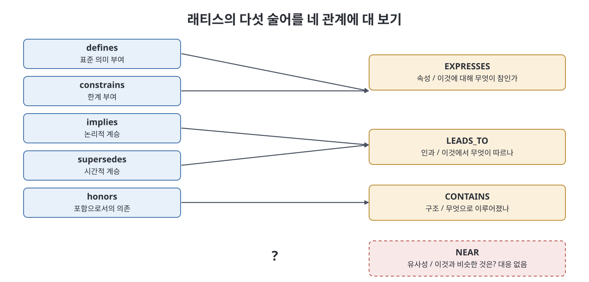
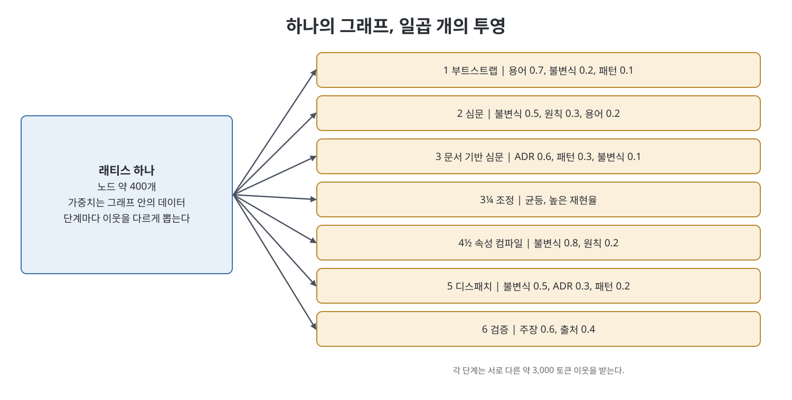

# 6장 래티스를 위한 시맨틱 시공간 (Semantic Spacetime for the Lattice)

래티스의 다섯 술어는 "아키텍처 결정에 무엇이 필요한가"라는 질문에서 나왔다. 이 장은 전혀 다른 질문에서 나온 완결된 관계 어휘와 그 선택을 대조해 본다. 결과는 구멍 하나의 발견이다. 다섯 술어에는 유사성을 말하는 관계가 아예 없고, 이 빈틈이 4장의 실패 여섯 개 중 넷의 원인이라는 것이 책의 논지다. 이어서 이 빈 자리를 어떻게 메우되 래티스의 저작 규율을 해치지 않는지, 임베딩만으로는 왜 부족한지, 시간 차원을 어떻게 더하는지를 설명한다.

> **쉽게 말하면**
> 지도에 "어디가 서로 의존하나"만 그려 놓고 "어디가 서로 비슷하나"는 그리지 않은 상태다. 비슷한 것을 찾는 일은 컴퓨터가 계산해서 알려 주면 되고, 사람이 쓰는 판정은 기존 술어가 그대로 맡는다. 계산 결과는 "여길 보라"고 가리킬 뿐 "이게 사실이다"라고 말하지 못한다.

> **참고(노트 작성자)** 시맨틱 시공간(Semantic Spacetime)은 Mark Burgess의 지식 표현 이론이다. 책은 이 이론의 상세를 다른 책에 맡기고 래티스에 필요한 부분만 가져온다. 이 노트에서 "포지"는 4장에 나온 Clarity Forge의 줄임말이다. 단계 이름(Stage 3¼ 등)과 가중치 수치는 책의 예시이며 시점과 프로젝트에 따라 달라진다.

## 이 장의 흐름

1. 네 가지 관계: NEAR, LEADS_TO, CONTAINS, EXPRESSES
2. 포지의 다섯 술어를 네 관계에 대응시키기
3. 빠진 관계의 비용
4. NEAR는 계산하고 쓰지 않는다
5. 실용적 근접성: 맥락마다 거리가 다르다
6. 왜 임베딩만으로는 안 되는가
7. 시간 차원과 유효 기간
8. 확장된 어휘

## 1. 네 가지 관계

버제스(Burgess)의 시맨틱 시공간은 물리적 시공간의 구조를 지식 표현으로 옮긴다. 물리 공간이 공간과 시간 좌표로 물체를 배치하듯, 개념을 의미 좌표로 배치한다. 근접성은 의미의 유사성을 뜻하고 시간 차원은 인과와 변화를 담는다. 이 이론의 주장은 모든 의미 관계가 네 유형으로 충분하고 또 필요하다는 것이다.

| 관계 | 성격 | 담는 것 | 답하는 질문 |
|------|------|---------|-------------|
| NEAR | 연상 | 가중치 있고 맥락에 의존하는 유사성 | 이것과 비슷한 것은? |
| LEADS_TO | 시간과 인과 | 원인, 순서, 계승 | 이것에서 무엇이 따르나? |
| CONTAINS | 구조 | 집합, 구성, 계층 | 이것은 무엇으로 이루어졌나? |
| EXPRESSES | 기능과 속성 | 특성, 속성, 성질 | 이것에 대해 무엇이 참인가? |

충분성 주장은 감사 도구로 유용하다. NEAR만 쓰는 그래프는 유사성은 잡아도 인과와 구조는 못 잡고, LEADS_TO만 쓰는 그래프는 인과만 잡는다. 완전한 지식 표현이라면 네 가지를 모두 다뤄야 하니, 어떤 스키마를 네 가지에 대 보면 그 스키마가 무엇에 눈이 먼지 알 수 있다.

책은 두 속성에 주목한다.

- **NEAR는 가중치가 있고 차원이 이름을 가진다.** 유사한가 아닌가의 이진 값이 아니라, 유전, 행동, 가축화 같은 이름 붙은 차원마다 좌표가 있다. 벡터 임베딩에서는 47번 차원이 무엇인지 아무도 말하지 못하지만 여기서는 모든 차원에 이름이 있다. 디버그할 수 있는 유사성과 믿는 수밖에 없는 유사성의 차이다.
- **EXPRESSES는 속성을 노드 안이 아니라 관계로 만든다.** 속성을 노드에 인라인으로 두지 않고 명시적 관계를 만들어, 그 관계가 확신도, 유효 기간, 맥락을 가진다. 책의 예는 어떤 사람이 어떤 회사의 CEO였던 기간과 확신도를 붙이는 것이다. 이는 5장의 재귀화 패턴이 전혀 다른 방향에서 같은 구조로 도착한 것이고, 독립된 두 추론이 같은 구조에 닿는 것은 그 구조가 실재한다는 신호라고 책은 말한다.

## 2. 포지의 다섯 술어를 네 관계에 대응시키기

| 래티스 술어 | 대응하는 관계 | 설명 |
|-------------|---------------|------|
| defines | EXPRESSES | 용어에 표준 의미를 붙이는 속성 관계 |
| constrains | EXPRESSES | 한계를 붙이는, 부정 극성의 속성 관계 |
| implies | LEADS_TO | 논리적 계승: 이것을 받아들이면 저것이 따른다 |
| supersedes | LEADS_TO | 시간적 계승: 이것이 저것을 시점에 맞춰 대체한다 |
| honors | CONTAINS | 포함으로서의 의존: 이것은 저것 안에서만 성립한다 |
| (없음) | NEAR | 아무것도 없다 |

다섯 중 넷은 깔끔히 대응한다. implies와 supersedes가 둘 다 LEADS_TO인 것(논리 대 시간), defines와 constrains가 둘 다 EXPRESSES인 것(반대 극성)은 약간의 혼합이지만 실무상 문제는 없다고 책은 본다. 흥미로운 줄은 마지막이다. 래티스에는 약한 유사성 관계가 아니라 유사성 관계 자체가 없다. 다섯 술어로는 두 노드가 같은 것에 관한 것이라고 말할 방법이 없다.

## 3. 빠진 관계의 비용

우아함의 문제가 아니라고 책은 말한다. 4장의 여섯 실패 중 NEAR가 막았을 것을 짚어 본다.

| 실패 | 어떻게 NEAR가 막는가 |
|------|----------------------|
| 중복 노드 | 에이전트 둘이 같은 성질을 다른 이름의 불변식으로 만든다. 탐지는 "이 노드와 가까운 기존 노드는?"이라는 질문이 필요한데 어휘가 그 질문을 만들 수 없다. 네 규칙 관문의 "이미 유효 노드가 덮고 있으면 안 된다"는 규칙은 옳지만 뒷받침 장치가 없었고, NEAR가 그 장치다 |
| 용어 표류 | 제안서에 "바구니"라고 쓰는데 래티스에는 "주문"이 있다. 1단계의 인터뷰가 이를 드러내야 하는데 문맥에 맞는 용어 일부가 우연히 로드되고 모델이 우연히 알아챌 때만 드러난다. NEAR가 있으면 조회가 된다 |
| 예산 안 검색 | 9장의 컨텍스트 조립기는 작업이 언급하는 개체를 찾아 바깥으로 확장한다. "찾기"는 최근접 이웃 연산이다. NEAR가 없으면 재현율을 설명할 수 없는 grep으로 후퇴한다 |
| 고아 불변식 | 들어오는 honors 엣지가 없는 불변식은 정말 고아이거나 조용히 위반되는 중이다. 활성 기능 셋에 NEAR가 높은데 honors가 없다면 고아가 아니라 위반 중이다. 이 위험한 경우가 해롭지 않은 경우와 구별되지 않았다 |

하나의 빠진 관계로 여섯 중 넷이다.

## 4. NEAR는 계산하고 쓰지 않는다

이 장에서 가장 중요한 설계 결정이고, 래티스가 불어나는 것을 막는다고 책은 말한다.

- 다섯 술어는 **저작된다**. 사람이나 심문을 거친 에이전트가 쓰고 책임지며, 관문을 거치고, 추가만 한다.
- NEAR는 **파생된다**. 아무도 쓰지 않는다. 색인을 다시 만들 때마다 노드 내용으로 계산하고, 일회용이며, 권위가 없다.

구체적 규칙은 세 가지다. NEAR 엣지는 파생 색인(5장의 인코딩 A)에만 살고 마크다운에는 없다. 색인을 만들 때마다 통째로 다시 계산한다. 관문이 되지 않는다. NEAR 엣지가 보관을 막을 수는 없고, 검색과 제안 신호로만 쓰여 "어디를 볼지"만 알려 주고 "무엇이 참인지"는 말하지 않는다.

> **NEAR는 제안하고, 나머지 넷이 결정한다.** NEAR는 에이전트가 두 노드가 중복인지 묻게 만들 수는 있어도 결론짓지는 못한다. 합치는 일은 네 규칙 관문을 거쳐 저작된 supersedes로 한다.

책은 이것이 지식 그래프 구축 파이프라인의 추출과 해소 분리와 같은 규율이라고 한다. 값싼 신호로 후보를 좁히고 강한 모델이 판정하고, 기록되는 것은 판정이다. 8장이 이를 만든다.

## 5. 실용적 근접성

책은 시맨틱 시공간이 이론서가 아닌 공학서에서 값을 하는 곳이 여기라고 말한다. 실용적 근접성(pragmatic proximity)은 의미의 거리가 맥락에 따라 달라진다는 생각이다. 같은 두 개체가 어떤 틀에서는 가깝고 다른 틀에서는 멀다. 책의 예는 프린터와 복사기가 쇼핑 맥락에서는 0.85, 영상 맥락에서는 0.42, 문서 배포 맥락에서는 0.61만큼 가깝다는 것이다. 개체는 그대로이고 무엇이 중요한지가 바뀐다.

이를 파이프라인에 적용한다. 포지의 각 단계가 하나의 맥락이고, 단계마다 래티스의 다른 조각을 본다.

| 단계 | "가깝다"의 뜻 | 차원 가중치 |
|------|---------------|-------------|
| 1 부트스트랩 | 용어의 겹침 | 용어 0.7, 불변식 0.2, 패턴 0.1 |
| 2 심문(Grill-Me) | 같은 주제에서 말하지 않은 전제 | 불변식 0.5, 원칙 0.3, 용어 0.2 |
| 3 문서 기반 심문 | 같은 주제의 이전 결정 | ADR 0.6, 패턴 0.3, 불변식 0.1 |
| 3¼ 조정 | 중복될 수 있는 모든 것 | 균등, 높은 재현율 |
| 4½ 속성 컴파일 | 이 기능을 제약하는 불변식 | 불변식 0.8, 원칙 0.2 |
| 5 디스패치 | 이 작업에 구속력이 있는 제약 | 불변식 0.5, ADR 0.3, 패턴 0.2 |
| 6 검증 | 변경이 주장한 것과 그 근거 | 주장 0.6, 출처 0.4 |

이 표가 5장 레이어 3(맥락과 정책)을 구체화한 것이다. 가중치는 코드 상수가 아니라 그래프 안의 데이터이므로, 에이전트가 가중치 변경을 다른 모든 것과 같은 mint, grill, archive 경로로 제안할 수 있다.

실무적 귀결은 크다고 책은 말한다. 노드 400개짜리 래티스 하나가 일곱 단계를 서로 다른 모양의 약 3,000 토큰 이웃으로 섬기고, 누구도 일곱 가지 뷰를 따로 유지하지 않는다. 하나의 그래프, 일곱 개의 투영이다. 이것이 "예산 안 조회가 불가능하다"는 실패를 없애는 메커니즘이며, NEAR가 단일 코사인 값이 아니라 가중치 있고 차원이 있어야 하는 이유다.

## 6. 왜 임베딩만으로는 안 되는가

임베딩은 코사인 유사도 한 번 호출이므로 왜 차원 좌표를 만드느냐는 반문이 나온다. 책은 세 가지 이유와 한 가지 양보를 든다.

| 이유 | 내용 |
|------|------|
| 설명 가능성 | 임베딩은 0.83이라고만 하고 이유는 말하지 못한다. 차원 좌표는 주제는 가깝고 기능 범위는 멀다고 말하므로 조정 단계의 프롬프트가 "같은 주제, 다른 범위이지 중복이 아니다"를 알 수 있다. 설명하지 못하는 관문은 엔지니어가 우회하게 된다 |
| 모델 독립성 | 임베딩 모델을 바꾸면 저장된 벡터가 모두 비교 불능이라 전부 다시 임베딩해야 한다. 이름 붙은 좌표는 모델이 바뀌어도 안정적이다. 도구보다 오래 사는 것이 목적인 래티스에는 업그레이드에 깨지는 표현은 부적격이다 |
| 맥락 민감성 | 고정 임베딩은 노드당 벡터 하나라서 "은행"이 금융에서든 강에서든 한 위치다. 실용적 근접성은 같은 노드가 단계마다 거리가 달라야 한다 |

양보는 이렇다. 임베딩은 값싼 첫 번째 거름망으로 훌륭하다. 후보 400개를 열두 개로 줄이는 데 임베딩을 쓰고, 열두 개 중 판정은 차원 좌표와 모델이 한다. 임베딩을 답으로 쓰지는 않는다.

## 7. LEADS_TO와 시간 차원

네 관계가 래티스에 반쯤만 있는 것을 하나 더 채운다. supersedes는 계승 사슬이라는 시간 관계를 주지만 유효 기간(validity window), 곧 어떤 사실이 두 날짜 사이에 참이었다는 말은 못 한다. 현재 유효 또는 동결의 둘뿐이다.

이것은 구체적이고 흔한 질문에 중요하다. 이 변경은 만들어질 때 유효했는가? 6개월 뒤 감사에서 불변식을 위반한 변경이 나왔을 때, 그때 위반한 것인지 불변식이 나중에 생긴 것인지 유효 기간이 없으면 답할 수 없고, 래티스가 조여질 때마다 모든 과거 변경이 위반처럼 보인다. 추가만 하는 규율 덕에 정보는 있으므로 대체를 재생해 과거의 유효 노드 집합을 복원할 수 있다. 유효 기간은 그것을 재구성에서 질의로 바꿔 줄 뿐이다. 래티스에는 재귀화된 모든 주장에 유효 시작과 종료를 두는 좁은 버전이면 충분하다고 책은 말한다.

## 8. 확장된 어휘

5장과 6장을 합쳐 7장이 형식화할 어휘를 책은 이렇게 정리한다.

| 종류 | 관계 | 비고 |
|------|------|------|
| 저작됨, 지식 평면 | supersedes, implies, constrains, defines, honors | 포지에서 변경 없음 |
| 파생됨, 저작 안 됨 | near | 가중치, 차원, 맥락 범위, 색인마다 재계산 |
| 구조적, 배치에서 암묵 | contains | 기능에서 요구사항, 시나리오, 속성으로. 메타노드 캡슐화 |
| 속성적, 재귀화된 엣지 위 | expresses | 상태, 확신도, 유효 기간, 맥락 범위 |

엣지 타입을 발명하지 말라는 포지의 규칙은 그대로이며, 감당할 수 있게 하는 정제가 붙는다. 저작되는 술어는 다섯 개로 유지한다. 파생 관계와 구조 관계는 저작된 술어가 아니라 계산되거나 배치에서 암시되므로 예산에 들어가지 않고 손으로 탐색할 필요도 없다. 여섯 번째 저작 술어가 필요하다고 느끼면 노드를 넓히거나 관계를 산문으로 받아들인다.

## 핵심 정리

- 시맨틱 시공간은 의미 관계가 NEAR, LEADS_TO, CONTAINS, EXPRESSES 넷으로 충분하다고 보고, 어떤 스키마의 맹점을 점검하는 감사 도구가 된다.
- 래티스의 다섯 술어는 넷에 대응하지만 NEAR(유사성)만 비어 있고, 그 때문에 중복 노드, 용어 표류, 예산 안 검색, 고아 불변식 판별이 막힌다.
- NEAR는 계산되고 일회용이며 관문이 되지 않는다. 제안은 NEAR가, 결정은 저작된 술어가 한다.
- 실용적 근접성으로 단계마다 가중치를 다르게 둔 하나의 그래프가 일곱 단계에 맞는 작은 이웃을 공급한다. 가중치도 데이터다.
- 임베딩은 후보를 좁히는 첫 거름망으로만 쓰고, 설명 가능성, 모델 독립성, 맥락 민감성이 필요한 판정은 이름 붙은 차원 좌표와 모델이 맡는다. 유효 기간은 과거 유효성을 질의로 만든다.

---

이전: [5장 래티스 메타그래프](05%EC%9E%A5%20%EB%9E%98%ED%8B%B0%EC%8A%A4%20%EB%A9%94%ED%83%80%EA%B7%B8%EB%9E%98%ED%94%84.md) | 다음: [7장 스키마](07%EC%9E%A5%20%EC%8A%A4%ED%82%A4%EB%A7%88.md)

 
 
 

[Graph Engineering - The Loop Memory Model](../)
