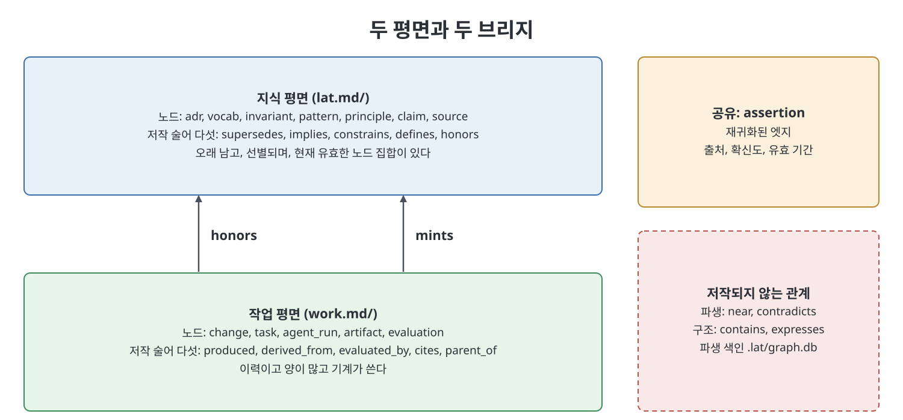
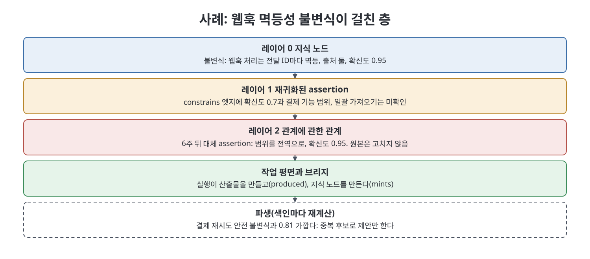

# 7장 스키마 (The Schema)

2부의 모든 내용이 이 장에서 하나의 닫힌 스키마로 모인다. 책은 구현 전에 한 장만 읽는다면 이 장을 읽으라고 하고, 그 뒤 12장을 읽고 나서 이 스키마를 확정하라고 덧붙인다. 이 장은 노드 타입, 술어, 파일 형식, 참조 문법, 완결된 사례, 그래프 불변식 다섯 개, 디렉터리 배치, 기존 래티스에서의 이행 절차를 차례로 정리한다. 책의 스키마 코드와 YAML은 옮기지 않고 필드와 의미를 표로 재구성했다.

> **쉽게 말하면**
> 지식(오래 남는 사실)과 작업(에이전트가 한 일의 기록)을 서로 다른 두 평면에 나누어 담고, 두 평면은 딱 두 종류의 선으로만 잇는다. 모든 선의 종류는 미리 정해 두고 새로 만들지 않는다. 마크다운 파일이 정본이고 그래프는 언제든 버리고 다시 만드는 사본이다.

> **참고(노트 작성자)** 책은 2026년경의 에이전트 워크플로를 전제로 하며 `lat.md`, `work.md`, `openspec` 같은 도구와 폴더 이름은 책 시점 기준이다. 책은 본문에서 노드 타입이 "열두 개"라고 말하지만 표에 나열된 것은 지식 평면 7, 작업 평면 5, 공유 1로 모두 13개다. 아래 표는 표에 적힌 대로 정리했으니 책의 숫자와 대조하며 읽기 바란다.

## 이 장의 흐름

1. 설계 제약 다섯 가지
2. 노드 타입: 지식 평면, 작업 평면, 공유
3. 술어: 지식, 작업, 브리지, 파생, 구조
4. 노드 파일 형식과 참조 문법
5. 완결된 사례: 웹훅 멱등성
6. 그래프 불변식 다섯 가지
7. 디렉터리 배치와 이행 절차

## 1. 설계 제약 다섯 가지

스키마가 쓸 수 없는 온톨로지로 자라지 않게 하는, 래티스에서 물려받은 규칙이다.

| 규칙 | 뜻 |
|------|----|
| 닫힌 술어 집합 | 평면마다 저작되는 술어가 작고 고정되어 있다. 하나를 더하는 일은 책의 개정이지 화요일 아침의 작업이 아니다 |
| 노드 원자성 | 노드 하나에 사실, 용어, 결정 하나. 앵커나 부분 참조 없음 |
| 추가만, 대체로 변경 | 아무것도 수정하지 않고 후속 노드로 교체한다 |
| 마크다운이 정본 | 그래프 색인은 일회용 투영이다 |
| 파생 관계는 권위 없음 | 제안만 하고 관문이 되지는 않는다 |

## 2. 노드 타입

### 지식 평면: 오래 남고, 선별되고, 유효 집합이 있는 쪽

| 타입 | 담는 것 | 대체 가능 |
|------|---------|-----------|
| adr | 오래 유지할 아키텍처 결정 | 예 |
| vocab | 도메인 용어의 표준 정의 | 예 |
| invariant | 여러 기능에 걸친 시스템 전체 성질 | 예 |
| pattern | 받아들인 패턴과 적용 맥락 | 예 |
| principle | 팀 규칙과 그것이 막으려는 실패 양상 | 예 |
| claim | 증거와 확신도가 있는 번복 가능한 진술 | 예 |
| source | claim을 뒷받침하는 내외부 문서 | 아니요, 불변 |

앞의 다섯은 래티스 그대로이고 둘이 새롭다. claim은 포지에 없었고 스웜이 필요로 하는 타입이다. 불변식은 팀이 참으로 정하고 강제하는 것이고, claim은 에이전트가 찾아내 어느 정도 확신하는 것(예: 일괄 가져오기가 테넌트 범위를 우회한다)으로 맞을 수도 틀릴 수도 다툼이 있을 수도 있다. claim이 없으면 에이전트의 발견은 불변식으로 곧장 승격되어 얻지 못한 권위를 갖거나 대화 기록에 남아 사라진다. claim은 대기실이며, claim에서 불변식으로의 승격도 다른 mint와 같이 네 규칙 관문을 거친다. source는 문서가 내 의견이 바뀐다고 변하지 않으므로 구조상 불변이고, 그래서 뒷받침 관계(supported_by)가 의미를 갖는다.

### 작업 평면: 이력이고 양이 많고 기계가 쓰는 쪽

| 타입 | 담는 것 |
|------|---------|
| change | OpenSpec의 변경 폴더, 의도의 단위 |
| task | 변경 안의 보낼 수 있는 작업 하나 |
| agent_run | 한 번의 경계 있는 실행: 모델, 프롬프트, 예산, 결과 |
| artifact | 불변이고 버전이 있는 산출물: 차이, 보고서, 명세 변경, 속성 모음 |
| evaluation | 루브릭이나 모음에 대한 산출물 평가 한 건 |

### 공유

| 타입 | 담는 것 |
|------|---------|
| assertion | 5장에서 재귀화한 엣지. 출처, 확신도, 유효 기간을 갖는다 |

assertion은 레이어 1의 시민이며 엣지에 속성이 필요할 때만 존재한다. 점진적 재귀화가 적용되므로 대부분의 엣지는 assertion이 되지 않는다.

## 3. 술어

책은 평면마다 저작되는 술어 다섯 개, 브리지 둘, 저작되지 않는 파생과 구조 관계를 둔다.

### 지식 평면, 저작됨 (포지 그대로)

| 술어 | 의미 |
|------|------|
| supersedes | 같은 타입의 이전 노드를 대체하고 옛 노드를 얼린다 |
| implies | 이 노드를 받아들이면 다른 노드가 성립해야 한다 |
| constrains | 다른 노드의 허용 결정을 좁힌다 |
| defines | 다른 노드가 쓰는 표준 의미를 준다 |
| honors | 다른 노드가 유효함에 의존한다 |

### 작업 평면, 저작됨

| 술어 | 의미 | 역할 |
|------|------|------|
| produced | 실행이 산출물을 만들었다 | 감사 기록 |
| derived_from | 산출물이 다른 산출물이나 출처에서 나왔다 | 출처 추적 |
| evaluated_by | 산출물을 평가가 평가했다 | 감사 기록 |
| cites | 산출물이나 claim이 출처를 인용한다 | 출처 추적 |
| parent_of | 이 실행이나 커밋이 저것의 후손이다 | 계보(2장의 DAG) |

지식 평면의 예산(다섯)을 그대로 따른 것이다. 계보가 하나, 감사 기록이 둘, 출처 추적이 둘이다.

### 브리지: 평면을 잇는 유일한 술어

| 술어 | 방향 | 의미 |
|------|------|------|
| honors | 작업에서 지식으로 | 이 산출물이나 작업이 저 노드가 유효함에 의존한다 |
| mints | 작업에서 지식으로 | 이 실행이 저 지식 노드를 만들어 냈다 |

정확히 둘이다. honors는 지식 평면의 것을 일부러 재사용했고(양쪽에서 같은 뜻이므로) 그래서 저작 어휘의 총수가 열둘이 아니라 열하나다. 둘뿐인 이유는 나머지 평면 간 관계가 모두 파생되기 때문이다. "이 불변식을 뒷받침하는 출처는?"은 mints를 따라 실행으로 가고 cites를 따라 출처로 가면 된다. "이 claim을 확인한 평가는?"은 claim을 만든 실행에서 산출물로, 산출물에서 평가로 간다. 이 두 브리지로 파생되지 않는 평면 간 관계는 무언가를 엉뚱한 평면에 모델링했다는 강한 증거이므로, 술어를 더하기 전에 점검하라고 책은 말한다.

### 파생과 구조, 저작되지 않음

| 종류 | 관계 | 의미 |
|------|------|------|
| 파생 | near | 가중치 있고 차원이 있고 맥락 범위가 있는 유사성(6장) |
| 파생 | contradicts | 본문이 충돌하는 두 유효 노드. 표시할 뿐 판정하지 않는다 |
| 구조 | contains | 기능에서 요구사항, 시나리오, 속성으로. 변경에서 작업으로. 메타노드 캡슐화 |
| 구조 | expresses | 재귀화된 assertion에 붙는 속성: 상태, 확신도, 유효 기간, 범위 |

contradicts가 파생인 이유는 near와 같다. 모순을 선언할 수 있는 에이전트는 잘못 선언해 래티스를 얼려 버릴 수 있다. 탐지는 값싸고 기계적이지만 해소는 관문을 거친 저작된 supersedes로 한다. contradicts 엣지는 판결이 아니라 할 일 목록의 항목이라고 책은 말한다.

## 4. 노드 파일 형식과 참조 문법

노드 파일은 래티스와 모양이 같고 필드 둘이 늘었다. 기존 노드는 수정 없이 파싱되는 하위 호환이다.

| 필드 | 값 | 비고 |
|------|----|------|
| 제목 | 슬러그와 제목 | 슬러그는 케밥 케이스 |
| Type | adr, vocab, invariant, pattern, principle, claim, source 중 하나 | |
| Status | proposed, accepted, 또는 대체 관계를 단 accepted | |
| Date | 연월일 | |
| Plane | 지식 | 새 필드. 기본값은 지식이라 기존 노드는 손댈 필요 없음 |
| Provenance | 실행, 변경, 확신도, 출처 목록 | 새 필드. 사람이 쓴 노드는 생략 가능 |
| Edges | 술어와 대상 쌍의 목록 | |
| 본문 구역 | Context, Body, Consequences | Body는 타입마다 의미가 다르다 (ADR은 결정, vocab은 정의, 불변식은 전칭 주장, 패턴은 적용 범위, 원칙은 규칙과 실패 양상, claim은 진술과 범위와 반증 조건) |

Plane은 작업 평면 노드가 같은 형식을 쓸 수 있게 하려고 있다. Provenance는 에이전트가 쓴 노드를 감사 가능하게 하는 블록이다. 에이전트가 만든 노드에 이것이 없으면 보관 관문에서 실패하며, 책은 이것이 스키마에서 가장 중요한 새 규칙이고 7.7에서 불변식으로 승격된다고 한다.

참조 문법은 두 번째 네임스페이스로 확장되며 grep에 오탐이 없는 성질을 유지한다.

| 네임스페이스 | 대상 | 모양의 예 |
|--------------|------|-----------|
| lat | 지식 평면 | lat:invariant/totals-non-negative |
| work | 작업 평면 | work:run/3f2a91 |
| assert | 재귀화된 엣지 | assert:0412 |

세 가지 참조 규칙(원본에서 한 방향, 케밥 케이스 슬러그, 앵커와 줄 번호 없음)은 세 네임스페이스 모두에 적용된다. 이 문법 하나로 저장소 안 어떤 산출물의 의존 전체 표면을 grep으로 얻을 수 있다.

## 5. 완결된 사례: 웹훅 멱등성

책은 3장에서 본 "멱등성 발견"을 모든 구성 요소를 보여 주는 한 사례로 끝까지 추적한다. 노트 작성자가 줄거리를 요약한다.

| 층 | 무슨 일이 일어났나 |
|----|-------------------|
| 레이어 0, 지식 노드 | 한 에이전트가 "웹훅 처리는 전달 ID마다 멱등이다"라는 불변식을 만들었다. 출처로 결제 사업자의 문서와 7월의 장애 기록을 달았고 확신도 0.95다. 아웃박스 패턴을 constrains로 제약하고 멱등 키 용어를 defines하며 금액 불변식을 honors한다. 반증 조건도 적혀 있다: 재전송이 원장 항목을 둘 만들면 틀린 것이다 |
| 레이어 1, 재귀화된 assertion | constrains 엣지에는 확신도와 범위가 필요하다. 이 불변식은 단단하지만 아웃박스 패턴에 대한 적용은 결제 기능 안에서만 확신도 0.7이고 일괄 가져오기는 미확인이라는 메모가 붙는다. 5장 패턴 3이 일하는 대목이다 |
| 레이어 2, 관계에 관한 관계 | 6주 뒤 일괄 가져오기가 감사로 확인되자, 새 실행이 앞선 assertion을 대상으로 한 대체 assertion을 만든다. 범위를 전역으로 넓히고 확신도 0.95다. 원래 assertion은 고치지 않고 대체되며, 이전에 Touches 산문이 하던 일을 이제 질의로 찾을 수 있다 |
| 작업 평면과 브리지 | 실행이 산출물을 만들고(produced), 자식 실행이 있고(parent_of), 출처를 인용하고(cites), 산출물에 평가가 달리며(evaluated_by), 실행이 지식 노드를 만들고(mints) 산출물과 작업이 그 불변식을 honors한다 |
| 파생 | 색인을 만들 때마다 이 불변식이 결제 재시도 안전 불변식에 0.81만큼 가깝다고 계산된다 |

마지막 줄의 NEAR 엣지가 바로 중복 탐지기가 울린 것이다. 아무것도 합치지 않는다. 3¼ 단계에서 "만들려는 노드가 유효한 노드와 0.81 가깝다, 같은 사실인가?"라는 질문으로 올라오고, 사람이나 심문을 거친 에이전트가 답한다.

## 6. 그래프 불변식 다섯 가지

모든 그래프 쓰기는 앞의 넷을 만족해야 하고, 에이전트가 쓰는 경우 다섯째도 만족해야 한다. 이것이 관문이고, 11장이 보관 단계에 연결한다.

| 번호 | 불변식 | 위반 시 |
|------|--------|---------|
| 1 | 모든 claim은 출처가 있거나 명시적으로 추론으로 표시된다 | cites도 Status 추론 표시도 없는 claim은 거부된다 |
| 2 | 모든 산출물은 저작한 실행과 버전이 있다 | 어느 실행이 만들었는지 말할 수 없으면 산출물이 아니라 그냥 파일이다 |
| 3 | 모든 평가는 자신의 루브릭을 밝힌다 | 루브릭이나 모음이 없는 평가 노드는 거부된다. "괜찮아 보인다"는 평가가 아니다 |
| 4 | 대체된 모든 객체는 주소를 유지한다 | 대체는 얼리기이지 삭제가 아니다. 옛 참조가 풀리지 않으면 이력 감사가 끝난다 |
| 5 | 에이전트가 만든 모든 노드는 Provenance 블록을 가진다 | 사람이 쓴 노드는 생략할 수 있어도 기계가 쓴 노드는 안 된다 |

다섯째가 양이 늘수록 감사 가능성을 지키는 선이고, 금요일 오후 4시에 가장 완화하라는 압박을 받을 규칙이라고 책은 말한다.

## 7. 디렉터리 배치와 이행 절차

### 디렉터리 배치

| 위치 | 역할 | 비고 |
|------|------|------|
| lat.md/ | 지식 평면, 마크다운 정본 | 색인 매니페스트는 재생성, 하위에 adr, vocab, 불변식, 패턴, 원칙, 그리고 새로 claims와 sources |
| work.md/ | 작업 평면 | 변경, 실행, 산출물, 평가, 그리고 재귀화된 엣지(레이어 1과 2)인 assertions |
| .lat/graph.db | 파생 색인 | 일회용, git에 올리지 않음 |
| openspec/ | 프로젝트 설명, 기능별 명세, 변경 | 두 평면의 형제 |

책은 세 가지를 덧붙인다. work.md/는 lat.md/를 일부러 흉내 낸다(끝의 .md까지). 디렉터리를 마크다운 파일처럼 보게 하는 이 관례는 도구에 대한 강제 장치였고, 이를 유지하면 두 평면에 하나의 정신 모델이 쓰인다. 그래프 DB 파일은 git에 올리지 않는다. 아무도 읽지 않는 파일에서 병합 충돌이 나고 누가 그것을 정본처럼 취급하면 제약 4가 깨진다. 두 평면은 모두 openspec/의 형제인데, 기반이 변경 절차, 현재 스키마, 개별 변경보다 오래 살아야 한다는 같은 이유다.

### 포지 래티스에서의 이행

네 단계이고 모두 되돌릴 수 있으며, 앞 단계가 동작하기 전에는 다음 단계가 필요 없다.

| 단계 | 할 일 | 주의 |
|------|-------|------|
| 1 | 아무것도 하지 않는다 | 기존 노드는 새 형식으로 그대로 파싱된다. 파서를 현재 래티스에 돌려 첫날 유효한 색인이 나와야 하고, 아니면 파일이 아니라 파서를 고친다 |
| 2 | work.md/를 더한다 | 새 변경만 기록하고 과거는 채우지 않는다. 과거 실행은 복구할 수 없고 있는 척하면 감사 기록에 허구가 들어간다 |
| 3 | 파생 관계를 켠다 | 색인을 만들어 near와 contradicts를 계산하고 3¼ 단계에 질문으로 띄운다. 관문으로 쓰지 않고 한 달을 지켜본다 |
| 4 | 불변식을 켠다 | 7.7의 점검 다섯 개를 순서대로 하나씩 켠다. 다섯째가 마지막이다. 출처 없이 노드를 만드는 도구에 가장 시끄럽게 실패하기 때문이다 |

모든 단계에서 마크다운이 정본이고 그래프는 일회용이다. 3단계가 잡음을 내면 .lat/을 지우면 디렉터리 두 개가 늘어난 포지 래티스로 돌아간다. 책은 3부가 그래프에 일을 시키는 단계, 곧 만들기, 예산 안 조회, 근거 기반 평가, 스웜 실행이라고 예고한다.

## 핵심 정리

- 스키마는 닫힌 술어 집합, 노드 원자성, 추가만 하며 대체, 마크다운 정본, 권위 없는 파생 관계라는 다섯 제약 위에 선다.
- 지식 평면(adr, vocab, invariant, pattern, principle, claim, source)과 작업 평면(change, task, agent_run, artifact, evaluation)을 나누고, 재귀화된 엣지 assertion을 공유 타입으로 둔다.
- 저작되는 술어는 지식 5, 작업 5이고 평면을 잇는 것은 honors와 mints 둘뿐이라 총 열하나다. near와 contradicts는 파생, contains와 expresses는 구조이며 모두 저작되지 않는다.
- 노드 파일은 Plane과 Provenance를 더했고, 참조는 lat, work, assert 세 네임스페이스로 grep이 의존 표면 전체를 준다.
- 그래프 불변식 다섯이 관문이다(claim의 출처, 산출물의 실행, 평가의 루브릭, 대체물의 주소 유지, 에이전트 노드의 Provenance). 이행은 되돌릴 수 있는 네 단계이고 다섯째 불변식은 마지막에 켠다.

---

이전: [6장 래티스를 위한 시맨틱 시공간](06%EC%9E%A5%20%EB%9E%98%ED%8B%B0%EC%8A%A4%EB%A5%BC%20%EC%9C%84%ED%95%9C%20%EC%8B%9C%EB%A7%A8%ED%8B%B1%20%EC%8B%9C%EA%B3%B5%EA%B0%84.md) | 다음: [8장 그래프 만들기](../03.%203%EB%B6%80%20%EB%A9%94%EC%BB%A4%EB%8B%88%EC%A6%98/08%EC%9E%A5%20%EA%B7%B8%EB%9E%98%ED%94%84%20%EB%A7%8C%EB%93%A4%EA%B8%B0.md)

 
 
 

[Graph Engineering - The Loop Memory Model](../)
